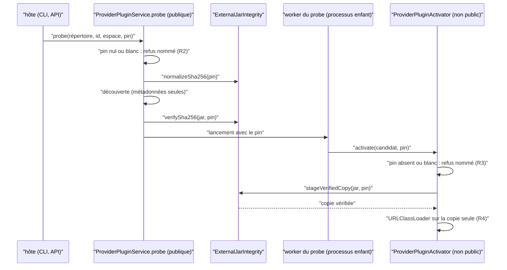
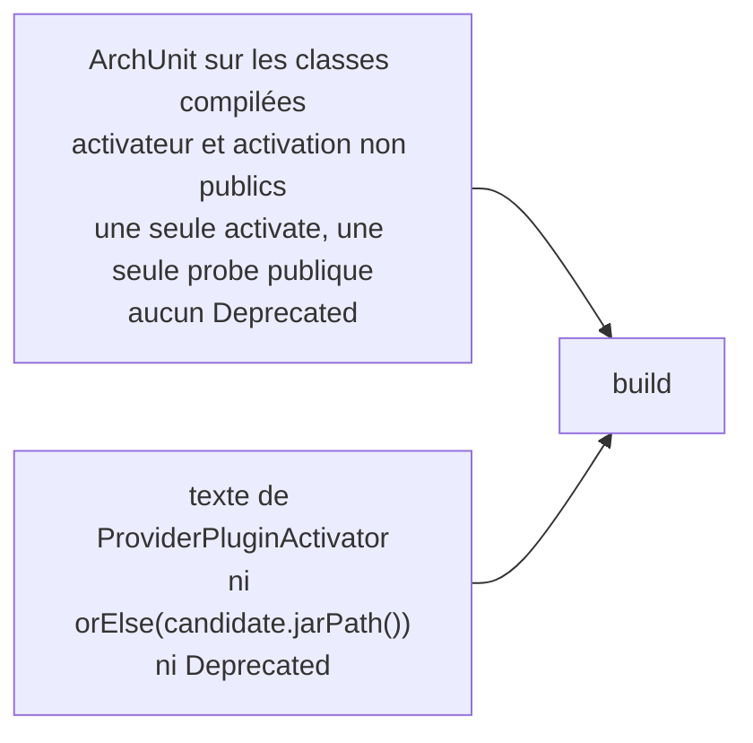

# Entrée épinglée du code de plugin provider (`provider-plugin-pinned-entry`)

Spec de référence : [`openspec/specs/provider-plugin-pinned-entry/spec.md`](../../../openspec/specs/provider-plugin-pinned-entry/spec.md)
· Relevé du 2026-11-04 sur `2913fc30`.

## Objet et périmètre

Le code d'un plugin provider est du code tiers. La capacité fixe par quelle porte il s'exécute, ce que cette porte
refuse avant toute lecture, ce que le chargeur de classes voit, et comment le build garde ces propriétés.

- **Acteurs** : `ProviderPluginService.probe` (seule entrée publique), `ProviderPluginActivator` et
  `ProviderPluginActivation` (non publics, dans `morpheus-provider-sdk`), `ExternalJarIntegrity` (pin, copie vérifiée).
- **Inclus** : la visibilité des entrées, les refus d'un pin absent, vide ou mal formé, le chargement de la copie
  vérifiée, la citation de ces refus dans la règle de sécurité du dépôt.
- **Exclus** : la découverte (métadonnées seules), le worker du probe et le cycle de vie de son sous-arbre de
  processus, l'exposition remote-only et ADMIN du probe. Ces propriétés relèvent de
  [`SEC-0129`](../../architecture/adr/SEC-0129-plugins-provider-code-de-confiance-hors-processus.md) et de
  `.claude/rules/security.md`.

## Exigences

| Alias | Exigence (titre exact) | En bref | Nature |
|---|---|---|---|
| R1 | Provider plugin code SHALL be reachable only through the pinned probe | `probe` est la seule entrée publique et prend le pin ; activateur et activation non publics ; une seule surcharge d'`activate`, avec pin ; aucun `@Deprecated` ; le build échoue sinon | `[EXIGENCE]` |
| R2 | The probe SHALL refuse a missing pin by name before reading the plugin directory | pin nul ou blanc : refus nommé, avant lecture du répertoire | `[EXIGENCE]` |
| R3 | Activation SHALL refuse a missing or malformed pin by name before reading the JAR | pin absent ou mal formé refusé par nom, sans copie ni chargeur ; pin bien formé mais faux : refus d'intégrité avant tout chargement de classe | `[EXIGENCE]` |
| R4 | Activation SHALL load the verified copy or nothing | le chargeur ne lit que la copie préparée, jamais le chemin d'origine | `[EXIGENCE]` |
| R5 | The security rule SHALL cite what is enforced | la règle de sécurité et sa commande d'audit citent les tests qui tiennent le pin, pas un message que le chemin d'activation ne produit pas | `[EXIGENCE]` |

## Comportement détaillé

### Entrées et refus

| Entrée | Visibilité | Pin absent ou blanc | Pin mal formé | Pin faux |
|---|---|---|---|---|
| `ProviderPluginService.probe(Path, String, Path, String)` | publique, unique surcharge | `IllegalArgumentException` « provider plugin probe requires a trusted SHA-256 pin » | refus de `ExternalJarIntegrity.normalizeSha256` | diagnostic `PLUGIN_INTEGRITY_VERIFICATION_FAILED` dans le résultat du probe |
| `ProviderPluginActivator.activate(ProviderPluginCandidate, String)` | non publique, unique surcharge | `IllegalArgumentException` « provider plugin activation requires a trusted SHA-256 pin » | « expected SHA-256 must contain exactly 64 hexadecimal characters » | refus « integrity mismatch » avant tout chargeur |

- `[EXISTANT VÉRIFIÉ]` Dans `probe`, le test du pin précède `discovery.discover` ; il suit seulement la validation des
  arguments non nuls et de `pluginId`. Le pin est normalisé avant la découverte.
- `[EXISTANT VÉRIFIÉ]` Le parent vérifie le pin (`ExternalJarIntegrity.verifySha256`) pour un diagnostic précis, puis
  l'enfant le vérifie de nouveau avant de charger : un échange de fichier entre les deux ne contourne pas le pin.
- `[EXISTANT VÉRIFIÉ]` `activatePinned` appelle `ExternalJarIntegrity.stageVerifiedCopy(candidate.jarPath(), trustedSha256)`
  et ne construit le `URLClassLoader` que sur le chemin renvoyé. Aucune expression ne retombe sur `candidate.jarPath()`.
- `[EXISTANT VÉRIFIÉ]` Un échec pendant l'exécution du code tiers (initialiseur statique, `LinkageError`, métadonnées
  discordantes) ferme le chargeur et supprime la copie préparée (`releaseLoaderAndStaging`) ; voir
  `ProviderPluginActivationCleanupTest`. Ce volet est hors de la spec.

## Diagrammes

### Par quelle porte du code de plugin s'exécute-t-il, et où le pin est-il exigé ?

Existant vérifié par lecture de `ProviderPluginService` et `ProviderPluginActivator`. Exigences R1 à R4.

L'hôte n'atteint jamais l'activateur : le code du plugin ne s'exécute que dans le worker (R1). Le pin est exigé à
l'entrée du probe, revérifié par le parent, puis revérifié par l'activateur dans l'enfant.

### Comment le build tient-il la visibilité des entrées ?

Existant vérifié. Exigence R1 et R4.

La règle de bytecode tient la forme ; le texte tient ce qu'une règle ne voit pas (un repli écrit sur une ligne).

## Écarts et questions ouvertes

- `[EXISTANT VÉRIFIÉ]` **Ordre du refus du probe.** R2 dit « avant de lire le répertoire ». `ProviderPluginServicePinTest`
  passe un répertoire temporaire existant et vide : un probe qui lirait ce répertoire avant de refuser passerait aussi.
  **Preuve manquante** pour l'ordre (il faudrait un répertoire inexistant ou illisible).
- `[EXISTANT VÉRIFIÉ]` Le scénario « A public activator fails the build » (le build échoue et nomme la classe ou la
  méthode) est tenu par les messages de `ProviderPluginTrustBoundaryContractTest#theOnlyPublicEntryToPluginCodeIsThePinnedProbe` ;
  aucun test ne produit la violation pour constater l'échec (c'est la preuve manuelle exigée par `.claude/rules/architecture.md`).
- `[EXISTANT VÉRIFIÉ]` R5 est tenue par la revue : aucun test ne compare le texte de `.claude/rules/security.md` ou de
  `.claude/commands/security-audit.md` aux messages produits. Les deux pages citent les tests et les deux messages
  exacts, et `ProviderPluginServicePinTest` / `ProviderPluginActivatorTest` obtiennent ces messages de l'entrée épinglée.
- `[EXISTANT VÉRIFIÉ]` Le nom de l'activateur dans R1 désigne une classe non publique ; sa méthode `activate` n'est
  donc atteinte que par les tests du paquet et par le worker.

## Traçabilité

| Exigence | Scénario | Conception ou diagramme | Changement | Preuve |
|---|---|---|---|---|
| R1 | The activator is not public | séquence, flowchart | archive `2026-10-29-remove-the-unpinned-plugin-entry-points` | [`ProviderPluginTrustBoundaryContractTest`](../../../morpheus-architecture-tests/src/test/java/com/morpheus/architecture/m22/ProviderPluginTrustBoundaryContractTest.java)`#theOnlyPublicEntryToPluginCodeIsThePinnedProbe` |
| R1 | A public activator fails the build | flowchart | idem | même test (messages d'échec nommant la classe et la méthode) ; **preuve manquante** pour l'échec constaté |
| R2 | Probe without a pin | séquence | idem | [`ProviderPluginServicePinTest`](../../../morpheus-provider-sdk/src/test/java/com/morpheus/sdk/provider/ProviderPluginServicePinTest.java)`#aProbeWithoutAPinIsRefusedByName`, `#aProbeWithABlankPinIsRefusedByName` ; ordre avant lecture du répertoire : **preuve manquante** |
| R3 | No pin | séquence | idem | [`ProviderPluginActivatorTest`](../../../morpheus-provider-sdk/src/test/java/com/morpheus/sdk/provider/ProviderPluginActivatorTest.java)`#aMissingPinIsRefusedByNameBeforeAnyCopyIsStaged`, `#aBlankPinIsRefusedByNameBeforeAnyCopyIsStaged` |
| R3 | A pin of the wrong shape | séquence | idem | `ProviderPluginActivatorTest#aPinOfTheWrongShapeIsRefusedWithTheExpectedShapeBeforeAnyCopyIsStaged` |
| R3 | A pin that does not match | séquence | idem | `ProviderPluginActivatorTest#rejectsDigestMismatchBeforeCreatingPluginClassLoader` |
| R4 | No fallback to the original file | flowchart | idem | [`ExternalCodeTrustBoundaryArchitectureTest`](../../../morpheus-architecture-tests/src/test/java/com/morpheus/architecture/ExternalCodeTrustBoundaryArchitectureTest.java)`#executablePluginActivationStaysPinnedStagedAndFailClosed` |
| R5 | The cited message is one the product says | — | idem | `ProviderPluginServicePinTest#aProbeWithoutAPinIsRefusedByName` et `ProviderPluginActivatorTest#aMissingPinIsRefusedByNameBeforeAnyCopyIsStaged` ; [`ProviderPluginPlatformContractTest`](../../../morpheus-architecture-tests/src/test/java/com/morpheus/architecture/m22/ProviderPluginPlatformContractTest.java) sur le JAR de référence ; citation dans la règle : revue |

## Sources

- ADR : [SEC-0129](../../architecture/adr/SEC-0129-plugins-provider-code-de-confiance-hors-processus.md).
- Règle du dépôt : `.claude/rules/security.md`, section « Plugins providers (M22) » ; commande `.claude/commands/security-audit.md`.
- Archive OpenSpec : `2026-10-29-remove-the-unpinned-plugin-entry-points`, `2026-10-29-forbid-adapter-dependencies-from-the-provider-sdk`.
- Pages liées : [`mcp-peer-launch-command.md`](mcp-peer-launch-command.md) (autre frontière de code externe).
