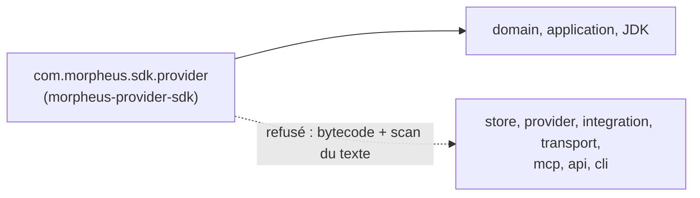
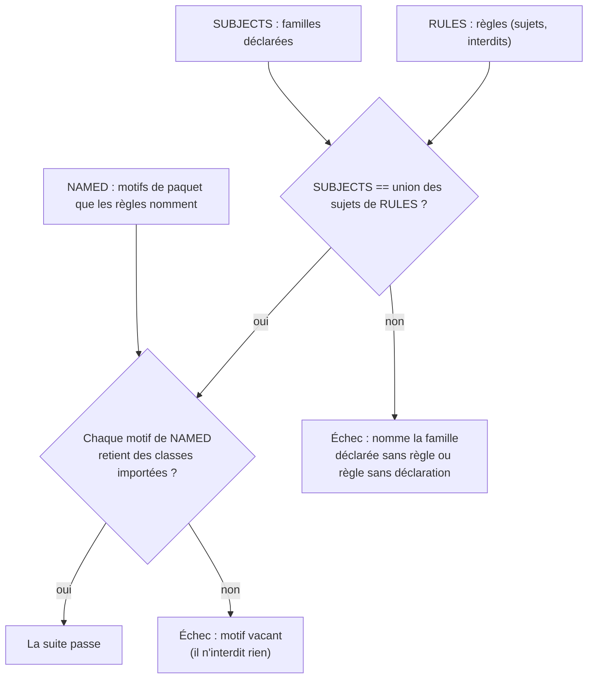

# Frontière de dépendance du SDK de provider (`provider-sdk-dependency-boundary`)

Spec de référence : [`openspec/specs/provider-sdk-dependency-boundary/spec.md`](../../../openspec/specs/provider-sdk-dependency-boundary/spec.md)
· Relevé du 2026-11-04 sur `2913fc30`.

## Objet et périmètre

Le SDK de provider est publié aux auteurs de plugins : il ne dépend que du domaine, de l'application et du JDK, jamais
d'un adaptateur, et un adaptateur qu'il atteindrait serait publié avec lui. La capacité ajoute que la classe des règles
de frères tient une règle par sujet qu'elle déclare, et que les pages `.claude/` écrivent le paquet du SDK comme le
code.

- **Acteurs** : auteur de plugin (consommateur du SDK) ; mainteneur qui ajoute une dépendance ou un sujet de règle.
- **Inclus** : les classes de `morpheus-provider-sdk` sous `com.morpheus.sdk.provider` ; la classe
  `AdapterSiblingArchitectureTest` (`SUBJECTS`, `RULES`, `NAMED`) ; les pages `.claude/` qui décrivent la frontière.
- **Exclus** : `morpheus-provider-testkit`, qui partage le paquet mais n'est pas importé par la suite d'architecture
  (sa frontière est son POM, voir Écarts) ; l'activation d'un plugin et le pin SHA-256
  ([`../PROVIDER_SDK.md`](../PROVIDER_SDK.md)).

## Exigences

| Alias | Exigence (titre exact) | En bref | Nature |
|---|---|---|---|
| R1 | The provider SDK SHALL depend on no adapter | aucune classe sous `com.morpheus.sdk..` ne dépend d'un store, provider, intégration, adaptateur MCP, HTTP ou CLI | `[EXIGENCE]` |
| R2 | The sibling rules SHALL have every subject they declare | chaque famille de `SUBJECTS` est sujet d'une règle de `RULES`, et réciproquement | `[EXIGENCE]` |
| R3 | The repository rules SHALL name the SDK's package as the code does | `.claude/` écrit `com.morpheus.sdk.provider`, jamais `provider.sdk`, et cite la règle par son nom de méthode | `[EXIGENCE]` |

## Comportement détaillé

### R1 : le SDK ne dépend d'aucun adaptateur

`[EXISTANT VÉRIFIÉ]` `SDK_DEPENDS_ON_NO_ADAPTER` interdit à `com.morpheus.sdk..` les paquets
`com.morpheus.store..`, `com.morpheus.provider..`, `com.morpheus.integration..`, `com.morpheus.transport..`,
`com.morpheus.mcp..`, `com.morpheus.api..` et `com.morpheus.cli..`. Le message `because` dit que le SDK est compilé par
les auteurs de plugins et ne dépend que vers l'intérieur (ADR-0129). Deux moitiés :

- bytecode (`theProviderSdkDependsOnNoAdapter`) : la dépendance compilée, même non épelée ;
- texte (`noProviderSdkSourceNamesAnAdapterPackage`) : un source du SDK qui cite le préfixe d'un paquet d'adaptateur,
  ce qui attrape la constante de compilation que `javac` inline et qui ne laisse aucune dépendance.

`[EXISTANT VÉRIFIÉ]` Le sujet est non vide : le garde-fou `archRule.failOnEmptyShould` fait échouer une règle qui ne
retient aucune classe, et `everyPackageTheseRulesNameResolvesToImportedClasses` exige que chaque motif de paquet nommé
(`NAMED`) corresponde à des classes importées. Le SDK vit dans `com.morpheus.sdk.provider`, pas sous
`com.morpheus.provider` : un motif `..provider.sdk..` ne retiendrait rien.

### R2 : sujets déclarés et règles

`[EXISTANT VÉRIFIÉ]` `everyDeclaredSubjectIsTheSubjectOfARuleAndNoOther` compare `SUBJECTS` à l'union des sujets de
`RULES` dans les deux sens : une famille déclarée sans règle échoue, une règle dont le sujet n'est pas déclaré échoue
aussi. Les familles `api` et `cli` n'y figurent que comme cibles interdites.

### R3 : documentation

`[EXISTANT VÉRIFIÉ]` Relu à la main le 2026-11-04 : `.claude/rules/architecture.md` écrit `com.morpheus.sdk.provider`
et cite `AdapterSiblingArchitectureTest#theProviderSdkDependsOnNoAdapter` ; une recherche de `provider.sdk` dans les
`.md` de `.claude/` ne trouve rien. Le Javadoc de la classe renvoie à `{@link #SUBJECTS}` sans énumérer les familles.

### Comportement vérifié absent de la spec

- `[EXISTANT VÉRIFIÉ]` La même classe porte les règles de domaine et d'application (qui ignorent le SDK), des
  providers intégrés (qui l'ignorent), des stores et des providers (frères), de MINOS, de NEXUS et de l'adaptateur MCP.
  Seule la règle du SDK est exigée par cette spec.

## Diagrammes

### Que peut atteindre le SDK ?

Existant vérifié (`SDK_DEPENDS_ON_NO_ADAPTER`). Organigramme : flèche pleine = dépendance permise, flèche barrée =
interdit exécutable. Exigence : R1.

### Comment la suite garde-t-elle ses sujets et ses motifs honnêtes ?

Existant vérifié. Organigramme de décision. Exigences : R1 (sujet non vide), R2.

## Écarts et questions ouvertes

- **Le testkit n'est pas jugé (R1).** La spec dit qu'aucune classe sous `com.morpheus.sdk..` ne dépend d'un adaptateur.
  `morpheus-provider-testkit` réside sous `com.morpheus.sdk.provider.testkit` mais n'est pas dans l'ensemble importé ;
  sa frontière est son POM (dépendances actuelles : domaine, application, SDK, JUnit). Aucun test ne lit ce POM pour la
  tenir. Preuve manquante pour le testkit.
- **Pas de rejeu du refus (R1, scénario 1).** Aucun test ne plante une dépendance du SDK vers un store pour constater
  l'échec nommant les deux classes ; la règle est exécutée sur le bytecode réel, et le message `because` porte
  la raison. Preuve par rejeu manquante.
- **Documentation (R3) et Javadoc (R2, scénario 2).** Aucun test ne cherche `provider.sdk` dans `.claude/` ni ne lit le
  Javadoc de la classe ; la tenue repose sur la revue. Preuve manquante.

## Traçabilité

| Exigence | Scénario | Conception ou diagramme | Changement | Preuve |
|---|---|---|---|---|
| R1 | A dependency from the SDK to a store fails the build | « Que peut atteindre le SDK ? » | archive `2026-10-29-forbid-adapter-dependencies-from-the-provider-sdk` | [`AdapterSiblingArchitectureTest`](../../../morpheus-architecture-tests/src/test/java/com/morpheus/architecture/AdapterSiblingArchitectureTest.java)`#theProviderSdkDependsOnNoAdapter` (ArchUnit) et `#noProviderSdkSourceNamesAnAdapterPackage` (texte) ; rejeu : preuve manquante |
| R1 | The rule judges at least one class | « Comment la suite garde-t-elle ses sujets… » | idem | `AdapterSiblingArchitectureTest#everyPackageTheseRulesNameResolvesToImportedClasses` ; `failOnEmptyShould` prouvé par [`AnEmptyArchitectureRuleFailsTest`](../../../morpheus-architecture-tests/src/test/java/com/morpheus/architecture/AnEmptyArchitectureRuleFailsTest.java)`#aRuleThatSelectsNoClassFailsForHavingCheckedNone` |
| R2 | A subject is declared and no rule has it | idem | idem | `AdapterSiblingArchitectureTest#everyDeclaredSubjectIsTheSubjectOfARuleAndNoOther` (comparaison des constantes `SUBJECTS` et `RULES` de la classe) |
| R2 | The documentation of the class does not restate the list | — | idem | revue seule (Javadoc de `AdapterSiblingArchitectureTest`) ; preuve automatique manquante |
| R3 | The misspelled package is gone | — | idem | revue seule : `.claude/rules/architecture.md` ; preuve automatique manquante |

## Sources

- ADR : [SEC-0129](../../architecture/adr/SEC-0129-plugins-provider-code-de-confiance-hors-processus.md) (SDK publié, plugins
  hors processus).
- Règles du dépôt : `.claude/rules/architecture.md`, sections « `com.morpheus.sdk..` (le SDK provider) ne dépend d'aucun
  adaptateur » et « `domain` et `application` ignorent le SDK plugin ».
- Pages liées : [`../PROVIDER_SDK.md`](../PROVIDER_SDK.md), [`module-package-correspondence.md`](module-package-correspondence.md).
