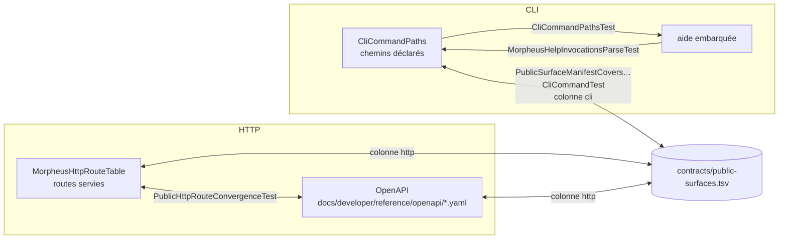

# Convergence des surfaces publiques (`public-surface-convergence`)

Spec de référence : [`openspec/specs/public-surface-convergence/spec.md`](../../../openspec/specs/public-surface-convergence/spec.md)
· Relevé du 2026-11-03 sur `ef006fb7`.

## Objet et périmètre

Toute route HTTP servie, toute commande CLI servie et toute capacité déclarée concordent entre le code, le manifeste
de convergence et la documentation, ou en sont explicitement exclues avec une raison écrite. Une surface ajoutée d'un
seul côté fait échouer le build.

- **Acteurs** : mainteneur qui ajoute ou retire une surface ; client qui lit l'OpenAPI ou l'aide de la CLI.
- **Inclus** : colonne `http` du manifeste ↔ table des routes ↔ OpenAPI ; colonne `cli` ↔ chemins de commande
  déclarés ↔ aide embarquée.
- **Exclus** : le contenu des réponses (capacité en cours `public-payload-convergence`) ; la colonne `mcp`, tenue par
  `PublicSurfaceManifestCoversEveryServedToolTest` sans exigence dans cette spec.

## Exigences

| Alias | Exigence (titre exact) | En bref | Nature |
|---|---|---|---|
| R1 | Served HTTP routes are documented | toute route servie figure dans un OpenAPI | `[EXIGENCE]` — écart sur les exclusions |
| R2 | Manifest, OpenAPI and code agree in both directions | la colonne `http` ne nomme que des routes servies et documentées ; une route documentée non servie échoue | `[EXIGENCE]` |
| R3 | The CLI SHALL serve exactly the command paths it declares | une déclaration unique ; chemin non déclaré refusé ; chemin déclaré routé | `[EXIGENCE]` |
| R4 | The `cli` column of the manifest and the served commands SHALL agree in both directions | chaque cellule nomme un chemin déclaré ; chaque chemin est nommé une fois ou exclu avec raison | `[EXIGENCE]` |
| R5 | The embedded help SHALL document every declared command path | chaque chemin déclaré apparaît dans une ligne d'usage de l'aide | `[EXIGENCE]` |

## Comportement détaillé

`[EXISTANT VÉRIFIÉ]` :

- **Sources comparées** : `MorpheusHttpRouteTable.declaredRoutes()` (`morpheus-api/.../transport/`, préfixe
  `/api/v1`, qui calcule aussi l'en-tête `Allow` local et alimente la politique distante) ;
  [`contracts/public-surfaces.tsv`](../../../contracts/public-surfaces.tsv) (colonnes `capability`, `intent`, `cli`,
  `mcp`, `http`, `notes`) ; tous les `docs/developer/reference/openapi/*.yaml` ;
  `CliCommandPaths.paths()` (`morpheus-cli/.../cli/`) ; l'aide embarquée.
- **Paramètres de chemin** : comparés par position (`{id}`, `{viewId}`, `{savedViewId}` deviennent le même segment).
- **Exclusions HTTP** (`PublicHttpRouteConvergenceTest`) : `REMOTE_ONLY` (routes servies par la seule façade
  distante, que le serveur local doit refuser par 404) et `NOT_IN_MANIFEST` (sondes d'exploitation sans ligne au
  manifeste, chacune avec sa raison). Lire les listes dans le test, pas ici.
- **Exclusions CLI** (`PublicSurfaceManifestCoversEveryServedCliCommandTest.EXCLUSIONS`) : chemins servis sans ligne
  au manifeste, chacun avec sa raison. Une cellule est comparée sur les mots qui précèdent sa première option
  (`server restore --confirm` → `server restore`). Un sentinelle (`EXPLICITLY_*`) ne nomme aucune commande.
- **Refus d'un chemin non déclaré** : `unknown command: <mots>`, code de sortie `USAGE` (2), avant toute sous-commande.

## Diagrammes

### Quelles sources sont comparées entre elles, et par quel test ?

Existant vérifié. Organigramme (pas UML) : chaque arête est une comparaison dans les deux sens.

Exigences : R1 et R2 pour la partie HTTP, R3, R4 et R5 pour la partie CLI. La table des routes est une source, pas le
serveur : une route qu'un serveur servirait sans l'inscrire dans la table échapperait à ces comparaisons ; la façade
distante la refuse (404), le serveur local non.

## Écarts et questions ouvertes

- `[EXISTANT VÉRIFIÉ]` **Écart avec R1.** La spec admet qu'une route servie soit exclue de l'OpenAPI « with a reason » ;
  le test n'a aucune exclusion de ce côté (`everyServedRouteIsDocumentedInOpenApi`). `NOT_IN_MANIFEST` dispense du
  manifeste, `REMOTE_ONLY` de la distribution locale. Le code est plus strict que la spec. `[QUESTION]` Retirer la
  clause de la spec ?
- `[EXISTANT VÉRIFIÉ]` R1 parle des routes « registered by the local or remote server » ; la preuve lit la table des
  routes. `theLocalServerDispatchesEveryRouteTheTableLists` démarre un vrai serveur local pour l'aller, pas pour le
  retour.
- `[EXISTANT VÉRIFIÉ]` Les refus HTTP nomment la capacité, pas le numéro de ligne du manifeste annoncé par le scénario
  « A manifest route that nothing serves » ; le test CLI, lui, nomme la ligne.
- `[EXISTANT VÉRIFIÉ]` Comportements testés absents de la spec : le 405 et son en-tête `Allow` exact, la distribution
  locale de chaque route de la table, le classement d'un chemin non routé, le refus d'une cellule vide ou d'un
  sentinelle inventé, la colonne `mcp`.
- `[EXISTANT VÉRIFIÉ]` Deux scénarios sont rédigés au passé : « on the corrected manifest », « as before this change ».
- La javadoc de `PublicSurfaceManifestCoversEveryServedCliCommandTest` cite `CliCommandPathsAreRoutedTest`, qui
  n'existe pas : le test réel est `CliCommandPathsTest`.

## Traçabilité

| Exigence | Scénario | Diagramme | Changement | Preuve |
|---|---|---|---|---|
| R1 | The provider-plugin discovery route | organigramme | archive `2026-10-09-close-public-surface-convergence-gaps` | **générique** : [`PublicHttpRouteConvergenceTest`](../../../morpheus-architecture-tests/src/test/java/com/morpheus/api/PublicHttpRouteConvergenceTest.java)`#everyServedRouteIsDocumentedInOpenApi` |
| R1 | An undocumented route is refused | idem | idem | même méthode |
| R2 | A manifest route that nothing serves | idem | idem | `PublicHttpRouteConvergenceTest#everyManifestRouteIsServedAndDocumented`, `#everyDocumentedRouteIsServed` |
| R2 | Path parameter names differ | idem | idem | **implicite** : normalisation exercée par toutes les comparaisons, sans test dédié |
| R3 | A declared path is routed | idem | archive `2026-10-21-compare-the-cli-with-the-convergence-manifest` | [`CliCommandPathsTest`](../../../morpheus-cli/src/test/java/com/morpheus/cli/CliCommandPathsTest.java)`#everyDeclaredPathIsRoutedToABehaviour` |
| R3 | An undeclared path is refused before any sub-command is asked | idem | idem | `CliCommandPathsTest#anUndeclaredPathIsRefusedAsAnUnknownCommandWhateverItsFamily`, `#anUnknownFirstWordAndAnUnknownOptionAreRefusedAsUnknownCommands` |
| R3 | A branch added without a declaration is not reachable | idem | idem | **partielle** : mêmes tests, simulés par un mot non déclaré |
| R3 | A declared path that nothing routes is refused by the build | idem | idem | `CliCommandPathsTest#everyDeclaredPathIsRoutedToABehaviour` ; `CliCommandDispatchIsExhaustiveTest#everyDeclaredPathIsClaimedByExactlyOneClassOfTheDispatch` |
| R4 | A manifest cell that names no served command | idem | idem | [`PublicSurfaceManifestCoversEveryServedCliCommandTest`](../../../morpheus-architecture-tests/src/test/java/com/morpheus/cli/PublicSurfaceManifestCoversEveryServedCliCommandTest.java)`#aCellThatNamesNoServedCommandIsNamedWithItsLine`, `#everyServedCommandIsInTheManifestAndEveryNamedCommandIsServed` |
| R4 | A served command without a row | idem | idem | même classe : `#aServedCommandWithoutARowIsNamed` |
| R4 | A sentinel does not hide a served command | idem | idem | même classe : `#aSentinelNamesNothingAndSoDoesNotHideAServedCommand` |
| R4 | The portfolio reads are declared as served | — | idem | **indirecte** : le gate réel passe sur les lignes `portfolio.list`, `portfolio.members`, `portfolio.conflicts` |
| R4 | A command named twice is refused | — | idem | même classe : `#aCommandNamedTwiceIsRefusedWithBothLines` |
| R4 | A cell that carries an option is compared on its path | — | idem | même classe : `#aCellThatCarriesAnOptionIsComparedOnItsPath` |
| R4 | An exclusion that excuses nothing is refused | — | idem | même classe : `#anExclusionThatExcusesNothingIsRefused` |
| R4 | An empty read is a failure | — | idem | même classe : `#anEmptyReadIsAFailureNotAPass`, `#theGuardReadSomethingOnBothSides` |
| R5 | A served action missing from the help | organigramme | idem | `CliCommandPathsTest#everyDeclaredPathIsInAUsageLineOfTheEmbeddedHelp`, `#aPathTheHelpDoesNotDocumentIsFoundMissing` |
| R5 | The help and the parser still agree the other way | organigramme | idem | [`MorpheusHelpInvocationsParseTest`](../../../morpheus-cli/src/test/java/com/morpheus/cli/MorpheusHelpInvocationsParseTest.java)`#everyDocumentedInvocationIsAcceptedByItsParser` |

## Sources

- Règle du dépôt : `.claude/rules/governance.md`, section « Le manifeste de convergence est la loi ».
- Décision : [ARCH-0066](../../architecture/adr/ARCH-0066-versioned-http-api-contract.md) (contrat HTTP versionné).
- Pages développeur : [`../API.md`](../API.md), [`../reference/README.md`](../reference/README.md).
