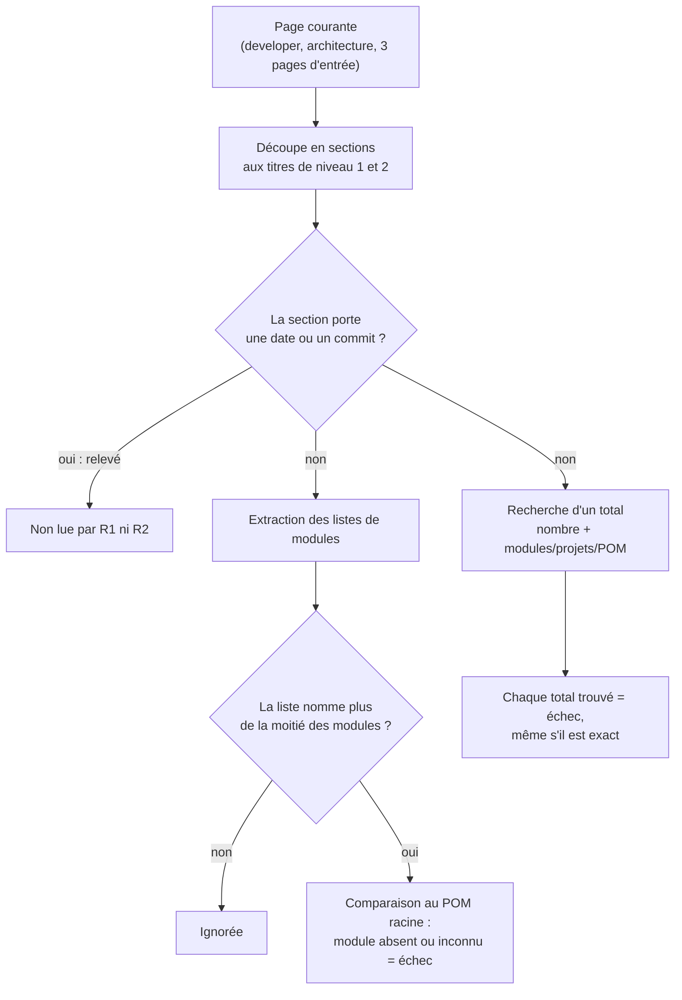

# Modules du reactor dans la documentation courante (`reactor-module-documentation`)

Spec de référence : [`openspec/specs/reactor-module-documentation/spec.md`](../../../openspec/specs/reactor-module-documentation/spec.md)
· Relevé du 2026-11-04 sur `2913fc30`.

## Objet et périmètre

Le POM racine est la seule déclaration des modules du reactor Maven. Une page de documentation courante qui énumère le
reactor doit l'énumérer en entier, et aucune page courante ne dit combien de modules, de projets Maven ou de POM il
compte : un total est la copie que le prochain module rend fausse, même exacte le jour où on l'écrit.

- **Acteurs** : mainteneur qui ajoute ou retire un module ; auteur d'une page `docs/developer/` ou `docs/architecture/`.
- **Inclus** : les listes de modules (bloc de code, liste à puces, tableau) et les phrases qui énoncent un total.
- **Exclus** : les ADR, les relevés de validation, les audits, les notes de version et le guide utilisateur, qui sont des
  enregistrements datés ou ne parlent pas du reactor ; les mesures qui portent leur propre date ou leur propre commit.

## Exigences

| Alias | Exigence (titre exact) | En bref | Nature |
|---|---|---|---|
| R1 | A current page that lists the reactor's modules SHALL list every module the root POM declares | une page qui nomme plus de la moitié des modules les nomme tous ; un module retiré du POM et resté dans une liste échoue aussi | `[EXIGENCE]` |
| R2 | A current page SHALL NOT state how many modules or Maven projects the reactor has | aucun total présent de modules, projets ou POM, même juste ; une mesure datée est un relevé | `[EXIGENCE]` |

## Comportement détaillé

`[EXISTANT VÉRIFIÉ]` Le gate est une classe de cohérence (`@CoherenceCheck`) qui lit le POM racine et les pages en
texte, puisque les cibles sont du Markdown et un POM.

- **Modules déclarés** : les entrées `<module>` du bloc `<modules>` du POM racine. Un POM sans module fait échouer la
  règle (`no <module> read from the <modules> block`), elle ne passe pas sur le vide.
- **Pages lues** : tout `.md` sous `docs/developer` et `docs/architecture`, hors `docs/architecture/adr`, plus
  `README.md`, `CONTRIBUTING.md` et `docs/README.md`.
- **Une liste de modules** : un bloc de code dont des lignes ne portent qu'un nom `morpheus-…`, une liste à puces de la
  même forme, ou un tableau dont une cellule ne contient que des noms entre accents graves (les noms après le premier
  peuvent perdre le préfixe `morpheus`, `` `morpheus-a`, `-b` ``). La liste est comptée par bloc, par tableau ou par suite
  de lignes consécutives.
- **R1** : une liste qui nomme plus de la moitié des modules déclarés doit nommer tous les modules ; chaque absence est
  rapportée `<page>:<ligne> omits <module>, which the root POM declares`, chaque nom inconnu `names <module>, which the
  root POM does not declare`. Une liste qui en nomme la moitié ou moins n'est pas concernée. Si aucune page ne liste le
  reactor, la règle échoue (`no page lists the reactor`).
- **R2** : tout motif « nombre + module(s) / projet(s) / project(s) / POM(s) » (par exemple `17 modules`, `14/14
  modules`) sur une page courante est rapporté `<page>:<ligne> "<expression>"`. Si l'ensemble de pages est vide, la règle
  échoue (`no current page`).
- **Relevé daté** : une section (découpée aux titres de niveau 1 et 2, hors blocs de code) qui contient une date
  (`JJ/MM/AAAA` ou `AAAA-MM-JJ`) ou un commit (7 à 40 caractères hexadécimaux avec au moins un chiffre et une lettre)
  est un relevé : ni R1 ni R2 ne la lisent.

## Diagrammes

### Comment une page est-elle jugée par les deux règles ?

Existant vérifié, lu dans `ReactorModuleDocumentationTest`. Organigramme, pas UML. Exigences R1 et R2.

R1 compare une liste au POM ; R2 ne compare rien, il refuse l'énoncé d'un total. Une section datée échappe aux deux.

## Écarts et questions ouvertes

- `[EXISTANT VÉRIFIÉ]` **Périmètre plus large que la spec** : la spec parle des pages « developer and architecture » ;
  le test lit aussi `README.md`, `CONTRIBUTING.md` et `docs/README.md` (`ENTRY_PAGES`). Comportement non écrit dans la
  spec.
- `[EXISTANT VÉRIFIÉ]` **Relevé détecté par section, pas par mesure** : la spec exempte « a measurement that carries its
  own date or commit » ; le test exempte toute la section dès qu'une date ou un commit y figure, même sans rapport avec
  la mesure. Une date étrangère dans une section suffit donc à masquer un total.
- `[EXISTANT VÉRIFIÉ]` **Total écrit en toutes lettres non reconnu** : le motif cherche des chiffres ; « dix-sept
  modules » passe (limite reconnue dans le commentaire du test).
- **Scénarios sans test dédié** : « The coverage report module is listed » n'a pas de test propre ; il est tenu par
  `everyCurrentPageThatListsTheReactorListsEveryModuleTheRootPomDeclares` sur les pages réelles, qui exige tout module du
  POM. « The four pages of the finding no longer carry a total » est tenu par
  `noCurrentPageStatesHowManyModulesOrProjectsTheReactorHas` sur l'ensemble des pages, sans nommer les quatre.

## Traçabilité

Tests dans [`ReactorModuleDocumentationTest`](../../../morpheus-architecture-tests/src/test/java/com/morpheus/architecture/ReactorModuleDocumentationTest.java).

| Exigence | Scénario | Conception ou diagramme | Changement | Preuve |
|---|---|---|---|---|
| R1 | A module added to the POM and not to the pages | organigramme ci-dessus | archive `2026-10-21-list-the-reactor-modules-from-the-pom` | `#aModuleAddedToThePomAndNotToAListIsNamedWithItsPage` ; sur les pages réelles `#everyCurrentPageThatListsTheReactorListsEveryModuleTheRootPomDeclares` |
| R1 | The coverage report module is listed | idem | idem | indirecte : `#everyCurrentPageThatListsTheReactorListsEveryModuleTheRootPomDeclares` (pas de test qui nomme `morpheus-coverage-report`) |
| R1 | A page that mentions a few modules is not concerned | idem | idem | `#aPageThatNamesFewModulesIsNotRequiredToNameTheOthers` |
| R1 | A module removed from the POM and left on a page | idem | idem | `#aModuleRemovedFromThePomAndLeftInAListIsNamedWithItsPage` |
| R1 | The rule found something to check | idem | idem | `#theListRuleFailsInsteadOfPassingWhenItFindsNothingToCheck` |
| R2 | A stated total is refused even when it is right | idem | idem | `#aStatedTotalIsRefusedWithItsPageEvenWhenItIsRight` ; sur les pages réelles `#noCurrentPageStatesHowManyModulesOrProjectsTheReactorHas` |
| R2 | The four pages of the finding no longer carry a total | idem | idem | indirecte : `#noCurrentPageStatesHowManyModulesOrProjectsTheReactorHas` |
| R2 | A dated measurement is left as it is | idem | idem | `#aMeasurementThatCarriesItsDateOrCommitIsARecordAndIsLeftAlone` (et `#aListInASectionThatCarriesItsDateIsARecordOfThatRunAndIsLeftAlone` pour R1) |
| R2 | A dated record is not scanned | idem | idem | `#decisionRecordsStepsAndTheUserGuideAreNotRead` ; `#theTotalRuleFailsInsteadOfPassingWhenTheScannedSetIsEmpty` pour le garde contre le vide |

## Sources

- Règle de dépôt : `.claude/rules/architecture.md` (modules lus dans le POM, jamais cités de mémoire) et
  `.claude/rules/meta.md`.
- Pages liées : [`../BUILD_AND_TEST.md`](../BUILD_AND_TEST.md), [`../README.md`](../README.md).
- Pages de la même famille : [`repository-root-location.md`](repository-root-location.md) (le gate localise la racine
  par `RepositoryRoot`).
