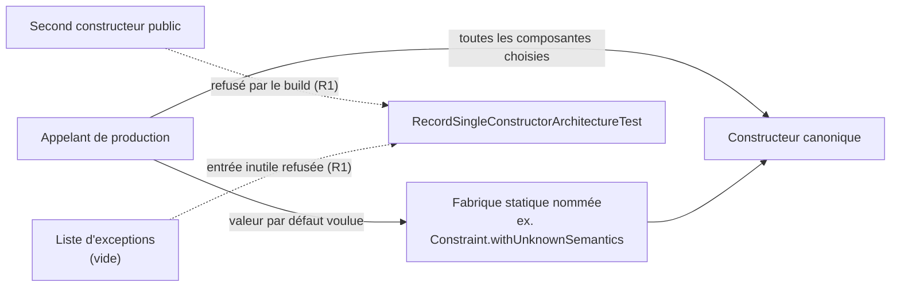
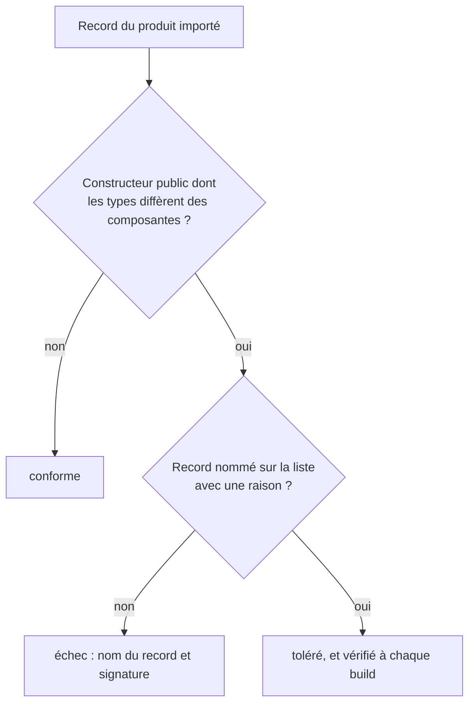

# Construction d'un record du produit (`record-construction`)

Spec de référence : [`openspec/specs/record-construction/spec.md`](../../../openspec/specs/record-construction/spec.md)
· Relevé du 2026-11-04 sur `2913fc30`.

## Objet et périmètre

Un record du produit offre une seule façon publique d'être construit : son constructeur canonique. Un second
constructeur public remplit une composante que l'appelant n'a pas choisie (sémantique `UNKNOWN`, liste vide, borne par
défaut) sans que le site d'appel le dise. Un appelant qui veut une valeur par défaut la demande à une fabrique statique
nommée, dont le nom énonce l'hypothèse.

- **Acteurs** : auteur d'un record sous `src/main/java` d'un module du produit ; auteur de plugin de fournisseur (le
  SDK expose `Constraint` et `NormalizedProjectContent`) ; relecteur.
- **Inclus** : le gabarit d'un record, ses fabriques nommées, la liste d'exceptions du test d'architecture, la page de
  règle qui distingue un shim de compatibilité de ce qui n'en est pas.
- **Exclus** : les classes qui ne sont pas des records ; les constructeurs non publics ; la construction des cartes de
  réponse (voir [`payload-map-construction.md`](payload-map-construction.md)).

## Exigences

| Alias | Exigence (titre exact) | En bref | Nature |
|---|---|---|---|
| R1 | A record SHALL offer one public constructor | aucun constructeur public autre que le canonique, sauf record nommé avec sa raison sur une liste du module de tests d'architecture ; une entrée devenue inutile fait échouer le build | `[EXIGENCE]` |
| R2 | A default SHALL be obtained through a factory that names it | une valeur par défaut passe par une fabrique statique nommée, égale au constructeur canonique pour les mêmes défauts | `[EXIGENCE]` |
| R3 | The rule against compatibility shims SHALL state what it covers | la page de règle dit qu'un record a un constructeur public, cite le test, et nomme ce qui n'est pas un shim | `[EXIGENCE]` |

## Comportement détaillé

### Le test de structure (R1)

`[EXISTANT VÉRIFIÉ]` [`RecordSingleConstructorArchitectureTest`](../../../morpheus-architecture-tests/src/test/java/com/morpheus/architecture/RecordSingleConstructorArchitectureTest.java)
importe les classes de production de `com.morpheus` et compare, pour chaque record, les types des paramètres de
chaque constructeur **public** aux types de ses composantes. Un constructeur public dont la liste de types diffère est
un second constructeur. La mesure porte sur le bytecode : supprimer le commentaire d'un constructeur ne change rien
au verdict.

- La liste d'exceptions (`RECORDS_WITH_A_SECOND_PUBLIC_CONSTRUCTOR`) est vide. Une entrée serait un nom binaire de
  record avec sa raison ; une raison vide ou un record qui ne déclare plus de second constructeur public (ou n'existe
  plus) fait échouer `everyListedRecordStillDeclaresASecondPublicConstructor`.
- Le test se garde de passer sur rien : il exige plus de 200 records examinés.
- Un constructeur non public (`private`) n'est pas signalé ; deux constructeurs de même arité mais de types
  différents le sont (`SameArityOtherTypes`). Le test le prouve sur cinq records locaux.
- L'ensemble jugé est celui que l'importation ArchUnit du module voit ; `ImportedClasspathCompletenessTest` tient cet
  ensemble au réacteur.

### Les fabriques nommées (R2)

`[EXISTANT VÉRIFIÉ]` `Constraint.withUnknownSemantics(id, changeId, statement, provenance)` produit une contrainte dont
l'applicabilité, la gravité et la satisfaction valent `UNKNOWN`, dont la politique de blocage est `unknown()` et sans
preuve de soutien (fabrique dans
[`Constraint.java`](../../../morpheus-domain/src/main/java/com/morpheus/domain/constraint/Constraint.java)).
`NormalizedProjectContent` porte deux fabriques du même ordre, `currentSpecificationsOnly` et
`withoutAcceptanceCriteria`. Chaque fabrique est comparée au constructeur canonique par un test de son module.

### La page de règle (R3)

`[EXISTANT VÉRIFIÉ]` [`.claude/rules/code-style.md`](../../../.claude/rules/code-style.md) énonce qu'un record n'a qu'un
constructeur public (le canonique), cite `RecordSingleConstructorArchitectureTest`, interdit un second constructeur
public comme shim de compatibilité, et nomme les deux choses qui n'en sont pas : une méthode `default` qui donne à un
port un repli correct (`VersionedRequirementStore.listCurrentRequirementVersions`) et un nom public conservé par une
décision du manifeste de convergence (l'outil MCP `check_product_update`, ligne `product.update-discovery` de
[`contracts/public-surfaces.tsv`](../../../contracts/public-surfaces.tsv)).

## Diagrammes

### Comment un appelant obtient-il un record avec des valeurs par défaut ?

Existant vérifié. Il répond à R1 et R2 : le chemin qui reste ouvert est la fabrique nommée.

### Que juge le test sur un record ?

Existant vérifié, organigramme de la décision du test.

## Écarts et questions ouvertes

- `[EXISTANT VÉRIFIÉ]` **Preuve manquante pour « No entry exists for tests alone » (R2).** Aucun test ne refuse une
  fabrique ou un constructeur qu'aucune classe de production n'appelle. La règle est écrite dans
  `.claude/rules/code-style.md` et tenue par la revue. La porte voisine
  [`UnreferencedPublicMethodArchitectureTest`](../../../morpheus-architecture-tests/src/test/java/com/morpheus/architecture/UnreferencedPublicMethodArchitectureTest.java)
  ne la remplace pas : elle ne lit que des méthodes (un constructeur n'a pas de type de retour dans son motif) et
  compte une mention dans un test comme une référence, donc une fabrique appelée par un test seul y passe.
- `[EXISTANT VÉRIFIÉ]` **Preuve manquante pour « No source claims compatibility… » (R3).** Aucun test ne parcourt les
  Javadoc de `src/main/java`. Une recherche manuelle (2026-11-04) relève : la Javadoc de classe de `MorpheusApiService`
  (« compatibility delegation only »), qui décrit une façade et ne justifie aucun élément (la même observation figure
  dans les tâches du changement archivé), et le texte « Compatibility stub » de la description d'outil de
  `MorpheusProductMcpTools`, qui est le stub déclaré au manifeste. Ces deux correspondances ne sont ni « disparues » ni
  le seul stub : la lettre du scénario (« each match is either gone or is the declared stub ») n'est donc pas tenue à
  la lettre pour la première. `[QUESTION]` Faut-il reformuler cette Javadoc ou assouplir le scénario ?
- `[EXISTANT VÉRIFIÉ]` Le test ne voit pas `morpheus-provider-testkit` (hors de l'ensemble importé,
  `ImportedClasspathCompletenessTest`) : son unique record a été lu à la main lors du changement archivé. La spec
  vise « un module du produit » sans nommer cette limite.
- `[EXISTANT VÉRIFIÉ]` Aucun test ne lit la page de règle (R3, première phrase) : le texte de
  `.claude/rules/code-style.md` n'est pas comparé à l'exigence.
- `[DÉCISION]` La version d'API du SDK reste `ProviderSdk.API_VERSION` : le retrait des constructeurs de `Constraint`
  et `NormalizedProjectContent` est une rupture de source pour les auteurs de plugins, déclarée dans les notes de
  version, sans nouvelle version d'API (réponse du mainteneur consignée à la tâche 0.1 du changement archivé). Voir
  [`../PROVIDER_SDK.md`](../PROVIDER_SDK.md).

## Traçabilité

| Exigence | Scénario | Conception ou diagramme | Changement | Preuve |
|---|---|---|---|---|
| R1 | A second public constructor fails the build | organigramme du test | archive `2026-10-29-construct-a-record-through-one-constructor` | [`RecordSingleConstructorArchitectureTest`](../../../morpheus-architecture-tests/src/test/java/com/morpheus/architecture/RecordSingleConstructorArchitectureTest.java)`#everyRecordOfTheProductDeclaresNoPublicConstructorBesideItsCanonicalOne` et `#aSecondPublicConstructorIsReportedWithItsSignatureAndANonPublicOneIsNot` |
| R1 | Removing a comment changes nothing | idem (mesure sur le bytecode) | idem | même test : le verdict ne lit aucun commentaire ; aucun test ne retire un commentaire pour le montrer |
| R1 | A listed record is cleaned up | idem | idem | `RecordSingleConstructorArchitectureTest#everyListedRecordStillDeclaresASecondPublicConstructor` (liste vide : preuve par construction, cassée une fois à la main selon la tâche 3.3 archivée) |
| R2 | A constraint whose semantics are not known | organigramme des appelants | idem | [`ConstraintSemanticsTest`](../../../morpheus-domain/src/test/java/com/morpheus/domain/constraint/ConstraintSemanticsTest.java)`#aConstraintWithUnknownSemanticsIsUnknownOnEveryAxisAndCarriesWhatItWasGiven` ; [`NormalizedProjectContentTest`](../../../morpheus-application/src/test/java/com/morpheus/application/read/NormalizedProjectContentTest.java)`#contentOfCurrentSpecificationsOnlyCarriesNoChangeArtefactAndNoAcceptanceCriterion` et `#contentWithoutAcceptanceCriteriaKeepsEveryOtherListItWasGiven` |
| R2 | No entry exists for tests alone | — | idem | **Preuve manquante** (voir Écarts) |
| R3 | No source claims compatibility for an element the rule allows | — | idem | **Preuve manquante** (voir Écarts) ; texte de la règle : [`.claude/rules/code-style.md`](../../../.claude/rules/code-style.md) |

## Sources

- Règle du dépôt : [`.claude/rules/code-style.md`](../../../.claude/rules/code-style.md), sections « TOUJOURS » et « JAMAIS ».
- Changement archivé : `2026-10-29-construct-a-record-through-one-constructor` (tâches 0.1, 1.1 à 1.3, 3.1 à 3.3).
- Pages liées : [`payload-map-construction.md`](payload-map-construction.md), [`dead-code-refusal.md`](dead-code-refusal.md).
- Contrat du SDK : [`../PROVIDER_SDK.md`](../PROVIDER_SDK.md).
