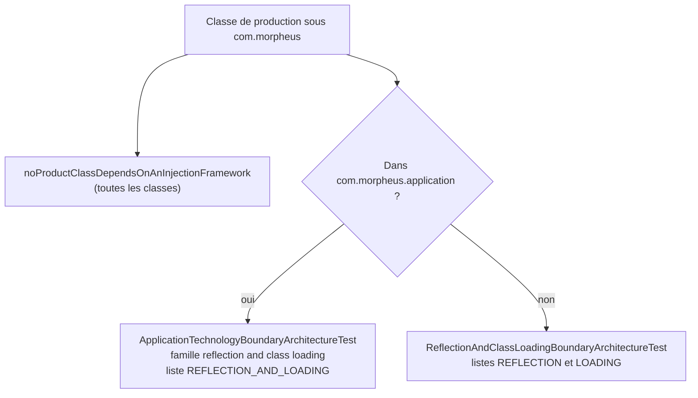
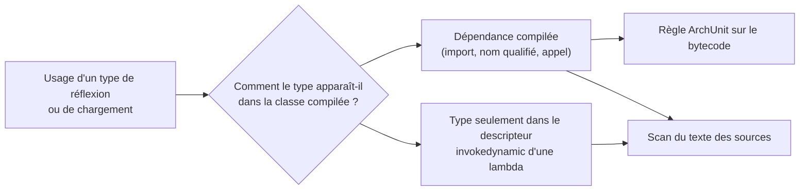

# Réflexion, chargement de classes et injection (`reflection-boundary`)

Spec de référence : [`openspec/specs/reflection-boundary/spec.md`](../../../openspec/specs/reflection-boundary/spec.md)
· Relevé du 2026-11-04 sur `2913fc30`.

## Objet et périmètre

La réflexion, le chargement de services et de classes ne sont employés que par des classes nommées pour cela, chacune
avec sa raison ; aucun framework d'injection ne câble le produit ; la page de règles du dépôt dit exactement ce que le
build interdit.

- **Acteurs** : auteur d'une classe qui a besoin de réflexion, de `ServiceLoader` ou d'un `ClassLoader` ; relecteur.
- **Inclus** : toutes les classes sous `com.morpheus..`. Le produit est partagé entre deux tests : hors de
  `com.morpheus.application`, `ReflectionAndClassLoadingBoundaryArchitectureTest` ; dans l'application,
  `ApplicationTechnologyBoundaryArchitectureTest` (ARCH-0150), que le premier vérifie qu'il conserve.
- **Exclus** : l'activation d'un plugin et son pin SHA-256 ([`../PROVIDER_SDK.md`](../PROVIDER_SDK.md)) ; les accesseurs
  de `java.lang.Class` (`getName`, `getSimpleName`, `isRecord`, `getClassLoader`), qui ne sont pas de la réflexion ici.

## Exigences

| Alias | Exigence (titre exact) | En bref | Nature |
|---|---|---|---|
| R1 | Reflection SHALL be used only by classes named for it | `java.lang.reflect..` seulement par une classe de la liste, avec sa raison ; une classe listée qui n'en dépend plus échoue | `[EXIGENCE]` |
| R2 | Service and class loading SHALL be used only by classes named for it | `ServiceLoader`, `ClassLoader`, `Class.forName` seulement par une classe de la seconde liste, avec son ADR | `[EXIGENCE]` |
| R3 | The product SHALL depend on no injection framework | aucun framework d'injection ni annotation d'injection | `[EXIGENCE]` |
| R4 | The repository rule SHALL forbid what the build forbids | la page de règles énonce les interdits comme les tests les imposent et renvoie au test qui tient les listes | `[EXIGENCE]` |

## Comportement détaillé

`[EXISTANT VÉRIFIÉ]` Deux familles, vues sur le bytecode importé de `com.morpheus` :

| Famille | Types | Appels | Liste (hors application) |
|---|---|---|---|
| réflexion | `java.lang.reflect.*`, `java.lang.invoke.*` | — | `REFLECTION` : classe -> raison (trois classes du runtime SQLite : proxys de `java.sql.Connection` et lecture de leur gestionnaire) |
| chargement de services et de classes | `ServiceLoader` (et ses types imbriqués), `ClassLoader`, `SecureClassLoader`, `URLClassLoader` | `Class.forName` | `LOADING` : classe -> ADR (deux classes du SDK de provider, ADR SEC-0129) |

- **Hors application** : `reflectionIsReachedOnlyByTheClassesNamedForIt` et
  `serviceAndClassLoadingAreReachedOnlyByTheClassesNamedForThem` refusent toute classe non nommée ;
  `everyNamedClassStillReachesItsFamily` exige l'égalité exacte entre la liste et les classes qui atteignent la
  famille, donc une classe listée qui n'y touche plus échoue. Les classes imbriquées ou anonymes sont rapportées à leur
  classe de premier niveau.
- **Dans l'application** : `ApplicationTechnologyBoundaryArchitectureTest` confine la famille « reflection and class
  loading » aux classes de `REFLECTION_AND_LOADING` (dette ARCH-0150) ;
  `theApplicationKeepsItsOwnConfinementOfReflectionAndLoading` lit le texte de ce test pour exiger qu'il garde cette
  famille.
- **Jumeau textuel** : une lambda dont le seul lien avec `java.lang.reflect` est son type cible
  (`(InvocationHandler) (p, m, a) -> …`) laisse le type dans un descripteur `invokedynamic`, où ArchUnit ne le lit pas.
  `noSourceOutsideTheApplicationNamesReflectionOrLoadingUnlessItsClassIsNamed` (et son équivalent dans l'application)
  cherche `java.lang.reflect`, `java.lang.invoke`, `ServiceLoader`, `ClassLoader`, `Class.forName` dans le texte
  des sources, commentaires retirés, de tous les modules.
- **Injection** : `noProductClassDependsOnAnInjectionFramework` interdit à toute classe de `com.morpheus..` une
  dépendance vers Spring, Quarkus, Micronaut, Guice, `jakarta.inject`, `javax.inject`, `jakarta.enterprise`,
  `javax.enterprise` ; la règle n'a aucune exception.

`[EXISTANT VÉRIFIÉ]` Documentation (R4), relue à la main le 2026-11-04 : la section « Pas de framework, pas de magie »
de `.claude/rules/architecture.md` interdit l'injection sans exception, dit que réflexion et chargement
« n'existent que dans les classes nommées pour eux, chacune avec sa raison et, pour un chargement, l'ADR qui le décide »,
et renvoie à `ReflectionAndClassLoadingBoundaryArchitectureTest` et `ApplicationTechnologyBoundaryArchitectureTest`
pour les listes. `.claude/rules/code-review.md` répète la même nuance.

### Comportement vérifié absent de la spec

- `[EXISTANT VÉRIFIÉ]` Le partage application / hors application : la spec parle d'« une liste » alors que le code en
  tient deux régimes (listes `REFLECTION` et `LOADING` ici, `REFLECTION_AND_LOADING` dans l'application).
- `[EXISTANT VÉRIFIÉ]` `ReasoningAdapterRegistry` (application) emploie `ServiceLoader` et `CanonicalJsonSerializer`
  emploie `java.lang.reflect` ; ARCH-0150 les range sous « réflexion » dans son tableau de décision.

## Diagrammes

### Quel test juge quelle classe ?

Existant vérifié. Organigramme (pas UML) : le produit est partagé selon que la classe réside ou non sous
`com.morpheus.application`. Exigences : R1, R2, R3.

### Quelle moitié voit quel usage ?

Existant vérifié. Organigramme de décision. Exigences : R1, R2.

## Écarts et questions ouvertes

- **« Chaque entrée cite sa décision » n'est pas imposé (R2, scénario 2).** `LOADING` associe à chaque classe une chaîne
  qui commence par `SEC-0129:`, mais aucun test ne lit ces chaînes : les règles n'utilisent que les clés
  (`names.containsKey`). Preuve manquante. L'identifiant de l'ADR s'écrit `SEC-0129` dans le code, `ADR-0129`
  dans la spec et les règles : même décision, deux écritures.
- **Raison absente côté application (R1, R2).** Les classes de `REFLECTION_AND_LOADING` forment un `Set<String>` sans raison
  ni ADR par entrée. L'ADR qui les décide, ARCH-0150, est déclaré pour la liste entière
  (`ProductionClassListsArchitectureTest.KINDS`), pas par classe. La spec attend « la raison » (R1) et « l'ADR » (R2)
  pour chaque classe listée. `ReasoningAdapterRegistry`, qui emploie `ServiceLoader`, est rangée dans la liste de
  réflexion de l'ADR.
- **Cas « une lambda sans import » (R1, scénario 2).** Sa tenue est portée par le scan textuel, qui voit la chaîne
  `java.lang.reflect` y compris dans un `import` ; aucun test ne rejoue le cas avec une lambda synthétique. Preuve par
  rejeu manquante. Tout nom d'un type de `java.lang.reflect` ou `java.lang.invoke` s'écrit par un import ou un nom qualifié
  qui contient la chaîne cherchée : le cas est couvert par construction, non par un test dédié.
- **Scénarios « A new … fails the build » (R1, R2, R3).** Les règles sont exécutées sur le bytecode réel ; aucun test ne
  plante une classe fautive pour constater l'échec nommant la classe. Preuve par rejeu manquante.
- **Page de règles (R4).** Aucun test ne vérifie l'absence de la phrase absolue ni la présence du nom du test. Relu à la
  main. Preuve automatique manquante.

## Traçabilité

| Exigence | Scénario | Conception ou diagramme | Changement | Preuve |
|---|---|---|---|---|
| R1 | A new reflective class fails the build | « Quel test juge quelle classe ? » | archive `2026-10-29-name-every-use-of-reflection` | [`ReflectionAndClassLoadingBoundaryArchitectureTest`](../../../morpheus-architecture-tests/src/test/java/com/morpheus/architecture/ReflectionAndClassLoadingBoundaryArchitectureTest.java)`#reflectionIsReachedOnlyByTheClassesNamedForIt` (ArchUnit) ; côté application [`ApplicationTechnologyBoundaryArchitectureTest`](../../../morpheus-architecture-tests/src/test/java/com/morpheus/architecture/ApplicationTechnologyBoundaryArchitectureTest.java)`#aConfinedFamilyIsReachedOnlyByTheClassesNamedForIt` |
| R1 | A use spelled without an import is seen | « Quelle moitié voit quel usage ? » | idem | `ReflectionAndClassLoadingBoundaryArchitectureTest#noSourceOutsideTheApplicationNamesReflectionOrLoadingUnlessItsClassIsNamed` (texte) et `ApplicationTechnologyBoundaryArchitectureTest#noApplicationSourceNamesReflectionOrLoadingUnlessItsClassIsNamed` ; rejeu : preuve manquante |
| R1 | A listed class stops using reflection | — | idem | `ReflectionAndClassLoadingBoundaryArchitectureTest#everyNamedClassStillReachesItsFamily` (ArchUnit, égalité exacte) ; côté application `ApplicationTechnologyBoundaryArchitectureTest#everyNamedClassStillReachesItsFamily` |
| R2 | A new service lookup fails the build | « Quel test juge quelle classe ? » | idem | `ReflectionAndClassLoadingBoundaryArchitectureTest#serviceAndClassLoadingAreReachedOnlyByTheClassesNamedForThem` (ArchUnit) |
| R2 | Each entry cites its decision | — | idem | Preuve manquante : les valeurs de `LOADING` ne sont lues par aucun test |
| R3 | An injection annotation fails the build | — | idem | `ReflectionAndClassLoadingBoundaryArchitectureTest#noProductClassDependsOnAnInjectionFramework` (ArchUnit) |
| R4 | The absolute sentence is gone | — | idem | revue seule : `.claude/rules/architecture.md`, section « Pas de framework, pas de magie » ; preuve automatique manquante. `#theApplicationKeepsItsOwnConfinementOfReflectionAndLoading` tient seulement que le test de l'application garde sa famille |

## Sources

- ADR : [SEC-0129](../../architecture/adr/SEC-0129-plugins-provider-code-de-confiance-hors-processus.md) (chargement du plugin),
  [ARCH-0150](../../architecture/adr/ARCH-0150-ce-que-le-coeur-applicatif-peut-toucher.md) (réflexion dans l'application),
  [ARCH-0156](../../architecture/adr/ARCH-0156-racines-de-composition-nommees-paquets-sans-cycle-et-decisions-dans-le-domaine.md)
  (proxy de connexion SQLite, câblage explicite).
- Règles du dépôt : `.claude/rules/architecture.md` (section « Pas de framework, pas de magie »), `.claude/rules/code-review.md`.
- Pages liées : [`application-technology-boundary.md`](application-technology-boundary.md),
  [`provider-sdk-dependency-boundary.md`](provider-sdk-dependency-boundary.md).
