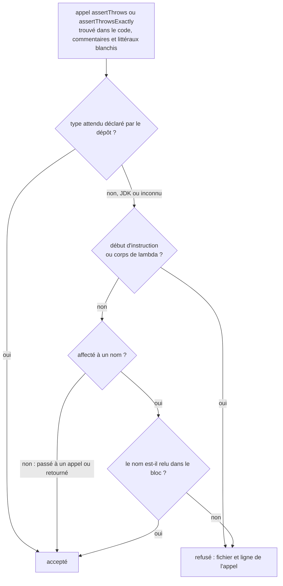

# Preuve de la raison d'un refus dans un test (`refusal-test-evidence`)

Spec de référence : [`openspec/specs/refusal-test-evidence/spec.md`](../../../openspec/specs/refusal-test-evidence/spec.md)
· Relevé du 2026-11-04 sur `2913fc30`.

## Objet et périmètre

Un test qui attend un refus doit lire ce que le produit a refusé. `assertThrows(IllegalArgumentException.class, …)` posé comme
instruction passe pour n'importe quelle `IllegalArgumentException` : il continue de passer quand la validation visée est
retirée et qu'une autre du même type répond à sa place. La suite d'architecture refuse cette forme.

- **Acteurs** : `RefusalTestEvidenceArchitectureTest` (module `morpheus-architecture-tests`), qui lit les sources de test de
  tout le dépôt ; tout auteur de test.
- **Inclus** : `assertThrows` et `assertThrowsExactly` sur un type que le dépôt ne déclare pas (type du JDK ou inconnu) ;
  la preuve que la règle lit bien des sources ; la liste des sites antérieurs à la règle.
- **Exclus** : un type déclaré sous un `src/main/java` ou un `src/test/java` du dépôt, qui porte lui-même sa raison ; ce que le
  test compare (la revue le lit : la règle prouve qu'une assertion a pu être écrite, pas qu'elle compare le bon message).

## Exigences

| Alias | Exigence (titre exact) | En bref | Nature |
|---|---|---|---|
| R1 | A test that expects a refusal typed by the JDK SHALL read the refusal it received | résultat passé à un appel ou lié à un nom que la méthode relit, sinon échec | `[EXIGENCE]` |
| R2 | The rule SHALL prove that it read the test sources | échec si aucun test ni aucun `assertThrows` ; type inconnu = générique | `[EXIGENCE]` |
| R3 | The sites that predate the rule SHALL be listed exactly and the list SHALL only shrink | tant que des sites existent, liste exacte avec effectifs ; aucun fichier des modules de frontière | `[EXIGENCE]` |

## Comportement détaillé

`[EXISTANT VÉRIFIÉ]` [`RefusalTestEvidenceArchitectureTest`](../../../morpheus-architecture-tests/src/test/java/com/morpheus/architecture/RefusalTestEvidenceArchitectureTest.java)
blanchit d'abord commentaires et littéraux, puis pour chaque appel `assertThrows` / `assertThrowsExactly` (écrit nu ou
`Assertions.`) :

1. lit le type attendu (`X.class`, éventuellement qualifié) ; s'il figure parmi les types que le dépôt déclare
   (`class`, `interface`, `record`, `enum` des `src/main` et `src/test`), l'appel n'est pas concerné ;
2. sinon regarde ce qui précède l'appel : début d'instruction (`;`, `{`, `}`) ou corps de lambda (`->`) signifie un résultat
   abandonné ; sinon, si l'appel est le membre droit d'une affectation, le nom lié doit réapparaître dans le bloc qui suit
   (hors nouvelle affectation) ; dans tout autre cas (argument d'un appel, `return`), le résultat est lu ;
3. rapporte la ligne où l'appel commence.

L'assertion de population non vide vaut pour cette règle de fichier, que la garde d'ArchUnit ne couvre pas : plus de 200
sources de test, plus de 100 appels, et la présence de deux types déclarés connus (`KnowledgeStoreException`,
`RejectedRequestException`) pour garantir que la collecte des types déclarés fonctionne.

La règle n'a pas de liste d'exceptions : le test exige `List.of()` pour l'ensemble des offenseurs (voir Écarts).

## Diagrammes

### Comment la règle juge-t-elle un appel `assertThrows` ?

Existant vérifié, lu dans `unreadGenericRefusals` et ses aides. Organigramme. Exigences R1, R2.

La règle ne compare pas le message : elle prouve qu'une assertion a pu être écrite. Un type de JDK jamais listé ailleurs est
générique par défaut, parce que le critère est « n'est pas déclaré par le dépôt », pas « est dans une liste du JDK » (R2).

## Écarts et questions ouvertes

1. **R3 décrit une liste qui n'existe plus.** `[EXISTANT VÉRIFIÉ]` La règle exige `assertEquals(List.of(), offenders, …)` : aucun
   site n'est toléré, aucune liste de fichiers avec effectifs n'existe dans le test. L'exigence est conditionnelle (« While
   sites that predate the rule remain »), et le dernier scénario (« The list ends ») décrit l'état présent. Les trois autres
   scénarios (site ajouté dans un fichier listé, fichier corrigé à retirer, module de frontière listé) n'ont aucun code à
   exercer. Preuve : sans objet tant qu'aucune liste n'est rétablie. `[QUESTION]` Retirer l'exigence R3 de la spec, ou la
   garder comme garde-fou si une liste revenait ?
2. **Le scénario « A proof that a gate refuses is held to the same rule ».** `[EXISTANT VÉRIFIÉ]` `AssertionError` est un
   type du JDK donc générique pour la règle ; `AnEmptyArchitectureRuleFailsTest#aRuleThatSelectsNoClassFailsForHavingCheckedNone`
   lie le résultat à `failure` et le relit. Aucune forme de `Shape` n'utilise `AssertionError`, et l'application réelle de
   la règle à l'ensemble des tests en tient lieu de preuve.
3. **« An empty scan is a failure ».** `theScanReadsTheTestSourcesItJudges` affirme sur le dépôt réel qu'il y a des sources et
   des appels. Aucun test n'exécute la règle sur un arbre sans fichier de test pour constater l'échec. Preuve par
   construction (les assertions de population), non jouée.
4. **Couplage à deux noms de types du dépôt.** `[EXISTANT VÉRIFIÉ]` Le test de lecture affirme que `KnowledgeStoreException`
   et `RejectedRequestException` sont déclarés. Une suppression légitime de l'un de ces types ferait échouer la preuve de
   lecture sans lien avec la règle.
5. **Seuils de population en littéraux.** Les bornes « plus de 200 sources » et « plus de 100 appels » sont des constantes
   du test, sans lien avec la spec, qui parle d'« aucun test source ou aucun `assertThrows` ».

## Traçabilité

Archive : `2026-10-21-assert-the-reason-of-every-refusal-a-test-expects`. Fichier de test :
[`RefusalTestEvidenceArchitectureTest`](../../../morpheus-architecture-tests/src/test/java/com/morpheus/architecture/RefusalTestEvidenceArchitectureTest.java).

| Exigence | Scénario | Conception ou diagramme | Preuve |
|---|---|---|---|
| R1 | A bare assertion on a generic type is refused | organigramme | `#theRuleRefusesEveryShapeThatDropsTheResultOfTheRefusal` (formes : instruction nue, appel sur deux lignes, `Assertions.` qualifié, `assertThrowsExactly`, corps de lambda) ; dépôt réel : `#noTestExpectsAGenericRefusalWithoutReadingWhyTheProductRefused` |
| R1 | A captured exception nobody reads is refused | idem | même méthode de formes (variable jamais lue, variable seulement réaffectée, nom lu seulement dans la méthode suivante) |
| R1 | A refusal whose message is asserted is accepted | idem | `#theRuleAcceptsEveryShapeThatReadsTheResultOrExpectsATypeOfTheProject` (résultat passé à un appel, retourné d'une aide, variable lue trois lignes plus loin) |
| R1 | A type of the project is not concerned | idem | même méthode (type du projet, type du projet qualifié) ; `#aJdkTypeThatAppearsNowhereElseInTheRepositoryIsStillGeneric` pour la frontière |
| R1 | A proof that a gate refuses is held to the same rule | idem | règle appliquée à toute la suite ; aucune forme dédiée à `AssertionError` (Écart 2) |
| R2 | An empty scan is a failure | idem | `#theScanReadsTheTestSourcesItJudges` (sur le dépôt réel ; exécution sur un arbre vide : **preuve manquante**, Écart 3) |
| R2 | A JDK type the rule never listed is still generic | idem | `#aJdkTypeThatAppearsNowhereElseInTheRepositoryIsStillGeneric` |
| R3 | A new site in a listed file fails | sans objet | **sans code** : aucune liste (Écart 1) |
| R3 | A corrected file must leave the list | sans objet | **sans code** (Écart 1) |
| R3 | A boundary module cannot be listed | sans objet | **sans code** (Écart 1) |
| R3 | The list ends | organigramme | `#noTestExpectsAGenericRefusalWithoutReadingWhyTheProductRefused` (`List.of()` attendu) ; `#theLineOfEachRefusalIsReportedWhereTheCallStarts` pour la ligne rapportée |

## Sources

- Règle de test du dépôt : `.claude/rules/testing.md` (« Tester un cas d'échec par `assertThrows` et une assertion sur le
  message ou le code »), `.claude/rules/architecture.md` (assertion textuelle, ArchUnit ne voit pas ces fichiers).
- Pages liées : [`architecture-rule-vacuity-guard.md`](architecture-rule-vacuity-guard.md),
  [`enforcement-mechanism-accounting.md`](enforcement-mechanism-accounting.md).
- Archive OpenSpec : `2026-10-21-assert-the-reason-of-every-refusal-a-test-expects`.
