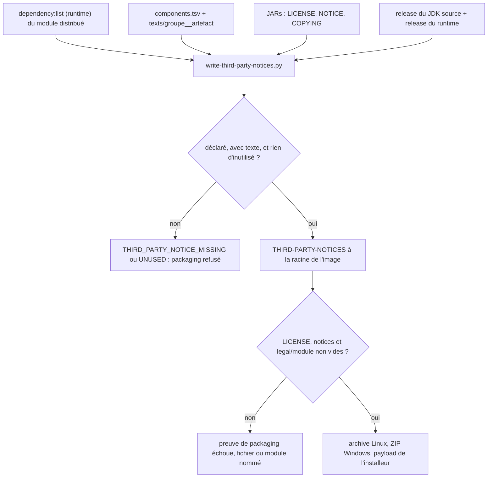
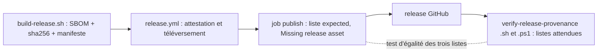

# Divulgation des composants d'une release (`release-component-disclosure`)

Spec de référence : [`openspec/specs/release-component-disclosure/spec.md`](../../../openspec/specs/release-component-disclosure/spec.md)
· Relevé du 2026-11-04 sur `2913fc30`.

## Objet et périmètre

Une release de MORPHEUS dit ce qu'elle redistribue : l'attribution des composants tiers voyage dans chaque artefact,
l'inventaire (SBOM CycloneDX) est publié à côté avec son empreinte et sa provenance, et les deux sont tenus égaux à
ce qui est livré.

- **Acteurs** : destinataire d'une archive ou de l'installeur ; mainteneur qui prépare un tag ; qualification de release.
- **Inclus** : `LICENSE` et `THIRD-PARTY-NOTICES` à la racine de l'image, génération des notices, notices légales du
  runtime embarqué, SBOM de la release, égalité des trois listes d'assets.
- **Exclus** : signature Authenticode (autre capacité), analyse de compatibilité des licences, VEX.

## Exigences

| Alias | Exigence (titre exact) | En bref | Nature |
|---|---|---|---|
| R1 | Every distributed artifact SHALL carry the product licence and the third-party notices | archive Linux, archive Windows et payload de l'installeur contiennent `LICENSE` et `THIRD-PARTY-NOTICES` non vides ; le packaging échoue sinon | `[EXIGENCE]` |
| R2 | The notices SHALL cover exactly the third-party components of the distributed program | population dérivée du classpath d'exécution du module distribué ; texte de licence pour chacun ; `THIRD_PARTY_NOTICE_MISSING` sinon | `[EXIGENCE]` |
| R3 | The artifact SHALL keep the legal notices of its embedded runtime and name the runtime's origin | `legal` non vide par module embarqué ; JDK (distribution et version) nommé, égal au `release` du runtime | `[EXIGENCE]` |
| R4 | A release SHALL publish the inventory of the tagged commit, with its checksum and provenance | un SBOM CycloneDX, son `.sha256`, une entrée de manifeste, une attestation | `[EXIGENCE]` |
| R5 | The expected asset set SHALL be the same in the release workflow and in both qualification scripts | trois listes, mêmes noms ; le build échoue sinon | `[EXIGENCE]` |

## Comportement détaillé

`[EXISTANT VÉRIFIÉ]` :

- **Génération** (`scripts/write-third-party-notices.py`, un seul générateur appelé par `build-portable.sh` et
  `build-portable.ps1`) : composants = sortie de `dependency:list -DincludeScope=runtime` du module distribué, sans le
  groupe du produit. Pour chacun : textes `LICENSE`/`NOTICE`/`COPYING` de son JAR, puis fichiers committés sous
  `distribution/third-party/texts/<groupe>__<artefact>/` ; déclaration obligatoire dans
  `distribution/third-party/components.tsv` (coordonnées, identifiant SPDX, source). Refus :
  `THIRD_PARTY_NOTICE_MISSING` (non déclaré ou sans texte), `THIRD_PARTY_NOTICE_UNUSED` (déclaration ou répertoire de
  texte qu'aucun composant livré n'utilise). La version n'est pas dans la clé : une montée de version n'exige pas de
  modification.
- **Origine du runtime** : le fournisseur est lu dans le fichier `release` du JDK source, la version est comparée à
  celle du runtime embarqué ; un désaccord est refusé.
- **Preuve de packaging** : les deux scripts copient `LICENSE`, génèrent les notices, refusent un fichier absent ou vide
  à la racine de l'image, et refusent un module du runtime sans notice légale (`legal/<module>`) ; un message `PASS` est
  imprimé. L'installeur Windows installe le ZIP portable comme payload.
- **SBOM** : `distribution/build-release.sh` invoque `cyclonedx:makeAggregateBom@m21-aggregate-sbom`, refuse l'absence du
  SBOM (`Release SBOM was not produced`), écrit `morpheus-<version>-sbom.cdx.json` et son `.sha256`, et l'inscrit au
  manifeste Linux. `release.yml` l'atteste avec l'archive, le téléverse, et son job de publication exige la liste
  `expected` (message `Missing release asset`) avant `gh release create`.
- **Qualification** (`scripts/verify-release-provenance.sh` et `.ps1`) : liste d'assets attendus, refus d'un asset en
  trop (`release publishes unexpected assets`) ou manquant, vérification des empreintes, `gh attestation verify` sur
  quatre artefacts, SBOM qui décrit la version du tag, et chaque composant attribué dans une archive présent dans le SBOM.

## Diagrammes

### D'où viennent les notices et quand le packaging refuse-t-il ?

Existant vérifié (`write-third-party-notices.py`, `build-portable.*`). Exigences : R1, R2, R3.

### Comment les trois listes d'assets et le SBOM se rejoignent-ils ?

Existant vérifié (`release.yml`, `verify-release-provenance.*`, `ReleaseQualificationContractTest`). Exigences : R4, R5.

## Écarts et questions ouvertes

- `[EXISTANT VÉRIFIÉ]` « The Windows archive and the installed tree hold both files » : aucun test ni validateur ne
  liste les fichiers de l'arborescence installée par l'installeur en mode smoke. La preuve est indirecte (le payload
  est le ZIP portable, dont le packaging prouve la présence). Preuve manquante pour l'arborescence installée.
- `[EXISTANT VÉRIFIÉ]` « The Linux archive holds both files... `LICENSE` identical to the repository's » : le packaging
  copie `LICENSE` mais ne prouve que sa présence non vide, pas l'identité octet pour octet.
- `[EXISTANT VÉRIFIÉ]` « A component that is not shipped is not attributed » : le test Python vérifie l'exclusion des
  modules du produit (groupe `io.github.fturleque`) ; aucun test ne couvre un module du réacteur non embarqué qui
  déclare une dépendance tierce. L'exclusion repose sur le choix du module distribué dans `dependency:list`.
- `[EXISTANT VÉRIFIÉ]` « The SBOM describes the tagged commit », « The SBOM's provenance verifies publicly », « The
  qualification still refuses anything else » sont des contrôles exécutés par la qualification d'une vraie release ;
  les tests du dépôt ne lisent que le texte des scripts (`bothVariantsPerformTheSameVerifications`). Aucune release
  n'a encore passé ces contrôles de bout en bout sur ce relevé (voir `RELEASE_QUALIFICATION.md`).
- `[EXISTANT VÉRIFIÉ]` « A release without the SBOM does not publish » (`Missing release asset`) : le test d'égalité
  prouve que le SBOM est dans la liste `expected` ; aucun test n'asserte la chaîne `Missing release asset`.
- `[EXISTANT VÉRIFIÉ]` « A stripped runtime is refused » : la boucle Linux suit les liens (`find -L`) alors que la
  variante PowerShell compte les fichiers du répertoire ; elles ne sont pas strictement identiques.
- `[EXISTANT VÉRIFIÉ]` La correction de la conception archivée (le fichier `release` du runtime ne nomme pas le
  fournisseur, d'où la lecture dans le JDK source) est dans le code et non dans la spec, qui dit « read from the build ».
- `[QUESTION]` Le texte de chaque licence est-il le bon ? La complétude est mécanique, la justesse est une lecture
  humaine (revue du mainteneur consignée dans les tâches du changement archivé).

## Traçabilité

| Exigence | Scénario | Conception ou diagramme | Changement | Preuve |
|---|---|---|---|---|
| R1 | The Linux archive holds both files | organigramme des notices | archive `2026-10-16-disclose-third-party-components-with-the-release` | [`ReleaseQualificationContractTest`](../../../morpheus-architecture-tests/src/test/java/com/morpheus/architecture/m20/ReleaseQualificationContractTest.java)`#everyDistributionCarriesItsAttributionsAndTheReleaseBuildWritesTheInventory` (texte des scripts) ; exécution : `distribution/build-portable.sh` |
| R1 | The Windows archive and the installed tree hold both files | idem | idem | même test pour `build-portable.ps1` ; arborescence installée : preuve manquante |
| R1 | A build that drops a file is refused | idem | idem | même test (`is missing or empty at the root of the image`) |
| R2 | Every shipped component is attributed | idem | idem | [`test_write_third_party_notices.py`](../../../scripts/tests/test_write_third_party_notices.py)`#test_texts_come_from_the_jar_then_from_the_repository_and_own_modules_are_left_out` ; `#test_the_committed_declarations_and_texts_agree` |
| R2 | A new dependency without a text fails the packaging | idem | idem | `test_write_third_party_notices.py#test_a_shipped_component_that_is_not_declared_is_refused` ; `#test_a_declared_component_without_any_text_is_refused` |
| R2 | A component that is not shipped is not attributed | idem | idem | `test_write_third_party_notices.py#test_texts_come_from_the_jar_then_from_the_repository_and_own_modules_are_left_out` (modules du produit seulement ; preuve partielle) |
| R2 | A version bump needs no edit | idem | idem | `test_write_third_party_notices.py#test_a_version_bump_needs_no_edit` |
| R2 | A removed dependency leaves no stale entry | idem | idem | `test_write_third_party_notices.py#test_a_declaration_and_a_directory_nobody_ships_are_refused` |
| R3 | The runtime's notices are present | idem | idem | `ReleaseQualificationContractTest#everyDistributionCarriesItsAttributionsAndTheReleaseBuildWritesTheInventory` (texte) ; exécution des deux packagings |
| R3 | A stripped runtime is refused | idem | idem | même test (`the embedded runtime carries no legal notice for`) ; rupture manuelle consignée dans les tâches de l'archive, variante `.sh` non rompue |
| R3 | The notices name the JDK that was used | idem | idem | `test_write_third_party_notices.py#test_a_runtime_that_is_not_the_one_of_the_jdk_given_is_refused` ; égalité avec le `release` du runtime : par le générateur |
| R4 | The SBOM is among the published assets | second organigramme | idem | `ReleaseQualificationContractTest#theReleaseWorkflowAndBothQualificationScriptsExpectTheSameAssets` ; `#everyDistributionCarriesItsAttributionsAndTheReleaseBuildWritesTheInventory` |
| R4 | The SBOM describes the tagged commit | idem | idem | `ReleaseQualificationContractTest#bothVariantsPerformTheSameVerifications` (texte : `published SBOM describes version`, `attributes components the published SBOM does not list`) |
| R4 | The SBOM's provenance verifies publicly | idem | idem | `bothVariantsPerformTheSameVerifications` (`expected four attested artifacts`) ; exécution réelle : preuve manquante avant une release |
| R4 | A release without the SBOM does not publish | idem | idem | liste `expected` de `release.yml` couverte par le test d'égalité ; chaîne `Missing release asset` : preuve manquante |
| R5 | The three lists agree | idem | idem | `theReleaseWorkflowAndBothQualificationScriptsExpectTheSameAssets` |
| R5 | An asset added to one list only fails the build | idem | idem | même test (message : fichier, assets manquants et en trop) |
| R5 | The qualification still refuses anything else | idem | idem | `bothVariantsPerformTheSameVerifications` (`release publishes unexpected assets`) |

## Sources

- ADR : [GEN-0088](../../architecture/adr/GEN-0088-product-release-installation-and-persistent-data-separation.md),
  [GEN-0089](../../architecture/adr/GEN-0089-production-integrity-surface-convergence.md).
- Pages : [`../../project/validation/RELEASE_QUALIFICATION.md`](../../project/validation/RELEASE_QUALIFICATION.md),
  [`../../user/PRODUCT_INTEGRITY.md`](../../user/PRODUCT_INTEGRITY.md), [`../../../distribution/README.md`](../../../distribution/README.md).
- Fichiers : [`write-third-party-notices.py`](../../../scripts/write-third-party-notices.py),
  [`components.tsv`](../../../distribution/third-party/components.tsv).
