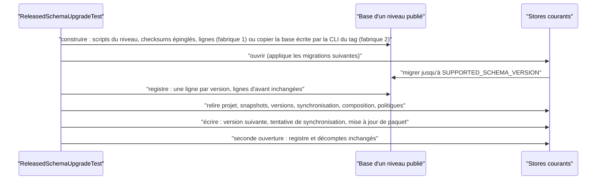
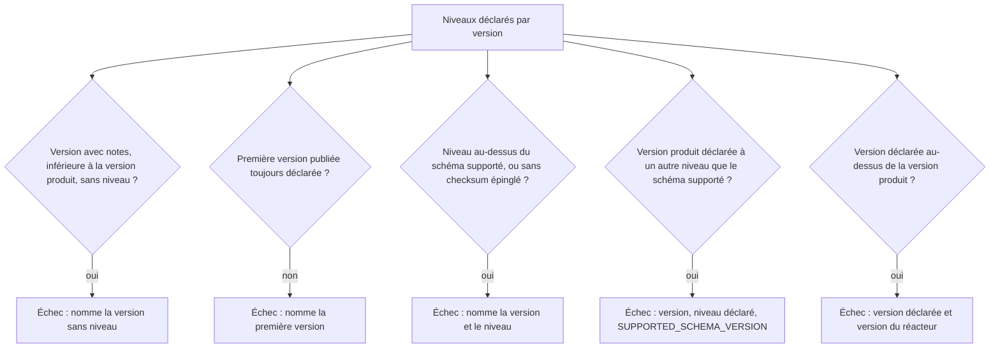

# Mise à niveau depuis chaque schéma publié (`released-schema-upgrade`)

Spec de référence : [`openspec/specs/released-schema-upgrade/spec.md`](../../../openspec/specs/released-schema-upgrade/spec.md)
· Relevé du 2026-11-04 sur `2913fc30`.

## Objet et périmètre

La spec fixe la preuve qu'une base écrite par une version publiée de MORPHEUS arrive au schéma courant sans perdre ce
qu'elle contenait, et comment la liste des niveaux de schéma publiés reste complète.

- **Acteurs** : `ReleasedSchemaUpgradeTest`, `PublishedDatabaseUpgrade`, `PublishedDatabases`, `ReleasedSchemaLevels`
  (module `morpheus-store-sqlite`), `ReleasedSchemaLevelsDeclarationTest` (module `morpheus-architecture-tests`), les
  validateurs `scripts/validate-r2.sh` et `scripts/validate-r2.ps1`.
- **Inclus** : la mise à niveau d'une base reconstruite pour chaque niveau publié, celle d'une base que le programme
  publié a écrite, la relecture par les stores, les écritures qui suivent, la déclaration des niveaux, le décompte du
  validateur de livraison.
- **Exclus** : l'historique et la copie avant migration ([`sqlite-schema-history.md`](sqlite-schema-history.md)), le guide
  de mise à niveau pour l'utilisateur (`docs/user/UPGRADE_1_2_2.md`).

## Exigences

| Alias | Exigence (titre exact) | En bref | Nature |
|---|---|---|---|
| R1 | The upgrade from every released schema level SHALL be executed on a database that holds data | une base par niveau, migrations du niveau et checksums épinglés, lignes dans les tables que les migrations suivantes lisent ou réécrivent | `[EXIGENCE]` |
| R2 | What an upgraded database held SHALL be read back through the store | relecture par les opérations publiques des stores, non par SQL seul | `[EXIGENCE]` |
| R3 | An upgraded database SHALL still accept the writes its family allows | au moins une écriture par famille contrainte par un index ou un déclencheur ultérieur | `[EXIGENCE]` |
| R4 | Every released version SHALL declare the schema level it shipped | un seul emplacement ; le build échoue si une version avec notes de version, inférieure à la version produit, n'a pas de niveau | `[EXIGENCE]` |
| R5 | The upgrade SHALL also be executed on a database that the released program wrote | une base écrite par la CLI d'un tag par niveau, avec tag, commit et SHA-256 | `[EXIGENCE]` |
| R6 | The release gate SHALL count one upgrade case per declared level | `validate-r2` refuse un rapport où une fabrique ne joue pas exactement un cas par niveau distinct | `[EXIGENCE]` |
| R7 | The product version SHALL be declared released only at the schema level it ships | la version du réacteur, si déclarée, l'est au niveau supporté ; aucune version au-dessus du réacteur | `[EXIGENCE]` |

## Comportement détaillé

`[EXISTANT VÉRIFIÉ]` **Déclaration.** `morpheus-store-sqlite/src/test/resources/released-schema-levels.properties`
associe une version publiée à son niveau (clés `1.0.0`, `1.1.0`, `1.2.0`, `1.2.1` au relevé ; lire le fichier pour les
valeurs). `ReleasedSchemaLevels.distinctLevels()` en tire l'ensemble des niveaux distincts.

`[EXISTANT VÉRIFIÉ]` **Première fabrique** (`aDatabaseOfEveryReleasedSchemaLevelIsUpgradedWithoutLosingWhatItHeld`) : pour
chaque niveau, `applyBaseline` rejoue les scripts de migration du niveau et inscrit au registre les checksums épinglés
de `SqliteMigrationChecksumGoldenTest.CANONICAL_CHECKSUMS` (non recalculés depuis les ressources), puis la
fixture écrit les lignes (projet, snapshots, versions de spécification, état de synchronisation, conflit de
composition, et, dès le niveau 15, paquet de politique avec version et audit). La base est ouverte par le store
courant ; le registre doit compter une ligne par version supportée et conserver les lignes d'avant ; les lignes sont
relues par les stores ; une écriture par famille réussit ; une seconde ouverture ne change ni le registre, ni le
nombre de projets, ni celui de snapshots.

`[EXISTANT VÉRIFIÉ]` **Seconde fabrique** (`aDatabaseThatEveryPublishedProgramWroteIsUpgradedWithoutLosingWhatItHeld`) :
`PublishedDatabaseUpgrade.upgradeAndVerify` copie `published-databases/level-<n>/morpheus.db`, refuse un fichier dont
le SHA-256 n'est pas celui de `provenance.properties` (le message nomme le tag), relit chaque ligne de chaque table
avant et après (valeur par valeur ; seule `composition_conflict.resolution` passe de `SELECTED_BY_PRECEDENCE` à
`PRECEDENCE_RECORDED`, nommée dans `REWRITTEN_VALUES`), puis relit identités et historique par les stores.

`[EXISTANT VÉRIFIÉ]` **Bornes de fixture.** `ReleasedSchemaUpgradeTest.ROW_SHAPES_KNOWN_THROUGH` fixe le plus haut niveau
dont les formes de lignes sont écrites à la main ; un niveau déclaré au-delà échoue par un message
`released level <n> has no row shapes`. Un niveau déclaré sans base publiée échoue par
`released schema level <n> has no database written by a published program` et nomme `published-databases/level-<n>/`.

## Diagrammes

### Que prouvent les deux fabriques de mise à niveau ?

Existant vérifié dans `ReleasedSchemaUpgradeTest` et `PublishedDatabaseUpgrade`. Exigences R1, R2, R3 et R5.

### Quelles déclarations de niveau font échouer le build ?

Existant vérifié dans `ReleasedSchemaLevelsDeclarationTest.problems`. Exigences R4 et R7.

## Écarts et questions ouvertes

- **R1, deux scénarios négatifs sans test** : « A migration that fails on existing rows fails the test » et « The
  baseline does not follow an edited migration » reposent sur le mécanisme (migration réelle sur lignes réelles ;
  checksums du registre pris dans `CANONICAL_CHECKSUMS` et non recalculés), sans test qui introduise la
  violation. Preuve manquante comme tests nommés.
- **R5, « A kept database that was altered is refused »** : `PublishedDatabases.copy` lève une erreur nommant le tag
  quand le SHA-256 diffère, mais aucun test n'altère une base conservée. Preuve manquante.
- **R5, « A declared level without a published database is refused »** : le seul test appelant ce refus vise des
  niveaux **au-dessus** du dernier niveau publié
  (`ReleasedSchemaUpgradeTest#aLevelAboveTheLastReleasedOneIsRefusedUntilItsReleaseProvidesItsRowsAndItsDatabase`),
  non un niveau déclaré dont la base manque.
- **R6, aucun test du validateur** : le décompte est dans les scripts `validate-r2.sh` (bloc Python) et
  `validate-r2.ps1` ; aucun test d'architecture ni test de script n'exécute un rapport dont un niveau manque.
  `validate-r2.sh` supprime le résumé d'une exécution précédente au démarrage et ne l'écrit qu'à la fin ; le refus
  par `SystemExit` empêche donc l'écriture. Preuve manquante comme test négatif.
- **R7, exemple de la spec** : le scénario « The product version declares an older level » cite 1.2.1, schéma 24 et
  niveau 20. `ReleasedSchemaLevelsDeclarationTest#theProductVersionIsDeclaredOnlyAtTheSchemaLevelTheReactorShips` rejoue
  exactement ces valeurs sur des données fixes. La version du réacteur et la constante de schéma courantes se lisent
  dans le POM racine et `SqliteSchemaManager.SUPPORTED_SCHEMA_VERSION`, non dans cette page.
- **Plafond des formes de lignes** : au-delà de `ROW_SHAPES_KNOWN_THROUGH`, la mise à niveau d'un nouveau niveau publié
  exige d'écrire à la main ses formes de lignes et de produire sa base avec la CLI du tag
  (`published-databases/README.md`). Ce coût est voulu par le test, non par la spec.
- **Hors périmètre de la spec, vérifié** : `ReleasedSchemaUpgradeTest` exige que le niveau le plus haut des formes
  connues ne dépasse pas le dernier niveau publié.

## Traçabilité

| Exigence | Scénario | Conception ou diagramme | Changement | Preuve |
|---|---|---|---|---|
| R1 | A database of the last published release is upgraded | séquence ci-dessus | archive `2026-10-21-prove-the-upgrade-from-every-released-schema` | [`ReleasedSchemaUpgradeTest`](../../../morpheus-store-sqlite/src/test/java/com/morpheus/store/sqlite/runtime/ReleasedSchemaUpgradeTest.java)`#aDatabaseOfEveryReleasedSchemaLevelIsUpgradedWithoutLosingWhatItHeld` (cas du dernier niveau) |
| R1 | The oldest published release is still covered | idem | idem | même fabrique (cas du plus bas niveau) |
| R1 | A migration that fails on existing rows fails the test | idem | idem | **Preuve manquante** comme test négatif |
| R1 | The baseline does not follow an edited migration | idem | idem | **Preuve manquante** comme test négatif ; `ReleasedSchemaUpgradeTest#upgradeFrom` (méthode privée de la fabrique) lit `CANONICAL_CHECKSUMS` |
| R2 | A synchronization state written before the revision column existed | idem | idem | même fabrique ; `readBackSyncState` (privée) ; [`SqliteSyncStateRevisionMigrationTest`](../../../morpheus-store-sqlite/src/test/java/com/morpheus/store/sqlite/runtime/SqliteSyncStateRevisionMigrationTest.java) pour la migration seule |
| R2 | Specification versions written before sequences were unique | idem | idem | même fabrique ; `readBackSpecificationVersions` et `writeThroughTheStores` (privées) ; [`SqliteSpecificationVersionSequenceMigrationTest`](../../../morpheus-store-sqlite/src/test/java/com/morpheus/store/sqlite/runtime/SqliteSpecificationVersionSequenceMigrationTest.java) pour la migration seule |
| R3 | A policy pack written by an earlier release is updated | idem | idem | même fabrique ; `writeThroughTheStores` (`compareAndSetDefinition`, privée) |
| R4 | The version after a release must declare what was shipped | organigramme de déclaration | idem | [`ReleasedSchemaLevelsDeclarationTest`](../../../morpheus-architecture-tests/src/test/java/com/morpheus/architecture/ReleasedSchemaLevelsDeclarationTest.java)`#theNextVersionFailsUntilTheLevelJustShippedIsDeclared`, `#aReleasedVersionWithoutADeclaredLevelNamesItselfInTheFailure`, `#everyReleasedVersionDeclaresTheSchemaLevelItShippedInTheRepository` |
| R4 | The version in progress is not required | idem | idem | `ReleasedSchemaLevelsDeclarationTest#theVersionInProgressIsNotRequiredToDeclareALevelUntilItIsReleased` |
| R4 | A declared level beyond the supported schema is refused | idem | idem | `ReleasedSchemaLevelsDeclarationTest#aDeclaredLevelBeyondTheSupportedSchemaOrWithoutAPinnedChecksumIsRefused` |
| R5 | A database written by the first release is upgraded | séquence ci-dessus | archive `2026-10-28-upgrade-the-databases-published-programs-wrote` | `ReleasedSchemaUpgradeTest#aDatabaseThatEveryPublishedProgramWroteIsUpgradedWithoutLosingWhatItHeld` (cas du niveau 12, `REWRITTEN_VALUES`) |
| R5 | A declared level without a published database is refused | idem | idem | preuve partielle : `ReleasedSchemaUpgradeTest#aLevelAboveTheLastReleasedOneIsRefusedUntilItsReleaseProvidesItsRowsAndItsDatabase` (niveaux non publiés, message `level-<n>/`) |
| R5 | A kept database that was altered is refused | idem | idem | **Preuve manquante** comme test |
| R6 | A level is dropped from the run | — | archive `2026-10-21-prove-the-upgrade-from-every-released-schema` | **Preuve manquante** comme test ; logique dans `scripts/validate-r2.sh` et `scripts/validate-r2.ps1` |
| R7 | The product version declares an older level | organigramme de déclaration | archive `2026-11-04-record-the-sprint-15-medium-decisions` | `ReleasedSchemaLevelsDeclarationTest#theProductVersionIsDeclaredOnlyAtTheSchemaLevelTheReactorShips` |
| R7 | A version above the reactor is declared | idem | idem | `ReleasedSchemaLevelsDeclarationTest#aVersionAboveTheProductVersionCannotBeDeclaredAsReleased` |

## Sources

- Archives OpenSpec : `openspec/changes/archive/2026-10-21-prove-the-upgrade-from-every-released-schema/`,
  `openspec/changes/archive/2026-10-28-upgrade-the-databases-published-programs-wrote/`,
  `openspec/changes/archive/2026-11-04-record-the-sprint-15-medium-decisions/`.
- Preuve de livraison : [`VALIDATION_R2.md`](../../project/validation/VALIDATION_R2.md).
- Base conservée par niveau : `morpheus-store-sqlite/src/test/resources/published-databases/` (`README.md` et un
  `provenance.properties` par niveau).
- Guide utilisateur : `docs/user/UPGRADE_1_2_2.md` ; cohérence : `UpgradeGuideCoherenceTest`.
- Page liée : [`sqlite-schema-history.md`](sqlite-schema-history.md).
