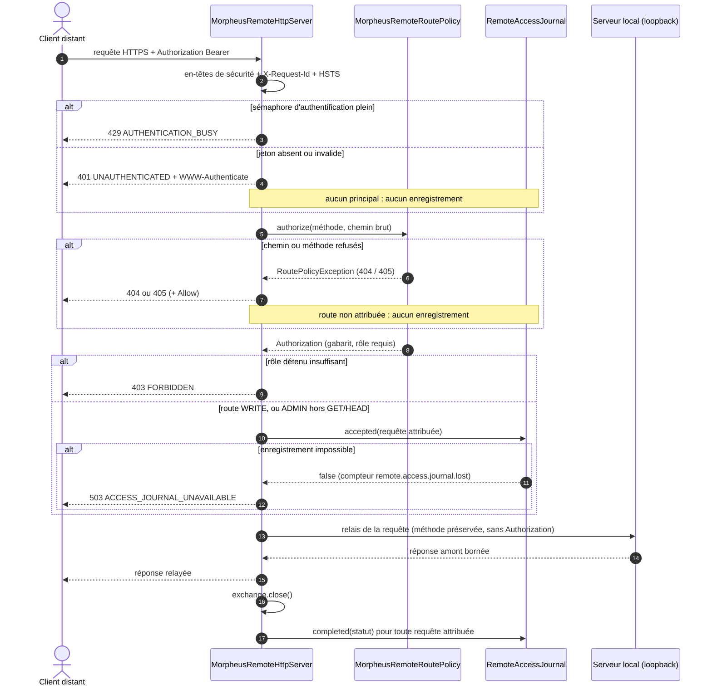
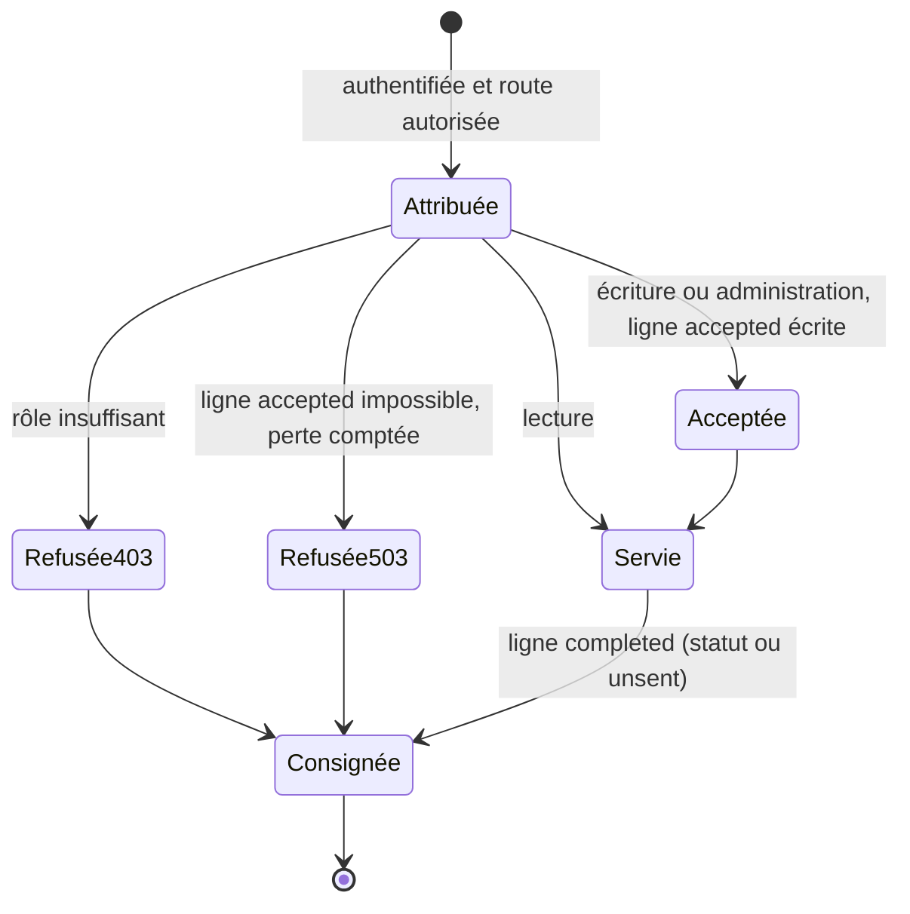

# Journal d'accès du serveur distant (`remote-access-journal`)

Spec de référence : [`openspec/specs/remote-access-journal/spec.md`](../../../openspec/specs/remote-access-journal/spec.md)
· Relevé du 2026-11-03 sur `836fffa5` ; preuves de R6 à R8 exécutées le 2026-11-04.

## Objet et périmètre

Le serveur distant garde la trace de qui a été autorisé à faire quoi. L'audit du fichier d'identités dit ce qui
arrive aux identifiants ; ce journal dit à quoi ils servent. Les deux restent séparés.

- **Acteurs** : principal authentifié du serveur distant et son rôle (`READ`, `WRITE`, `ADMIN`) ; opérateur qui lit
  le journal ou le compteur de pertes.
- **Inclus** : contenu d'un enregistrement, requêtes consignées et non consignées, bornes et rotation, issue d'une
  écriture impossible.
- **Exclus** : l'audit du fichier d'identités ; le journal opérationnel ; le serveur local, qui n'a pas de principal.

## Exigences

| Alias | Exigence (titre exact) | En bref | Nature |
|---|---|---|---|
| R1 | Every authorized remote request SHALL leave a record that attributes it | instant, identifiant de requête, principal, rôle détenu et exigé, méthode, gabarit de route, statut | `[EXIGENCE]` |
| R2 | A refused authorization SHALL be recorded and a failed authentication SHALL NOT | 403 consigné avec son principal ; 401 jamais | `[EXIGENCE]` |
| R3 | A record SHALL carry no secret and no caller-chosen text | ni jeton, ni empreinte, ni paramètre de chemin, ni requête, ni en-tête, ni corps | `[EXIGENCE]` |
| R4 | The journal SHALL be bounded, private and separate from the identity file | fichier à part, borné en taille et en générations, permissions privées | `[EXIGENCE]` |
| R5 | A record that cannot be written SHALL have a decided outcome | appliquer la politique de l'ADR, compter la perte, ne pas continuer comme si l'enregistrement existait | `[EXIGENCE]`, précisée par `[DÉCISION]` SEC-0113 §7 |
| R6 | Une écriture est consignée avant d'être servie | `accepted` avant de servir une écriture ou une administration hors `GET`/`HEAD`, puis `completed` ; une lecture ne laisse que `completed` | `[EXIGENCE]` (changement `state-what-the-http-boundary-already-does`), `[DÉCISION]` SEC-0113 §5 |
| R7 | Une écriture dont l'acceptation ne peut être consignée est refusée | 503 `ACCESS_JOURNAL_UNAVAILABLE` sans servir ; lecture servie ; compteur `remote.access.journal.lost` | `[EXIGENCE]` (idem), `[DÉCISION]` SEC-0113 §7 |
| R8 | Le serveur distant ne démarre pas sans son journal | refus commençant par `ACCESS_JOURNAL_UNAVAILABLE`, sans chemin | `[EXIGENCE]` (idem), `[DÉCISION]` SEC-0113 §7 |

## Comportement détaillé

Lu dans [`RemoteAccessJournal`](../../../morpheus-api/src/main/java/com/morpheus/api/remote/RemoteAccessJournal.java)
et `MorpheusRemoteHttpServer.serve` ; concordant avec
[SEC-0113](../../architecture/adr/SEC-0113-the-remote-server-records-who-was-authorized-to-do-what.md).
`[EXISTANT VÉRIFIÉ]`

| Situation | Lignes écrites | Réponse |
|---|---|---|
| échec d'authentification (401), ou sémaphore d'authentification plein (429) | aucune | 401 `UNAUTHENTICATED` / 429 `AUTHENTICATION_BUSY` |
| authentifié, route inconnue (404) ou méthode refusée (405) | aucune : la requête n'est pas autorisée | 404 / 405 avec `Allow` |
| rôle insuffisant | `completed` avec `status=403`, niveau `WARNING` | 403 `FORBIDDEN` |
| lecture (route `READ`, ou `ADMIN` en `GET`/`HEAD`) | `completed` seulement | réponse servie |
| écriture ou administration (`WRITE`, ou `ADMIN` hors `GET`/`HEAD`) | `accepted` avant d'être servie, puis `completed` | réponse servie |
| écriture ou administration dont `accepted` ne s'écrit pas | `completed` avec `status=503` si l'écriture réussit alors | 503 `ACCESS_JOURNAL_UNAVAILABLE` ; compteur `remote.access.journal.lost` +1 |
| réponse jamais envoyée | `completed` avec `status=unsent` | — |
| journal impossible à ouvrir au démarrage | — | le serveur distant ne démarre pas (`IllegalStateException` qui commence par `ACCESS_JOURNAL_UNAVAILABLE`) |

Fichier `morpheus-remote-access.jsonl`, à côté du fichier d'identités, une ligne JSON par enregistrement. Bornes :
`RemoteAccessJournal.MAX_FILE_BYTES` et `RemoteAccessJournal.KEPT_GENERATIONS` (constantes du code, non recopiées).
Permissions privées appliquées par `LocalWritePermissionHardener` via `RotatingOperationalLogFile`.

## Diagrammes

### Séquence de la façade distante

Question : dans quel ordre la façade authentifie, autorise, consigne et relaie une requête, et que reçoit le client à
chaque refus ? Existant vérifié, lu dans `MorpheusRemoteHttpServer.serve` (simplifié : les sémaphores de requête et
d'écriture, et les routes `server/status` et `server/backups` servies par la façade elle-même, sont omis). Séquence UML.

Les alternatives terminent la requête (le diagramme ne montre pas le retour anticipé). L'issue s'écrit une seule
fois, dans le `finally` de `serve`, après la fermeture de l'échange. Exigences : R1, R2, R5 ; la séquence sert aussi
[`http-response-headers`](http-response-headers.md) (en-têtes posés avant toute décision) et
[`http-path-decoding`](http-path-decoding.md) (chemin brut lu par le parseur partagé).

### Quelles lignes une requête attribuée laisse-t-elle ?

Existant vérifié. Diagramme d'états UML d'une requête, du point de vue du journal.

Une requête non attribuée (401, 404, 405) n'entre pas dans ce diagramme : elle ne laisse aucune ligne (R2).
L'écriture de la ligne `completed` peut elle-même échouer : la perte est alors comptée et la réponse déjà envoyée
reste inchangée.

## Écarts et questions ouvertes

- `[EXISTANT VÉRIFIÉ]` R5 renvoie à « the policy the decision record states » sans la nommer ; R6 à R8 l'énoncent
  (SEC-0113 §5 et §7) sans modifier R5. Deux exigences parlent du même sujet, l'une générale, l'autre précise.
- `[EXISTANT VÉRIFIÉ]` Le scénario de R6 « enregistre un projet » : la preuve HTTP envoie `POST /api/v1/projects`
  avec un corps `{}`, que le serveur local refuse en 400 ; les lignes `accepted` puis `completed` sont écrites
  quand même, ce qui est la propriété énoncée. Pas un écart de comportement.
- `[PROPOSITION]` Preuves partielles de R7 : le test HTTP n'asserte ni le compteur `remote.access.journal.lost` ni
  l'absence de relais vers le serveur local (le compteur est asserté au niveau du journal). La consultation d'une route
  `ADMIN` par `GET` comme lecture n'a qu'une preuve indirecte (`RemoteAccessJournal.accepted` rend `true` sans écrire).
- `[EXISTANT VÉRIFIÉ]` R8 : l'ouverture se fait dans le constructeur du serveur distant. Un test du serveur entier
  n'est pas écrit : le journal vit dans le répertoire du fichier d'identités que le serveur vient de lire, et un
  répertoire à la place du fichier n'empêche pas l'ouverture ; seul un refus de durcissement peut échouer, ce qu'un
  test portable ne reproduit pas. Preuve : refus au niveau du journal et épingle textuelle du câblage (décision du
  2026-11-04, `design.md` du changement).
- `[QUESTION]` La spec ne dit pas qu'une requête authentifiée vers une route inconnue (404) ou avec une méthode
  refusée (405) n'est pas consignée ; SEC-0113 §4 le décide, et `RemoteAccessJournalHttpTest` le vérifie pour le 404
  (aucune ligne après `GET /api/v1/nowhere` d'un lecteur authentifié). Faut-il l'écrire en exigence ?

## Traçabilité

| Exigence | Scénario | Conception ou diagramme | Changement | Preuve |
|---|---|---|---|---|
| R1 | A write is attributed | séquence, états | archive `2026-10-16-record-who-acted-on-the-remote-server` | [`RemoteAccessJournalHttpTest`](../../../morpheus-api/src/test/java/com/morpheus/api/remote/RemoteAccessJournalHttpTest.java)`#anAuthorizedRequestIsAttributedARefusedOneTooAndAnUnauthenticatedOneLeavesNothing` |
| R1 | The request identifier joins the two sides | séquence | idem | même test |
| R2 | A reader who tries to write is recorded | états | idem | même test |
| R2 | An unauthenticated caller cannot fill the journal | séquence | idem | même test |
| R3 | The template, not the path | — | idem | [`RemoteAccessJournalArchitectureTest`](../../../morpheus-architecture-tests/src/test/java/com/morpheus/architecture/m26/RemoteAccessJournalArchitectureTest.java)`#aRecordIsBuiltFromTheRouteTemplateAndNeverFromThePath` |
| R3 | No token in any form | — | idem | [`RemoteAccessJournalTest`](../../../morpheus-api/src/test/java/com/morpheus/api/remote/RemoteAccessJournalTest.java)`#aPrincipalNamedLikeASecretIsRedactedLikeAnyOtherValue` ; `RemoteAccessJournalArchitectureTest` |
| R4 | Rotation at the bound | — | idem | `RemoteAccessJournalTest#theJournalIsRotatedAtItsBoundAndKeepsNoMoreThanItsGenerations` ; permissions privées : **preuve indirecte** (tests de `RotatingOperationalLogFile`, non relus dans ce relevé) |
| R5 | The loss is visible | séquence, états | idem | `RemoteAccessJournalTest#aRecordThatCannotBeWrittenIsCountedRefusesAWriteAndLetsAReadThrough` ; `RemoteAccessJournalHttpTest#whenTheJournalCannotBeWrittenAWriteIsRefusedByNameAndAReadIsStillServed` |
| — | (issue écrite une fois, dans le `finally`) | séquence | idem | `RemoteAccessJournalArchitectureTest#theOutcomeIsRecordedOnceInTheFinallyOfServeAndTheAcceptanceBeforeAnythingIsServed` |
| — | (journal impossible à ouvrir) | tableau ci-dessus | — | `RemoteAccessJournalTest#aJournalThatCannotBeOpenedIsARefusalThatNamesNoLocation` |
| R6 | Une écriture laisse deux enregistrements | séquence, états | `state-what-the-http-boundary-already-does` | `RemoteAccessJournalTest#aReadLeavesOneRecordAndAWriteOrAnAdministrationTwo` ; `RemoteAccessJournalHttpTest#anAuthorizedRequestIsAttributedARefusedOneTooAndAnUnauthenticatedOneLeavesNothing` |
| R6 | Une lecture laisse un seul enregistrement | séquence, états | idem | mêmes tests |
| R6 | La consultation d'une route d'administration est une lecture | états | idem | `RemoteAccessJournalTest#aRecordThatCannotBeWrittenIsCountedRefusesAWriteAndLetsAReadThrough` (`GET` `ADMIN` accepté sans écriture) : **preuve indirecte** |
| R7 | Une écriture n'est pas servie sans son enregistrement | séquence, états | idem | `RemoteAccessJournalHttpTest#whenTheJournalCannotBeWrittenAWriteIsRefusedByNameAndAReadIsStillServed` ; compteur et non-relais : **preuve partielle** (compteur asserté au niveau du journal, relais non asserté) |
| R7 | Une lecture reste servie | séquence | idem | même test HTTP ; compteur : `RemoteAccessJournalTest#aRecordThatCannotBeWrittenIsCountedRefusesAWriteAndLetsAReadThrough` |
| R8 | Un répertoire inutilisable empêche le démarrage | tableau ci-dessus | idem | `RemoteAccessJournalTest#aJournalThatCannotBeOpenedIsARefusalThatNamesNoLocation` (niveau journal) ; câblage : [`RemoteAccessJournalArchitectureTest`](../../../morpheus-architecture-tests/src/test/java/com/morpheus/architecture/m26/RemoteAccessJournalArchitectureTest.java)`#theRemoteServerOpensItsJournalBesideTheIdentityFileWhenItIsConstructed` ; pas de test du serveur entier (décision 2.2) |

## Sources

- Décision : [SEC-0113](../../architecture/adr/SEC-0113-the-remote-server-records-who-was-authorized-to-do-what.md).
- Règle de sécurité du dépôt : `.claude/rules/security.md`, section « Journal d'accès ».
- Pages développeur : [`../REMOTE_SERVER_PLATFORM.md`](../REMOTE_SERVER_PLATFORM.md) ; utilisateur :
  [`../../user/TEAM_REMOTE_SERVER.md`](../../user/TEAM_REMOTE_SERVER.md).
