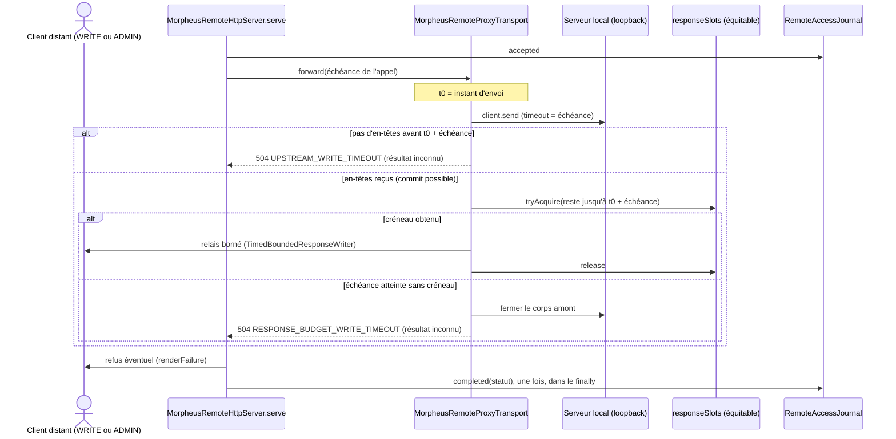

# Bornes des appels du proxy distant (`remote-proxy-upstream-bounds`)

Spec de référence : [`openspec/specs/remote-proxy-upstream-bounds/spec.md`](../../../openspec/specs/remote-proxy-upstream-bounds/spec.md)
· Relevé du 2026-11-06 sur `8c038add`, complété par le changement `bound-the-wait-for-a-remote-response-slot`.

## Objet et périmètre

La façade distante relaie chaque requête autorisée au serveur local par le saut loopback. Cette capacité dit combien de
temps elle attend ce serveur, combien de mémoire une réponse relayée peut occuper, et ce qu'un client apprend quand une
borne est atteinte.

- **Acteurs** : client distant d'une route READ, WRITE ou ADMIN relayée ; répartiteur placé devant la façade ;
  opérateur qui lit le journal d'accès et les compteurs de `server/status`.
- **Inclus** : l'échéance amont de chaque appel relayé, le budget de réponses du proxy (taille et créneaux), l'attente
  d'un créneau par une écriture, les refus nommés de ces bornes.
- **Exclus** : le serveur local, qui ne relaie rien ; la sauvegarde distante, que la façade exécute elle-même
  (ADR-0159) ; les délais d'écriture d'une réponse, régis par `TimedBoundedResponseWriter`.

## Exigences

| Alias | Exigence (titre exact) | En bref | Nature |
|---|---|---|---|
| R1 | Every upstream call SHALL have a read timeout | 60 s pour une route READ, 300 s pour une route WRITE ou ADMIN | `[EXIGENCE]` |
| R2 | Every proxied response SHALL be read within the memory budget | toute réponse prend un créneau et respecte la taille ; une écriture prend le sien après la réponse amont et l'attend au plus jusqu'à l'échéance de son appel | `[EXIGENCE]` |
| R3 | A timed-out write SHALL be answered as an unknown outcome | `504 UPSTREAM_WRITE_TIMEOUT`, relire avant de rejouer | `[EXIGENCE]` |
| R4 | Une écriture sans créneau de réponse à son échéance reçoit un refus de résultat inconnu | `504 RESPONSE_BUDGET_WRITE_TIMEOUT`, réponse amont fermée, aucun créneau rendu | `[EXIGENCE]` (changement en cours) |
| R5 | L'adaptateur HTTP n'attend aucun sémaphore sans délai | aucun `Semaphore.acquire` ni `acquireUninterruptibly` dans `com.morpheus.api..` | `[EXIGENCE]` (changement en cours) |
| R6 | La réponse à une écriture relayée commence avant l'échéance de son appel | réponse commencée à l'échéance au plus tard, terminée après le délai total d'écriture au plus tard ; borne écrite et calculée | `[EXIGENCE]` (changement en cours) |

## Comportement détaillé

`MorpheusRemoteProxyTransport.forward`
([source](../../../morpheus-api/src/main/java/com/morpheus/api/remote/MorpheusRemoteProxyTransport.java)) `[EXISTANT VÉRIFIÉ]` :

| Situation | Réponse | Effet sur les créneaux de réponse |
|---|---|---|
| lecture, aucun créneau libre avant l'appel | `429 RESPONSE_BUDGET_EXHAUSTED` | aucun pris |
| lecture sans réponse amont à son échéance (`UpstreamDeadline.READ`) | `504 UPSTREAM_TIMEOUT`, rejouable | créneau rendu |
| écriture sans réponse amont à son échéance (`UpstreamDeadline.WRITE`) | `504 UPSTREAM_WRITE_TIMEOUT`, résultat inconnu | aucun pris |
| écriture répondue, créneau obtenu avant l'échéance comptée depuis l'envoi | réponse amont relayée avec son statut | créneau rendu après l'écriture |
| écriture répondue, aucun créneau avant cette échéance | `504 RESPONSE_BUDGET_WRITE_TIMEOUT`, résultat inconnu ; corps amont fermé ; compté dans `throttledPrivilegedRequests` | aucun pris, aucun rendu |
| réponse amont sans `Content-Length` borné ou au-delà de la taille | `502 UPSTREAM_LENGTH_REQUIRED` / `UPSTREAM_RESPONSE_TOO_LARGE` | créneau rendu |
| interruption pendant l'attente d'un créneau | `503 UPSTREAM_INTERRUPTED`, corps amont fermé | aucun pris |

Le nombre de créneaux est `MorpheusRemoteHttpServer.MAX_PROXY_IN_FLIGHT_BYTES / MAX_PROXY_RESPONSE_BYTES`, et le
sémaphore est équitable : l'attente d'une écriture, par `tryAcquire` avec le reste de l'échéance, garde l'ordre
d'arrivée. Un refus suit le chemin de toute `TransportException` : `serve` le rend par `renderFailure`, puis écrit
l'issue au journal d'accès une fois, dans son `finally`, avec le statut et sans le code. Aucun effet persisté.

Borne vue du client d'une écriture : la réponse commence au plus tard à l'échéance `UpstreamDeadline.WRITE` comptée
depuis l'envoi amont, et se termine au plus tard `TimedBoundedResponseWriter.RESPONSE_TOTAL_TIMEOUT` plus tard. Les
deux valeurs sont écrites dans [`../REMOTE_SERVER_PLATFORM.md`](../REMOTE_SERVER_PLATFORM.md) et dans le guide
utilisateur du serveur d'équipe, et `RemoteWriteResponseBoundDocumentationTest` les recalcule depuis les constantes.

## Diagrammes

### Que se passe-t-il pour une écriture relayée quand tous les créneaux de réponse sont pris ?

Existant vérifié après le changement. Séquence UML ; les alternatives montrent les trois issues d'une écriture.

Exigences : R2 et R6 pour l'attente bornée et la borne vue du client, R3 pour la première alternative, R4 pour la
dernière. La séquence complète de la façade (authentification, autorisation, journal) est dans
[`remote-access-journal.md`](remote-access-journal.md#séquence-de-la-façade-distante).

## Écarts et questions ouvertes

- `[EXISTANT VÉRIFIÉ]` La section `## Purpose` de la spec principale ne renvoie à aucune page durable ; l'ajout de ce
  renvoi relève d'un changement de spec principale.
- `[EXISTANT VÉRIFIÉ]` Aucun test ne compare les codes de refus émis par la façade aux réponses de
  `morpheus-v1-remote-m26.yaml` : `UPSTREAM_WRITE_TIMEOUT` et `RESPONSE_BUDGET_WRITE_TIMEOUT` y sont documentés à la
  main, sur `/provider-plugins/probe` et dans `info.description`.
- `[EXISTANT VÉRIFIÉ]` Le scénario « Le refus est consigné une fois » n'a pas de test au niveau du serveur : l'échéance
  d'une écriture vient de la politique de routes (300 s) et le serveur construit son transport lui-même, sans point
  d'injection. Le refus suit le chemin de toute `TransportException`, que `RemoteAccessJournalHttpTest` exerce pour une
  écriture refusée.
- Question ouverte : nommer, dans le message du refus, le statut que l'amont avait répondu.

## Traçabilité

| Exigence | Scénario | Conception ou diagramme | Changement ou tâche | Preuve |
|---|---|---|---|---|
| R1 | A write that never answers ends | séquence ci-dessus, 1re alternative | — | [`MorpheusRemoteProxyResponseBudgetTest`](../../../morpheus-api/src/test/java/com/morpheus/api/remote/MorpheusRemoteProxyResponseBudgetTest.java)`#aWriteTheUpstreamNeverAnswersEndsAtItsDeadlineAsAnUnknownOutcome` |
| R1 | The privileged ceiling recovers | — | — | même classe : `#asManyStuckWritesAsThePrivilegedCeilingEndAndTheCeilingAdmitsTheNext` |
| R1 | Every role has the deadline of its role | — | — | `MorpheusRemoteRoutePolicyTest#onEveryRouteOfTheTableEveryRoleHasTheUpstreamDeadlineOfItsRole` |
| R2 | An oversized response to a write is refused | — | — | `MorpheusRemoteProxyResponseBudgetTest#anOversizedResponseToAWriteIsRefusedByNameAndItsSlotComesBack` |
| R2 | A write waits for a slot that frees in time | séquence, « créneau obtenu » | `bound-the-wait-for-a-remote-response-slot`, tâche 2.2 | même classe : `#aMutationWaitsForTheBudgetRatherThanBeingRefusedAfterItsCommit` |
| R3 | The client is told to read before retrying | séquence, 1re alternative | — | même classe : `#aWriteTheUpstreamNeverAnswersEndsAtItsDeadlineAsAnUnknownOutcome` |
| R4 | Aucun créneau ne se libère avant l'échéance | séquence, dernière alternative | tâches 1.2, 2.1 | même classe : `#aWriteThatGetsNoSlotBeforeItsDeadlineIsRefusedAsAnUnknownOutcome` |
| R4 | Le refus n'est pas celui d'un amont lent | idem | tâche 1.2 | même classe : `#aWriteThatGetsNoSlotBeforeItsDeadlineIsRefusedAsAnUnknownOutcome` et `#aWriteTheUpstreamNeverAnswersEndsAtItsDeadlineAsAnUnknownOutcome` |
| R4 | Le refus est consigné une fois | séquence, `completed` dans le `finally` | tâche 1.3 | **preuve manquante** au niveau du serveur (voir Écarts) |
| R4 | Le refus est documenté pour les clients distants | — | tâche 3.3 | relecture de [`morpheus-v1-remote-m26.yaml`](../reference/openapi/morpheus-v1-remote-m26.yaml) ; `PublicHttpRouteConvergenceTest` |
| R5 | Une attente non bornée réintroduite | — | tâches 1.1, 2.3 | [`RemoteServerArchitectureTest`](../../../morpheus-architecture-tests/src/test/java/com/morpheus/architecture/m26/RemoteServerArchitectureTest.java)`#noClassOfTheHttpAdapterWaitsOnASemaphoreWithoutADeadline` |
| R6 | La borne écrite suit les constantes | — | tâche 1.4 | [`RemoteWriteResponseBoundDocumentationTest`](../../../morpheus-api/src/test/java/com/morpheus/api/remote/RemoteWriteResponseBoundDocumentationTest.java) |

## Sources

- ADR-0159 (travailleurs de base de données de la façade), dont la sauvegarde distante suit le même patron de refus
  nommés.
- Page développeur : [`../REMOTE_SERVER_PLATFORM.md`](../REMOTE_SERVER_PLATFORM.md), section « Concurrence et timeout
  proxy ».
- Changement : `openspec/changes/bound-the-wait-for-a-remote-response-slot/`.
