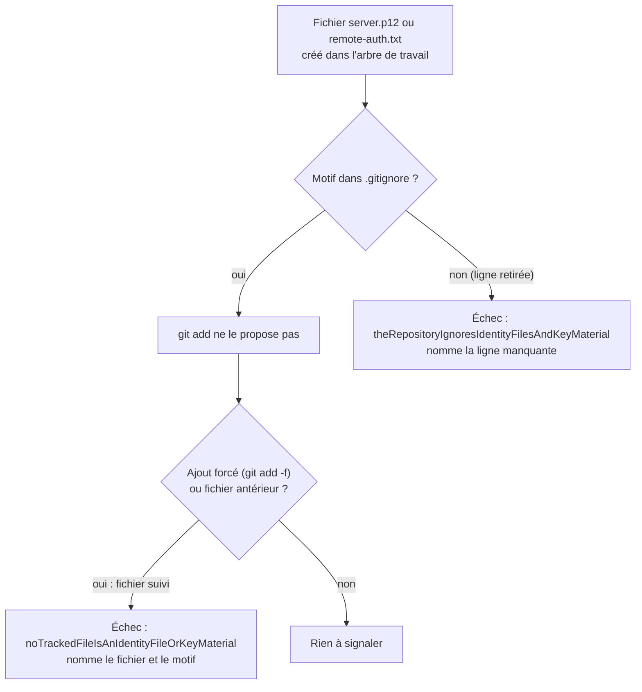

# Hygiène des fichiers d'identité et de clés (`repository-credential-hygiene`)

Spec de référence : [`openspec/specs/repository-credential-hygiene/spec.md`](../../../openspec/specs/repository-credential-hygiene/spec.md)
· Relevé du 2026-11-04 sur `2913fc30`.

## Objet et périmètre

Le serveur distant accepte n'importe quel chemin pour son fichier d'identités et son keystore, le répertoire de travail
compris. Le dépôt ignore donc par défaut les fichiers qui portent des identifiants ou du matériel de clé, et le build
refuse qu'un tel fichier soit suivi par Git. Deux garde-fous : la règle d'ignorance empêche `git add`, la vérification des
fichiers suivis attrape ce qu'une règle d'ignorance ne voit pas (ajout forcé, fichier antérieur à la règle).

- **Acteurs** : contributeur qui génère un keystore ou un fichier d'identités en local ; build (`clean verify`).
- **Inclus** : `.gitignore` et la liste des fichiers suivis (`git ls-files`).
- **Exclus** : le contenu des fichiers, leur chiffrement, et les secrets d'environnement (voir `.claude/rules/security.md`).

## Exigences

| Alias | Exigence (titre exact) | En bref | Nature |
|---|---|---|---|
| R1 | The repository SHALL ignore identity files and key material by default | six motifs dans `.gitignore`, build en échec si l'un manque | `[EXIGENCE]` |
| R2 | No tracked file SHALL match a credential pattern | build en échec nommant le fichier suivi ; hors checkout, pas de passage par défaut | `[EXIGENCE]` |

## Comportement détaillé

`[EXISTANT VÉRIFIÉ]` ([`RepositoryCredentialHygieneTest`](../../../morpheus-architecture-tests/src/test/java/com/morpheus/architecture/d2/RepositoryCredentialHygieneTest.java)).

| Motif de `.gitignore` | Expression sur un chemin suivi |
|---|---|
| `remote-auth*.txt` | nom `remote-auth suivi de n'importe quoi, puis .txt` à n'importe quelle profondeur |
| `*.p12`, `*.jks`, `*.pfx`, `*.pem`, `*.key` | extension, où que le fichier soit |

- **R1** : chaque motif doit figurer comme ligne entière de `.gitignore` (après `strip`). Le message d'échec nomme la
  ligne manquante.
- **R2** : `git ls-files -z` est lancé depuis la racine avec un exécutable Git trouvé sur le `PATH` et pris en chemin
  absolu ; une entrée du `PATH` qui n'est pas un chemin est ignorée. Chaque chemin est comparé aux six expressions,
  **sans tenir compte de la casse** (`SERVER.P12` est un offenseur). L'échec nomme le chemin et le motif.
- **Pas de verdict sans liste** : hors checkout ou sans Git, le test est sauté avec sa raison (`assumeTrue`), sauf si la
  variable d'environnement `CI` est définie : il échoue alors (« a build that is judged must list the tracked files »).
  Une liste de moins de 100 fichiers suivis fait échouer le test (« the rule would pass on nothing »).

## Diagrammes

### Qui arrête un fichier d'identité, et à quel moment ?

Existant vérifié. Exigences R1 et R2.

## Écarts et questions ouvertes

- **Preuve indirecte (R1, scénario « A keystore created in the working tree is not offered for commit »)** : aucun test
  ne crée un fichier ni n'interroge Git (`git status`, `git check-ignore`) ; la preuve est la présence littérale des
  lignes.
- **Preuve indirecte (R2, « A forced addition is refused »)** : aucun test n'exécute `git add -f` ; le
  comportement est prouvé par la comparaison des expressions (`aTrackedPathIsMatchedByItsNameWhereverItSits`) et par la
  lecture des fichiers réellement suivis.
- `[EXISTANT VÉRIFIÉ]` **Plus strict que la spec** : hors checkout, la spec veut « an explicit skip with its reason » ;
  quand `CI` est défini, le test échoue au lieu de sauter. Le seuil « non-empty list » est en fait 100 fichiers.
- `[EXISTANT VÉRIFIÉ]` **Ligne exacte** : un motif est reconnu seulement s'il est une ligne entière ; une ligne de
  négation postérieure (`!*.p12`) ne serait pas vue par le test d'ignorance, seulement par le contrôle des fichiers
  suivis. Non écrit dans la spec.
- `[EXISTANT VÉRIFIÉ]` **Casse** : les expressions des chemins suivis sont insensibles à la casse, les lignes de
  `.gitignore` sont comparées telles quelles. Non écrit dans la spec.

## Traçabilité

Tests : [`RepositoryCredentialHygieneTest`](../../../morpheus-architecture-tests/src/test/java/com/morpheus/architecture/d2/RepositoryCredentialHygieneTest.java).

| Exigence | Scénario | Conception ou diagramme | Changement | Preuve |
|---|---|---|---|---|
| R1 | A keystore created in the working tree is not offered for commit | organigramme | archive `2026-10-30-ignore-credential-files-in-the-repository` | indirecte : `#theRepositoryIgnoresIdentityFilesAndKeyMaterial` (lignes de `.gitignore`, pas de comportement Git) |
| R1 | A removed pattern fails the build | idem | idem | `#theRepositoryIgnoresIdentityFilesAndKeyMaterial` |
| R2 | Nothing of the kind is tracked today | idem | idem | `#noTrackedFileIsAnIdentityFileOrKeyMaterial` |
| R2 | A forced addition is refused | idem | idem | indirecte : `#aTrackedPathIsMatchedByItsNameWhereverItSits` |
| R2 | Outside a checkout the check does not pass by default | idem | idem | `#noTrackedFileIsAnIdentityFileOrKeyMaterial` (saut par `assumeTrue`, échec sous `CI`) ; `#aSearchPathEntryThatIsNotAPathnameIsPassedOver` pour la recherche de Git |

## Sources

- Règle de dépôt : `.claude/rules/security.md` (« Secrets — règle absolue »), `SECURITY.md` (interdit de commettre les
  fichiers d'identités et keystores).
- Pages liées : [`../REMOTE_SERVER_PLATFORM.md`](../REMOTE_SERVER_PLATFORM.md),
  [`repository-root-location.md`](repository-root-location.md).
