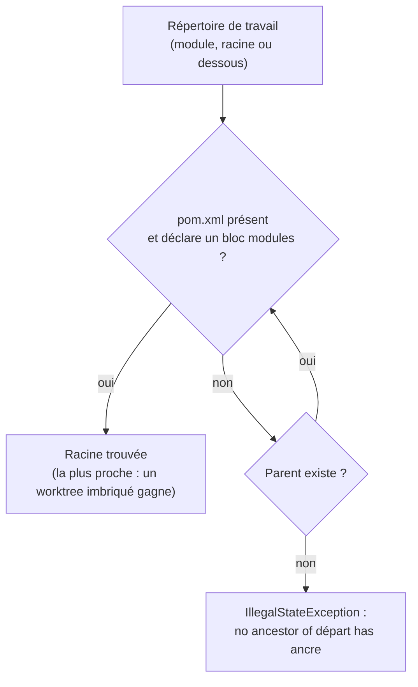
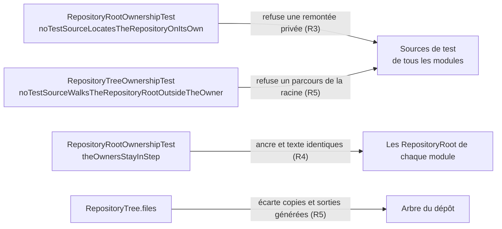

# Localisation de la racine du dépôt par les tests (`repository-root-location`)

Spec de référence : [`openspec/specs/repository-root-location/spec.md`](../../../openspec/specs/repository-root-location/spec.md)
· Relevé du 2026-11-04 sur `2913fc30`.

## Objet et périmètre

Un test qui lit des fichiers du dépôt doit savoir où est la racine. Chaque module de test a une seule classe qui la
trouve, `RepositoryRoot`, et les suites qui parcourent tout l'arbre passent par une seule classe, `RepositoryTree`, qui
écarte les copies du dépôt. Des localisateurs privés collés sous plusieurs noms et avec plusieurs ancres avaient fait
dériver les modules ; le gate refuse maintenant la copie.

- **Acteurs** : auteur d'un test ; exécution depuis Surefire (répertoire du module), l'IDE (racine ou en dessous) ou un
  worktree imbriqué dans un autre checkout.
- **Inclus** : le propriétaire de chaque module de test, son message d'échec, le refus d'un localisateur privé, la
  concordance des propriétaires entre modules, le parcours de tout le dépôt.
- **Exclus** : le contenu des fixtures M0 (seule leur résolution passe par le propriétaire).

## Exigences

| Alias | Exigence (titre exact) | En bref | Nature |
|---|---|---|---|
| R1 | A test module SHALL locate the repository root through one owner | une classe par module de test, une ancre documentée, trouvée depuis le module, la racine ou dessous | `[EXIGENCE]` |
| R2 | A failed location SHALL say where it started and what it looked for | échec non vérifié nommant le répertoire de départ et l'ancre | `[EXIGENCE]` |
| R3 | A private repository locator SHALL be refused | toute méthode qui remonte du répertoire de travail est refusée, nom quelconque, avec fichier et méthode | `[EXIGENCE]` |
| R4 | The owners of different modules SHALL stay in step | ancre et libellé d'échec identiques entre propriétaires | `[EXIGENCE]` |
| R5 | A walk of the whole repository SHALL go through one owner that skips copies of the repository | sorties générées, `.claude/worktrees` et tout répertoire portant son `.git` écartés ; liens non suivis ; reste de `.claude` lu | `[EXIGENCE]` |

## Comportement détaillé

- **Ancre** `[EXISTANT VÉRIFIÉ]` : la racine est l'ancêtre le plus proche du répertoire de travail dont le `pom.xml`
  contient `<modules>`, déclaré dans la constante `ANCHOR` (`a pom.xml that declares <modules>`) de
  [`RepositoryRoot`](../../../morpheus-architecture-tests/src/test/java/com/morpheus/architecture/RepositoryRoot.java).
  Un POM de module nomme le reactor comme parent mais ne déclare aucun module : il n'est jamais pris pour la racine.
  Un worktree imbriqué est trouvé avant le checkout qui le contient.
- **Échec** `[EXISTANT VÉRIFIÉ]` : `IllegalStateException` (non vérifiée) de message `no ancestor of <départ> has <ancre>` ;
  `locate()` ne déclare aucune clause `throws`. `fixture(name)` refuse une fixture absente par son chemin.
- **Propriétaires** `[EXISTANT VÉRIFIÉ]` : des copies volontaires, une par module de test (liste `OWNERS` de
  `RepositoryRootOwnershipTest`), non partagées par un module de plus ni par une arête de dépendance entre modules de
  test. `theOwnersStayInStep` compare l'ancre et tout le texte de la classe à partir de `CORE_START`.
- **Refus d'un localisateur privé** `[EXISTANT VÉRIFIÉ]` : le scan cherche une forme, pas un nom : une méthode dont le corps
  part du répertoire de travail et remonte par les parents. Les commentaires et le contenu des chaînes sont blanchis.
  Les climbs d'un autre usage sont listés par nom avec leur raison (`OTHER_PURPOSE_CLIMBS`, vide).
- **Parcours** `[EXISTANT VÉRIFIÉ]` : `RepositoryTree.files(root)` écarte `.git`, `target`, `dist`,
  `validation-output`, `node_modules`, `.idea`, `.claude/worktrees` et tout répertoire (hors racine) qui porte un `.git`,
  fichier ou répertoire ; le fichier `.git` de la racine n'est pas rendu ; le reste de `.claude` est lu.
  `RepositoryTreeOwnershipTest` refuse un parcours de la racine ailleurs que dans le propriétaire, en nommant source et
  ligne.

## Diagrammes

### Comment un test trouve-t-il la racine, et quand échoue-t-il ?

Existant vérifié (`RepositoryRoot.from`). Exigences R1 et R2.

### Qui garde quoi ?

Existant vérifié. Quel test empêche quelle dérive ? Exigences R3, R4 et R5.

## Écarts et questions ouvertes

- **Preuve manquante (R2)** : « no test method needs a checked exception clause because of the location » n'est
  vérifié par aucun test ; il résulte de la signature de `locate()` (aucun `throws`).
- **Preuve manquante (R5)** : « MUST NOT follow symbolic links » est écrit dans la Javadoc de `RepositoryTree` et tenu
  par l'absence d'option de suivi dans `Files.walkFileTree`, mais aucun test ne plante un lien symbolique.
- `[EXISTANT VÉRIFIÉ]` **Ancre lue en sous-chaîne** : `from` accepte tout ancêtre dont le `pom.xml` contient le texte
  `<modules>`, y compris dans un commentaire. Non écrit dans la spec.
- `[EXISTANT VÉRIFIÉ]` **R1, « every test class of that module »** : la règle réelle (`noTestSourceLocatesTheRepositoryOnItsOwn`)
  refuse une remontée privée ; elle ne prouve pas qu'une classe de test lit la racine par le propriétaire.
- `[EXISTANT VÉRIFIÉ]` **Modules couverts** : la liste `OWNERS` est écrite à la main ; un module de test supplémentaire
  qui lirait le dépôt n'y entre qu'en y étant ajouté. `theScanCoversEveryTestModuleAndReachesEachOwner` garde le scan, pas la liste.

## Traçabilité

Tests : [`RepositoryRootTest`](../../../morpheus-architecture-tests/src/test/java/com/morpheus/architecture/RepositoryRootTest.java),
[`RepositoryRootOwnershipTest`](../../../morpheus-architecture-tests/src/test/java/com/morpheus/architecture/RepositoryRootOwnershipTest.java),
[`RepositoryTreeOwnershipTest`](../../../morpheus-architecture-tests/src/test/java/com/morpheus/architecture/RepositoryTreeOwnershipTest.java).

| Exigence | Scénario | Conception ou diagramme | Changement | Preuve |
|---|---|---|---|---|
| R1 | A suite run from its module directory | premier organigramme | archive `2026-10-30-locate-the-repository-root-once-per-test-module` | `RepositoryRootTest#theRootIsFoundFromAModuleDirectory` |
| R1 | A suite run from the repository root | idem | idem | `RepositoryRootTest#theRootIsFoundFromItself` ; `#theRootIsFoundFromADirectoryNestedBelowAModule` |
| R1 | A nested checkout | idem | idem | `RepositoryRootTest#aWorktreeNestedInAnotherCheckoutIsItsOwnRoot` ; `#theRepositoryTheseTestsRunInIsTheNearestReactorAboveTheWorkingDirectory` |
| R2 | A test run outside the repository | idem | idem | `RepositoryRootTest#aDirectoryWithNoRepositoryAboveItIsRefusedNamingTheStartAndTheAnchor` ; la clause `throws` : **preuve manquante** |
| R3 | A new suite pastes the locator | second organigramme | idem | `RepositoryRootOwnershipTest#noTestSourceLocatesTheRepositoryOnItsOwn` ; `#everyNamedOtherPurposeClimbStillClimbs` |
| R3 | A renamed copy | idem | idem | `RepositoryRootOwnershipTest#theShapeIsFoundWhateverTheMethodIsCalled` ; `#neitherAStartWithoutAClimbNorAClimbInACommentOrAStringIsALocator` |
| R3 | A fixture locator | idem | idem | `RepositoryRootOwnershipTest#theShapeIsFoundWhateverTheMethodIsCalled` (cas du climb borné vers les fixtures) ; `RepositoryRootTest#aFixtureIsResolvedUnderTheRootAndAMissingOneIsRefusedByItsPath` pour la résolution |
| R4 | One owner is edited alone | idem | idem | `RepositoryRootOwnershipTest#theOwnersStayInStep` ; `#theScanCoversEveryTestModuleAndReachesEachOwner` |
| R5 | A workspace copy sits under the root | idem | archive `2026-11-04-record-the-sprint-15-medium-decisions` | `RepositoryTreeOwnershipTest#theWalkLeavesOutAWorkspaceCopyUnderClaudeWorktrees` |
| R5 | A nested checkout elsewhere in the tree | idem | idem | `RepositoryTreeOwnershipTest#theWalkLeavesOutANestedCheckoutWhereverItIsAndTheGeneratedTrees` ; `#aRootThatIsItselfAWorktreeIsWalked` |
| R5 | A test walks the root itself | idem | idem | `RepositoryTreeOwnershipTest#noTestSourceWalksTheRepositoryRootOutsideTheOwner` ; `#aWalkOfTheRootIsFoundWhateverItsShape` ; `#aWalkBelowTheRootOrOfAnotherTreeIsNotAWalkOfTheRoot` ; `#theScanSeesTheOwnerAndEveryTestModule`. Liens symboliques : **preuve manquante** |

## Sources

- Règle de dépôt : `.claude/rules/testing.md` (« Trouver la racine du dépôt… », « Parcourir tout l'arbre du dépôt… »).
- Classe du parcours : [`RepositoryTree`](../../../morpheus-architecture-tests/src/test/java/com/morpheus/architecture/RepositoryTree.java).
- Pages liées : [`reactor-module-documentation.md`](reactor-module-documentation.md), [`repository-credential-hygiene.md`](repository-credential-hygiene.md).
