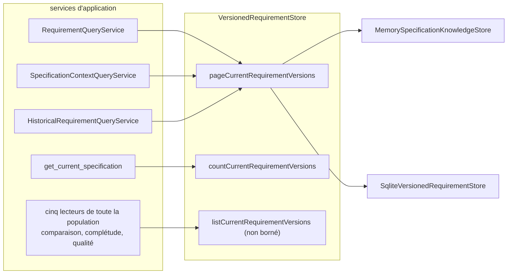
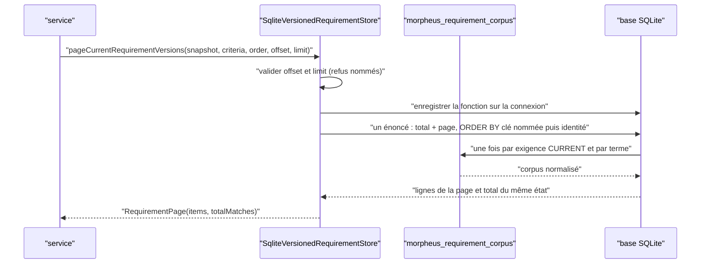

# Lecture paginée des exigences d'un snapshot (`requirement-page-reads`)

Spec de référence : [`openspec/specs/requirement-page-reads/spec.md`](../../../openspec/specs/requirement-page-reads/spec.md)
· Relevé du 2026-11-04 sur `2913fc30`.

## Objet et périmètre

Une page des exigences CURRENT d'un snapshot publié est découpée par le store, dans un ordre déclaré et total, avec son
total, et de façon identique sur les deux stores livrés.

- **Acteurs** : les trois services qui rendent une partie des exigences (`RequirementQueryService`,
  `SpecificationContextQueryService`, `HistoricalRequirementQueryService`) ; l'outil MCP `get_current_specification`
  (compte seulement) ; les stores mémoire et SQLite.
- **Inclus** : la lecture par page et son total, le tri, la parité, les lecteurs de toute la population nommés avec leur
  raison, le budget de performance de la recherche.
- **Exclus** : les lectures qui calculent sur toutes les exigences CURRENT (comparaison de snapshots, qualité), qui restent
  sur la lecture non bornée ; la forme publique des réponses (inchangée, voir R2).

## Exigences

| Alias | Exigence (titre exact) | En bref | Nature |
|---|---|---|---|
| R1 | A page of requirements SHALL be cut by the store port | le port offre page + total + compte ; les services et adaptateurs ne coupent pas | `[EXIGENCE]` |
| R2 | Moving the page SHALL NOT change what a paged read returns | mêmes éléments, ordre, total et `hasMore` qu'avant ; casse pliée comme l'application ; joker SQL littéral ; tous les termes requis | `[EXIGENCE]` |
| R3 | The order of a requirement page SHALL be declared and total | ordre nommé par l'appelant, départagé par une seconde clé unique | `[EXIGENCE]` |
| R4 | Every shipped store SHALL answer a requirement page identically | chaque store implémente sa lecture ; parité ; repli par défaut refusé | `[EXIGENCE]` |
| R5 | A page and its total SHALL describe the same state | éléments et total d'un même état ; refus nommé d'un snapshot non publié | `[EXIGENCE]` |
| R6 | A reader of every CURRENT requirement SHALL be named with its reason | liste exacte des lecteurs de toute la population | `[EXIGENCE]` |
| R7 | The cost of a deep page SHALL be held by a performance budget that runs | première page, dernière page, requête sans résultat, budget non relevé | `[EXIGENCE]` |

## Comportement détaillé

`[EXISTANT VÉRIFIÉ]` Le port est `VersionedRequirementStore`
([source](../../../morpheus-application/src/main/java/com/morpheus/application/store/VersionedRequirementStore.java)) :

| Opération | Rôle |
|---|---|
| `pageCurrentRequirementVersions(snapshotId, criteria, order, offset, limit)` | page + total du même état (`RequirementPage`) ; défaut qui répond depuis la population entière, pour les autres implémentations |
| `countCurrentRequirementVersions(snapshotId)` | nombre, sans remettre les exigences |
| `listCurrentRequirementVersions(snapshotId)` | lecture non bornée, réservée aux lecteurs nommés |
| `requireValidPage(offset, limit)` | refus nommés : « requirement page offset must be greater than or equal to zero », « requirement page limit must be positive » |

- **Critères** (`RequirementPageCriteria`) : `all()`, `lexical(terms)`, ou les exigences d'une spécification. Le corpus d'une
  exigence est sa clé, son titre et son énoncé, joints par une espace et normalisés par `normalize` ; un terme est un mot
  normalisé sans espace, cherché comme sous-chaîne ; tous les termes doivent être trouvés.
- **Ordre** (`RequirementPageOrder`) : `REQUIREMENT_ID` ou `ENTITY_IDENTITY`, chacun départagé par l'identité de la version
  d'entité. Les identités se comparent sur leurs moitiés signées, comme `UUID.compareTo` ; l'ordre textuel de la forme
  canonique diffère de celui du domaine dès qu'un premier chiffre vaut 8 ou plus.
- **Store SQLite** : un seul énoncé lit le total et la page (jointure à gauche pour garder le total d'une page vide) ; la
  correspondance appelle la fonction `morpheus_requirement_corpus` enregistrée sur la connexion avant chaque lecture de page,
  qui rappelle `RequirementPageCriteria.corpus`. Aucune colonne, aucun index, aucune migration n'a été ajoutée par ce
  changement (archive citée en Sources).
- **Appelants** : `RequirementQueryService` (ordre `REQUIREMENT_ID`, critères lexicaux), `SpecificationContextQueryService`
  (exigences d'une spécification), `HistoricalRequirementQueryService.requirements` (ordre `ENTITY_IDENTITY`, `all()`), que
  `MorpheusHistoryApiService.historicalRequirements` passe tel quel sans le trancher, et `MorpheusSpecificationMcpTools`
  (`get_current_specification`, qui lit `countCurrentRequirementVersions`).
- **Refus d'un snapshot** : `RequirementQueryService` refuse un snapshot ni `ACTIVE` ni `RETIRED` par
  « requirement query requires an ACTIVE or RETIRED snapshot: <id> is <état> ».
- **Budget** : `QUERY_BUDGET_NANOS` dans `M19QueryPerformanceGate`, jauge `requirement_query_p95_ms`,
  `requirement_query_last_page_p95_ms` et `requirement_query_no_match_p95_ms` ; la valeur est celle de cette constante
  (voir aussi [`M19_PERFORMANCE_BUDGETS.md`](../../project/roadmap/M19_PERFORMANCE_BUDGETS.md)).

## Diagrammes

### Qui coupe la page, et où la population entière est-elle encore lue ?

Existant, vérifié par les appels de `VersionedRequirementStore`. Exigences R1, R4, R6.

### Que fait un appel de page sur le store SQLite ?

Existant. Exigences R2, R3, R5.

## Écarts et questions ouvertes

- `[EXISTANT VÉRIFIÉ]` La spec (R6, scénario « The paged services are not in the list ») nomme « the MCP tool service ».
  Cette classe n'existe plus : l'appelant est `MorpheusSpecificationMcpTools`, qui compte et n'est pas dans la liste. Écart
  de vocabulaire de la spec, sans effet sur le code.
- `[EXISTANT VÉRIFIÉ]` Aucun test ne vérifie directement que les trois services ne figurent pas dans la liste ; la garantie
  est indirecte : `WHOLE_CURRENT_READERS` ne contient que cinq autres classes et toute autre classe qui appelle la lecture
  non bornée échoue.
- `[EXISTANT VÉRIFIÉ]` La correspondance lexicale parcourt toutes les lignes CURRENT (fonction appelée une fois par ligne et par
  terme) : le coût d'une page profonde est borné en lignes retournées, pas en lignes examinées. La requête vide est
  répondue en SQL sans fonction.
- Preuve manquante : le scénario R7 « The budget is not weakened » (budget égal ou inférieur à l'état précédent) n'a pas de
  test ; il relève de la revue.
- Preuve manquante : le scénario R1 « A search page is not built from the whole snapshot » (au plus `limit` exigences remises
  à l'application) n'a pas de test qui compte les lignes remises par le store ; le test de parité compare des pages mais pas
  le nombre de lignes lues.
- Le gate de performance n'est pas exécuté par `clean verify` : sa classe ne correspond à aucun motif Surefire (voie nocturne
  décrite dans `.claude/rules/testing.md`). Il mesure sur le store SQLite.

## Traçabilité

Archive : `2026-10-30-page-requirement-reads-in-the-store`. Tests d'architecture sous
`morpheus-architecture-tests/src/test/java/com/morpheus/architecture/`.

| Exigence | Scénario | Conception ou diagramme | Changement | Preuve |
|---|---|---|---|---|
| R1 | A search page is not built from the whole snapshot | schéma 1 | tâches 3.1 à 3.4 | `RequirementPageReadsCharacterisationTest#theSearchPagesPartitionTheMatchesInRequirementIdentityOrder` (pages) ; **preuve manquante** sur le nombre de lignes remises |
| R1 | The requirements of one published version are paged by the application | schéma 1 | tâche 3.4 | [`RequirementPageReadsCharacterisationTest`](../../../morpheus-architecture-tests/src/test/java/com/morpheus/architecture/RequirementPageReadsCharacterisationTest.java)`#theRequirementsOfOnePublishedVersionArePagedInEntityIdentityOrder` ; [`MorpheusHistoryApiServiceContractTest`](../../../morpheus-api/src/test/java/com/morpheus/api/MorpheusHistoryApiServiceContractTest.java)`#preservesPublishedLineagePaginationComparisonAndProjectIsolation` |
| R1 | A count is asked as a count | schéma 1 | tâche 3.4 | [`CatalogueToolsAnswerTest`](../../../morpheus-mcp/src/test/java/com/morpheus/mcp/CatalogueToolsAnswerTest.java)`#aBoundedSliceOfSpecificationsIsReturnedForAnOffsetAndALimit` (valeur de `requirementCount`) ; [`RequirementPagePortTest`](../../../morpheus-application/src/test/java/com/morpheus/application/store/RequirementPagePortTest.java)`#theDefaultPageKeepsTheCurrentVersionsOfTheSnapshotThatMatchInTheDeclaredOrder` |
| R2 | An accented upper-case term | schéma 2 | tâche 3.7 (a) | `RequirementPageReadsCharacterisationTest#theLexicalSearchFoldsEveryLetterTheApplicationFoldsAndOnlyThose` ; [`SqliteRequirementPageTest`](../../../morpheus-store-sqlite/src/test/java/com/morpheus/store/sqlite/adapter/SqliteRequirementPageTest.java)`#theCorpusFunctionComputesTheApplicationsCorpus` |
| R2 | A percent sign is a percent sign | schéma 2 | — | `RequirementPageReadsCharacterisationTest#aSqlWildcardOrABackslashMatchesOnlyItself` |
| R2 | An offset beyond the total | schéma 2 | — | `RequirementPageReadsCharacterisationTest#theRequirementsOfOnePublishedVersionArePagedInEntityIdentityOrder` (offset 9 sur 9) et `#theRequirementsOfOneSpecificationArePagedWithTheChangesThatAffectAnyOfThem` (offset 5 sur 5) |
| R2 | (exigence : « every term MUST be found ») | — | — | `RequirementPageReadsCharacterisationTest#everyTermMustBeFoundAndATermNeverSpansTwoFields` |
| R2 | The public contract is untouched | — | tâche 4.2 | [`PublicHttpRouteConvergenceTest`](../../../morpheus-architecture-tests/src/test/java/com/morpheus/api/PublicHttpRouteConvergenceTest.java), [`PublicSurfaceManifestCoversEveryServedToolTest`](../../../morpheus-architecture-tests/src/test/java/com/morpheus/mcp/PublicSurfaceManifestCoversEveryServedToolTest.java) (aucun diff du manifeste ni de l'OpenAPI) |
| R3 | The pages of a read partition its matches | schéma 2 | tâche 2.3 | [`RequirementPagePersistenceParityTest`](../../../morpheus-architecture-tests/src/test/java/com/morpheus/architecture/RequirementPagePersistenceParityTest.java)`#everyPageOfEveryReadIsTheSameOnBothStores` ; `RequirementPagePortTest#eachOrderComparesIdentitiesOnTheirSignedHalvesLikeTheDomain` |
| R3 | The store's order is the application's order | schéma 2 | tâche 3.3 | `RequirementPagePersistenceParityTest#theFixtureHoldsWhatTellsTheOrdersApart` ; `SqliteRequirementPageTest#theStoreMatchesWithTheApplicationsFoldingAndOrdersIdentitiesLikeTheDomain` |
| R4 | Parity over the difficult fixture | schéma 2 | tâche 2.3 | `RequirementPagePersistenceParityTest#everyPageOfEveryReadIsTheSameOnBothStores` ; [`MemoryRequirementPageTest`](../../../morpheus-store-memory/src/test/java/com/morpheus/store/memory/MemoryRequirementPageTest.java)`#theStorePagesTheCurrentVersionsThatMatchInTheDeclaredOrder` |
| R4 | A shipped store without its own paged read is refused | schéma 1 | tâche 3.5 | [`ShippedRequirementStoresPageThemselvesArchitectureTest`](../../../morpheus-architecture-tests/src/test/java/com/morpheus/architecture/ShippedRequirementStoresPageThemselvesArchitectureTest.java)`#everyShippedRequirementStoreDeclaresThePageAndTheCountItself`, `#theListOfShippedStoresIsEveryProductionImplementationOfThePort` |
| R5 | The total agrees with the pages | schéma 2 | tâche 3.3 | `RequirementPagePersistenceParityTest` (total constant sur toutes les pages, concaténation = ensemble) ; `RequirementPagePortTest#aPageCountsAtLeastItsItemsAndSaysWhetherMoreFollow` |
| R5 | A snapshot that is not published | — | — | `RequirementPageReadsCharacterisationTest#theSearchOfASnapshotThatIsNotPublishedKeepsItsNamedRefusal` |
| R6 | A new unbounded reader is refused | schéma 1 | tâche 2.2 | [`CurrentRequirementReaderArchitectureTest`](../../../morpheus-architecture-tests/src/test/java/com/morpheus/architecture/CurrentRequirementReaderArchitectureTest.java)`#onlyTheNamedReadersLoadEveryCurrentRequirementOfASnapshot`, `#everyNamedWholeCurrentReaderStillReadsTheWholePopulation` |
| R6 | The paged services are not in the list | schéma 1 | tâche 2.2 | même classe, indirectement (voir Écarts) |
| R7 | The last page is measured | — | tâche 3.6 | [`M19QueryPerformanceGate`](../../../morpheus-architecture-tests/src/test/java/com/morpheus/architecture/m19/M19QueryPerformanceGate.java)`#tenThousandRequirementSqliteQueryStaysWithinFrozenBudgetAndOrderingIsStable` (voie nocturne) |
| R7 | The budget is not weakened | — | tâche 3.6 | **Preuve manquante** (revue) |

Compléments non rattachés à un scénario : `SqliteQueryPlanGuardTest#everyGuardedStatementIsServedByAnIndexOnAMigratedDatabase`
([source](../../../morpheus-store-sqlite/src/test/java/com/morpheus/store/sqlite/adapter/SqliteQueryPlanGuardTest.java)) garde
les énoncés de page ; `SqliteRequirementPageTest#theRowsADatabaseHeldBeforeTheOrderKeysAreReadInThePageOrderOnceMigrated`.

## Sources

- ADR : [ARCH-0137](../../architecture/adr/ARCH-0137-lectures-et-recherche-sur-le-snapshot-publie.md) (où la page est coupée, comment SQLite évalue la correspondance).
- Archive OpenSpec : `2026-10-30-page-requirement-reads-in-the-store`.
- Budgets : [`M19_PERFORMANCE_BUDGETS.md`](../../project/roadmap/M19_PERFORMANCE_BUDGETS.md).
- Vocabulaire de page des transports : [`append-only-journal-reads.md`](append-only-journal-reads.md).
