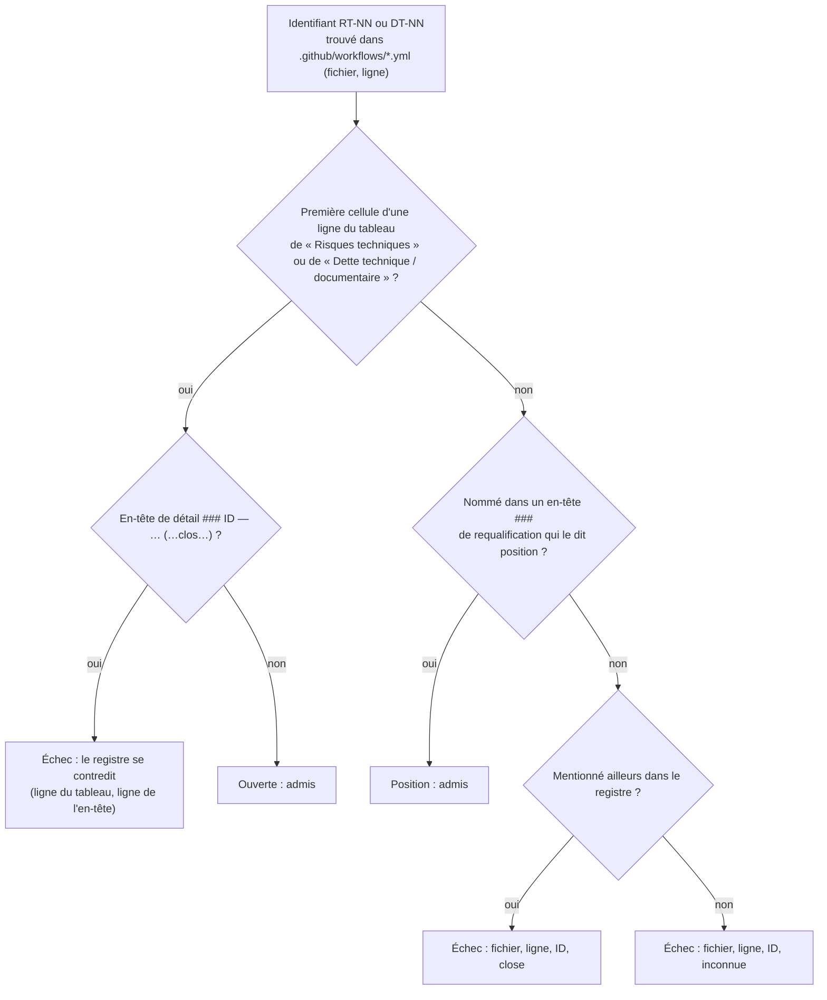

# Renvois des workflows vers le registre des risques (`risk-register-references`)

Spec de référence : `openspec/specs/risk-register-references/spec.md` · Relevé du 2026-11-06 sur `8c038add`.

## Objet et périmètre

Quand un gate échoue en CI, son message renvoie le mainteneur vers une entrée du
[registre des risques](../../architecture/risks/register.md) qui explique l'échec. Ce renvoi doit désigner une entrée
qui n'est pas close : un échec de gate ne doit jamais envoyer son lecteur lire qu'un problème encore actif est réglé.
La dérive s'est produite une fois (constat `AUD-DEP-26` de l'audit du 2026-10-09 : `security.yml` renvoyait à
`RT-13`, que le registre datait « clos » alors que le risque bloquait encore les PR).

- **Acteurs** : mainteneur qui lit un échec de gate ; auteur d'une PR qui clôt une entrée du registre ou modifie un
  workflow ; suite d'architecture.
- **Inclus** : les identifiants `RT-NN` et `DT-NN` des fichiers `.github/workflows/*.yml`, commentaires et noms d'étape
  compris ; l'état de ces entrées dans `docs/architecture/risks/register.md`.
- **Exclus** : les autres préfixes du registre (`A-NN`, `F-NN`) ; les renvois écrits ailleurs (`config/`, `scripts/`,
  `docs/`) ; la rédaction du registre hors de sa structure d'état.

## Exigences

| Alias | Exigence (titre exact) | En bref | Nature |
|---|---|---|---|
| R1 | Un workflow ne renvoie qu'à une entrée du registre qui n'est pas close | identifiant clos ou inconnu refusé, avec fichier, ligne, identifiant et état | `[EXIGENCE]` |
| R2 | Une entrée au tableau actif ou requalifiée en position n'est pas close | l'état se lit à la place de l'entrée dans le registre | `[EXIGENCE]` |
| R3 | Le registre ne dit pas close une entrée qu'il garde au tableau actif | ligne au tableau et en-tête « clos » : refus du registre | `[EXIGENCE]` |
| R4 | La règle des renvois ne passe pas à vide | aucune ligne de tableau actif, ou aucun identifiant lu : échec | `[EXIGENCE]` |

## Comportement détaillé

`[EXISTANT VÉRIFIÉ]` ([`RiskRegisterReferencesTest`](../../../morpheus-architecture-tests/src/test/java/com/morpheus/architecture/RiskRegisterReferencesTest.java), classe de cohérence).

- **Lecture des workflows** : `Files.list` du seul répertoire `.github/workflows`, fichiers `.yml` triés par nom ; tout
  jeton `\b(RT|DT)-[0-9]+\b` de chaque ligne est un renvoi. Un chemin vers le registre sans identifiant n'est pas jugé.
- **État d'une entrée (R2)** :
  - *ouverte* : l'identifiant est la première cellule d'une ligne du **premier** tableau de la section `## Risques
    techniques` ou `## Dette technique / documentaire` ; un second tableau de la section, ou un tableau d'une autre
    section, ne compte pas ;
  - *position* : l'identifiant figure entre accents graves dans un en-tête `###` qui contient « position » ;
  - *close* : toute autre mention dans le registre ;
  - *inconnue* : aucune mention.
- **Registre contradictoire (R3)** : une entrée ouverte dont l'en-tête de détail `### <identifiant> … (…)` porte « clos »,
  « close » ou « closes » dans sa parenthèse finale est refusée en nommant les deux lignes ; tout renvoi vers elle est
  refusé aussi, sous l'état « contredite ».
- **Non-vacuité (R4)** : chacune des deux sections doit fournir au moins une ligne de tableau actif, et les workflows au
  moins un identifiant. Aucun compte attendu n'est écrit.
- **Messages** : `<fichier>:<ligne> points at <ID>, which is closed in docs/architecture/risks/register.md`, `… which is
  unknown to …`, `… which the register both keeps active and calls closed` ; tous les problèmes sont rendus ensemble.

## Diagrammes

### Quel état la règle attribue-t-elle à un identifiant cité, et quand échoue-t-elle ?

Existant vérifié. Exigences R1, R2, R3 ; R4 est vérifiée avant ce classement.

## Écarts et questions ouvertes

- `[QUESTION]` **Renvois hors des workflows** : les notes de `config/dependency-check-suppressions.xml` et
  `config/dependency-check-hints.xml` citent aussi le registre. Étendre la règle à `config/` et `scripts/` ne changerait
  que la liste de fichiers lus par la fonction `problems` ; décision du mainteneur.
- `[EXISTANT VÉRIFIÉ]` **Clôture écrite ailleurs** : le mot « clos » n'est lu que dans la parenthèse finale d'un en-tête
  de détail ; une clôture écrite dans la prose d'une entrée gardée au tableau reste à la revue.
- `[EXISTANT VÉRIFIÉ]` **Date d'en-tête du registre** : la ligne « Mise à jour » du registre est antérieure à des entrées
  datées plus tard ; hors périmètre, non traité.

## Traçabilité

| Exigence | Scénario | Conception ou diagramme | Changement ou tâche | Preuve |
|---|---|---|---|---|
| R1 | Les renvois actuels sont admis | organigramme | `refuse-a-workflow-that-points-at-a-closed-risk`, 1.1 | `RiskRegisterReferencesTest#theWorkflowsOfTheRepositoryPointOnlyAtEntriesThatAreNotClosed` |
| R1 | Une entrée close et toujours citée | organigramme, branche « close » | idem, 1.2 et 1.3 | `RiskRegisterReferencesTest#anEntryClosedAndStillCitedIsRefusedWithItsFileLineAndState` ; rupture jouée sur le vrai registre (tâche 1.3) |
| R1 | Un identifiant inconnu | organigramme, branche « inconnue » | idem, 1.2 | `RiskRegisterReferencesTest#anUnknownIdentifierIsRefusedAsUnknown` |
| R1 | Un renvoi au registre sans identifiant | — | idem, 1.2 | `RiskRegisterReferencesTest#aPathToTheRegisterWithoutAnIdentifierIsNotJudged` |
| R2 | Un risque accepté sans correctif n'est pas clos | organigramme, branche « ouverte » | idem, 1.2 | `RiskRegisterReferencesTest#aRiskAcceptedWithoutAFixIsOpenAndCitable` |
| R2 | Une position est citable | organigramme, branche « position » | idem, 1.2 | `RiskRegisterReferencesTest#aPositionNamedByARequalificationHeadingIsCitable` |
| R2 | Une dette retirée du tableau est close | organigramme, branche « close » | idem, 1.2 | `RiskRegisterReferencesTest#aDebtRemovedFromTheTableIsClosed`, `#aRowOutsideTheFirstTableOfAnActiveSectionIsNotActive` |
| R3 | Une clôture écrite à moitié | organigramme, branche « se contredit » | idem, 1.2 et 1.3 | `RiskRegisterReferencesTest#aClosureWrittenHalfwayIsRefusedAsARegisterThatContradictsItself` ; rupture jouée sur le vrai registre (tâche 1.3) |
| R4 | Un registre réorganisé | — | idem, 1.2 | `RiskRegisterReferencesTest#aRenamedSectionReadsNoActiveRowAndFails`, `#workflowsWithoutAnyIdentifierFail` |

## Sources

- Registre : [`docs/architecture/risks/register.md`](../../architecture/risks/register.md), dont l'en-tête dit comment
  l'état d'une entrée se lit.
- Règle de dépôt : `.claude/rules/architecture.md` (une cible `.yml` ou `.md` s'enforce par le texte).
- Audit : constat `AUD-DEP-26`, [`docs/project/audits/2026-10-09/findings.md`](../../project/audits/2026-10-09/findings.md).
