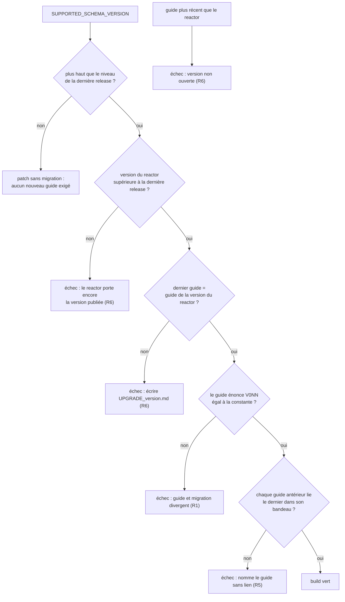

# Guide de mise à niveau et schéma SQLite (`schema-upgrade-guidance`)

Spec de référence : [`openspec/specs/schema-upgrade-guidance/spec.md`](../../../openspec/specs/schema-upgrade-guidance/spec.md)
· Relevé du 2026-11-04 sur `2913fc30`.

## Objet et périmètre

Quand une version de MORPHEUS fait avancer le schéma SQLite, l'opérateur lit un guide `docs/user/UPGRADE_*.md`. Cette
capacité dit ce que ce guide affirme (schéma atteint, sauvegarde obligatoire, retour arrière, refus d'un programme plus
ancien) et comment chaque affirmation est tenue égale au code par un test.

- **Acteurs** : l'opérateur qui met à niveau ; le mainteneur qui ajoute une migration ou ouvre une version.
- **Inclus** : le dernier guide, les guides antérieurs (bandeau), le guide qui quitte 1.2.0, le lien entre version du
  reactor, niveau de schéma de la dernière release et guide le plus récent.
- **Exclus** : la migration elle-même et sa preuve (capacités `sqlite-schema-history` et `released-schema-upgrade`),
  la commande `server backup` (code du store SQLite).

## Exigences

| Alias | Exigence (titre exact) | En bref | Nature |
|---|---|---|---|
| R1 | The latest upgrade guide SHALL state the schema version the code supports | le dernier guide énonce `V0NN` égal à `SUPPORTED_SCHEMA_VERSION` | `[EXIGENCE]` |
| R2 | The latest upgrade guide SHALL make the pre-upgrade backup mandatory and say which program takes it | sauvegarde avant l'installation, prise avec la version déjà installée | `[EXIGENCE]` |
| R3 | The latest upgrade guide SHALL describe the way back and quote the refusal an older program gives | restauration hors ligne, citation exacte du refus | `[EXIGENCE]` |
| R4 | The guide that leaves 1.2.0 SHALL say that 1.2.0 does not refuse a migrated database | `UPGRADE_1_2_1.md` interdit de démarrer 1.2.0 sur une base migrée | `[EXIGENCE]` |
| R5 | An earlier upgrade guide SHALL name the release it describes and point to the latest guide | bandeau d'ouverture avec lien vers le dernier guide | `[EXIGENCE]` |
| R6 | The reactor version SHALL follow the schema past the last release | pas de migration sans version ouverte ; pas de guide en avance sur le reactor | `[EXIGENCE]` |

## Comportement détaillé

`[EXISTANT VÉRIFIÉ]` Source des valeurs : le niveau de schéma est la constante
`SqliteSchemaManager.SUPPORTED_SCHEMA_VERSION`
([source](../../../morpheus-store-sqlite/src/main/java/com/morpheus/store/sqlite/runtime/SqliteSchemaManager.java)) ;
la version du reactor est la balise `<version>` du `pom.xml` racine ; les niveaux livrés par les versions publiées sont
dans [`released-schema-levels.properties`](../../../morpheus-store-sqlite/src/test/resources/released-schema-levels.properties).
Aucune de ces valeurs n'est recopiée ici.

| Contrôle | Ce que le test lit | Message d'échec |
|---|---|---|
| Schéma atteint (R1) | le plus haut `V0NN` (trois chiffres) de tout le contenu du dernier guide, comparé à la constante | nomme le guide, le plus haut `V0NN` trouvé et la constante |
| Sauvegarde (R2) | section `## Sauvegarde obligatoire` avant `## Installation`, contenant `server backup create`, `server backup verify`, « avec la version déjà installée », « au schéma du programme qui l'exécute » ; aucun motif `sauvegarde[^.\n]*souhait` dans le guide | nomme le guide et la phrase attendue |
| Retour (R3) | la source du store contient `is newer than supported`, le guide la cite, la section `## Retour` nomme `server restore` et `--confirm` | idem |
| 1.2.0 (R4) | `UPGRADE_1_2_1.md`, lu par son nom : « 1.2.0 ne refuse pas une base migrée », « Ne jamais démarrer 1.2.0 sur une base que 1.2.1 a ouverte », `backup schema version` | idem |
| Bandeau (R5) | les 12 premières lignes de chaque guide autre que le dernier contiennent `](<dernier guide>)` | nomme le guide sans lien |
| Version (R6) | compare version du reactor, dernier guide, constante de schéma et plus haut niveau déclaré publié | « still carries », « has not opened », « write UPGRADE_… » |

`[EXISTANT VÉRIFIÉ]` Le refus d'une base plus récente que le programme est produit par `SqliteSchemaManager.rejectFutureSchema`
(`SQLite schema version <N> is newer than supported <M>`), et celui d'une sauvegarde plus récente par
`SqliteServerMaintenance` (`backup schema version <N> is newer than supported <M>`).

`[EXISTANT VÉRIFIÉ]` Le « dernier guide » est celui dont la version, comparée numériquement composante par composante
(`1.10` après `1.9`), est la plus haute parmi les noms `UPGRADE_*.md` de `docs/user/`.

## Diagrammes

### Quand le build refuse-t-il la documentation de mise à niveau ?

Existant : les décisions de `UpgradeGuideCoherenceTest#versionProblems` et des contrôles de contenu. Organigramme, pas UML.
Exigences R1, R5, R6.

## Écarts et questions ouvertes

- `[EXISTANT VÉRIFIÉ]` Le scénario « The rule holds no copy of the value » dit que la source du test ne contient aucun
  littéral entier égal à la version de schéma. `UpgradeGuideCoherenceTest` contient les littéraux `24` et `20` (et `15`)
  dans `aReactorThatKeepsTheLastReleasedVersionAfterAMigrationIsRefused` et
  `aMigrationSinceTheLastReleaseRequiresTheGuideOfTheReactorVersion` : ce sont des valeurs synthétiques d'une règle pure,
  mais `24` est égal à la constante aujourd'hui. Aucun test ne contrôle l'absence de littéral dans cette classe
  (`SqliteStoreTestsDeriveTheSchemaVersionTest` ne vise que les tests du store SQLite). Écart entre scénario et source.
- `[EXISTANT VÉRIFIÉ]` Le scénario R1 « finds `V0N` stated as the schema reached » est contrôlé comme « le plus haut
  `V0NN` présent n'importe où dans le guide » : une mention d'un niveau plus haut ailleurs dans le guide fausserait le contrôle.
- Preuve manquante : la phrase de `UPGRADE_1_2.md` qui borne « schéma inchangé » à 1.2.0 (scénario R5) n'est lue par aucun
  test ; seul le lien du bandeau l'est.
- Preuve manquante : la sortie `backup schema version <N> is newer than supported 15` attribuée au programme 1.2.0 publié
  (scénario R4) ne peut pas être produite par ce dépôt ; le test ne vérifie que la présence de `backup schema version`.
- `[EXISTANT VÉRIFIÉ]` Dans `UPGRADE_1_2_2.md`, l'exemple de refus de 1.2.1 montre `SQLite schema version 23 …` alors
  que le même guide place la base migrée en V024 : l'exemple n'est pas la valeur que 1.2.1 afficherait. Aucun test ne
  compare l'exemple.
- Les « Scenario » de R2 (« contains no wording that makes the backup conditional ») sont tenus par un seul motif
  (`sauvegarde[^.\n]*souhait`) : une autre formulation de conditionnalité passerait.

## Traçabilité

Tests dans [`UpgradeGuideCoherenceTest`](../../../morpheus-architecture-tests/src/test/java/com/morpheus/architecture/UpgradeGuideCoherenceTest.java)
sauf mention contraire.

| Exigence | Scénario | Conception ou diagramme | Changement | Preuve |
|---|---|---|---|---|
| R1 | The guide of the version being released names the schema reached | organigramme | archive `2026-10-16-state-the-schema-upgrade-and-its-way-back` | `#theLatestUpgradeGuideStatesTheSchemaVersionTheCodeSupports` |
| R1 | A migration added without touching the guide fails the build | idem | idem | même test (message nommant guide, version énoncée, constante) |
| R1 | A patch release without a migration needs no new guide | idem | idem | `#aMigrationSinceTheLastReleaseRequiresTheGuideOfTheReactorVersion` (second `assertEquals`, niveau sans migration) |
| R1 | The rule holds no copy of the value | — | idem | **Preuve manquante** ; contredit par les littéraux de la classe (voir Écarts) |
| R2 | The backup step comes first and is not optional | — | idem | `#theLatestUpgradeGuideMakesTheBackupMandatoryBeforeInstallingAndSaysWhichProgramTakesIt` |
| R2 | The guide warns against a backup taken by the new version | — | idem | même test (« au schéma du programme qui l'exécute ») |
| R3 | The quoted refusal is the one in the code | — | idem | `#theLatestUpgradeGuideDescribesTheWayBackAndQuotesTheRefusalTheCodeGives` |
| R3 | A reworded refusal fails the build | — | idem | même test (message nommant la phrase) |
| R3 | The way back names the offline restore | — | idem | même test : `server restore` et `--confirm` ; **l'ordre des quatre étapes et la perte du travail postérieur ne sont pas lus** |
| R4 | The guide does not promise a refusal that 1.2.0 never gives | — | idem | `#theGuideThatLeavesOneDotTwoDotZeroSaysThatReleaseDoesNotRefuseAMigratedDatabase` (la valeur `15` n'est pas lue) |
| R4 | The statement stays on that guide when a later guide exists | — | idem | même test (lecture par nom de fichier) |
| R5 | A statement true of an earlier release no longer reads as current | — | idem | `#anEarlierUpgradeGuideNamesItsReleaseAndPointsToTheLatestGuide` (lien seulement) |
| R5 | A new guide demotes the previous one | — | idem | même test ; `#guideVersionsAreOrderedNumericallyNotAlphabetically` pour l'ordre |
| R6 | A migration is added without opening a version | organigramme | archive `2026-11-04-record-the-sprint-15-medium-decisions` | `#aReactorThatKeepsTheLastReleasedVersionAfterAMigrationIsRefused` ; `#theReactorVersionIsTheVersionOfTheLatestGuideOnceTheSchemaMovedPastTheLastRelease` sur le dépôt réel |
| R6 | A guide is written ahead of the reactor | organigramme | idem | `#aReactorThatKeepsTheLastReleasedVersionAfterAMigrationIsRefused` (message « has not opened ») |

## Sources

- Guides : `docs/user/UPGRADE_1_1.md`, `UPGRADE_1_2.md`, `UPGRADE_1_2_1.md`, `UPGRADE_1_2_2.md`.
- Test complémentaire : [`ReleasedSchemaLevelsDeclarationTest`](../../../morpheus-architecture-tests/src/test/java/com/morpheus/architecture/ReleasedSchemaLevelsDeclarationTest.java).
- Archives OpenSpec : `2026-10-16-state-the-schema-upgrade-and-its-way-back`, `2026-10-16-back-up-before-a-schema-migration`,
  `2026-11-04-record-the-sprint-15-medium-decisions`.
- Page développeur : [`../PRODUCT_VERSION.md`](../PRODUCT_VERSION.md).
