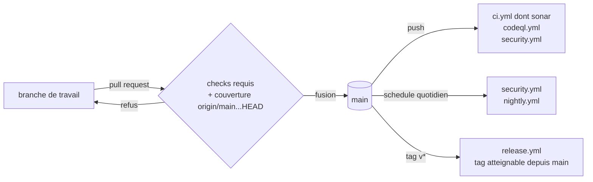

# Une seule branche longue (`single-integration-branch`)

Spec de référence : `openspec/specs/single-integration-branch/spec.md`, créée à l'archivage du changement
`retirer-la-branche-develop`. D'ici là, les exigences se lisent dans ce changement, sous `openspec/changes/`.

## Objet et périmètre

`main` est la seule branche longue du dépôt. Toute pull request la vise, chaque fusion y reçoit la CI complète et une
analyse statique, et une release est un tag `v*` posé sur un commit atteignable depuis `main`.

- **Acteurs** : le mainteneur, qui ouvre et fusionne les pull requests et règle le ruleset GitHub ; GitHub Actions
  (`ci.yml`, `codeql.yml`, `security.yml`, `nightly.yml`, `release.yml`) ; Dependabot ; les validateurs
  `scripts/validate-*` ; Archgate.
- **Inclus** : la configuration versionnée qui nomme une branche (filtres des workflows, base de la garde de
  couverture des lignes modifiées, branche cible de Dependabot, base par défaut des validateurs, `baseBranch`
  d'Archgate) ; l'analyse SonarQube Cloud de chaque fusion.
- **Exclus** : le ruleset lui-même, qui vit hors du dépôt et se vérifie par `gh api` ; une branche de maintenance
  d'une version publiée, que `release.yml` refuse aujourd'hui (tag non atteignable depuis `main`) ; les relevés
  datés, qui citent les branches de leur date.

## Exigences

| Alias | Exigence (titre exact) | En bref | Nature |
|---|---|---|---|
| R1 | Aucune configuration versionnée ne DOIT nommer une branche d'intégration autre que main | workflows, Dependabot, validateurs et Archgate ne nomment pas `develop` ; un test nomme chaque fichier fautif | `[EXIGENCE]` |
| R2 | Toute pull request DOIT être comparée à main pour la couverture des lignes modifiées | `origin/main...HEAD`, minima inchangés ; une autre base est refusée par son nom | `[EXIGENCE]` |
| R3 | Chaque fusion dans main DOIT recevoir une analyse statique | le job `sonar` de `ci.yml` analyse chaque push sur `main` ; aucun autre workflow ne porte `SONAR_TOKEN` | `[EXIGENCE]` |
| R4 | Dependabot DOIT viser la branche par défaut | aucune clé `target-branch` | `[EXIGENCE]` |
| R5 | La base de comparaison par défaut d'un validateur DOIT être main | `origin/main`, repli `main`, échec qui nomme les deux | `[EXIGENCE]` |

## Comportement détaillé

- **Pull request.** `ci.yml`, `codeql.yml` et `security.yml` s'exécutent sur toute pull request vers `main`. La voie
  Linux de `ci.yml` passe `git diff origin/main...HEAD` à `scripts/check-diff-coverage.py`. Une base autre que `main`
  arrête l'étape sur `Unsupported pull-request base branch` (code 2).
- **Fusion.** Le push sur `main` relance `ci.yml` (dont le job `sonar`), `codeql.yml` et `security.yml`. Ce dernier
  rafraîchit la base Dependency-Check et publie le cache que les pull requests suivantes restaurent.
- **Planification.** `security.yml` et `nightly.yml` tournent chaque jour sur la tête de `main`, la branche par
  défaut. Un `workflow_dispatch` de `nightly.yml` sur une autre branche analyse cette branche.
- **Release.** Un tag `v*` déclenche `release.yml`, qui refuse un tag non atteignable depuis `main` avant tout build.
- **Protection.** Le ruleset « Protect main » interdit suppression et force-push sur `main`, exige une pull request et
  quatre checks requis : `exact-head (ubuntu-latest)`, `exact-head (windows-latest)`, `dependency-check (ubuntu-latest)`
  et `java (ubuntu-latest)`.

## Diagrammes

Question : par quels événements passe une modification, de sa branche jusqu'à une release ?

Le diagramme couvre R2 et R3 (pull request, fusion), et le comportement que R1, R4 et R5 rendent possible : aucun
autre nœud n'existe à côté de `main`.

## Écarts et questions ouvertes

- Corriger une version publiée sans livrer `main` demanderait une branche de maintenance et un assouplissement de la
  garde de `release.yml`. Aucun correctif de ce type n'a été nécessaire ; la question reste au mainteneur.
- Les checks requis restent en mode strict : une pull request doit être à jour avec `main` avant fusion.

## Traçabilité

| Exigence | Scénario | Conception (changement) | Preuve |
|---|---|---|---|
| R1 | Un workflow qui filtre encore develop est refusé ; Un mot qui contient develop n'est pas une branche ; Un relevé daté peut citer develop | D1 | `D2RepositoryHardeningArchitectureTest#noVersionedConfigurationNamesAnIntegrationBranchOtherThanMain` |
| R2 | Une pull request vers main est comparée à main ; Une pull request vers une autre base est refusée | D2 | `AuditHardeningWorkflowContractTest#pullRequestCoverageGateIncludesChangedBranches` |
| R3 | Une fusion est analysée ; La lane nocturne ne porte plus le jeton | D3 | `AuditHardeningWorkflowContractTest#everyMergeIsAnalysedByTheMainBranchJobAndNoOtherWorkflowCarriesTheToken`, `SonarQualityGateClassificationContractTest#anUnreadableGateIsAnErrorBecauseOnlyMainIsAnalysed`, `scripts/tests/test_classify_sonar_quality_gate.py` ; job `sonar` du push de fusion (constat manuel) |
| R4 | Une mise à jour ouvre sa pull request vers main | D1 | `D2RepositoryHardeningArchitectureTest#dependencySecurityGateCoversMainAndDependabotUpdatesWithoutPrUpdatesOrCacheWrites` et la règle de R1 |
| R5 | Le validateur prend main sans argument ; Aucune base n'existe | D4 | `scripts/tests/test_validator_verdicts.py` (`baseRef=main`, `no_base_ref`), `scripts/tests/test_validator_entry_refusals.py` |

## Sources

- Workflows : `.github/workflows/{ci,codeql,security,nightly,release}.yml`, `.github/dependabot.yml`.
- Validateurs : `scripts/validate-{d2,m25,m26,m27,m28,r2,r3}.{ps1,sh}`.
- Ruleset : `gh api repos/FTurleque/morpheus-engine/rulesets`.
- Pages liées : [`gate-reachability.md`](gate-reachability.md), [`vulnerability-feed-freshness.md`](vulnerability-feed-freshness.md).
