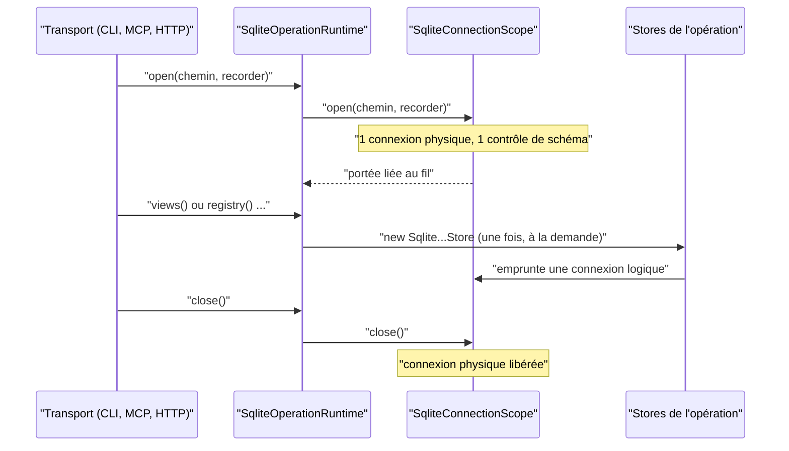
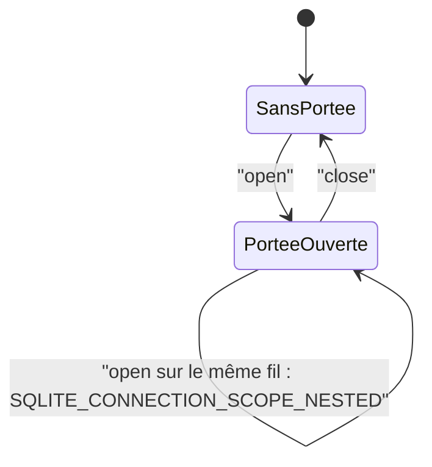

# Politique de connexion SQLite d'une opération (`sqlite-connection-policy`)

Spec de référence : [`openspec/specs/sqlite-connection-policy/spec.md`](../../../openspec/specs/sqlite-connection-policy/spec.md)
· Relevé du 2026-11-04 sur `2913fc30`.

## Objet et périmètre

Une opération (une commande CLI, un appel d'outil MCP, une requête HTTP) ouvre une seule connexion physique SQLite et
ne vérifie le schéma qu'une fois, quel que soit le transport qui la porte. Un store n'est construit que sous une
portée de connexion ouverte, sauf pour une liste fermée de sites nommés.

- **Acteurs** : les trois transports (`morpheus-cli`, `morpheus-mcp`, `morpheus-api`), le runtime d'opération
  `SqliteOperationRuntime`, la portée `SqliteConnectionScope` de `morpheus-store-sqlite`.
- **Inclus** : le nombre de connexions physiques et de vérifications de schéma par opération, la règle de
  construction des stores sous une portée, le refus d'imbrication des portées, la séquence de deux runtimes sur un
  même fil.
- **Exclus** : la politique de reprise sur contention (bail, minuteries), la pré-copie avant migration
  ([`sqlite-schema-history`](sqlite-schema-history.md)), le contenu des stores.

## Exigences

| Alias | Exigence (titre exact) | En bref | Nature |
|---|---|---|---|
| R1 | An operation SHALL open one physical connection whichever transport carries it | une connexion physique et un contrôle de schéma par opération, sur CLI, MCP et HTTP | `[EXIGENCE]` |
| R2 | An adapter SHALL build a SQLite store only inside a connection scope | tout `new Sqlite…Store(` d'un adaptateur est sous une portée, sauf sites nommés avec leur raison | `[EXIGENCE]` |
| R3 | Scopes SHALL NOT nest, and sequential runtimes SHALL work | portée ouverte dans une portée : refus nommé ; deux runtimes successifs fonctionnent | `[EXIGENCE]` |

## Comportement détaillé

`[EXISTANT VÉRIFIÉ]` **Un seul constructeur de stores par opération.** `SqliteOperationRuntime.open(chemin, recorder)`
ouvre la portée avant tout store, puis construit chaque store à la demande, une seule fois, sur la connexion logique
de la portée. Chaque transport enveloppe ce runtime dans son propre type (`ApiRuntime`, `CliRuntime`,
`MorpheusMcpRuntime`) : voir `.claude/rules/architecture.md` et ADR-0156.

`[EXISTANT VÉRIFIÉ]` **Refus d'imbrication.** `SqliteConnectionScope.NESTED_REFUSAL` vaut `SQLITE_CONNECTION_SCOPE_NESTED` ;
`SqliteConnectionScope.NestedScopeException` (sous-type d'`IllegalStateException`) porte le message
`SQLITE_CONNECTION_SCOPE_NESTED: a SQLite connection scope is already open on this thread, and scopes do not nest`.
Un runtime ouvert pendant qu'un autre l'est sur le même fil est refusé par ce message, et le premier reste utilisable.

`[EXISTANT VÉRIFIÉ]` **Sites hors portée, nommés.** `SqliteConnectionScopeUseArchitectureTest` tient deux listes
fermées : `SCOPE_OWNERS` (les classes qui ouvrent la portée elles-mêmes : `SqliteOperationRuntime`) et
`ONE_STORE_PER_OPERATION` (les classes qui construisent un seul store hors portée, avec le nombre de constructions et
l'opération servie : `CliProjectWriteCapabilityResolver`, `SqliteServerMaintenance`). Trois contrôles s'y ajoutent :
la portée s'ouvre avant la première construction (texte, commentaires retirés), une classe nommée n'ouvre jamais deux
stores ensemble dans un même `try`, et une règle sur le bytecode exige l'appel de `SqliteConnectionScope.open`.

`[EXISTANT VÉRIFIÉ]` **Ce que les tests de transport comptent.** Le compte est celui de la portée, lu sur le
`recorder` que le test passe (`SqliteConnectionScope.CONNECTIONS_OPENED`) : une connexion ouverte hors portée n'y
figure pas, et c'est la règle d'architecture ci-dessus qui la refuse là où elle s'écrit (javadoc de
`HttpRequestConnectionCountTest`, `AUD-QUA-17`).

## Diagrammes

### Qui ouvre la connexion d'une opération, et où se compte-t-elle ?

Existant vérifié dans `SqliteOperationRuntime`, `SqliteConnectionScope` et les trois `*ConnectionCountTest`.
Exigences R1 et R2.

Tous les stores d'une opération partagent la connexion de la portée. Un store construit hors portée ouvrirait une
connexion physique de plus, que ni la portée ni les tests de transport ne comptent : la règle d'architecture (R2)
est ce qui l'interdit.

### Quand une ouverture de portée est-elle refusée ?

Existant vérifié par `SqliteConnectionScopeTest#rejectsNestedOrDifferentDatabaseScopeBorrow` et
`SqliteOperationRuntimeConnectionTest#aRuntimeOpenedWhileAnotherIsOpenIsRefusedByNameAndTheFirstStillWorks`.
Exigence R3.

La fermeture d'un runtime ramène le fil à l'état sans portée : un second runtime ouvert ensuite fonctionne, sur sa
propre connexion.

## Écarts et questions ouvertes

- **Écart de vocabulaire** : R2 parle d'une liste fermée de « maintenance sites ». La liste du code,
  `ONE_STORE_PER_OPERATION` (`SqliteConnectionScopeUseArchitectureTest`), contient `SqliteServerMaintenance`, qui
  en est un, et `CliProjectWriteCapabilityResolver`, qui n'en est pas : sa raison écrite est une lecture de store
  faite depuis l'opération de son appelant, à l'intérieur de laquelle un runtime serait refusé comme portée imbriquée.
  Le code et la spec ne disent pas la même chose du second ; la spec n'est pas modifiée ici.
- **Preuve de R1 par transport** : le compte porte sur deux opérations par transport (liste des vues enregistrées,
  liste des paquets de politiques) et sur la portée, non sur le pilote JDBC. Aucun test ne compte les connexions
  d'un outil MCP, d'une commande ou d'une route autres que ces deux-là.
- **Comportement vérifié absent de la spec** : la portée doit s'ouvrir avant la première construction de store ; un
  site nommé n'ouvre jamais deux stores ensemble ; une base illisible reste l'échec `KnowledgeStoreException`
  (`SqliteOperationRuntimeConnectionTest#aDatabaseThatCannotBeOpenedIsStillTheKnowledgeStoreFailure`) et le runtime
  fermé refuse de construire un store (`IllegalStateException`, « the SQLite operation runtime is closed »).

## Traçabilité

| Exigence | Scénario | Conception ou diagramme | Changement | Preuve |
|---|---|---|---|---|
| R1 | An MCP tool call opens one connection | séquence ci-dessus | archive `2026-10-30-own-the-sqlite-connection-policy-in-one-place` | [`McpToolCallConnectionCountTest`](../../../morpheus-mcp/src/test/java/com/morpheus/mcp/McpToolCallConnectionCountTest.java)`#listingSavedViewsOpensOnePhysicalConnection`, `#listingPolicyPacksOpensOnePhysicalConnection` ; [`MorpheusMcpRuntimeConnectionTest`](../../../morpheus-mcp/src/test/java/com/morpheus/mcp/MorpheusMcpRuntimeConnectionTest.java)`#oneRuntimeOpensOnePhysicalConnectionAndGivesItBack` |
| R1 | The transports agree | idem | idem | [`HttpRequestConnectionCountTest`](../../../morpheus-api/src/test/java/com/morpheus/api/HttpRequestConnectionCountTest.java)`#listingSavedViewsOpensOnePhysicalConnection` ; [`CliCommandConnectionCountTest`](../../../morpheus-cli/src/test/java/com/morpheus/cli/CliCommandConnectionCountTest.java)`#listingSavedViewsOpensOnePhysicalConnection` ; [`SqliteOperationRuntimeConnectionTest`](../../../morpheus-store-sqlite/src/test/java/com/morpheus/store/sqlite/runtime/SqliteOperationRuntimeConnectionTest.java)`#everyStoreOfTheRuntimeSharesTheSameConnection` |
| R2 | A store built outside a scope fails the build | séquence ci-dessus | idem | [`SqliteConnectionScopeUseArchitectureTest`](../../../morpheus-architecture-tests/src/test/java/com/morpheus/architecture/SqliteConnectionScopeUseArchitectureTest.java)`#anAdapterClassThatBuildsStoresOpensAScopeOrIsNamedForItsSingleStore`, `#aClassThatBuildsAStoreCallsTheScopeOpeningOrIsNamedForItsSingleStore` |
| R2 | A stale exception fails the build | idem | idem | même classe, `#anAdapterClassThatBuildsStoresOpensAScopeOrIsNamedForItsSingleStore` (égalité exacte des sites nommés), `#theBytecodeRuleReachesTheOperationRuntimeAndEveryStoreItBuilds` |
| R3 | A nested scope is refused by name | machine à états | idem | [`SqliteConnectionScopeTest`](../../../morpheus-store-sqlite/src/test/java/com/morpheus/store/sqlite/runtime/SqliteConnectionScopeTest.java)`#rejectsNestedOrDifferentDatabaseScopeBorrow` ; `SqliteOperationRuntimeConnectionTest#aRuntimeOpenedWhileAnotherIsOpenIsRefusedByNameAndTheFirstStillWorks` |
| R3 | Two runtimes in sequence | idem | idem | [`MorpheusMcpRuntimeConnectionTest`](../../../morpheus-mcp/src/test/java/com/morpheus/mcp/MorpheusMcpRuntimeConnectionTest.java)`#twoRuntimesBuiltOneAfterTheOtherOnOneThreadBothWork` ; `SqliteOperationRuntimeConnectionTest#aRuntimeOpenedWhileAnotherIsOpenIsRefusedByNameAndTheFirstStillWorks` (second runtime après fermeture du premier) |

## Sources

- ADR : [ARCH-0156](../../architecture/adr/ARCH-0156-racines-de-composition-nommees-paquets-sans-cycle-et-decisions-dans-le-domaine.md)
  (racines de composition nommées).
- Archive OpenSpec : `openspec/changes/archive/2026-10-30-own-the-sqlite-connection-policy-in-one-place/`.
- Règles du dépôt : `.claude/rules/architecture.md`, sections « api / mcp → stores et providers concrets » et
  « store-sqlite ».
- Pages liées : [`sqlite-store-packages.md`](sqlite-store-packages.md), [`store-closed-refusal.md`](store-closed-refusal.md).
