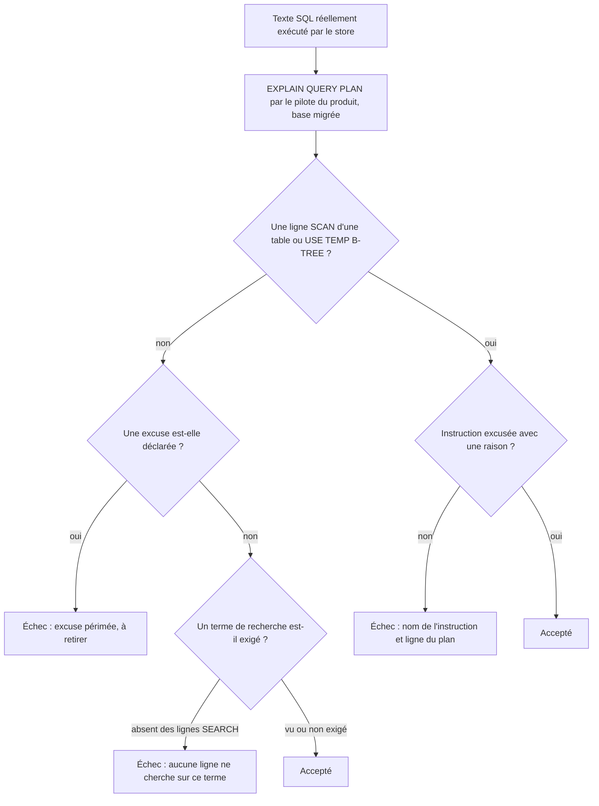
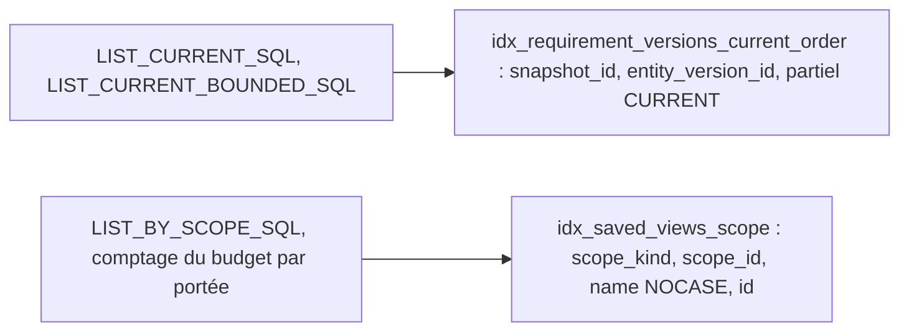

# Couverture des index SQLite (`sqlite-index-coverage`)

Spec de référence : [`openspec/specs/sqlite-index-coverage/spec.md`](../../../openspec/specs/sqlite-index-coverage/spec.md)
· Relevé du 2026-11-04 sur `2913fc30`.

## Objet et périmètre

La spec fixe quels index le schéma migré peut contenir, quelles lectures du store doivent être servies par un index
dans l'ordre qu'elles rendent, et comment le build le prouve.

- **Acteurs** : les migrations `V001` à `V024` de `morpheus-store-sqlite`, les stores `SqliteVersionedRequirementStore`
  et `SqliteSavedViewStore`, deux gardes de plan de requête.
- **Inclus** : l'interdit d'un index qui répète les colonnes de tête d'un autre, la conservation du comportement après
  retrait, les lectures des exigences CURRENT et des vues enregistrées d'une portée, la garde de plan.
- **Exclus** : le choix d'un index pour les lectures non gardées, la pagination des exigences
  (`SqliteRequirementPageTest`, page d'une autre capacité).

## Exigences

| Alias | Exigence (titre exact) | En bref | Nature |
|---|---|---|---|
| R1 | The migrated schema SHALL hold no index that repeats the leading columns of another | aucun `CREATE INDEX` non unique, non partiel, dont la liste de colonnes (noms, collations, sens) est le début d'un autre index non partiel de la même table | `[EXIGENCE]` |
| R2 | Removing a repeated index MUST NOT change what the store accepts, refuses or returns | contraintes, lignes et ordres inchangés après retrait | `[EXIGENCE]` |
| R3 | The CURRENT requirement reads SHALL be served in entity-version order by an index | lectures bornée et non bornée des versions CURRENT, sans tri temporaire | `[EXIGENCE]` |
| R4 | The saved-view listing of a scope SHALL be served in its order by an index | nom sans casse ASCII puis identifiant, ordre fourni par l'index de portée | `[EXIGENCE]` |
| R5 | A guarded read MUST fail the build when its plan gains a table scan or a temporary sort | `EXPLAIN QUERY PLAN` par le pilote du produit sur une base migrée, texte réellement exécuté, excuses motivées | `[EXIGENCE]` |

## Comportement détaillé

`[EXISTANT VÉRIFIÉ]` **Détection (R1).** `SqliteIndexRepetitions.find(connection)` (module de test) dérive la
comparaison de la base ; aucun compte d'index n'est écrit dans le test.

`[EXISTANT VÉRIFIÉ]` **Retrait et création (migration V022).** Onze `DROP INDEX` sans `IF EXISTS`, puis
`idx_requirement_versions_current_order` (index partiel `requirement_versions(snapshot_id, entity_version_id) WHERE
temporal_state = 'CURRENT'`), puis `idx_saved_views_scope` recréé sur `(scope_kind, scope_id, name COLLATE NOCASE, id)`.

`[EXISTANT VÉRIFIÉ]` **Lectures CURRENT (R3).** `SqliteVersionedRequirementStore.LIST_CURRENT_SQL` et
`LIST_CURRENT_BOUNDED_SQL` lisent `WHERE snapshot_id = ? AND temporal_state = 'CURRENT' ORDER BY entity_version_id`
(la seconde avec `LIMIT ?`). **Listing des vues (R4).** `SqliteSavedViewStore.LIST_BY_SCOPE_SQL`.

`[EXISTANT VÉRIFIÉ]` **Garde (R5).** Deux contrôles. `SqliteEveryReadStatementPlanGuardTest` lit dans les sources
tout `SELECT` ou `WITH` écrit en littéral entier (bloc de texte ou ligne) et l'explique sur une base migrée ; ses
exceptions sont la table `EXCUSED`, un fragment nommant exactement une instruction. `SqliteQueryPlanGuardTest` garde
les instructions assemblées par un constructeur (`endpointSql`, `pageSql`) et les constantes `…_SQL` ; une entrée
`Guarded` sans raison est refusée à la construction. Le plan est jugé sur sa forme (ligne `SCAN` d'une table connue,
`USE TEMP B-TREE`), jamais comparé à un texte enregistré ; un terme de recherche peut être exigé sur une ligne
`SEARCH`.

## Diagrammes

### Comment la garde décide-t-elle qu'une lecture est acceptable ?

Existant vérifié dans `SqliteQueryPlanGuardTest.problems`. Exigence R5.

Le terme de recherche est contrôlé avant l'excuse dans le code (`problems`) ; le diagramme regroupe les issues par
cause. La forme du plan, non son texte, décide.

### Quels index servent les lectures de la spec ?

Existant vérifié dans la migration V022 et les constantes SQL. Exigences R3 et R4.

## Écarts et questions ouvertes

- **R2 sans comparaison avant/après** : le scénario « A read that used a repeated index is still served by an
  index » demande de lire le plan d'une instruction avant et après la migration. Aucun test ne conserve le plan
  d'avant ; `SqliteEveryReadStatementPlanGuardTest` et `SqliteQueryPlanGuardTest` jugent le plan d'après, sans
  scan ni tri non excusé, ce qui couvre la moitié « aucun scan complet ni tri » du scénario. Preuve partielle.
- **R2, « persistence parity tests need no edit »** : aucun test ne l'exprime ; c'est un constat de la suite
  complète. Preuve manquante comme test nommé.
- **R1, « The rule holds no count »** : respecté dans `SqliteIndexRedundancyTest` ; aucune assertion ne vérifie
  l'absence de compte. Les listes de tables et d'index de `SqliteIndexRemovalUpgradeTest` sont des fixtures du test
  de mise à niveau, pas la règle.
- **R4, budget** : le scénario « The budget check is still answered from the index » demande un index couvrant
  la portée. La garde marque `saved-views.insert-within-budget` comme servie (ni scan ni tri) sans exiger que l'index
  soit couvrant.
- **R3, base de comparaison** : l'ordre et les lignes de la lecture bornée sont comparés au store mémoire par
  `BoundedCurrentRequirementStoreTest` ; le nombre `n` et les états temporels autres que CURRENT y sont exercés.
- **Excuse reconnue comme lacune** : `SqliteEveryReadStatementPlanGuardTest.EXCUSED` garde pour
  `FROM knowledge_snapshots WHERE project_id = ? ORDER BY created_at, id` l'excuse « known gap, not an accepted
  cost » (tri sur un texte d'instant dont l'ordre n'est pas celui du temps), renvoyée à la question ouverte 2 de
  l'archive `2026-10-21-filter-and-order-a-store-read-once`. Une excuse qui nomme une dette est tolérée par R5 mais
  n'est pas une réponse à la spec.
- **Garde plus large que la spec** : la garde couvre aussi les pages d'exigences, les journaux d'audit, les archives
  de sources et les liens de traçabilité, qu'aucun scénario de R5 ne nomme.
- **Version publiée** : le scénario « An upgraded database loses… » cite 1.2.0 ; `SqliteIndexRemovalUpgradeTest`
  fixe `PUBLISHED_SCHEMA_VERSION = 15`, que `released-schema-levels.properties` associe à 1.2.0 (et 1.1.0).

## Traçabilité

| Exigence | Scénario | Conception ou diagramme | Changement | Preuve |
|---|---|---|---|---|
| R1 | A new database holds no repeated index | — | archive `2026-10-21-serve-ordered-store-reads-from-an-index` | [`SqliteIndexRedundancyTest`](../../../morpheus-store-sqlite/src/test/java/com/morpheus/store/sqlite/runtime/SqliteIndexRedundancyTest.java)`#aMigratedDatabaseHoldsNoRepeatedIndex` |
| R1 | An upgraded database loses the repeated indexes and nothing else | — | idem | [`SqliteIndexRemovalUpgradeTest`](../../../morpheus-store-sqlite/src/test/java/com/morpheus/store/sqlite/runtime/SqliteIndexRemovalUpgradeTest.java)`#aDatabaseAtThePublishedSchemaLosesTheRepeatedIndexesAndNothingElse` |
| R1 | A later migration that adds a repeated index fails the build | — | idem | `SqliteIndexRedundancyTest#aMigratedDatabaseHoldsNoRepeatedIndex` (échec de la base migrée) ; format du message : `#anIndexThatRepeatsThePrimaryKeyIsNamedWithItsTableAndTheIndexItRepeats`, `#anIndexThatRepeatsAUniqueConstraintExactlyIsNamed` |
| R1 | An index that shares its leading column with a partial index is not reported | — | idem | `SqliteIndexRedundancyTest#anIndexThatSharesItsLeadingColumnWithAPartialIndexOnlyIsNotReported` (table synthétique) ; `idx_requirement_versions_snapshot` conservé : `SqliteIndexRemovalUpgradeTest#aDatabaseAtThePublishedSchemaLosesTheRepeatedIndexesAndNothingElse` |
| R1 | The rule holds no count | — | idem | **Preuve manquante** comme assertion ; lecture de `SqliteIndexRedundancyTest` |
| R2 | Uniqueness is still refused | — | idem | `SqliteIndexRemovalUpgradeTest#uniquenessAndForeignKeysAreStillEnforcedOnATableThatLostAnIndex` |
| R2 | A child row without its parent is still refused | — | idem | même test (clé étrangère de `saved_view_versions`) |
| R2 | The persistence parity tests need no edit | — | idem | **Preuve manquante** comme test nommé (constat de la suite) |
| R2 | A read that used a repeated index is still served by an index | — | idem | preuve partielle : [`SqliteEveryReadStatementPlanGuardTest`](../../../morpheus-store-sqlite/src/test/java/com/morpheus/store/sqlite/adapter/SqliteEveryReadStatementPlanGuardTest.java)`#everyWholeLiteralSelectIsServedByAnIndexOrExcusedWithAReason` (plan d'après seulement) |
| R3 | The plan of the bounded read has no temporary sort | diagramme des index | idem | [`SqliteQueryPlanGuardTest`](../../../morpheus-store-sqlite/src/test/java/com/morpheus/store/sqlite/adapter/SqliteQueryPlanGuardTest.java)`#everyGuardedStatementIsServedByAnIndexOnAMigratedDatabase` (`requirement-versions.current-bounded`) |
| R3 | The order and the rows are unchanged | idem | idem | [`BoundedCurrentRequirementStoreTest`](../../../morpheus-architecture-tests/src/test/java/com/morpheus/architecture/BoundedCurrentRequirementStoreTest.java)`#sqliteStoreFiltersCurrentRowsBeforeApplyingLimit`, `#memoryStoreFiltersCurrentRowsBeforeApplyingLimit` |
| R3 | The unbounded read shares the index | idem | idem | `SqliteQueryPlanGuardTest#everyGuardedStatementIsServedByAnIndexOnAMigratedDatabase` (`requirement-versions.current`) |
| R4 | The plan of the listing has no temporary sort | idem | idem | `SqliteQueryPlanGuardTest#everyGuardedStatementIsServedByAnIndexOnAMigratedDatabase` (`saved-views.list-by-scope`) |
| R4 | The order is unchanged | idem | idem | [`SqliteSavedViewListingOrderTest`](../../../morpheus-store-sqlite/src/test/java/com/morpheus/store/sqlite/adapter/SqliteSavedViewListingOrderTest.java)`#viewsAreListedByNameWithoutRegardToCaseThenById` |
| R4 | The budget check is still answered from the index | idem | idem | preuve partielle : `SqliteQueryPlanGuardTest#everyGuardedStatementIsServedByAnIndexOnAMigratedDatabase` (`saved-views.insert-within-budget`, pas de scan) ; [`SqliteSavedViewStoreBudgetTest`](../../../morpheus-store-sqlite/src/test/java/com/morpheus/store/sqlite/adapter/SqliteSavedViewStoreBudgetTest.java) (comportement du budget) |
| R5 | The guard explains the statement the store runs | organigramme de la garde | idem | `SqliteEveryReadStatementPlanGuardTest#everyWholeLiteralSelectIsServedByAnIndexOrExcusedWithAReason`, `#theReaderFindsTheStatementsItIsMeantToGuard` (texte lu dans les sources) |
| R5 | Dropping a needed index fails the build | idem | idem | `SqliteQueryPlanGuardTest#aStatementThatScansATableIsReportedWithItsPlanLine`, `#aStatementThatSortsInATemporaryTreeIsReportedWithItsPlanLine` (base synthétique ; le retrait de l'index réel n'est pas simulé) |
| R5 | An excused sort carries its reason | idem | idem | `SqliteQueryPlanGuardTest#anExcuseWithoutAReasonIsRefused`, `#anExcusedSortCarriesItsReasonAndPasses` |
| R5 | A stale excuse fails the build | idem | idem | `SqliteQueryPlanGuardTest#anExcuseForAStatementThatNoLongerSortsIsReportedAsStale` |
| R5 | The guard does not compare plan texts | idem | idem | **Preuve manquante** : aucun test ne simule un libellé de plan reformulé ; propriété de construction de `problems` |

## Sources

- Migration : `morpheus-store-sqlite/src/main/resources/db/migration/V022__serve_ordered_reads_from_an_index.sql`.
- Archive OpenSpec : `openspec/changes/archive/2026-10-21-serve-ordered-store-reads-from-an-index/`.
- Pages liées : [`sqlite-read-shaping.md`](sqlite-read-shaping.md), [`released-schema-upgrade.md`](released-schema-upgrade.md).
