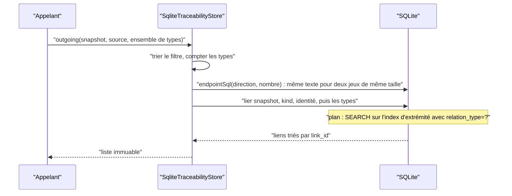
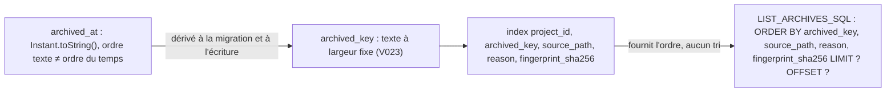

# Filtre et ordre des lectures SQLite (`sqlite-read-shaping`)

Spec de référence : [`openspec/specs/sqlite-read-shaping/spec.md`](../../../openspec/specs/sqlite-read-shaping/spec.md)
· Relevé du 2026-11-04 sur `2913fc30`.

## Objet et périmètre

La spec dit ce que les stores SQLite demandent à la base (filtrer, ordonner) et ce qu'ils font eux-mêmes, pour deux
lectures : les liens de traçabilité d'une extrémité, et le listing des archives de sources d'un projet.

- **Acteurs** : `SqliteTraceabilityStore`, `SqliteSyncStateStore`, leurs jumeaux mémoire `MemoryTraceabilityStore` et
  `MemorySyncStateStore`.
- **Inclus** : le filtre par type de relation (paramètres liés, ensemble vide = tous les types), l'ordre par
  identifiant de lien, l'ordre des archives (instant, chemin, raison), l'interdit d'un `ORDER BY` que le store
  remplace.
- **Exclus** : la pagination des journaux ([`BE-0151`](../../architecture/adr/BE-0151-pagination-des-collections-et-journaux.md)),
  les index qui servent ces lectures ([`sqlite-index-coverage.md`](sqlite-index-coverage.md)).

## Exigences

| Alias | Exigence (titre exact) | En bref | Nature |
|---|---|---|---|
| R1 | The SQLite traceability store SHALL apply a relation filter in the database | `relation_type IN (…)` avec valeurs liées ; l'ensemble vide garde le sens « tous les types » | `[EXIGENCE]` |
| R2 | The source archives of a project SHALL be returned by instant, then path, then reason | ordre chronologique, puis chemin, puis raison, identique sur les deux stores et à chaque lecture | `[EXIGENCE]` |
| R3 | A store MUST NOT ask the database for an order it then replaces | une lecture que le store ordonne lui-même ne porte pas d'`ORDER BY` et dit pourquoi à côté | `[EXIGENCE]` |

## Comportement détaillé

`[EXISTANT VÉRIFIÉ]` **Lecture d'une extrémité.** `SqliteTraceabilityStore.endpointSql(outgoing, relationTypeCount)`
construit `SELECT l.* FROM traceability_links l JOIN snapshot_traceability_links m ON m.link_id = l.link_id WHERE
m.snapshot_id = ? AND l.<kind> = ? AND l.<identity> = ?`, ajoute `AND l.relation_type IN (?, …)` si le nombre de
types est non nul, et termine par `ORDER BY l.link_id`. Le texte ne dépend que de la direction et du **nombre** de
types, jamais de leur valeur ; les types sont liés dans l'ordre de l'énumération (`sorted()`). Un type absent de
l'extrémité donne une liste vide sans échec.

`[EXISTANT VÉRIFIÉ]` **Listing des archives.** `SqliteSyncStateStore.LIST_ARCHIVES_SQL` lit
`… WHERE project_id = ? ORDER BY archived_key, source_path, reason, fingerprint_sha256 LIMIT ? OFFSET ?`.
`archived_key` est l'instant en texte à largeur fixe (migration V023 : treize chiffres de secondes d'époque, un point,
neuf chiffres de nanosecondes) ; `archived_at` garde `Instant.toString()`, dont l'ordre texte n'est pas l'ordre du
temps. `SqliteSyncStateStore.archivedKey` a le format de `SqlitePolicyPackStore.orderKey`. L'ordre est celui de
`SourceArchiveRecord` (instant, chemin, raison, empreinte) et les pages sont les mêmes que celles du store mémoire.

## Diagrammes

### Quel texte SQL une lecture de liens exécute-t-elle, et qu'en tire la base ?

Existant vérifié dans `SqliteTraceabilityStore` et `SqliteQueryPlanGuardTest`. Exigence R1.

Le filtre est dans la requête : le store ne lit pas les liens des autres types pour les écarter. Un ensemble vide
donne un texte sans `IN`, donc tous les types.

### Comment les archives sont-elles ordonnées aujourd'hui ?

Existant vérifié par `SqliteSyncStateStore.LIST_ARCHIVES_SQL`, la migration V023 et `SourceArchiveOrderParityTest`.
Exigences R2 et R3 ; le diagramme montre l'état du code, qui diffère de R3 (voir Écarts).

## Écarts et questions ouvertes

- **R3 contredite par le code et par un test.** La spec impose que l'instruction du listing des archives ne
  contienne aucun `ORDER BY` et que le store trie lui-même. Le code lit `ORDER BY archived_key, source_path, reason,
  fingerprint_sha256` (`SqliteSyncStateStore.LIST_ARCHIVES_SQL`), et
  [`SqliteSourceArchiveListingTest`](../../../morpheus-store-sqlite/src/test/java/com/morpheus/store/sqlite/adapter/SqliteSourceArchiveListingTest.java)`#theArchiveListingStatementOrdersByTheKeyAndBoundsThePage`
  **exige** cette clause. Le commentaire au-dessus de l'instruction dit encore que le texte de l'instant « does not
  sort by time » (le test `#theReasonIsWrittenAboveTheStatement` le vérifie), mais la raison est désormais le choix
  d'une clé triable, non l'absence de tri SQL. Les trois scénarios de R3 (« The archive listing carries no SQL
  order », « The other statements of the store are not concerned », « Putting the clause back fails the build ») ne
  décrivent pas le comportement vérifié. Preuve manquante : aucun test n'interdit un `ORDER BY` remplacé par le
  store. Décision attendue du mainteneur : retirer ou reformuler R3 ; la spec n'est pas modifiée ici.
- **R2, scénario « An existing database keeps its archives »** : le texte dit « the stored format does not change ».
  La migration V023 ajoute la colonne `archived_key` et la remplit par `UPDATE` sur les lignes existantes ;
  `archived_at` reste intact (`SqliteSourceArchiveOrderKeyMigrationTest#anArchiveThatExistedBeforeTheMigrationGetsTheKeyAndIsReadInTimeOrder`).
  Les archives sont conservées et lues dans l'ordre chronologique, mais le format stocké a changé.
- **R2, critère de départage** : la spec nomme instant, chemin, raison ; le code et les tests ajoutent l'empreinte
  (`fingerprint_sha256`) en dernier critère.
- **R1, « both stores agree »** : `TraceabilityRelationFilterParityTest` compare, **dans chaque store**, la lecture
  filtrée au filtre appliqué à la lecture non filtrée du même store (les identifiants sont tirés à chaque exécution,
  donc deux stores ne se comparent pas lien à lien). L'accord des deux stores est établi par cette propriété commune,
  non par comparaison directe.
- **R1, « The statement does not depend on a value »** : `endpointSql` ne reçoit que le nombre de types, mais aucun
  test ne compare le texte de deux lectures. Preuve manquante comme test nommé.
- **Garde de plan** : l'instruction `traceability.outgoing-several-types` et l'`unfiltered` portent une excuse de tri
  dans `SqliteQueryPlanGuardTest` (« the endpoint index returns links grouped by relation type … ») : l'ordre par
  `link_id` d'un jeu de liens d'une extrémité est un tri temporaire accepté, non servi par l'index.

## Traçabilité

| Exigence | Scénario | Conception ou diagramme | Changement | Preuve |
|---|---|---|---|---|
| R1 | Only the links of the requested types are returned | séquence ci-dessus | archive `2026-10-21-filter-and-order-a-store-read-once` | [`SqliteTraceabilityStorePersistenceTest`](../../../morpheus-store-sqlite/src/test/java/com/morpheus/store/sqlite/adapter/SqliteTraceabilityStorePersistenceTest.java)`#aRelationFilterNarrowsBothDirections` (un type) ; [`TraceabilityRelationFilterParityTest`](../../../morpheus-architecture-tests/src/test/java/com/morpheus/architecture/TraceabilityRelationFilterParityTest.java)`#sqliteStoreAppliesEveryShapeOfFilterInBothDirections` (plusieurs types, ordre par identifiant) |
| R1 | The empty filter returns every link | idem | idem | `SqliteTraceabilityStorePersistenceTest#aRelationFilterNarrowsBothDirections`, `TraceabilityRelationFilterParityTest#sqliteStoreAppliesEveryShapeOfFilterInBothDirections` |
| R1 | A type the endpoint has no link of | idem | idem | mêmes tests (type `SUPERSEDES` absent) |
| R1 | Both directions and both stores agree | idem | idem | `TraceabilityRelationFilterParityTest#memoryStoreAppliesEveryShapeOfFilterInBothDirections`, `#sqliteStoreAppliesEveryShapeOfFilterInBothDirections` (propriété commune, voir Écarts) |
| R1 | A link of another snapshot is not returned | idem | idem | `TraceabilityRelationFilterParityTest#sqliteStoreAppliesEveryShapeOfFilterInBothDirections` ; `SqliteTraceabilityStorePersistenceTest#linksNeverLeakBetweenSnapshots` |
| R1 | The database searches on the relation type | idem | idem | [`SqliteQueryPlanGuardTest`](../../../morpheus-store-sqlite/src/test/java/com/morpheus/store/sqlite/adapter/SqliteQueryPlanGuardTest.java)`#everyGuardedStatementIsServedByAnIndexOnAMigratedDatabase` (terme `relation_type=?` exigé pour les statements `traceability.*`) |
| R1 | The statement does not depend on a value | idem | idem | **Preuve manquante** comme test ; propriété portée par la signature `endpointSql(boolean, int)` |
| R2 | Timestamps whose text forms sort differently from time | organigramme ci-dessus | idem | [`SourceArchiveOrderParityTest`](../../../morpheus-architecture-tests/src/test/java/com/morpheus/architecture/SourceArchiveOrderParityTest.java)`#bothStoresCutTheSamePagesAcrossInstantsWhoseTextSortsAgainstTime`, `#sqliteStoreReturnsTheArchivesByInstantThenPathThenReason` |
| R2 | Archives sharing one instant | idem | idem | `SourceArchiveOrderParityTest#memoryStoreReturnsTheArchivesByInstantThenPathThenReason`, `#sqliteStoreReturnsTheArchivesByInstantThenPathThenReason` |
| R2 | An existing database keeps its archives | idem | idem | [`SqliteSourceArchiveOrderKeyMigrationTest`](../../../morpheus-store-sqlite/src/test/java/com/morpheus/store/sqlite/adapter/SqliteSourceArchiveOrderKeyMigrationTest.java)`#anArchiveThatExistedBeforeTheMigrationGetsTheKeyAndIsReadInTimeOrder` (écart sur « format inchangé ») |
| R3 | The archive listing carries no SQL order | — | idem | **Contredit** par `SqliteSourceArchiveListingTest#theArchiveListingStatementOrdersByTheKeyAndBoundsThePage` ; `#theReasonIsWrittenAboveTheStatement` ne vérifie que le commentaire |
| R3 | The other statements of the store are not concerned | — | idem | **Preuve manquante** ; `SqliteSourceArchiveListingTest#otherStatementsOfTheClassMayStillOrder` constate seulement qu'une autre instruction ordonne |
| R3 | Putting the clause back fails the build | — | idem | **Preuve manquante** : aucune assertion n'interdit un `ORDER BY` sur ce listing |

## Sources

- ADR : [BE-0151](../../architecture/adr/BE-0151-pagination-des-collections-et-journaux.md).
- Archives OpenSpec : `openspec/changes/archive/2026-10-21-filter-and-order-a-store-read-once/`,
  `openspec/changes/archive/2026-10-17-read-an-append-only-journal-one-page-at-a-time/`,
  `openspec/changes/archive/2026-10-30-page-the-two-remaining-journals/` (clé d'ordre `archived_key`).
- Migration : `morpheus-store-sqlite/src/main/resources/db/migration/V023__source_archive_order_key.sql`.
