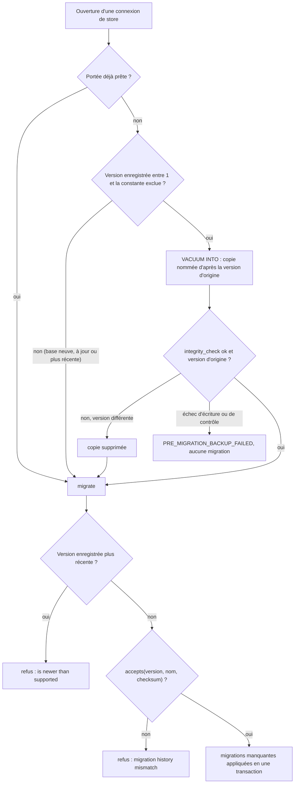
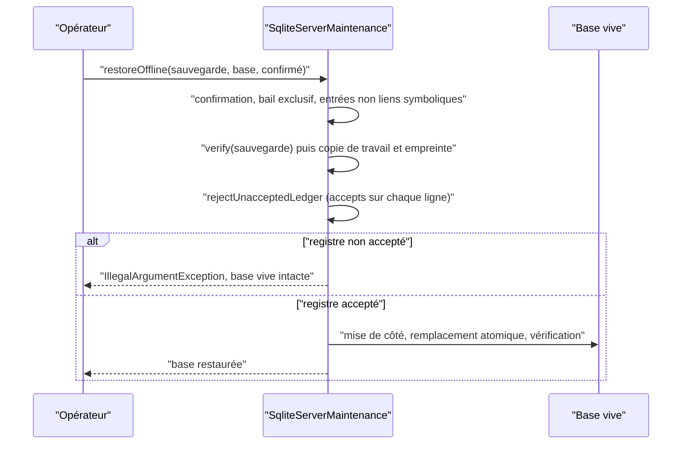

# Historique des migrations du schéma SQLite (`sqlite-schema-history`)

Spec de référence : [`openspec/specs/sqlite-schema-history/spec.md`](../../../openspec/specs/sqlite-schema-history/spec.md)
· Relevé du 2026-11-04 sur `2913fc30`.

## Objet et périmètre

La spec dit comment le store de connaissances SQLite identifie les migrations appliquées à une base, quels historiques
il accepte à l'ouverture et à la restauration, ce qu'il refuse, et la copie qu'il garde avant d'avancer le schéma.

- **Acteurs** : `SqliteSchemaManager` (migrations, acceptation du registre), `SqliteStoreConnection` (ouverture),
  `SqlitePreMigrationCopy` (copie), `SqliteServerMaintenance` (sauvegarde et restauration hors ligne).
- **Inclus** : le checksum indépendant de la plateforme, l'immuabilité du registre enregistré, l'épinglage des
  checksums, la vérification du registre à la restauration, un registre à une ligne par version, la dérivation de la
  version attendue dans les tests de store, la copie avant migration.
- **Exclus** : la preuve de mise à niveau depuis chaque niveau publié ([`released-schema-upgrade.md`](released-schema-upgrade.md)),
  le guide de mise à niveau utilisateur (`docs/user/UPGRADE_1_2_2.md`).

## Exigences

| Alias | Exigence (titre exact) | En bref | Nature |
|---|---|---|---|
| R1 | Migration identity is independent of the build platform | checksum calculé sur le texte aux fins de ligne normalisées ; une base d'un build Windows s'ouvre sous Linux et inversement | `[EXIGENCE]` |
| R2 | Recorded histories are never rewritten silently | un checksum CRLF ou LF enregistré est accepté, jamais réécrit | `[EXIGENCE]` |
| R3 | Released migrations are pinned | les checksums canoniques sont épinglés par le build | `[EXIGENCE]` |
| R4 | Offline restore verifies the ledger before replacing the database | le registre d'une sauvegarde est vérifié avant de déplacer la base vive, qui reste en place sinon | `[EXIGENCE]` |
| R5 | The ledger of a migrated database holds one entry per supported version | une ligne par version de 1 à la constante, checksum SHA-256 de 64 chiffres hexadécimaux, réouverture sans effet | `[EXIGENCE]` |
| R6 | Store tests derive the expected schema version from the declaring constant | un test de `morpheus-store-sqlite` lit la constante, jamais un littéral | `[EXIGENCE]` |
| R7 | The store SHALL keep a verified copy of an existing database before advancing its schema | copie contrôlée, nommée d'après la version d'origine, avant toute migration | `[EXIGENCE]` |
| R8 | The store SHALL refuse to advance the schema when the copy cannot be kept | `PRE_MIGRATION_BACKUP_FAILED`, deux versions nommées, aucun chemin, registre inchangé | `[EXIGENCE]` |
| R9 | A pre-migration copy MUST NOT replace a file nor be mistaken for another database's copy | un nom neuf par tentative, aucun fichier remplacé, copie écartée si elle ne porte pas la version d'origine | `[EXIGENCE]` |

## Comportement détaillé

`[EXISTANT VÉRIFIÉ]` **Acceptation d'un registre (R1, R2, R3).** `SqliteSchemaManager.accepts(version, name, checksum)`
connaît la migration de cette version, exige le **même nom** que le registre, et accepte le SHA-256 du texte
canonique (fins de ligne ramenées à `\n`) ou celui du même texte en `\r\n`, exactement ces deux empreintes. Tout autre
écart est refusé par `SQLite migration history mismatch for version <n>`. La valeur enregistrée n'est jamais
réécrite (DATA-0021).

`[EXISTANT VÉRIFIÉ]` **Refus d'une base plus récente.** `rejectFutureSchema` lève
`SQLite schema version <n> is newer than supported <SUPPORTED_SCHEMA_VERSION>` avant d'appliquer une migration connue.

`[EXISTANT VÉRIFIÉ]` **Restauration (R4).** `SqliteServerMaintenance.restoreOffline` exige la confirmation, vérifie la
sauvegarde, puis `rejectUnacceptedLedger` applique `accepts` à chaque ligne du registre de la sauvegarde ; un refus lève
`IllegalArgumentException("backup migration history is not accepted by this runtime for version <n>")` avant la mise de
côté de la base vive.

`[EXISTANT VÉRIFIÉ]` **Copie avant migration (R7 à R9).** À l'ouverture d'une connexion qui n'est pas déjà sous une
portée dont le schéma est prêt, `SqliteStoreConnection` appelle `SqlitePreMigrationCopy.keepIfTheSchemaWillAdvance`
avant `SqliteSchemaManager.migrate`. Si la version la plus haute enregistrée est comprise entre 1 et la constante
exclue, `VACUUM INTO` écrit `<base>.pre-migration-v<NNN>-<horodatage>-<suffixe>.db` (NNN sur trois chiffres), le
fichier est durci, son `integrity_check` doit répondre `ok` et sa version la plus haute doit être celle d'origine,
sinon il est supprimé. Tout échec lève `KnowledgeStoreException` dont le message commence par
`PRE_MIGRATION_BACKUP_FAILED: cannot keep a copy of the database at schema version <n> before migrating it to <m>`,
sans chemin. `VACUUM INTO` refuse une cible existante : une copie ne remplace aucun fichier.

## Diagrammes

### Que fait l'ouverture d'une base avant d'avancer son schéma ?

Existant vérifié dans `SqliteStoreConnection.open`, `SqlitePreMigrationCopy` et `SqliteSchemaManager.migrate`.
Exigences R1, R2, R7, R8 et R9.

La copie est prise avant le contrôle d'historique : une base à l'historique divergent est copiée puis refusée comme
divergente, non comme échec de copie.

### Dans quel ordre une restauration hors ligne vérifie-t-elle le registre ?

Existant vérifié dans `SqliteServerMaintenance.restoreOffline`. Exigence R4.

## Écarts et questions ouvertes

- **R6, scénario « A frozen historical baseline is excluded by name »** : la spec nomme `R2UpgradeCompatibilityTest`.
  Cette classe n'existe plus dans le dépôt, et `FROZEN_BASELINES` de
  [`SqliteStoreTestsDeriveTheSchemaVersionTest`](../../../morpheus-architecture-tests/src/test/java/com/morpheus/architecture/SqliteStoreTestsDeriveTheSchemaVersionTest.java)
  vaut `Map.of()`. Le mécanisme d'exclusion nommée (raison obligatoire, entrée périmée refusée) est en place mais
  aucune entrée réelle ne l'exerce : **preuve manquante** pour ce scénario tel qu'écrit.
- **R6, « An unrelated assertion is not looked at »** et **« Adding a migration needs no edit »** : ni l'un ni l'autre
  n'a de test dédié ; ils tiennent par la forme du motif (`currentVersion(` ou `getInt("count")`) et par l'emploi de la
  constante.
- **R1, preuve inter-plateformes** : les deux tests de portabilité ne lancent pas deux builds. Ils réécrivent le
  registre d'une base neuve comme le ferait l'autre convention de fins de ligne
  (`SqliteMigrationLineEndingCompatibilityTest#ledger`), puis rouvrent la base.
- **R3, périmètre** : `SqliteMigrationChecksumGoldenTest.CANONICAL_CHECKSUMS` épingle **toutes** les migrations, y
  compris celle de la version en cours, non seulement les migrations publiées ; `#everyMigrationIsPinned` compare
  le nombre d'entrées à `SqliteSchemaManager.SUPPORTED_SCHEMA_VERSION`. La spec parle de « released migration ».
  « names the migration » est tenu par la différence de cartes d'`assertEquals`, non par un message écrit.
- **R7, « a database without a ledger »** : le scénario « A new database is not copied » nomme aussi une base sans
  registre. Seul le cas d'un chemin sans base est exercé (`#aNewDatabaseAndAnUpToDateDatabaseAreNotCopied`).
  Preuve manquante pour une base existante sans table `schema_migrations`.
- **R7, « opened read-only »** : la copie est ouverte par une connexion ordinaire dans `#anOutdatedDatabaseIsCopiedAsItWasThenMigrated`,
  non en lecture seule.
- **R8, preuve au niveau du composant** : `#aCopyThatCannotBeWrittenIsRefusedByNameWithoutAPathAndReplacesNothing`
  appelle `SqlitePreMigrationCopy.keepIfTheSchemaWillAdvance` directement, non l'ouverture d'un store. Les scénarios
  « The refusal is repeatable » et « Once the cause is removed the upgrade completes » n'ont pas de test dédié (la
  reprise après échec de **migration** est exercée par `#aRetryAfterAFailedMigrationWritesANewCopyAndLeavesTheFirstAlone`,
  pas après échec de **copie**). Le scénario « A refusal raised inside a remote request discloses nothing » n'a **aucun
  test** qui cite `PRE_MIGRATION_BACKUP_FAILED` hors de `SqlitePreMigrationCopyTest` : preuve manquante côté réponse
  distante.
- **R9, « no process ends on a history mismatch »** : `#twoConcurrentOpeningsLeaveOnlyTrueCopies` (deux fils) l'exige ;
  `#twoProcessesOpeningOneOutdatedDatabaseLeaveOnlyTrueCopies` (deux processus) accepte la sortie `REFUSED` sans en
  contrôler la cause.
- **Comportement vérifié absent de la spec** : l'acceptation exige aussi l'égalité du **nom** de la migration ; une
  copie est écrite avant le refus d'un historique divergent (aucun test n'affirme son absence ni sa présence) ;
  `#aServerBackupOfAnOutdatedDatabaseIsAlreadyMigratedAndOnlyTheKeptCopyIsNot` fixe qu'une sauvegarde serveur d'une
  base ancienne est prise après sa migration.

## Traçabilité

| Exigence | Scénario | Conception ou diagramme | Changement | Preuve |
|---|---|---|---|---|
| R1 | A database created by a Windows build opens with a Linux build | organigramme d'ouverture | archive `2026-10-09-fix-sqlite-migration-checksum-portability` | [`SqliteMigrationLineEndingCompatibilityTest`](../../../morpheus-store-sqlite/src/test/java/com/morpheus/store/sqlite/runtime/SqliteMigrationLineEndingCompatibilityTest.java)`#aLedgerWrittenByACrlfCheckoutOpensAndIsLeftAsRecorded` |
| R1 | A database created by a Linux build opens with a Windows build | idem | idem | même classe, `#aLedgerWrittenByAnLfCheckoutOpensAndIsLeftAsRecorded` |
| R1 | A changed migration is still refused | idem | idem | même classe, `#aMigrationWhoseContentChangedIsStillRefused` ; [`SqliteSchemaMigrationTest`](../../../morpheus-store-sqlite/src/test/java/com/morpheus/store/sqlite/runtime/SqliteSchemaMigrationTest.java)`#modifiedMigrationHistoryIsRejected` |
| R2 | A legacy Windows ledger is accepted as recorded | idem | idem | `SqliteMigrationLineEndingCompatibilityTest#aLedgerWrittenByACrlfCheckoutOpensAndIsLeftAsRecorded` (registre inchangé après ouverture) |
| R3 | Editing a released migration fails the build | — | idem | [`SqliteMigrationChecksumGoldenTest`](../../../morpheus-store-sqlite/src/test/java/com/morpheus/store/sqlite/runtime/SqliteMigrationChecksumGoldenTest.java)`#aNewDatabaseRecordsTheCanonicalChecksumOfEveryMigration`, `#everyMigrationIsPinned` |
| R4 | A backup with an incompatible ledger is refused | séquence de restauration | idem | [`SqliteRestoreLedgerVerificationTest`](../../../morpheus-store-sqlite/src/test/java/com/morpheus/store/sqlite/runtime/SqliteRestoreLedgerVerificationTest.java)`#aBackupWhoseLedgerTheRuntimeRefusesIsNotRestoredAndTheLiveDatabaseSurvives` |
| R4 | A backup from the other platform is restored | idem | idem | même classe, `#aBackupWrittenByAnLfCheckoutIsRestoredAndOpens`, `#aBackupWrittenByACrlfCheckoutIsRestoredAndOpens` |
| R5 | A new database records every supported migration once | — | archive `2026-10-10-derive-schema-replay-expectations-from-the-constant` | `SqliteSchemaMigrationTest#migrationsCreateVersionedNormalizedFoundationWithoutGenericJsonPayload` (`currentVersion`), `#migrationReplayIsIdempotentAndLedgerContainsOneEntryPerSupportedMigration` (compte, 64 chiffres hexadécimaux) |
| R5 | Reopening is a no-op | — | idem | `SqliteSchemaMigrationTest#migrationReplayIsIdempotentAndLedgerContainsOneEntryPerSupportedMigration` |
| R6 | The replay test names the invariant and reads the constant | — | idem | même méthode (nom et constante) |
| R6 | A restated version is refused | — | idem | `SqliteStoreTestsDeriveTheSchemaVersionTest#noStoreTestComparesTheSchemaVersionOrTheLedgerCountWithALiteral`, `#theScannedShapeIsTheLiteralComparisonAndNotTheDerivedOne` |
| R6 | A frozen historical baseline is excluded by name | — | idem | **Preuve manquante** : `FROZEN_BASELINES` est vide, `R2UpgradeCompatibilityTest` n'existe plus |
| R6 | An unrelated assertion is not looked at | — | idem | **Preuve manquante** comme test nommé |
| R6 | Adding a migration needs no edit of the replay test | — | idem | **Preuve manquante** comme test nommé ; tenu par l'emploi de la constante |
| R7 | An outdated database is copied, then migrated | organigramme d'ouverture | archive `2026-10-16-back-up-before-a-schema-migration` | [`SqlitePreMigrationCopyTest`](../../../morpheus-store-sqlite/src/test/java/com/morpheus/store/sqlite/runtime/SqlitePreMigrationCopyTest.java)`#anOutdatedDatabaseIsCopiedAsItWasThenMigrated`, `#anOutdatedDatabaseOpenedInsideARequestScopeIsCopiedOnTheScopedConnection` |
| R7 | The copy holds the data as it was | idem | idem | `SqlitePreMigrationCopyTest#anOutdatedDatabaseIsCopiedAsItWasThenMigrated` (tables, lignes, aucune migration ultérieure) |
| R7 | A new database is not copied | idem | idem | `SqlitePreMigrationCopyTest#aNewDatabaseAndAnUpToDateDatabaseAreNotCopied` (cas sans base ; **preuve manquante** pour une base sans registre) |
| R7 | An up-to-date database is not copied | idem | idem | même test |
| R7 | A database ahead of the program is still refused first | idem | idem | `SqlitePreMigrationCopyTest#aDatabaseAheadOfTheProgramIsRefusedWithoutACopy` ; [`SqliteFutureSchemaCompatibilityTest`](../../../morpheus-store-sqlite/src/test/java/com/morpheus/store/sqlite/runtime/SqliteFutureSchemaCompatibilityTest.java)`#refusesDatabaseCreatedByNewerMorpheusVersionBeforeApplyingKnownMigrations` |
| R7 | A divergent history is still refused as a history mismatch | idem | idem | `SqlitePreMigrationCopyTest#aDivergentHistoryIsStillRefusedAsAHistoryMismatch` |
| R8 | A copy that cannot be written stops the migration | idem | idem | `SqlitePreMigrationCopyTest#aCopyThatCannotBeWrittenIsRefusedByNameWithoutAPathAndReplacesNothing` (composant) |
| R8 | The refusal is repeatable | idem | idem | **Preuve manquante** comme test dédié |
| R8 | Once the cause is removed the upgrade completes | idem | idem | preuve partielle : `SqlitePreMigrationCopyTest#aRetryAfterAFailedMigrationWritesANewCopyAndLeavesTheFirstAlone` (cause : échec de migration) |
| R8 | A refusal raised inside a remote request discloses nothing | idem | idem | **Preuve manquante** pour la réponse distante ; message sans chemin vérifié par le test du composant |
| R9 | A retry writes a new copy and leaves the first one alone | idem | idem | `SqlitePreMigrationCopyTest#aRetryAfterAFailedMigrationWritesANewCopyAndLeavesTheFirstAlone`, `#aMigrationThatKeepsFailingKeepsOneCopyPerAttempt` |
| R9 | A copy from an earlier upgrade is never presented as this one | idem | idem | `SqlitePreMigrationCopyTest#aDatabaseReplacedByAnotherOfTheSameOldVersionIsCopiedAsItIs` |
| R9 | A copy taken after someone else migrated is discarded | idem | idem | `SqlitePreMigrationCopyTest#aCopyTakenAfterSomeoneElseMigratedIsDiscarded` (composant), `#twoConcurrentOpeningsLeaveOnlyTrueCopies` |
| R9 | Two processes opening at once leave only true copies | idem | idem | `SqlitePreMigrationCopyTest#twoProcessesOpeningOneOutdatedDatabaseLeaveOnlyTrueCopies`, `#twoConcurrentOpeningsLeaveOnlyTrueCopies` |

## Sources

- ADR : [DATA-0021](../../architecture/adr/DATA-0021-sqlite-schema-migrations-foundation.md),
  [DATA-0110](../../architecture/adr/DATA-0110-a-copy-is-kept-before-the-schema-advances.md).
- Archives OpenSpec : `openspec/changes/archive/2026-10-09-fix-sqlite-migration-checksum-portability/`,
  `openspec/changes/archive/2026-10-10-derive-schema-replay-expectations-from-the-constant/`,
  `openspec/changes/archive/2026-10-16-back-up-before-a-schema-migration/`.
- Guide utilisateur de la mise à niveau : `docs/user/UPGRADE_1_2_2.md` ; cohérence code et guide :
  `UpgradeGuideCoherenceTest` (module `morpheus-architecture-tests`).
- Page liée : [`released-schema-upgrade.md`](released-schema-upgrade.md).
