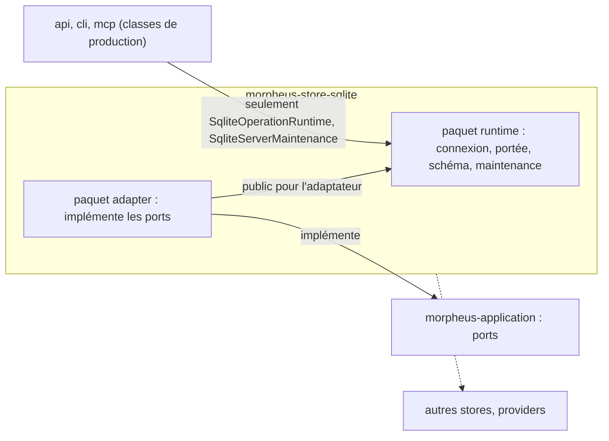

# Paquets du store SQLite (`sqlite-store-packages`)

Spec de référence : [`openspec/specs/sqlite-store-packages/spec.md`](../../../openspec/specs/sqlite-store-packages/spec.md)
· Relevé du 2026-11-04 sur `2913fc30`.

## Objet et périmètre

`morpheus-store-sqlite` se range en deux paquets, `com.morpheus.store.sqlite.adapter` (les implémentations des ports
de l'application) et `com.morpheus.store.sqlite.runtime` (connexion, portée, bail, schéma, transactions, maintenance
hors ligne). La spec fixe qui peut atteindre le runtime, ce que l'adaptateur peut contenir, les modules dont le store
ne dépend pas, et l'absence de changement de comportement du déplacement.

- **Acteurs** : les classes de production des autres modules (api, cli, mcp), les tests d'architecture.
- **Inclus** : la répartition en deux paquets, les deux points d'entrée nommés du runtime, ses types publics, les
  frontières avec les autres stores et les providers.
- **Exclus** : la politique de connexion ([`sqlite-connection-policy.md`](sqlite-connection-policy.md)), le contenu des
  migrations.

## Exigences

| Alias | Exigence (titre exact) | En bref | Nature |
|---|---|---|---|
| R1 | The SQLite store SHALL be split into an adapter package and a runtime package | toute classe principale dans `adapter` ou `runtime` ; une classe qui implémente une interface de l'application est dans `adapter` ; pas de classe sans port dans `adapter` hors deux collaborateurs nommés | `[EXIGENCE]` |
| R2 | Only the SQLite store SHALL reach its runtime package, except two named classes | hors du store, seules `SqliteOperationRuntime` et `SqliteServerMaintenance` (types imbriqués compris) ; aucune source principale ne nomme une autre classe du runtime | `[EXIGENCE]` |
| R3 | The named entry points of the runtime SHALL be a debt counter that only shrinks | `RUNTIME_ENTRY_POINTS` : chaque entrée reste atteinte de l'extérieur, taille égale à sa clé de ratchet | `[EXIGENCE]` |
| R4 | The public types of the runtime package SHALL only shrink | `RUNTIME_PUBLIC_TYPES` : exactement les types publics du runtime, imbriqués compris | `[EXIGENCE]` |
| R5 | The SQLite store SHALL NOT depend on another persistence module or on a provider | aucun autre `store..`, aucun `provider..` | `[EXIGENCE]` |
| R6 | The relocation SHALL NOT change the behaviour of the store | requêtes, version de schéma, migrations, messages et résultats inchangés ; visibilité élargie seulement où l'autre paquet l'emploie | `[EXIGENCE]` |

## Comportement détaillé

`[EXISTANT VÉRIFIÉ]` Les listes et leurs raisons sont dans `SqliteStorePackagesArchitectureTest` :

- `RUNTIME_ENTRY_POINTS` : `SqliteOperationRuntime`, `SqliteServerMaintenance` ;
- `RUNTIME_PUBLIC_TYPES` : `SqliteConnectionScope` (et `$NestedScopeException`), `SqliteContentionMetrics`,
  `SqliteFailureClassifier`, `SqliteOperationRuntime`, `SqliteServerMaintenance` (et `$BackupVerification`,
  `$ServerLease`), `SqliteStoreConnection` (et `$Preparation`), `SqliteTransactionRunner` (et `$SqlVoidWork`,
  `$SqlWork`) ;
- `ADAPTER_COLLABORATORS` : `SqliteSnapshotBusinessContentReader`, `SqliteSnapshotBusinessContentWriter` (table de
  faits, non compteur de dette).

`[EXISTANT VÉRIFIÉ]` Les tailles des deux compteurs sont comparées aux clés
`SqliteStorePackagesArchitectureTest.RUNTIME_ENTRY_POINTS` et `SqliteStorePackagesArchitectureTest.RUNTIME_PUBLIC_TYPES`
de [`config/debt-counter-ratchets.properties`](../../../config/debt-counter-ratchets.properties) ; une clé ne fait que
baisser (`ProductionClassListsArchitectureTest`).

`[EXISTANT VÉRIFIÉ]` La frontière du runtime est tenue deux fois : par une règle sur le bytecode (aucune classe hors
de `com.morpheus.store.sqlite..` ne dépend d'une classe du runtime hors des deux points d'entrée) et par un scan du
texte des sources principales hors du store, qui voit aussi une constante de compilation inlinée par `javac`.

`[DÉCISION]` Les types du runtime sont publics pour l'adaptateur, non pour les autres modules : la frontière n'est
plus tenue par le compilateur mais par ces règles (ARCH-0158).

## Diagrammes

### Qui peut dépendre de quel paquet du store ?

Existant vérifié par les règles de `SqliteStorePackagesArchitectureTest` et de `AdapterSiblingArchitectureTest`.
Exigences R1, R2 et R5.

Une flèche pointillée est un interdit. L'adaptateur voit le runtime ; les autres modules n'en voient que deux
classes ; ni l'un ni l'autre ne dépend d'un autre store ou d'un provider.

## Écarts et questions ouvertes

- **R1, seconde phrase sans règle** : « A class that implements an interface of `com.morpheus.application..` MUST
  reside in the adapter package » n'a pas de règle propre. La règle présente va dans l'autre sens
  (`everyTopLevelClassOfTheAdapterPackageImplementsAnApplicationPortBesideTheTwoNamedCollaborators` : une classe de
  `adapter` implémente un port). Preuve manquante pour une classe de `runtime` qui implémenterait un port. À la date
  du relevé, aucune classe du runtime ne déclare `implements` d'une interface de l'application (relevé des sources).
- **R1, première phrase plus large que sa règle** : la spec impose `adapter` ou `runtime` ; la règle
  `noClassOfTheStoreResidesDirectlyInItsParentPackage` ne refuse que le paquet parent
  `com.morpheus.store.sqlite`. Une classe d'un troisième sous-paquet ne serait pas refusée par ce test.
- **R6 sans test dédié** : la preuve que le déplacement ne change rien est le résultat de `./mvnw clean verify`
  sur le module déplacé, non un test. Preuve manquante au sens d'un test nommé ; le scénario porte sur les comptes et
  la couverture de la base, qu'aucune assertion ne compare.
- **Nom de classe** : la spec donne `storesDoNotDependOnEachOther` et `storesDoNotDependOnProvidersTransportsOrIntegrations`
  pour R5 ; elles existent dans `AdapterSiblingArchitectureTest` et sélectionnent `com.morpheus.store..` (sous-paquets
  compris, via la constante `STORES` du test).

## Traçabilité

| Exigence | Scénario | Conception ou diagramme | Changement | Preuve |
|---|---|---|---|---|
| R1 | A helper class is added to the adapter package | organigramme ci-dessus | archive `2026-10-24-restructure-sqlite-store` | [`SqliteStorePackagesArchitectureTest`](../../../morpheus-architecture-tests/src/test/java/com/morpheus/architecture/SqliteStorePackagesArchitectureTest.java)`#everyTopLevelClassOfTheAdapterPackageImplementsAnApplicationPortBesideTheTwoNamedCollaborators` |
| R1 | A class is left in the parent package | idem | idem | même classe, `#noClassOfTheStoreResidesDirectlyInItsParentPackage` |
| R2 | A transport adapter uses the transaction runner | idem | idem | même classe, `#onlyTheStoreDependsOnItsRuntimeBesideTheTwoNamedEntryPoints` |
| R2 | A transport adapter reads a constant of the runtime | idem | idem | même classe, `#noMainSourceOutsideTheStoreNamesARuntimeClassBesideTheTwoNamedEntryPoints` |
| R2 | The named exceptions keep working | idem | idem | mêmes tests (la règle passe) ; `#everyNamedEntryPointIsStillReachedFromOutsideTheStore` |
| R3 | An entry point is no longer used | idem | idem | même classe, `#everyNamedEntryPointIsStillReachedFromOutsideTheStore` ; [`ProductionClassListsArchitectureTest`](../../../morpheus-architecture-tests/src/test/java/com/morpheus/architecture/ProductionClassListsArchitectureTest.java)`#everyDebtCounterHoldsExactlyTheSizeItsRatchetAllows` |
| R3 | An entry point is added | idem | idem | `ProductionClassListsArchitectureTest#everyDebtCounterHoldsExactlyTheSizeItsRatchetAllows`, `#everyListIsNamedByTheAcceptedDecisionRecordItDeclares` |
| R4 | A runtime type becomes public | idem | idem | `SqliteStorePackagesArchitectureTest#theRuntimeDeclaresExactlyTheNamedPublicTypes` (ajout) |
| R4 | A runtime type is no longer public | idem | idem | même test (retrait), plus `ProductionClassListsArchitectureTest#everyDebtCounterHoldsExactlyTheSizeItsRatchetAllows` |
| R5 | A store borrows from the memory store | idem | idem | [`AdapterSiblingArchitectureTest`](../../../morpheus-architecture-tests/src/test/java/com/morpheus/architecture/AdapterSiblingArchitectureTest.java)`#storesDoNotDependOnEachOther` |
| R5 | The runtime borrows from a provider | idem | idem | `AdapterSiblingArchitectureTest#storesDoNotDependOnProvidersTransportsOrIntegrations` |
| R6 | The suites after the move | — | idem | **Preuve manquante** comme test : constat de `./mvnw clean verify` à la livraison |

## Sources

- ADR : [ARCH-0158](../../architecture/adr/ARCH-0158-le-runtime-du-store-sqlite-est-public-pour-son-adaptateur-seulement.md),
  [ARCH-0162](../../architecture/adr/ARCH-0162-racines-de-composition-nommees-paquets-sans-cycle-hors-une-paire-bornee-et-decisions-dans-le-domaine.md).
- Archive OpenSpec : `openspec/changes/archive/2026-10-24-restructure-sqlite-store/`.
- Règles du dépôt : `.claude/rules/architecture.md`, section « store-sqlite : adapter et runtime ».
