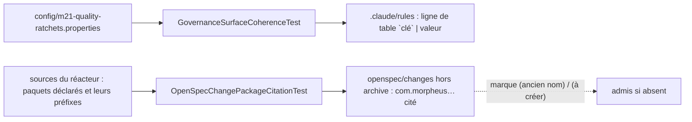

# Actualité d'un fait recopié par un document vivant (`stated-fact-currency`)

Spec de référence : `openspec/specs/stated-fact-currency/spec.md` à l'archivage du changement
`compare-every-document-that-states-a-fact-to-its-source`, qui porte la capacité jusque-là · Relevé du 2026-11-06 sur
`8c038add`.

## Objet et périmètre

Un document vivant qui recopie un fait dont la source est lisible par un test est comparé à cette source par le build.
Deux faits sont couverts : une valeur de cliquet recopiée dans `.claude/rules/`, et un nom de paquet `com.morpheus`
cité par un changement OpenSpec actif.

- **Acteurs** : agent qui lit `.claude/rules/` à chaque session ; contributeur qui reprend un changement OpenSpec
  actif ; mainteneur qui relève un cliquet.
- **Inclus** : les pages de `.claude/rules/` (lignes de table) ; les fichiers Markdown de `openspec/changes/` hors
  `archive/`.
- **Exclus** : les paragraphes datés de `.claude/rules/testing.md` (relevés de requalification) ; les archives
  OpenSpec ; les specs principales `openspec/specs/` ; les versions de dépendances, tenues par
  [`dependency-version-management`](dependency-version-management.md).

## Exigences

| Alias | Exigence (titre exact) | En bref | Nature |
|---|---|---|---|
| R1 | Une valeur de cliquet qu'une page de règles recopie sous le nom de sa clé DOIT égaler cette clé | ligne de table `` `clé` `` puis valeur, comparée à `config/m21-quality-ratchets.properties` ; clé retirée refusée ; scan vide refusé | `[EXIGENCE]` |
| R2 | Un nom de paquet `com.morpheus` cité dans un changement OpenSpec actif DOIT exister dans les sources du réacteur | paquet ou préfixe d'un paquet déclaré sous `src/main/java` ou `src/test/java` d'un module du POM racine | `[EXIGENCE]` |
| R3 | Seule une mention marquée « (ancien nom) » ou « (à créer) » DOIT être admise pour un paquet absent des sources | la marque suit le nom sur la même ligne ; « (à créer) » sur un paquet qui existe est refusé | `[EXIGENCE]` |

## Comportement détaillé

- **R1** `[EXISTANT VÉRIFIÉ]` ([`GovernanceSurfaceCoherenceTest`](../../../morpheus-architecture-tests/src/test/java/com/morpheus/architecture/GovernanceSurfaceCoherenceTest.java)`#everyRatchetARulePageCopiesUnderItsKeyEqualsTheKey`) :
  le test lit, dans chaque page de `.claude/rules/`, les lignes de table dont la première cellule est un nom de clé en
  span de code terminé par `Minimum` ou `Maximum`, et compare le premier nombre de la cellule suivante à la clé, en
  valeur décimale (`0.9260` égale `0.926`). Il échoue en nommant la page, la clé et les deux valeurs, ou la clé que le
  fichier ne déclare pas ; il échoue aussi quand il ne lit aucune ligne. La seule copie de `.claude/rules/` est la
  table de `testing.md` ; `governance.md` renvoie à elle.
- **R2** `[EXISTANT VÉRIFIÉ]` ([`OpenSpecChangePackageCitationTest`](../../../morpheus-architecture-tests/src/test/java/com/morpheus/architecture/OpenSpecChangePackageCitationTest.java)`#everyPackageAnActiveChangeCitesExistsInTheReactorSources`) :
  le nom cité est la plus longue suite de segments en minuscules après `com.morpheus.` (`com.morpheus.api..` donne
  `com.morpheus.api`, un nom de classe qualifié donne son paquet). L'arbre est parcouru par `RepositoryTree.files`. Un
  refus nomme le fichier, la ligne et le paquet. Le test exige que l'ensemble des paquets lus contienne
  `com.morpheus.application`, pour ne pas passer sur un scan vide ; sans changement actif, rien n'est lu.
- **R3** `[EXISTANT VÉRIFIÉ]` (même classe) : entre le nom et sa marque ne peuvent figurer que la fin d'un nom
  qualifié, la fermeture d'un span de code et des espaces. Une autre tournure (« renommé depuis », « formerly ») n'est
  pas une marque. Aucune liste d'exceptions n'est tenue dans le test.

## Diagrammes

### Quelle copie est comparée à quelle source ?

Existant. Exigences R1, R2 et R3.

## Écarts et questions ouvertes

- `[QUESTION]` **Version produit recopiée** : `.claude/CLAUDE.md` et `.claude/rules/governance.md` écrivent la version
  produit en prose ; aucun test ne la compare à `ProductMetadata`. Hors de cette capacité, à trancher par le mainteneur.
- `[EXISTANT VÉRIFIÉ]` **Marque « (ancien nom) » sur un paquet existant** : admise ; la spec ne dit rien de ce cas.

## Traçabilité

| Exigence | Scénario | Conception ou diagramme | Changement | Preuve |
|---|---|---|---|---|
| R1 | Un cliquet relevé sans la page de règles | organigramme | `compare-every-document-that-states-a-fact-to-its-source` | `GovernanceSurfaceCoherenceTest#everyRatchetARulePageCopiesUnderItsKeyEqualsTheKey` ; `#aRatchetRowIsComparedByValueAndARetiredKeyIsRefusedWhileADatedParagraphIsNotRead` |
| R1 | Une clé retirée du fichier | idem | idem | `GovernanceSurfaceCoherenceTest#aRatchetRowIsComparedByValueAndARetiredKeyIsRefusedWhileADatedParagraphIsNotRead` |
| R1 | Une mesure datée n'est pas comparée | idem | idem | idem |
| R1 | Le contrôle a trouvé des valeurs à comparer | idem | idem | idem (scan vide refusé) |
| R2 | Le paquet supprimé par un renommage | idem | idem | `OpenSpecChangePackageCitationTest#everyPackageAnActiveChangeCitesExistsInTheReactorSources` ; `#anAbsentPackageIsRefusedWhereverItIsCitedAndAnExistingOneUnderEveryForm` |
| R2 | Un paquet existant cité sous plusieurs formes | idem | idem | `OpenSpecChangePackageCitationTest#anAbsentPackageIsRefusedWhereverItIsCitedAndAnExistingOneUnderEveryForm` |
| R2 | Une archive cite un ancien nom | idem | idem | idem |
| R2 | Aucun changement actif | idem | idem | `OpenSpecChangePackageCitationTest#noActiveChangeIsReadAsNoCitationWhileTheCorpusProvesTheRefusal` |
| R3 | Un renommage raconté | idem | idem | `OpenSpecChangePackageCitationTest#onlyTheTwoMarksAdmitAnAbsentPackageAndTheCreationMarkDoesNotOutliveTheCreation` |
| R3 | Un paquet qu'un changement propose de créer | idem | idem | idem |
| R3 | Une marque restée après la création | idem | idem | idem |
| R3 | Une autre formulation n'est pas une marque | idem | idem | idem |

## Sources

- Règles de dépôt : `.claude/rules/meta.md`, `.claude/rules/testing.md` (table des cliquets), `.claude/rules/governance.md`.
- Conventions de rédaction OpenSpec : [`../OPENSPEC_SCHEMA.md`](../OPENSPEC_SCHEMA.md).
- Pages liées : [`dependency-version-management.md`](dependency-version-management.md),
  [`module-package-correspondence.md`](module-package-correspondence.md).
