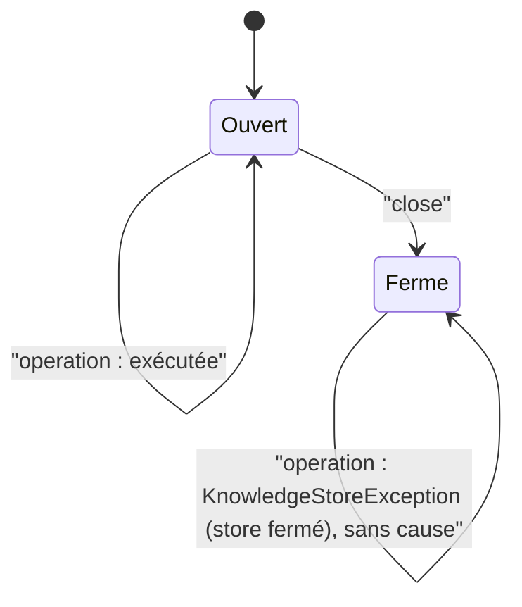

# Refus d'un store SQLite fermé (`store-closed-refusal`)

Spec de référence : [`openspec/specs/store-closed-refusal/spec.md`](../../../openspec/specs/store-closed-refusal/spec.md)
· Relevé du 2026-11-04 sur `2913fc30`.

## Objet et périmètre

Un store SQLite utilisé après sa fermeture refuse toute opération de la même façon, pour qu'un appelant traite un
store fermé par une seule règle.

- **Acteurs** : les douze stores de `com.morpheus.store.sqlite.adapter` ; les appelants des transports, qui
  rattrapent `KnowledgeStoreException` (serveur HTTP local, `McpCatalogTool`).
- **Inclus** : le type du refus, son message, l'absence de cause, l'ordre (avant tout accès à la base et avant la
  validation des arguments), l'idempotence de `close()`.
- **Exclus** : les stores mémoire (sans `close()`), le runtime d'opération fermé (voir la section Écarts).

## Exigences

| Alias | Exigence (titre exact) | En bref | Nature |
|---|---|---|---|
| R1 | A closed SQLite store refuses every operation as a storage failure | `KnowledgeStoreException` nommant le store fermé, sans cause, avant la base ; même refus pour tous les stores ; double fermeture sans effet | `[EXIGENCE]` |

## Comportement détaillé

`[EXISTANT VÉRIFIÉ]` Chacun des douze stores déclare une méthode privée `ensureOpen()` qui lève
`new KnowledgeStoreException("SQLite <nom> store is closed")` (message sans cause). Messages relevés dans les sources :

| Store | Message |
|---|---|
| `SqliteChangeLifecycleMutationStore` | `SQLite lifecycle mutation store is closed` |
| `SqliteCompositionStateStore` | `SQLite composition state store is closed` |
| `SqliteEntityIdentityStore` | `SQLite entity identity store is closed` |
| `SqliteExternalReferenceStore` | `SQLite external reference store is closed` |
| `SqlitePolicyPackStore` | `SQLite policy-pack store is closed` |
| `SqlitePortfolioStore` | `SQLite portfolio store is closed` |
| `SqliteSavedViewStore` | `SQLite saved-view store is closed` |
| `SqliteSnapshotBusinessContentStore` | `SQLite snapshot business content store is closed` |
| `SqliteSpecificationKnowledgeStore` | `SQLite knowledge store is closed` |
| `SqliteSyncStateStore` | `SQLite synchronization state store is closed` |
| `SqliteTraceabilityStore` | `SQLite traceability store is closed` |
| `SqliteVersionedRequirementStore` | `SQLite versioned requirement store is closed` |

`[EXISTANT VÉRIFIÉ]` Le test appelle les opérations avec des arguments `null` : la garde passe avant la validation,
sinon un `NullPointerException` ferait échouer le test. `close()` appelé deux fois ne lève rien.

`[EXISTANT VÉRIFIÉ]` Les transports rattrapent `KnowledgeStoreException` comme échec de stockage :
`MorpheusHttpServer` (clause `catch (KnowledgeStoreException | PublishedHistoryException | IllegalStateException …)`)
et `McpCatalogTool` (`catch (IllegalArgumentException | KnowledgeStoreException …)`).

## Diagrammes

### Que devient un appel fait après `close()` ?

Existant vérifié. Exigence R1.

## Écarts et questions ouvertes

- **Preuve partielle de « every operation »** : le test exerce toutes les opérations pour deux stores seulement
  (`SqliteSavedViewStore`, sept opérations ; `SqliteCompositionStateStore`, deux). Pour les dix autres, le
  recensement `everySqliteStoreRefusesAnOperationAfterCloseTheSameWay` n'appelle **qu'une** opération par store. Un
  appel ajouté à un de ces stores sans `ensureOpen()` passerait ce test. Le compte des appels à `ensureOpen()` dans
  chaque source est cohérent avec le nombre d'opérations publiques pour le store des mutations de cycle de vie
  (quatre opérations, quatre gardes), relevé à la main, sans test qui le tienne.
- **Preuve de « before touching the database »** : l'ordre garde-puis-arguments est prouvé par les arguments `null` ;
  l'absence d'accès à la base n'est pas observée séparément.
- **Hors périmètre de la spec, vérifié** : le runtime d'opération fermé refuse de construire un store par un
  `IllegalStateException` (« the SQLite operation runtime is closed »), non par `KnowledgeStoreException`
  ([`SqliteOperationRuntimeConnectionTest`](../../../morpheus-store-sqlite/src/test/java/com/morpheus/store/sqlite/runtime/SqliteOperationRuntimeConnectionTest.java)`#aStoreAskedForAfterCloseIsRefusedRatherThanOpenedOnAConnectionOfItsOwn`).
  La spec parle des stores, pas du runtime.
- **Vocabulaire** : la spec dit « the storage-failure refusal the transports already map » ; le type du code est
  `KnowledgeStoreException` (`com.morpheus.application.store`), dont le nom ne dit pas « storage failure ».

## Traçabilité

| Exigence | Scénario | Conception ou diagramme | Changement | Preuve |
|---|---|---|---|---|
| R1 | Any operation after close | machine à états | archive `2026-10-09-align-store-refusal-parity` | [`SqliteClosedStoreRefusalTest`](../../../morpheus-store-sqlite/src/test/java/com/morpheus/store/sqlite/adapter/SqliteClosedStoreRefusalTest.java)`#theSavedViewStoreRefusesEveryOperationAfterClose`, `#theCompositionStateStoreRefusesEveryOperationAfterClose` (toutes les opérations) ; preuve partielle pour les dix autres stores (une opération chacun) |
| R1 | The same refusal for every store | idem | idem | même classe, `#everySqliteStoreRefusesAnOperationAfterCloseTheSameWay` (recensement des messages lus dans les sources, type, absence de cause) |
| R1 | Closing twice | idem | idem | même classe, aide `closed(...)` appelée par `#everySqliteStoreRefusesAnOperationAfterCloseTheSameWay` (deux `close()` sans exception) |

## Sources

- Archive OpenSpec : `openspec/changes/archive/2026-10-09-align-store-refusal-parity/`.
- Page liée : [`sqlite-connection-policy.md`](sqlite-connection-policy.md) (cycle de vie du runtime d'opération).
