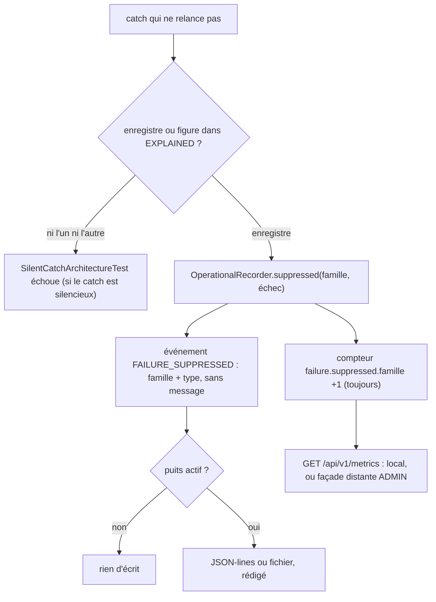

# Trace d'un échec écarté (`suppressed-failure-trace`)

Spec de référence : [`openspec/specs/suppressed-failure-trace/spec.md`](../../../openspec/specs/suppressed-failure-trace/spec.md)
· Relevé du 2026-11-04 sur `2913fc30`.

## Objet et périmètre

Quand le produit choisit de ne pas propager un échec (adaptateur optionnel qui ne se charge pas, requête HTTP morte
d'un défaut imprévu, pair MCP défaillant...), il laisse une trace : un compteur par famille nommée, un événement quand
un puits écoute, jamais le message de l'échec.

- **Acteurs** : code du produit qui attrape un échec sans le relancer ; opérateur qui lit les métriques ou le journal ;
  mainteneur qui ajoute un `catch`.
- **Inclus** : `OperationalRecorder.suppressed`, liste fermée `SuppressedFailureFamily`, événement `FAILURE_SUPPRESSED`,
  service des compteurs par `GET /api/v1/metrics`, garde `SilentCatchArchitectureTest`.
- **Exclus** : le contenu des journaux eux-mêmes ([`operational-log-mode.md`](operational-log-mode.md)) ; le texte d'un
  échec rendu à un appelant HTTP ([`http-failure-disclosure.md`](http-failure-disclosure.md)).

## Exigences

| Alias | Exigence (titre exact) | En bref | Nature |
|---|---|---|---|
| R1 | A deliberately swallowed failure SHALL be counted under a named family | chaque `catch` sans relance enregistre l'échec (compteur, événement) ou figure dans une liste fermée avec sa raison | `[EXIGENCE]` |
| R2 | The trace SHALL name the family and the type and SHALL NOT carry the message | l'événement porte la famille et le nom simple du type, jamais le message | `[EXIGENCE]` |
| R3 | The counters SHALL be served with the metrics the product already exposes | compteurs servis par les métriques locales et distantes, sans nouvelle route | `[EXIGENCE]` |

## Comportement détaillé

`[EXISTANT VÉRIFIÉ]` (`OperationalRecorder`, `SuppressedFailureFamily`, `OPERABILITY.md`) :

- `suppressed(famille, échec)` incrémente `failure.suppressed.<clé>` **quel que soit le puits**, puis émet un
  événement de code `FAILURE_SUPPRESSED` dont les attributs sont exactement `family` et `failureType`
  (`getClass().getSimpleName()`). `suppressing(famille)` en donne la forme `Consumer<Throwable>` pour un composant qui
  ne connaît pas son écoute.
- Les familles sont une liste fermée de l'énumération (la liste exacte est à lire dans `SuppressedFailureFamily`, avec
  leur niveau d'événement) ; chaque clé suit `[a-z]+(-[a-z]+)*` et a un compteur propre.
- Découverte des adaptateurs de raisonnement : `ReasoningAdapterRegistry.standard(setAside)` appelle `setAside` pour
  tout fournisseur absent car en échec ; la CLI, l'outil MCP et le service API câblent
  `recorder.suppressing(SuppressedFailureFamily.ADAPTER_DISCOVERY)`.
- Métriques : la projection `MorpheusOperabilityApiService.metrics()` ne porte aucune liste de noms ; une famille est
  servie dès qu'elle a compté et absente tant qu'elle n'a jamais bougé. La route est celle de `/api/v1/metrics`, servie
  localement et, derrière la façade distante, au rôle ADMIN.
- Les noms de compteurs ne font pas partie du contrat OpenAPI (`OPERABILITY.md`) : décision de contrat laissée au
  mainteneur.
- Garde de build : `SilentCatchArchitectureTest` lit les sources principales et compare les `catch` « silencieux »
  (corps sans instruction, ou variable nommée `ignored`, `ignore`, `unused`) à la table `EXPLAINED` (fichier, types,
  nombre, raison).

## Diagrammes

### Que devient un échec écarté ?

Existant vérifié (`OperationalRecorder.suppressed`, `MorpheusOperabilityApiService`). Exigences : R1, R2, R3.

## Écarts et questions ouvertes

- `[EXISTANT VÉRIFIÉ]` **Écart de portée (R1).** La spec vise « every `catch` of the product that does not rethrow ».
  `SilentCatchArchitectureTest` ne voit que les `catch` dont le corps ne contient aucune instruction ou dont la
  variable est nommée `ignored`/`ignore`/`unused` ; sa javadoc reconnaît qu'un `catch` qui rend une valeur par défaut
  sous une variable bien nommée lui échappe et que la revue doit le lire.
- `[EXISTANT VÉRIFIÉ]` **Écart de message (R1).** Le scénario « A new silent catch fails the build » promet que la suite
  « names the file and the line ». Le message d'échec de `everySilentCatchOfTheProductIsNamedWithItsReason` compare
  deux tables `fichier.java#types` -> nombre : il nomme le fichier et les types attrapés, pas la ligne.
- `[EXISTANT VÉRIFIÉ]` Scénario « A broken optional adapter is visible » : le test d'enregistrement prouve que
  `setAside` reçoit l'échec (`ReasoningAdapterRegistryTest`) et un autre que le compteur de la famille se déplace
  (`SuppressedFailureTraceTest`), mais aucun test ne relie les deux par le câblage CLI, MCP ou API vers le compteur
  `failure.suppressed.adapter-discovery`. Preuve manquante pour la chaîne complète.
- `[EXISTANT VÉRIFIÉ]` Scénario « A message that names a location stays out » : le test sur le puits JSON vérifie
  l'absence du mot `plugins` et non celle du chemin entier ; l'attribut `Map.of("family", ..., "failureType", ...)`
  est lui vérifié exactement (`theEventNamesTheFamilyAndTheTypeAndNeverTheMessage`).
- `[EXISTANT VÉRIFIÉ]` Deux modules ne comptent pas par eux-mêmes (transport MCP, SDK plugin) et reçoivent un
  observateur de celui qui les construit ; `theModulesThatCannotCountAreHandedWhatDoes` tient ce câblage par texte.
- `[EXISTANT VÉRIFIÉ]` Comportement absent de la spec : un descendant vu par le seul worker de sonde de plugin ne
  laisse aucune trace ; c'est une entrée de `EXPLAINED` (`ProviderPluginDescendantTermination.java`).
- `[QUESTION]` Figer les noms de compteurs dans l'OpenAPI serait une décision de contrat (réservée au mainteneur).

## Traçabilité

| Exigence | Scénario | Conception ou diagramme | Changement | Preuve |
|---|---|---|---|---|
| R1 | A broken optional adapter is visible | organigramme | archive `2026-10-16-leave-a-trace-when-a-failure-is-swallowed` | [`ReasoningAdapterRegistryTest`](../../../morpheus-application/src/test/java/com/morpheus/application/reasoning/ReasoningAdapterRegistryTest.java)`#anInstalledAdapterThatCannotBeBuiltIsLeftOutAndReported` ; [`SuppressedFailureTraceTest`](../../../morpheus-application/src/test/java/com/morpheus/application/operability/SuppressedFailureTraceTest.java)`#theCounterOfTheFamilyMovesWhenNoSinkListens` ; chaîne de câblage : preuve manquante |
| R1 | The counter moves with logs off | idem | idem | `SuppressedFailureTraceTest#theCounterOfTheFamilyMovesWhenNoSinkListens` |
| R1 | A new silent catch fails the build | idem | idem | [`SilentCatchArchitectureTest`](../../../morpheus-architecture-tests/src/test/java/com/morpheus/architecture/SilentCatchArchitectureTest.java)`#everySilentCatchOfTheProductIsNamedWithItsReason` (nomme fichier et types, pas la ligne) ; `#theShapeOfASilentCatchIsRecognised` |
| R2 | A message that names a location stays out | idem | idem | `SuppressedFailureTraceTest#theEventNamesTheFamilyAndTheTypeAndNeverTheMessage` ; `#theStructuredSinkWritesTheEventWithoutTheLocationTheFailureNamed` |
| R3 | An operator reads them | idem | idem | [`SuppressedFailureCountersServedTest`](../../../morpheus-api/src/test/java/com/morpheus/api/SuppressedFailureCountersServedTest.java)`#aFamilyThatNeverMovedIsAbsentAndEveryFamilyThatMovedIsServedUnderItsOwnName` ; [`UnforeseenFailureTraceTest`](../../../morpheus-api/src/test/java/com/morpheus/api/transport/UnforeseenFailureTraceTest.java)`#anUnforeseenFailureIsAnsweredGenericallyAndCountedInTheMetricsTheServerServes` ; [`RemoteSuppressedFailureCountersServedTest`](../../../morpheus-api/src/test/java/com/morpheus/api/remote/RemoteSuppressedFailureCountersServedTest.java)`#aFailureSetAsideBehindTheFacadeIsCountedInTheMetricsTheFacadeServesToAnAdministrator` |

Preuves par famille hors de ce tableau : `MinosSuppressedFailureTraceTest` et `NexusSuppressedFailureTraceTest`
(`morpheus-integration-minos` et `morpheus-integration-nexus`, famille des pairs MCP et du nettoyage de copie).

## Sources

- Page développeur : [`../OPERABILITY.md`](../OPERABILITY.md), section « Échecs écartés ».
- ADR : [BE-0146](../../architecture/adr/BE-0146-journal-operationnel-slf4j-et-fichier-borne.md) (même option que `FAILURE_SUPPRESSED` pour le type seul).
- Pages liées : [`http-failure-disclosure.md`](http-failure-disclosure.md), [`mcp-peer-launch-command.md`](mcp-peer-launch-command.md).
