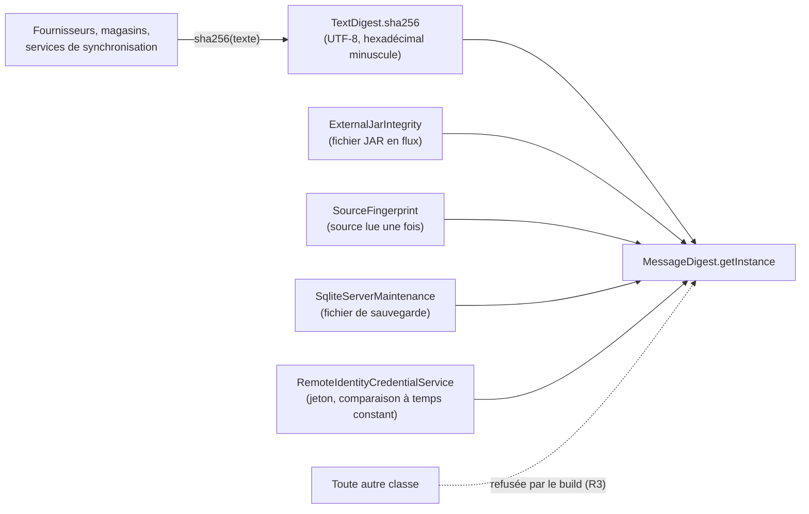
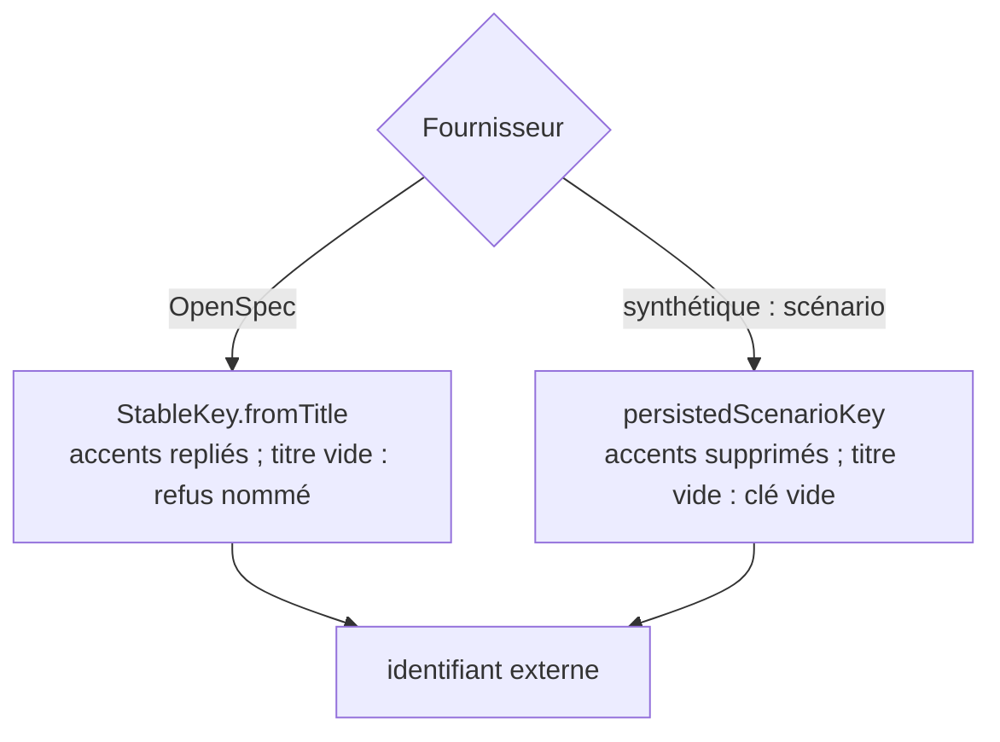

# Empreinte d'un texte et clé stable d'un titre (`text-digest-and-key-derivation`)

Spec de référence : [`openspec/specs/text-digest-and-key-derivation/spec.md`](../../../openspec/specs/text-digest-and-key-derivation/spec.md)
· Relevé du 2026-11-04 sur `2913fc30`.

## Objet et périmètre

Le produit calcule le SHA-256 d'un texte, et la clé stable d'un titre, **chacun à un seul endroit**. L'empreinte d'un
extrait entre dans les empreintes de provenance : une seconde copie est un lieu où un encodage ou une normalisation peut
changer pour certaines empreintes et pas pour d'autres. La clé d'un titre entre dans les identifiants externes des
fournisseurs, donc dans des identités persistées.

- **Acteurs** : les fournisseurs (OpenSpec, Markdown, synthétique), les services de synchronisation, le magasin SQLite,
  le cycle de vie ; l'auteur d'une classe qui voudrait « son » SHA-256.
- **Inclus** : `TextDigest` et `StableKey` (`com.morpheus.application.foundation`), `OpenSpecSourceText`, la liste nommée
  des classes autorisées à demander un `MessageDigest`, la dérivation propre au fournisseur synthétique.
- **Exclus** : l'empreinte d'un fichier, d'un flux ou d'un jeton, calculée par les classes que la règle nomme.

## Exigences

| Alias | Exigence (titre exact) | En bref | Nature |
|---|---|---|---|
| R1 | The digest of a text SHALL be computed in one place | une fonction rend le SHA-256 hexadécimal minuscule des octets UTF-8 ; le remplacement ne change aucune empreinte existante | `[EXIGENCE]` |
| R2 | A platform without the digest SHALL be reported with one wording | même message d'échec quel que soit le module | `[EXIGENCE]` |
| R3 | Only named classes SHALL ask the platform for a message digest | le build échoue pour toute classe hors liste ; chaque entrée dit pourquoi elle n'utilise pas la fonction commune ; la liste ne grossit pas sans cette phrase | `[EXIGENCE]` |
| R4 | The OpenSpec provider SHALL derive keys and read lines through one helper each | dérivation d'une clé, lecture bornée en lignes et jonction de lignes : une fois chacune ; le build échoue si une classe du fournisseur déclare la sienne | `[EXIGENCE]` |
| R5 | Two key derivations SHALL NOT share a name while behaving differently | une dérivation de fournisseur est la commune, ou porte un nom et un énoncé documenté de sa différence | `[EXIGENCE]` |

## Comportement détaillé

### L'empreinte (R1, R2)

`[EXISTANT VÉRIFIÉ]` `TextDigest.sha256(String)` refuse un texte absent par le nom `text`, calcule
`MessageDigest.getInstance("SHA-256")` sur les octets UTF-8 et rend `HexFormat.of().formatHex` (minuscules). Son échec
de plateforme est `IllegalStateException(TextDigest.UNAVAILABLE)`, où `UNAVAILABLE` vaut `SHA-256 must be available`.

### Les classes qui demandent quand même un digest (R3)

`[EXISTANT VÉRIFIÉ]` `TextDigestOwnershipArchitectureTest.DIGEST_SITES` est une table nom binaire vers raison. Elle nomme le
propriétaire (`TextDigest`) et quatre classes dont la raison est écrite : `ExternalJarIntegrity` (JAR lu en flux),
`SourceFingerprint` (source hachée pendant la lecture), `SqliteServerMaintenance` (fichier de sauvegarde en flux),
`RemoteIdentityCredentialService` (jeton haché en octets pour une comparaison à temps constant). Trois verrous :
règle ArchUnit sur l'appel compilé de `MessageDigest.getInstance` hors de la liste ; égalité exacte entre la liste et les
classes qui demandent un digest ; jumeau textuel (`getInstance("SHA-256")` dans toute source de production, y compris
`morpheus-provider-testkit` hors du classpath importé).

### Les aides du fournisseur OpenSpec (R4)

`[EXISTANT VÉRIFIÉ]` Un motif de déclaration (`slug`, `stableKey`, `readAllLines`, `joinContent`, et `sha256(String…)`)
est appliqué ligne à ligne à toutes les sources de production. `HELPER_OWNERS` désigne un seul fichier propriétaire pour
`sha256`, `readAllLines` et `joinContent` ; `slug` et `stableKey` n'ont aucun propriétaire et sont donc interdits partout.
`OpenSpecSourceText.readAllLines` lit sous le budget d'ingestion et échoue par
`Cannot read OpenSpec source: …`, un texte relayable ; `joinContent` joint les lignes non vides qui ne sont pas des titres.
Le motif est vérifié contre des faux positifs (`sha256(Path)`, `slugify`, un appel) par `theDeclarationPatternIsNotAFamilyPrefix`.

### La clé d'un titre (R5)

`[EXISTANT VÉRIFIÉ]` `StableKey.fromTitle` : forme NFD, retrait des marques, minuscules, toute suite hors `[a-z0-9]`
devient un trait d'union, sans trait d'union aux extrémités ; un titre qui ne laisse rien est refusé par
`IllegalArgumentException("Cannot derive a stable key from: <titre>")`. Le fournisseur synthétique garde une dérivation
propre, `persistedScenarioKey` (minuscules, `[^a-z0-9]+` en trait d'union, sans trait d'union aux extrémités, **sans repli
des accents**) : ses identités sont persistées, et un repli différent leur donnerait de nouvelles identités. Sa Javadoc
l'énonce.

## Diagrammes

### Qui a le droit de calculer une empreinte ?

Existant vérifié. Il répond à R1 et R3 : un seul calcul de texte, quatre exceptions de flux ou de fichier, une règle qui
refuse le reste.

### Quelle dérivation de clé, pour quel fournisseur ?

Existant vérifié. Il répond à R5 : la clé commune replie les accents ; la clé synthétique, nommée à part, ne les replie pas.

## Écarts et questions ouvertes

- **Preuve manquante : « Two providers on a deficient platform » (R2).** Aucun test ne provoque l'échec : `TextDigestTest`
  n'asserte que la constante (`thePlatformWithoutTheDigestIsReportedWithOneWording`). Le message est copié en littéral dans
  quatre classes (`ExternalJarIntegrity`, `SourceFingerprint`, `SqliteServerMaintenance`, `RemoteIdentityCredentialService`)
  au lieu de référencer `TextDigest.UNAVAILABLE`. La seule garde, `noProductSourceOutsideTheNamedListCallsTheDigestByItsAlgorithmName`,
  interdit l'ancienne formulation `SHA-256 is unavailable` : une cinquième formulation passerait.
- **Preuve manquante : lecture de la raison (R3).** Le code de la table ne vérifie pas qu'une raison est non vide (comme le
  fait la porte `UnreferencedPublicMethodArchitectureTest` pour la sienne). « La liste ne grossit pas sans cette phrase »
  est tenu par la revue : `DIGEST_SITES` est une table de faits dans `ProductionClassListsArchitectureTest`
  (`Kind.TABLE_OF_FACTS`), sans cliquet ni ADR de compteur de dette, alors que la Javadoc du test dit « the list only shrinks ».
  `[QUESTION]` Faut-il en faire un compteur de dette ?
- **Preuve partielle : R1, « Existing fingerprints » et « The same text in two providers ».** Aucun test ne compare
  deux fournisseurs, ni ne rejoue les empreintes d'avant le remplacement : la preuve est que les suites de fournisseurs, de
  magasins et de cycle de vie passent sans modifier une empreinte attendue (constat du changement archivé), et qu'aucun
  fournisseur ne calcule plus lui-même un digest (R3). Les vecteurs fixes de `TextDigestTest` couvrent le texte vide,
  ASCII et hors ASCII.
- **Limite connue du motif de R4.** Seuls les noms `slug`, `stableKey`, `readAllLines`, `joinContent` et `sha256(String` sont
  jugés : « its name is the only handle » (Javadoc du test). Une dérivation privée sous un autre nom ne serait pas vue ;
  `persistedScenarioKey` en est l'exemple, voulu et documenté.
- **Preuve partielle : « An unreadable source » (R4).** `OpenSpecSourceText.readAllLines` est l'unique site du message
  `Cannot read OpenSpec source:` ; `OpenSpecRefusedFileNameTest#anEvidenceBudgetRefusalNamesTheFileAsItExistsInEveryReader`
  vérifie le nom de fichier d'un refus de budget dans chaque lecteur, mais aucun test ne compare le texte complet entre
  lecteurs.
- **Écart d'énoncé : « A title that leaves nothing » (R5).** La dérivation synthétique n'échoue pas et ne rend pas de clé
  vide « par accident » : un titre sans lettre ni chiffre donne une clé vide, donc un identifiant qui finit par `/`. Le
  résultat est fixé par un test
  (`SyntheticSpecificationContentReaderTest#aScenarioTitleThatLeavesNoKeyKeepsTheIdentityOfItsRequirementPrefix`) mais la
  Javadoc de `persistedScenarioKey` ne l'énonce pas. `[QUESTION]` Le test suffit-il comme énoncé « documenté » ?
- **Preuve manquante : « Adopting the shared derivation… MUST NOT change a key » (R5).** Aucun test dédié ne compare les clés
  des fixtures avant et après adoption.

## Traçabilité

| Exigence | Scénario | Conception ou diagramme | Changement | Preuve |
|---|---|---|---|---|
| R1 | The same text in two providers | flux des empreintes | archive `2026-10-30-derive-digests-and-stable-keys-in-one-place` | [`TextDigestOwnershipArchitectureTest`](../../../morpheus-architecture-tests/src/test/java/com/morpheus/architecture/TextDigestOwnershipArchitectureTest.java)`#onlyTheNamedClassesAskThePlatformForAMessageDigest` (preuve structurelle ; pas de test de comparaison) |
| R1 | A text outside ASCII | idem | idem | [`TextDigestTest`](../../../morpheus-application/src/test/java/com/morpheus/application/foundation/TextDigestTest.java)`#aTextOutsideAsciiIsDigestedAsUtf8` |
| R1 | Existing fingerprints | idem | idem | suites existantes inchangées ; **preuve manquante** dédiée |
| R2 | Two providers on a deficient platform | — | idem | `TextDigestTest#thePlatformWithoutTheDigestIsReportedWithOneWording` (constante seule) ; **preuve manquante** pour l'échec réel |
| R3 | A reader hashes for itself | flux des empreintes | idem | `TextDigestOwnershipArchitectureTest#onlyTheNamedClassesAskThePlatformForAMessageDigest` et `#noProductSourceOutsideTheNamedListCallsTheDigestByItsAlgorithmName` |
| R3 | An excused class disappears | idem | idem | `TextDigestOwnershipArchitectureTest#everyNamedClassStillAsksThePlatformForAMessageDigest` |
| R4 | A fourth reader is added | — | idem | `TextDigestOwnershipArchitectureTest#theKeyLineAndContentHelpersAreDeclaredOnlyByTheirOwner` ; `#theDeclarationPatternIsNotAFamilyPrefix` ; `#theRulesSeeTheOwnersTheyProtect` |
| R4 | An unreadable source | — | idem | partielle : [`OpenSpecRefusedFileNameTest`](../../../morpheus-provider-openspec/src/test/java/com/morpheus/provider/openspec/OpenSpecRefusedFileNameTest.java)`#anEvidenceBudgetRefusalNamesTheFileAsItExistsInEveryReader` |
| R5 | An accented title in the synthetic provider | choix de dérivation | idem | [`SyntheticSpecificationContentReaderTest`](../../../morpheus-provider-synthetic/src/test/java/com/morpheus/provider/synthetic/SyntheticSpecificationContentReaderTest.java)`#anAccentedScenarioTitleKeepsTheKeyItsPersistedIdentityWasDerivedFrom` ; commune : [`StableKeyTest`](../../../morpheus-application/src/test/java/com/morpheus/application/foundation/StableKeyTest.java)`#anAccentedLetterIsFoldedToItsBaseLetter` |
| R5 | A title that leaves nothing | choix de dérivation | idem | `StableKeyTest#aTitleThatLeavesNothingIsRefusedByName` ; synthétique : `SyntheticSpecificationContentReaderTest#aScenarioTitleThatLeavesNoKeyKeepsTheIdentityOfItsRequirementPrefix` (voir Écarts) |

## Sources

- Changement archivé : `2026-10-30-derive-digests-and-stable-keys-in-one-place`.
- Règle du dépôt : [`.claude/rules/code-style.md`](../../../.claude/rules/code-style.md), section « Déterminisme ».
- Pages liées : [`openspec-provider-reading.md`](openspec-provider-reading.md), [`../OPENSPEC_PROVIDER.md`](../OPENSPEC_PROVIDER.md).
