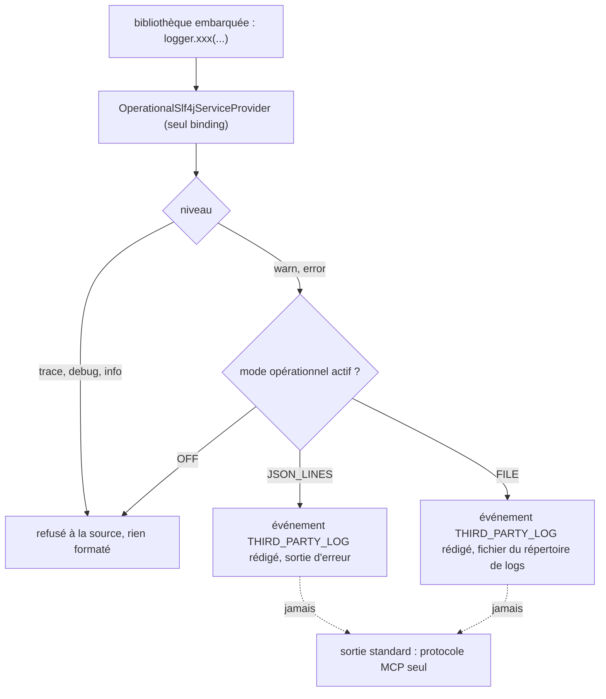

# Capture des journaux des bibliothèques embarquées (`third-party-log-capture`)

Spec de référence : [`openspec/specs/third-party-log-capture/spec.md`](../../../openspec/specs/third-party-log-capture/spec.md)
· Relevé du 2026-11-04 sur `2913fc30`.

## Objet et périmètre

Ce que les bibliothèques embarquées (SDK MCP, Reactor...) journalisent par SLF4J au niveau avertissement ou au-dessus
rejoint le puits opérationnel quand un mode actif le demande, et n'est écrit nulle part sinon. Le produit ne porte
qu'un fournisseur SLF4J.

- **Acteurs** : opérateur ; bibliothèques embarquées ; mainteneur du packaging.
- **Inclus** : fournisseur `OperationalSlf4jServiceProvider`, niveaux acceptés, rédaction, absence d'écriture sur la
  sortie standard, unicité du binding.
- **Exclus** : les classes du produit qui journalisent par `System.Logger` (sortie d'erreur en texte dans tous les
  modes, BE-0146 décision 9).

## Exigences

| Alias | Exigence (titre exact) | En bref | Nature |
|---|---|---|---|
| R1 | Third-party warnings and errors SHALL reach the operational sink when one is active | WARN et ERROR deviennent un événement `THIRD_PARTY_LOG` rédigé ; mode coupé = rien | `[EXIGENCE]` |
| R2 | The product SHALL ship exactly one logging binding | un seul fournisseur SLF4J, celui de MORPHEUS, pas de `slf4j-nop` | `[EXIGENCE]` |

## Comportement détaillé

`[EXISTANT VÉRIFIÉ]` (`OperationalSlf4jServiceProvider`, ADR BE-0146 décisions 1 à 3) :

- `initialize()` lit `LocalOperationalRuntime.writesEvents()` et le puits du processus une fois. `isWarnEnabled` et
  `isErrorEnabled` valent `writesEvents()` ; trace, debug et info sont toujours faux : la bibliothèque ne formate rien.
  Mode coupé : comportement de `slf4j-nop`.
- L'événement porte le code `THIRD_PARTY_LOG`, le niveau (ERROR ou WARNING), `logger` (nom), `message` formaté et borné
  à `MAX_MESSAGE_CHARACTERS`, et `failureType` (nom simple du type de l'échec joint) s'il y en a un ; jamais le message
  de l'échec joint.
- Le puits est celui du processus : la rédaction (`SensitiveValueRedactor`) s'applique comme pour tout événement.
- Rien n'est écrit sur la sortie standard, flux de protocole du serveur MCP.
- `morpheus-cli/pom.xml` déclare `slf4j-api` et ne nomme pas `slf4j-nop`.

## Diagrammes

### Où va un enregistrement SLF4J d'une bibliothèque ?

Existant vérifié (`SinkLogger`, `OperationalRuntime`). Exigences : R1, R2.

## Écarts et questions ouvertes

- `[EXISTANT VÉRIFIÉ]` Le scénario « A failed MCP handshake is heard » est prouvé avec un logger de fixture
  (`io.example.Fixture`, processus `FixtureThirdPartyLogProcess`), pas avec un vrai client MCP qui échoue. Le chemin
  testé est le même (SLF4J vers le puits).
- `[EXISTANT VÉRIFIÉ]` « The protocol stream stays clean » : prouvé sur un processus de fixture (sortie standard vide),
  pas sur un serveur MCP STDIO réel avec journal actif.
- `[EXISTANT VÉRIFIÉ]` « No second binding » dit « the packaged application's class path » : le test du binding lit le
  chemin de classes de test de `morpheus-cli` (`ServiceLoader`), et le gate d'architecture lit le POM de
  `morpheus-cli` ; aucun test n'énumère le chemin de classes de l'image empaquetée. Preuve manquante à cet étage.
- `[EXISTANT VÉRIFIÉ]` Une règle Archgate compagnon (`no-other-slf4j-provider`) est citée par BE-0146 ; elle ne tourne
  pas dans le build (hors CI).
- `[EXISTANT VÉRIFIÉ]` « Off stays silent ... as before this change » : formulation historique de la spec, non reprise.

## Traçabilité

| Exigence | Scénario | Conception ou diagramme | Changement | Preuve |
|---|---|---|---|---|
| R1 | A failed MCP handshake is heard | organigramme ci-dessus | archive `2026-10-16-leave-a-trace-when-a-failure-is-swallowed` | [`OperationalSlf4jServiceProviderTest`](../../../morpheus-cli/src/test/java/com/morpheus/cli/launch/OperationalSlf4jServiceProviderTest.java)`#aWarningAndAnErrorBecomeOneEventEachWithTheLoggerTheLevelAndTheFormattedMessage` ; `#aSecretALibraryPutInItsMessageIsRedactedByTheSinkLikeAnyOtherEvent` ; [`OperationalLogFileLaunchTest`](../../../morpheus-cli/src/test/java/com/morpheus/cli/OperationalLogFileLaunchTest.java)`#whatAnEmbeddedLibraryLogsGoesToTheFileAndNotToStandardError` |
| R1 | Off stays silent | idem | idem | `OperationalSlf4jServiceProviderTest#nothingIsAcceptedWhenNoOperationalLogIsWritten` ; `#aProcessWithLogsOffWritesNothingAtAllNotEvenTheWarningOfAMissingBinding` ; `#whatIsBelowAWarningIsNotAccepted` |
| R1 | The protocol stream stays clean | idem | idem | `OperationalSlf4jServiceProviderTest#aProcessWithLogsOnWritesOneJsonLineOnStandardErrorAndNothingOnStandardOutput` (processus de fixture, pas un serveur MCP) |
| R2 | No second binding | — | idem | `OperationalSlf4jServiceProviderTest#theClassPathOfTheProductCarriesOneBindingAndItIsThisOne` ; [`ProductReleaseContractTest`](../../../morpheus-architecture-tests/src/test/java/com/morpheus/architecture/m20/ProductReleaseContractTest.java)`#releaseScriptsEnforcePerUserInstallExactTagChecksumsAndVerifiedToolBootstrap` (assertions sur le POM de `morpheus-cli`) ; chemin de classes empaqueté : preuve manquante |

## Sources

- ADR : [BE-0146](../../architecture/adr/BE-0146-journal-operationnel-slf4j-et-fichier-borne.md).
- Pages : [`../OPERABILITY.md`](../OPERABILITY.md), [`../../user/INSTALLATION.md`](../../user/INSTALLATION.md).
- Pages liées : [`operational-log-mode.md`](operational-log-mode.md), [`logs-directory-truth.md`](logs-directory-truth.md).
