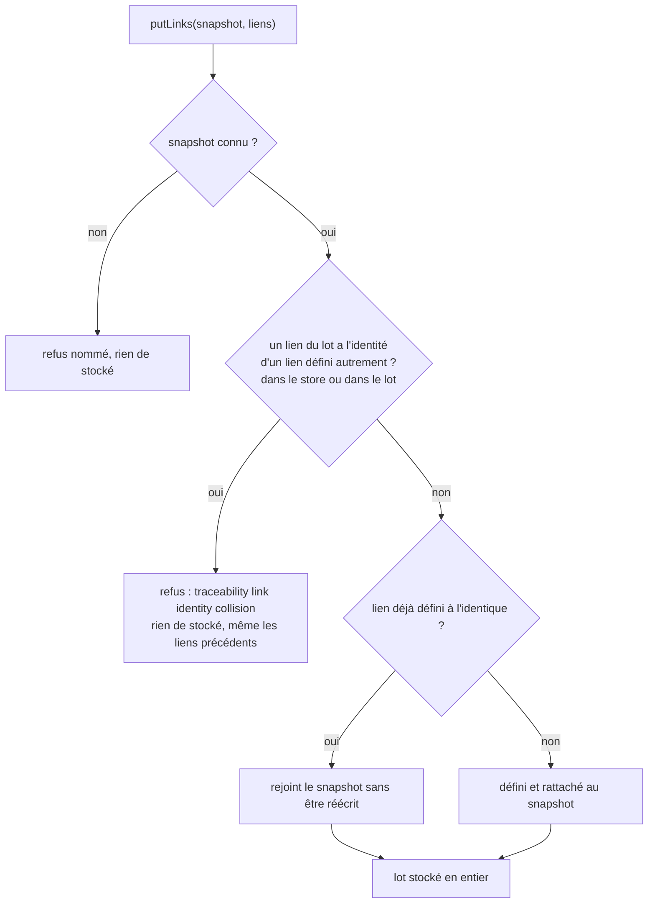

# Écriture d'un lot de liens de traçabilité (`traceability-link-batch-write`)

Spec de référence : [`openspec/specs/traceability-link-batch-write/spec.md`](../../../openspec/specs/traceability-link-batch-write/spec.md)
· Relevé du 2026-11-04 sur `2913fc30`.

## Objet et périmètre

Stocker un lot de liens de traçabilité pour un snapshot est atomique et identique sur les deux stores, et son coût en
énoncés préparés ne dépend pas de sa taille.

- **Acteur** : la publication d'un snapshot (`ProjectSnapshotImportService`), seul appelant de production de `putLinks`.
- **Inclus** : le contrat du port `TraceabilityStore.putLinks`, les stores mémoire et SQLite, le comptage des énoncés.
- **Exclus** : la lecture des liens, l'écriture d'un lien isolé (`putLink`), le budget de publication au-delà de sa référence.

## Exigences

| Alias | Exigence (titre exact) | En bref | Nature |
|---|---|---|---|
| R1 | A batch of links SHALL be stored entirely or not at all | tout ou rien, mêmes règles sur les deux stores | `[EXIGENCE]` |
| R2 | Storing a batch SHALL cost a number of prepared statements that does not depend on its size | même nombre d'énoncés pour 3 ou beaucoup de liens, pas de recherche par lien | `[EXIGENCE]` |

## Comportement détaillé

`[EXISTANT VÉRIFIÉ]` Contrat du port ([source](../../../morpheus-application/src/main/java/com/morpheus/application/store/TraceabilityStore.java)) :
`putLinks` n'a pas d'implémentation par défaut ; un lien déjà défini à l'identique rejoint le snapshot sans être réécrit ; un
lien listé deux fois à l'identique est stocké une fois ; une définition différente sous une identité déjà utilisée (dans le
store ou plus tôt dans le lot) refuse tout le lot par une `KnowledgeStoreException` qui nomme l'identité
(`traceability link identity collision: <id>`) ; rien du lot n'est stocké.

| Cas | Store mémoire | Store SQLite |
|---|---|---|
| Collision au milieu d'un lot | tout le lot est validé avant d'être stocké | une transaction ; refus et retour arrière |
| Snapshot inconnu | `snapshot not found for traceability link: <id>` | message contenant `snapshot not found for traceability link` |
| Lot vide | ne cherche même pas le snapshot | n'écrit rien et n'échoue pas |

`[EXISTANT VÉRIFIÉ]` Le store SQLite
([source](../../../morpheus-store-sqlite/src/main/java/com/morpheus/store/sqlite/adapter/SqliteTraceabilityStore.java))
lit les définitions et les preuves déjà présentes pour tout le lot par deux énoncés préparés une fois, exécutés par tranches de
`LOOKUP_SLICE` identités, puis écrit définitions, preuves et appartenances par trois énoncés préparés une fois et exécutés par
tranches de `BATCH_SLICE` lignes, dans une transaction. Les deux tailles de tranche sont des constantes de la classe.

## Diagrammes

### Quand un lot est-il accepté, joint ou refusé ?

Existant. Organigramme, pas UML. Exigence R1.

## Écarts et questions ouvertes

- `[EXISTANT VÉRIFIÉ]` Le scénario R2 compare un lot de trois liens à un lot de trois mille ; le test compare trois liens à 650
  (plus d'une tranche de recherche et d'écriture) et exige en plus au plus 8 énoncés. La propriété testée est la même
  (nombre indépendant de la taille), pas la taille citée.
- `[EXISTANT VÉRIFIÉ]` « A link already defined identically … readable with the evidence it was first stored with » : le test
  passe le même objet lien (mêmes preuves) ; il ne distingue pas une réécriture des preuves d'un rejoint sans réécriture.
- Preuve manquante : « An unknown snapshot refuses the batch … stores nothing » sur le store SQLite : le test de lot vérifie
  le type de l'exception, le message est vérifié pour le store mémoire (`putLinks`) et, côté SQLite, pour `putLink` et `findLink`.
- Preuve manquante : « The count is checked on every build … states the two counts it compared » : le message de
  `theNumberOfStatementsOfABatchDoesNotGrowWithItsLinks` nomme les deux comptes, mais aucun test ne prouve que l'échec se produit
  si l'on rétablit un énoncé par lien (preuve faite une fois à la main, tâche 2.2 de l'archive).
- Preuve manquante : le temps de publication avant/après figure dans la description de la PR (tâche 4.4), pas dans un test ;
  le gain mesuré était dans la dispersion de deux exécutions du même code.
- Le budget de publication est tenu par `M19FullPublishPerformanceGate`, exécuté par la voie nocturne et non par
  `clean verify`.

## Traçabilité

Archive : `2026-10-30-write-traceability-links-as-one-batch`.

| Exigence | Scénario | Conception ou diagramme | Changement | Preuve |
|---|---|---|---|---|
| R1 | A collision in the middle stores nothing | organigramme | tâches 2.1, 3.1, 3.3 | [`TraceabilityPersistenceContractTest`](../../../morpheus-architecture-tests/src/test/java/com/morpheus/architecture/TraceabilityPersistenceContractTest.java)`#memoryStoreWritesABatchAllOrNothing`, `#sqliteStoreWritesABatchAllOrNothing` ; [`MemoryTraceabilityStoreTest`](../../../morpheus-store-memory/src/test/java/com/morpheus/store/memory/MemoryTraceabilityStoreTest.java)`#aBatchWithAConflictLeavesNothingBehind` |
| R1 | A link already defined identically joins the snapshot | organigramme | tâche 3.3 | mêmes deux tests de contrat (lien lisible dans les deux snapshots) |
| R1 | A link listed twice is stored once | organigramme | tâche 2.1 | mêmes tests de contrat ; `MemoryTraceabilityStoreTest#aBatchThatContradictsItselfIsRefusedAndAConsistentRepeatIsAccepted` |
| R1 | An unknown snapshot refuses the batch | organigramme | — | `MemoryTraceabilityStoreTest#everyOperationOnAnUnknownSnapshotIsRefusedByName` ; [`SqliteTraceabilityStorePersistenceTest`](../../../morpheus-store-sqlite/src/test/java/com/morpheus/store/sqlite/adapter/SqliteTraceabilityStorePersistenceTest.java)`#anUnknownSnapshotCannotReceiveALink` (partielle) |
| R2 | A small and a large batch prepare the same statements | — | tâche 3.2 | [`SqliteTraceabilityBatchWriteCostTest`](../../../morpheus-store-sqlite/src/test/java/com/morpheus/store/sqlite/adapter/SqliteTraceabilityBatchWriteCostTest.java)`#theNumberOfStatementsOfABatchDoesNotGrowWithItsLinks`, `#aBatchOfLinksAlreadyDefinedCostsNoMoreThanABatchOfNewOnes` |
| R2 | The count is checked on every build | — | tâche 2.2 | même classe, suite ordinaire de `morpheus-store-sqlite` (voir Écarts) |
| R2 | The publication stays within its budget | — | tâche 4.3 | [`M19FullPublishPerformanceGate`](../../../morpheus-architecture-tests/src/test/java/com/morpheus/architecture/m19/M19FullPublishPerformanceGate.java)`#fiveLargePublishedSnapshotsStayWithinFrozenPublicationRetentionAndReopenBudgets` (voie nocturne ; borne `PUBLISH_BUDGET_NANOS`) |

## Sources

- Archive OpenSpec : `2026-10-30-write-traceability-links-as-one-batch`.
- Budgets : [`M19_PERFORMANCE_BUDGETS.md`](../../project/roadmap/M19_PERFORMANCE_BUDGETS.md).
