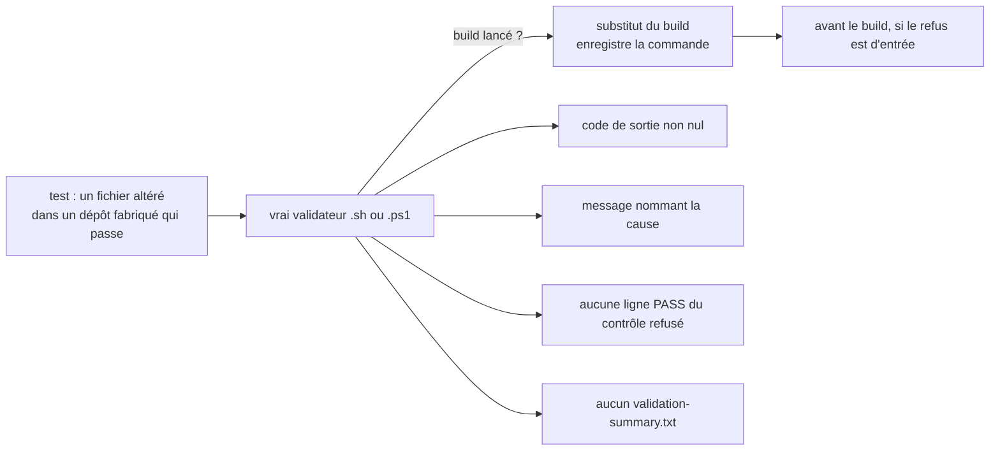
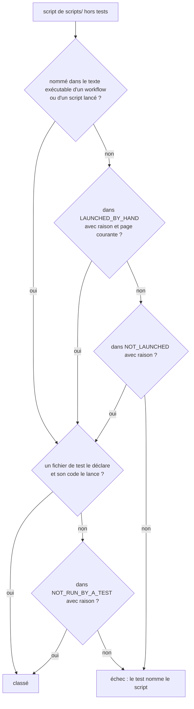

# Auto-test des validateurs (`validator-self-test`)

Spec de référence : [`openspec/specs/validator-self-test/spec.md`](../../../openspec/specs/validator-self-test/spec.md)
· Relevé du 2026-11-04 sur `2913fc30`.

## Objet et périmètre

Un script qui rend un verdict sur le dépôt est lui-même exercé sur les deux plateformes ; chaque refus qu'il annonce est
provoqué par un test ; chaque script de `scripts/` est lancé par quelque chose et testé, ou excusé par son nom.

- **Acteurs** : validateurs `scripts/validate-<cible>.sh` et `.ps1`, répartiteur `scripts/validate.ps1`, bibliothèques de
  `scripts/lib/`, tests Python de `scripts/tests/`, workflow `ci.yml`.
- **Inclus** : tests de verdict sur un dépôt fabriqué, parité `.sh` / `.ps1`, test du répartiteur, exécution des tests de
  scripts sur Linux et Windows en CI, inventaire de `scripts/`.
- **Exclus** : l'atteignabilité des gates par les workflows (voir [`gate-reachability.md`](gate-reachability.md)) ; la
  logique de couverture elle-même.

## Exigences

| Alias | Exigence (titre exact) | En bref | Nature |
|---|---|---|---|
| R1 | The refusals of a validator SHALL be provoked by a test that does not build the product | chaque refus annoncé est joué sur un dépôt fabriqué, sans construire le produit | `[EXIGENCE]` |
| R2 | Both implementations of a validator SHALL meet the same cases | mêmes cas contre le `.sh` et le `.ps1` ; bibliothèques bilingues sur une liste commune | `[EXIGENCE]` |
| R3 | The dispatcher SHALL be tested for what it forwards and what it refuses | liste exacte, refus nommant les cibles, arguments transmis, échec propagé | `[EXIGENCE]` |
| R4 | The script tests SHALL run on Linux and on Windows in CI and MUST NOT pass by skipping | deux jambes en CI ; un outil manquant échoue en CI et se saute ailleurs | `[EXIGENCE]` |
| R5 | Every script of `scripts/` SHALL be launched by something, and tested or excused by name | inventaire : lanceur, test ou excuse nommée avec sa raison | `[EXIGENCE]` |

## Comportement détaillé

### Le dépôt fabriqué (R1, R2)

`[EXISTANT VÉRIFIÉ]` [`validator_harness.py`](../../../scripts/tests/validator_harness.py) fabrique un dépôt (`FabricatedCheckout`)
et y remplace le build Maven par un substitut qui enregistre la commande reçue et dont le code de sortie vient de
`MORPHEUS_STUB_BUILD_EXIT`. Le test altère **un** fichier d'un dépôt qui passe, lance le vrai validateur, puis exige un
code non nul, un message qui nomme la cause, l'absence de la ligne PASS du contrôle refusé et l'absence de
`validation-summary.txt` (un résumé d'un run précédent est retiré par un run refusé).

Le contrat de verdict est écrit une fois dans [`test_validator_verdicts.py`](../../../scripts/tests/test_validator_verdicts.py)
(`VerdictContract`) et joué contre les `.sh` et `.ps1` des cibles `m21`, `d2`, `m22` à `m27` ; les refus d'entrée des
autres cibles sont joués par [`test_validator_entry_refusals.py`](../../../scripts/tests/test_validator_entry_refusals.py)
(`m19`, `m20`, `r2`, `m28`, `r3`). L'emballage est écarté par l'interrupteur propre à chaque validateur.

### Ce que les tests ne couvrent pas, dit par cible

`[EXISTANT VÉRIFIÉ]` [`test_script_inventory.py`](../../../scripts/tests/test_script_inventory.py) porte `NOT_REACHED_BY_A_TEST` :
pour chaque cible il dit la **partie** du validateur qu'aucun test n'atteint (l'emballage pour `d2`, `m21` à `m27` ; tout ce
qui suit le contrôle d'arbre propre pour `m19` ; etc.) et `NOT_RUN_BY_A_TEST` excuse les scripts `verify-*` par leur nom,
avec leur raison.

### Le répartiteur (R3)

`[EXISTANT VÉRIFIÉ]` [`test_validate_dispatcher.py`](../../../scripts/tests/test_validate_dispatcher.py) lance
`scripts/validate.ps1` et le wrapper `.cmd` : liste, refus sans cible ou avec une cible inconnue ou mal formée (la forme
est refusée avant tout chemin construit), insensibilité à la casse, transmission des arguments restants comme paramètres
nommés, lancement sans argument pour un validateur qui n'en prend pas, propagation d'un échec ou d'une exception.

### CI : ni saut silencieux, ni jambe oubliée (R4)

`[EXISTANT VÉRIFIÉ]` `validator_harness.require_tool` lève une `AssertionError` quand l'outil manque et que `CI` ou
`GITHUB_ACTIONS` est défini, et un `SkipTest` sinon. `ci.yml` lance `python3 -m unittest discover -s scripts/tests -v` sur
la jambe Linux et `python -B -m unittest discover -s scripts/tests -v` sur la jambe Windows.

## Diagrammes

### Que prouve un test de verdict ?

Existant vérifié, lu dans `VerdictContract.refused`. Organigramme. Exigences R1, R2.

### Comment un script de `scripts/` est-il classé par l'inventaire ?

Existant vérifié (`ScriptInventoryTest`). Organigramme. Exigence R5.

Une page de documentation n'est jamais un lanceur ; elle sert seulement à exiger qu'un point d'entrée lancé à la main soit
documenté. Une entrée d'excuse devenue inutile (script lancé, testé ou disparu) fait échouer le test.

## Écarts et questions ouvertes

1. **Excuse par script ou par partie.** `[EXISTANT VÉRIFIÉ]` R1 dit que **tout** validateur « not excused by name » voit
   chacun de ses refus provoqués. Le code excuse des **parties** de validateurs (`NOT_REACHED_BY_A_TEST` : emballage,
   tout ce qui suit le contrôle d'arbre propre pour `m19`, le build et les smokes pour `m20`…) et des scripts entiers
   (`NOT_RUN_BY_A_TEST`, les `verify-*`). La spec ne parle que de l'excuse d'un script nommé.
2. **« A validator that stops refusing is noticed ».** Le scénario décrit une mutation du validateur. Aucun test ne mute un
   validateur : la propriété est tenue indirectement, parce que chaque refus a son test qui échouerait. Preuve indirecte.
3. **Défaut d'outil en CI.** `[EXISTANT VÉRIFIÉ]` Le comportement de `require_tool` (échec en CI, saut ailleurs) est dans
   le harnais ; aucun test du harnais ne joue les deux branches. Preuve manquante pour « A missing tool is a failure in CI »
   et « A developer without the tool is not blocked » (le comportement se lit dans `validator_harness.py`).
4. **Les cas de bibliothèque sont joués dans une seule méthode.** `[EXISTANT VÉRIFIÉ]` `test_every_shared_case` joue tous
   les cas en `subTest` : un cas ajouté à `CASES` est joué contre les deux lecteurs sans autre changement, ce qui tient le
   scénario « A case added … runs against the other ». Il n'y a pas de test nommé par cas.
5. **Règle de la jambe en CI portée ailleurs.** `[EXISTANT VÉRIFIÉ]` Le scénario « A leg that stops running the tests is
   refused » est tenu par une méthode de la suite d'architecture :
   [`GateReachabilityArchitectureTest#theScriptTestsRunOnEachLegOfTheContinuousIntegrationWorkflow`](../../../morpheus-architecture-tests/src/test/java/com/morpheus/architecture/GateReachabilityArchitectureTest.java).
   Elle n'est pas dans la spec `gate-reachability`.

## Traçabilité

Tous les scénarios sont nommés. Archive : `2026-10-21-test-the-validators-that-give-a-verdict`. Les méthodes Python citées
sont définies une fois et jouées par classes générées pour chaque cible et chaque langage.

| Exigence | Scénario | Conception ou diagramme | Preuve |
|---|---|---|---|
| R1 | A tracked change in the tree is refused | organigramme 1 | [`test_validator_verdicts.py`](../../../scripts/tests/test_validator_verdicts.py)`#test_a_tracked_change_is_refused_before_the_build` |
| R1 | A missing supply-chain file is refused | idem | `#test_a_missing_sbom_is_refused_by_name` |
| R1 | A failing Surefire report is refused | idem | `#test_a_surefire_report_with_a_failure_is_refused`, `#test_a_surefire_report_with_an_error_is_refused` |
| R1 | A count below the living minimum is refused with the key | idem | `#test_a_test_count_below_the_minimum_is_refused_with_both_counts` ; la clé nommée : `#test_a_missing_minimum_is_refused_by_its_key_before_the_build` |
| R1 | Coverage evidence of the other scale is refused | idem | `#test_coverage_evidence_of_the_other_scale_is_refused_before_a_ratio_is_read` |
| R1 | A complete fabricated checkout passes | idem | `#test_a_complete_checkout_passes_and_the_summary_names_the_commit_it_validated` |
| R1 | The build the validator asked for is the one expected | idem | `#test_the_build_the_validator_asks_for_is_one_clean_verify_and_it_comes_first` |
| R1 | A validator that stops refusing is noticed | idem | preuve indirecte (Écart 2) |
| R2 | The PowerShell ratchet reader refuses what the shell reader refuses | sans diagramme | [`test_read_quality_ratchet.py`](../../../scripts/tests/test_read_quality_ratchet.py)`#test_every_shared_case` (`ShellReaderTest` et `PowerShellReaderTest`) ; garde de preuve de couverture agrégée : [`test_require_aggregate_coverage_evidence.py`](../../../scripts/tests/test_require_aggregate_coverage_evidence.py)`#test_every_shared_case` |
| R2 | A case added for one implementation runs against the other | idem | par construction de `SharedReaderCases` (Écart 4) |
| R3 | An unknown target is refused with the list | sans diagramme | [`test_validate_dispatcher.py`](../../../scripts/tests/test_validate_dispatcher.py)`#test_a_target_without_a_validator_is_refused_with_the_available_ones`, `#test_no_target_is_refused_with_the_available_ones`, `#test_a_malformed_target_is_refused_before_any_path_is_built_from_it` |
| R3 | A failing validator fails the dispatcher | idem | `#test_a_validator_that_exits_non_zero_fails_the_dispatcher`, `#test_a_validator_that_throws_fails_the_dispatcher` ; liste exacte : `#test_list_prints_exactly_the_targets_that_have_a_validator` ; transmission : `#test_the_remaining_arguments_reach_the_validator_as_named_parameters` |
| R4 | The Windows leg runs the PowerShell cases | sans diagramme | [`ci.yml`](../../../.github/workflows/ci.yml) (pas `python -B -m unittest discover -s scripts/tests`, jambe Windows) ; `validator_harness.require_powershell` |
| R4 | A missing tool is a failure in CI | idem | [`validator_harness.py`](../../../scripts/tests/validator_harness.py) (`require_tool`) ; **preuve manquante** : aucun test ne joue la branche (Écart 3) |
| R4 | A developer without the tool is not blocked | idem | idem ; **preuve manquante** |
| R4 | A leg that stops running the tests is refused | idem | [`GateReachabilityArchitectureTest`](../../../morpheus-architecture-tests/src/test/java/com/morpheus/architecture/GateReachabilityArchitectureTest.java)`#theScriptTestsRunOnEachLegOfTheContinuousIntegrationWorkflow` |
| R5 | A new script without a test is refused | organigramme 2 | `test_script_inventory.py#test_every_script_is_run_by_a_test_or_excused_with_its_reason` |
| R5 | A script that nothing launches is refused | idem | `#test_every_script_is_launched_by_something_or_named_with_the_reason_it_is_kept` |
| R5 | A page is not a launch | idem | même test (les racines sont les workflows et les scripts lancés, jamais une page) |
| R5 | A mention in a comment is not a launch | idem | même test (`executable_text` retire les commentaires) |
| R5 | An entry point launched by hand is named and documented | idem | `#test_every_script_launched_by_hand_is_named_with_its_reason_and_by_a_current_page` |
| R5 | Reading a script is not testing it | idem | `#test_every_test_file_says_which_scripts_it_runs` (un fichier qui déclare des scripts doit lancer un processus ou passer par le harnais) |
| R5 | A declaration the test code does not back is refused | idem | `#test_what_a_test_file_declares_is_what_its_code_runs` |
| R5 | A stale excuse is refused | idem | `#test_every_script_is_run_by_a_test_or_excused_with_its_reason` et `#test_every_script_is_launched_by_something_or_named_with_the_reason_it_is_kept` (entrée d'excuse devenue fausse) |

Les refus plantés de R5 (script ajouté, lanceur retiré, page seule) sont décrits par le comportement des règles sur le
dépôt réel ; aucun test ne fabrique l'arbre fautif. Preuve manquante pour ces refus joués.

## Sources

- Règles du dépôt : `.claude/rules/tooling.md` (lancer les validateurs, ASCII des `.ps1`), `.claude/rules/governance.md`.
- ADR cité par l'inventaire : ADR-0103 (lecture du texte des fichiers `.yml`, `.sh`, `.ps1`, `.cmd`, `.md`).
- Pages liées : [`gate-reachability.md`](gate-reachability.md), [`gate-verdict-currency.md`](gate-verdict-currency.md).
- Page développeur : [`scripts/README.md`](../../../scripts/README.md).
