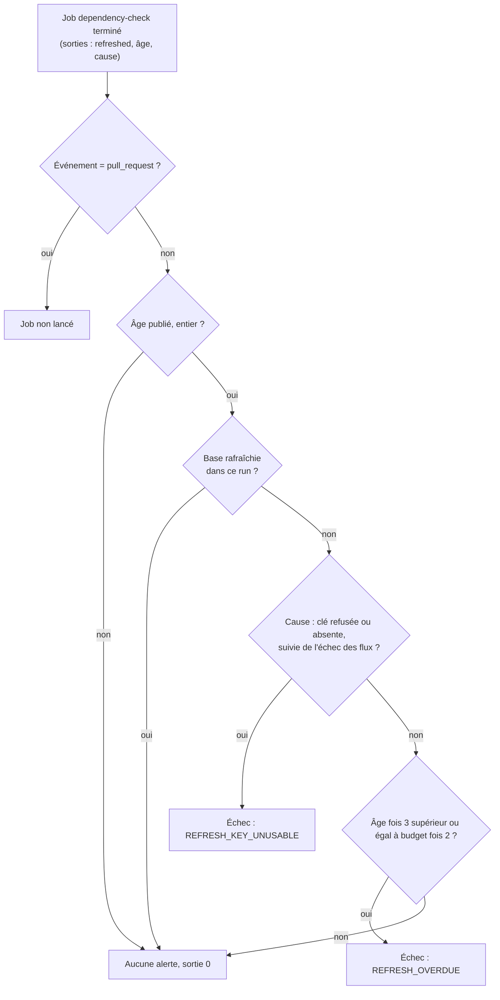
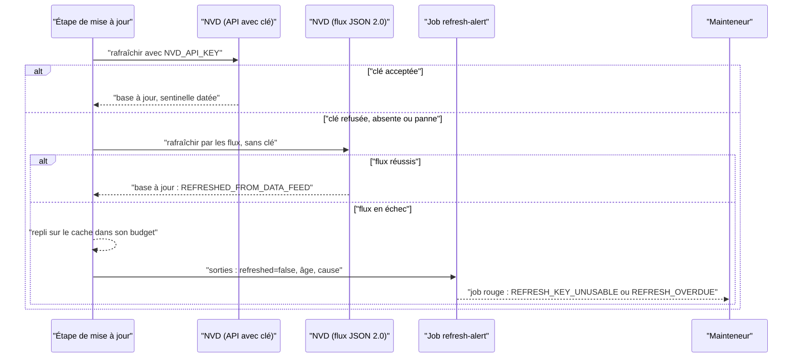

# Fraîcheur de la base de vulnérabilités du gate CVE (`vulnerability-feed-freshness`)

Spec de référence : [`openspec/specs/vulnerability-feed-freshness/spec.md`](../../../openspec/specs/vulnerability-feed-freshness/spec.md)
· Relevé du 2026-11-04 sur `2913fc30`.

## Objet et périmètre

Le gate CVE (OWASP Dependency-Check, workflow [`security.yml`](../../../.github/workflows/security.yml)) refuse tout scan
dont la base a dépassé son budget de fraîcheur (`DEPENDENCY_CHECK_MAX_CACHE_AGE_HOURS`, valeur à lire dans le workflow).
Passé ce budget, **toutes** les pull requests échouent d'un coup. La capacité décide comment la base est rafraîchie, ce
qui est publié sur son âge, comment un rafraîchissement manqué atteint une personne avant l'échéance, et que le scan
identifie le moteur SQLite embarqué par le pilote JDBC quelle que soit l'histoire de la base.

- **Acteurs** : mainteneur détenteur de `NVD_API_KEY` ; workflow planifié et workflows de `push` ; pull requests.
- **Inclus** : le job d'alerte, ses codes, le guide de reprise, l'indice (hint) d'identification du moteur SQLite, la
  suppression ciblée d'une CVE du shell SQLite.
- **Exclus** : le choix du seuil CVSS, les autres suppressions, le contenu des flux du NVD.

## Exigences

| Alias | Exigence (titre exact) | En bref | Nature |
|---|---|---|---|
| R1 | A refresh that did not happen SHALL raise a distinct alert once two thirds of the freshness budget are consumed | événement de confiance, base non rafraîchie, âge à deux tiers du budget : job en échec avec `REFRESH_OVERDUE` | `[EXIGENCE]` — écart sur la clé absente |
| R2 | The alert SHALL come after the scan and SHALL NOT block by name | job après le scan et le dépôt de ses preuves, jamais un check requis, même seuil que l'avertissement | `[EXIGENCE]` |
| R3 | The recovery guide SHALL explain every code the workflow emits and record who holds the key | tout code `MORPHEUS_DEPENDENCY_CHECK_*` expliqué ; section `NVD_API_KEY` qui dit qui, comment détecter, remplacer, vérifier | `[EXIGENCE]` |
| R4 | The scan SHALL identify the SQLite engine that the driver embeds, whatever the history of the database | indice versionné sur les bibliothèques natives extraites ; `SQLITE_ENGINE_NOT_IDENTIFIED` si l'identité manque | `[EXIGENCE]` |
| R5 | A suppression on the embedded engine SHALL name one vulnerability and the extracted libraries only | une CVE, les natives extraites, une raison ; toute autre CVE du moteur reste scannée | `[EXIGENCE]` |

## Comportement détaillé

### Rafraîchissement et alerte (R1, R2)

- `[EXISTANT VÉRIFIÉ]` **Deux sources de rafraîchissement** (comportement vérifié, absent de la spec) : l'API du NVD avec
  `NVD_API_KEY`, puis, chaque fois que ce chemin n'a pas rafraîchi la base, les flux de données CVE JSON 2.0 du NVD
  (`NVD_DATAFEED_URL`), qui ne lisent jamais la clé. Un succès par les flux est un rafraîchissement
  (`MORPHEUS_DEPENDENCY_CHECK_REFRESH=REFRESHED_FROM_DATA_FEED`) ; un échec n'écrit rien.
  Test : `DependencyCheckWorkflowContractTest#theDataFeedRefreshIsTheSecondSourceWheneverTheKeyPathDidNotRefresh`.
- **Sentinelle** `[EXISTANT VÉRIFIÉ]` : la fraîcheur se lit dans une sentinelle de rafraîchissement, jamais dans la date de
  modification d'un fichier (`#freshnessIsReadFromARefreshSentinelAndNeverFromAFileModificationTime`) ; le cache de
  confiance est clé sur la version de schéma (`#theTrustedCacheIsKeyedOnTheSchemaVersionAndNeverFallsBackAcrossSchemas`).
- **Le job `refresh-alert`** `[EXISTANT VÉRIFIÉ]` : nom « Dependency-Check refresh alert », `needs: dependency-check`,
  `if: always() && github.event_name != 'pull_request'`. Le job d'analyse publie trois sorties (`refreshed`,
  `refresh_age_seconds`, `refresh_cause`) que l'alerte lit.
  - âge absent ou non entier : message « nothing to alert on here », sortie 0 ;
  - base rafraîchie dans ce run : « no alert », sortie 0 ;
  - cause `NVD_API_KEY was refused by the NVD; …` ou `NVD_API_KEY is not configured; …` (suivie de l'échec des flux) :
    échec immédiat avec `MORPHEUS_DEPENDENCY_CHECK_ALERT=REFRESH_KEY_UNUSABLE`, quel que soit l'âge ;
  - sinon, si `age_seconds * 3 >= max_age_seconds * 2` : échec avec `MORPHEUS_DEPENDENCY_CHECK_ALERT=REFRESH_OVERDUE`,
    message avec l'âge en heures, les heures restantes et la cause ;
  - sinon : « no alert ».
- **Un seul refus dans l'étape de mise à jour** `[EXISTANT VÉRIFIÉ]` : le repli de l'étape garde exactement deux `exit 1` ; le
  prédicat d'alerte n'est pas dans cette étape (`#aRefreshThatFailedIsNotARefreshAndIsAlsoNotByItselfARefusal`).
- **Seuil commun** : l'expression `(( age_seconds * 3 >= max_age_seconds * 2 ))` est écrite à l'identique dans
  `security.yml` et dans [`scripts/report-dependency-check-cache.sh`](../../../scripts/report-dependency-check-cache.sh)
  (`#theAlertAndTheWarningShareOneThreshold`).
- **Noms exigés par le jeu de règles** : le test copie quatre noms de checks requis et refuse que le job d'alerte en porte
  un ; le jeu de règles est hors du dépôt (relu par `gh api` à la livraison, vérification manuelle).

### Guide de reprise (R3)

[`docs/developer/COLD_START_RECOVERY.md`](../COLD_START_RECOVERY.md) : le test extrait les codes
`MORPHEUS_DEPENDENCY_CHECK_<CLÉ>=<VALEUR>` de `security.yml` et exige chaque valeur dans le guide (au moins trois codes
trouvés, sinon échec). La section `NVD_API_KEY` nomme le détenteur (compte du propriétaire du dépôt, ni secret
d'organisation ni environnement), la détection, la rotation et la vérification (ligne `Obtained via` = `NVD API key
refresh`, âge 0).

### Identification du moteur SQLite (R4)

- **Indice** : [`config/dependency-check-hints.xml`](../../../config/dependency-check-hints.xml) donne le fournisseur
  `sqlite`, le produit `sqlite` et la version du pilote aux bibliothèques natives extraites du JAR `sqlite-jdbc`
  (`sqlite-jdbc-<version>.jar: sqlitejdbc.dll`, `libsqlitejdbc.so`…). Il ne vise ni le code MORPHEUS ni le JAR du pilote.
- **Couplage de version** : la version de l'indice doit égaler `<sqlite-jdbc.version>` du POM racine ; les deux profils
  `d2-security` et `d2-security-tests` chargent l'indice ; chaque scan agrégé du workflow tourne sous l'un d'eux.
- **Contrôle** : [`scripts/check-dependency-check-sqlite-identification.py`](../../../scripts/check-dependency-check-sqlite-identification.py)
  lit le rapport produit après les deux scans ; sans CPE `cpe:2.3:a:sqlite:sqlite:<version du pilote>` sur le pilote ou
  sur une bibliothèque extraite, il écrit `MORPHEUS_DEPENDENCY_CHECK_FAILURE=SQLITE_ENGINE_NOT_IDENTIFIED` et sort en 1.

### Suppression du shell SQLite (R5)

`[EXISTANT VÉRIFIÉ]` [`config/dependency-check-suppressions.xml`](../../../config/dependency-check-suppressions.xml) porte une
règle `suppress` pour une seule CVE, visant par expression régulière les bibliothèques natives extraites de
`sqlite-jdbc`, avec une note qui dit que le shell `sqlite3` n'est ni lancé ni livré. Cette règle porte `base="true"`
(exemptée de `failBuildOnUnusedSuppressionRule`). Identifiant de la CVE : lire le fichier.

## Diagrammes

### Que décide le job d'alerte, et dans quel ordre ?

Existant vérifié (étape du job `refresh-alert`, rejouée par `scripts/tests/test_refresh_alert_step.py`). Exigences R1 et R2.

### Comment la base est-elle rafraîchie, et qui voit l'échec ?

Existant vérifié (`DependencyCheckWorkflowContractTest`). Exigences R1 et R3.

## Écarts et questions ouvertes

- **Écart (R1, « A missing key is alerted like a refused one »)** : la spec dit que, clé non configurée, dernier
  rafraîchissement à 50 h, le job échoue avec `REFRESH_OVERDUE` en nommant `NVD_API_KEY is not configured`. Le
  workflow échoue avec `MORPHEUS_DEPENDENCY_CHECK_ALERT=REFRESH_KEY_UNUSABLE`, dès le premier run (âge 1 h dans le test),
  quand la cause commence par `NVD_API_KEY is not configured; ` ou `NVD_API_KEY was refused by the NVD; `. Test :
  `scripts/tests/test_refresh_alert_step.py` `RefreshAlertStepTest.test_a_missing_key_is_alerted_like_a_refused_one`
  (assertion `REFRESH_KEY_UNUSABLE`). Le code `REFRESH_KEY_UNUSABLE` n'est pas dans la spec ; le guide et le registre
  des risques RT-13 le décrivent. Aucune exigence n'est modifiée ici : écart à trancher par le mainteneur.
- **Écart de formulation (R1, « A single missed refresh does not »)** : le comportement « 24 h : rien » ne vaut que pour la
  cause « le NVD a échoué avec la clé configurée » ; une clé refusée ou absente alerte à tout âge. Le test de 24 h
  (`test_a_single_missed_daily_refresh_with_the_key_configured_stays_green`) emploie cette cause.
- `[EXISTANT VÉRIFIÉ]` **Deuxième source par les flux** : comportement absent de la spec, tenu par un test ; la spec ne dit pas
  que la clé n'est plus l'unique source.
- **Preuve manquante (R2)** : « the scan job has already completed and uploaded its evidence » n'est prouvé que par
  `needs: dependency-check` (test textuel) ; aucun test ne vérifie l'ordre des étapes d'envoi des preuves. Le
  scénario « check name is none of the required checks » est une vérification manuelle (`gh api`), comme la spec le dit ;
  la copie des quatre noms requis dans le test peut vieillir.
- **Preuve manquante (R3)** : la section `NVD_API_KEY` (détenteur, détection, remplacement, vérification) n'est pas lue par
  un test ; seule la présence de chaque code l'est (`#everyDependencyCheckCodeTheWorkflowEmitsIsExplainedInTheRecoveryGuide`).
- **Preuve manquante (R4, « A database rebuilt from scratch »)** : la mesure sur une base reconstruite des flux du NVD est
  décrite dans la Javadoc du test et dans l'archive du changement ; aucun test automatique ne reconstruit une base. Les
  tests prouvent l'indice (texte) et le contrôle du rapport (script Python).
- `[EXISTANT VÉRIFIÉ]` **Preuve de R5** : `DependencyCheckSuppressionContractTest` lit
  `config/dependency-check-suppressions.xml` et exige d'une règle de vulnérabilité nommée un seul identifiant CVE, un
  chemin qui reconnaît les bibliothèques natives extraites du pilote et ni le JAR du pilote ni le code MORPHEUS, et une
  note non vide ; l'exemption `base="true"` de la règle est dans la table exacte du test.
- `[EXISTANT VÉRIFIÉ]` **Autres suppressions du même fichier** : les deux règles de faux positif de CPE sur les paquets
  internes `morpheus-store-sqlite` et `morpheus-cli` sont hors de ces exigences ; leur forme et leur concordance avec la
  version du réacteur sont tenues par la capacité
  [`dependency-check-suppression-contract`](dependency-check-suppression-contract.md).
- **Suivi** : RT-13 du registre des risques ([`risks/register.md`](../../architecture/risks/register.md)) reste ouvert.

## Traçabilité

Tests : [`DependencyCheckWorkflowContractTest`](../../../morpheus-architecture-tests/src/test/java/com/morpheus/architecture/d2/DependencyCheckWorkflowContractTest.java) (DCW),
[`test_refresh_alert_step.py`](../../../scripts/tests/test_refresh_alert_step.py) (RAS, classe `RefreshAlertStepTest`),
[`test_check_dependency_check_sqlite_identification.py`](../../../scripts/tests/test_check_dependency_check_sqlite_identification.py)
(SQL, classe `CheckDependencyCheckSqliteIdentificationTest`). Les tests Python tournent dans `ci.yml` (`unittest discover -s scripts/tests`).

| Exigence | Scénario | Conception ou diagramme | Changement | Preuve |
|---|---|---|---|---|
| R1 | A second consecutive missed refresh raises the alert | premier diagramme | archive `2026-10-10-alert-before-the-cve-gate-starves` | RAS `test_a_second_missed_refresh_raises_the_alert_with_the_cause_and_the_time_left` ; DCW `#aRefreshThatDidNotHappenRaisesItsOwnAlertAfterTheScanAndNeverUnderARequiredName` |
| R1 | A missing key is alerted like a refused one | idem | idem | **Écart** : RAS `test_a_missing_key_is_alerted_like_a_refused_one` affirme `REFRESH_KEY_UNUSABLE`, la spec `REFRESH_OVERDUE` ; DCW `#aCauseThatCannotClearByItselfRaisesTheAlertInTheFirstRunThatSeesIt` |
| R1 | An unknown age raises no alert | idem | idem | RAS `test_an_unknown_age_raises_no_alert_and_no_arithmetic_error` |
| R1 | A single missed refresh does not | idem | idem | RAS `test_a_single_missed_daily_refresh_with_the_key_configured_stays_green` ; annotation et résumé : DCW `#databaseFreshnessAndFailureReasonsAreObservableBeforeAndWhenTheyStopTheBuild` |
| R1 | A successful refresh clears the condition | idem | idem | RAS `test_a_run_that_refreshed_raises_nothing_whatever_the_age_says` ; libellé « NVD API key refresh » : DCW `#theProvenancePublishedOnAPullRequestIsReadFromTheSentinelNotFromALiteral` |
| R1 | A pull request is never alerted | idem | idem | RAS `test_the_job_never_runs_on_a_pull_request_and_runs_after_a_failed_scan` ; `STALE_DATABASE` au-delà du budget : DCW `#databaseFreshnessAndFailureReasonsAreObservableBeforeAndWhenTheyStopTheBuild` |
| R2 | The scan completes first | premier diagramme | idem | DCW `#aRefreshThatDidNotHappenRaisesItsOwnAlertAfterTheScanAndNeverUnderARequiredName` (`needs`) ; ordre des preuves : **preuve manquante** |
| R2 | The alert cannot block a pull request by name | idem | idem | DCW (même méthode, quatre noms requis copiés) ; vérification manuelle `gh api` |
| R2 | The alert and the warning share one threshold | idem | idem | DCW `#theAlertAndTheWarningShareOneThreshold` |
| R2 | The update step keeps a single refusal | idem | idem | DCW `#aRefreshThatFailedIsNotARefreshAndIsAlsoNotByItselfARefusal` |
| R3 | A new code without documentation is refused | second diagramme | idem | DCW `#everyDependencyCheckCodeTheWorkflowEmitsIsExplainedInTheRecoveryGuide` |
| R3 | The section answers who, how detected, how replaced, how verified | idem | idem | **Preuve manquante** (revue du guide) |
| R4 | A database rebuilt from scratch | — | archive `2026-11-04-record-the-sprint-15-medium-decisions` | **Preuve manquante** automatique ; mesure décrite dans la Javadoc de DCW `#theSqliteEngineEmbeddedBySqliteJdbcIsIdentifiedWhateverTheHistoryOfTheDatabase` |
| R4 | The identification is lost | — | idem | SQL `test_a_driver_identified_as_sqlite_jdbc_only_fails_naming_the_gap` ; DCW `#theSqliteEngineEmbeddedBySqliteJdbcIsIdentifiedWhateverTheHistoryOfTheDatabase` (le workflow lit le rapport après les scans) |
| R4 | The driver is upgraded without the hint | — | idem | DCW `#theSqliteEngineEmbeddedBySqliteJdbcIsIdentifiedWhateverTheHistoryOfTheDatabase` (version de l'indice égale à `sqlite-jdbc.version`) ; SQL `test_an_engine_identifier_at_another_version_than_the_driver_fails` |
| R5 | A vulnerability of the command-line shell | — | changement `hold-the-dependency-check-suppressions-to-a-contract` | [`DependencyCheckSuppressionContractTest`](../../../morpheus-architecture-tests/src/test/java/com/morpheus/architecture/d2/DependencyCheckSuppressionContractTest.java) `#theSuppressionFileOfTheRevisionHoldsToTheContract`, `#aFilePathThatMatchesEverythingIsRefusedNamingTheJarItWronglyMatches`, `#aVulnerabilityNameThatIsNotACveIsRefusedNamingTheValue` ; sens de la règle (shell non livré) : revue de sa note |

## Sources

- Registre des risques : RT-13 dans [`../../architecture/risks/register.md`](../../architecture/risks/register.md).
- Guide de reprise : [`../COLD_START_RECOVERY.md`](../COLD_START_RECOVERY.md) ; règle de dépôt : `.claude/rules/build.md`
  (« Workflows CI »), `.claude/rules/security.md` (« Chaîne d'approvisionnement CI »).
- Pages liées : [`dependency-version-management.md`](dependency-version-management.md),
  [`dependency-check-suppression-contract.md`](dependency-check-suppression-contract.md).
