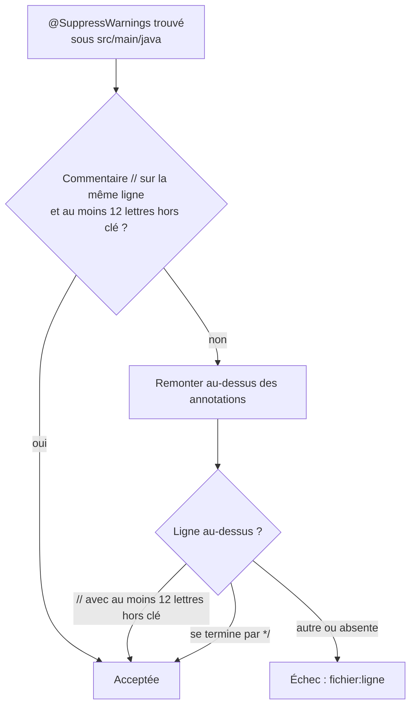

# Justification des avertissements supprimés (`warning-suppression-justification`)

Spec de référence : [`openspec/specs/warning-suppression-justification/spec.md`](../../../openspec/specs/warning-suppression-justification/spec.md)
· Relevé du 2026-11-04 sur `2913fc30`.

## Objet et périmètre

Un `@SuppressWarnings` du code de production dit pourquoi l'avertissement est faux ou accepté pour ce code, à l'endroit
où un relecteur le lit. Une frontière MCP ou HTTP qui reçoit une valeur structurée la valide au lieu de la caster.

- **Acteurs** : auteur d'un `@SuppressWarnings` sous `src/main/java` ; appelant d'un outil MCP ou d'une route HTTP.
- **Inclus** : toutes les sources `src/main/java` des modules `morpheus-*`.
- **Exclus** : les suppressions des tests (elles ne cachent rien à un appelant du produit) ; le jugement sur la qualité
  de la raison (le test fait exister la raison, il ne la juge pas).

## Exigences

| Alias | Exigence (titre exact) | En bref | Nature |
|---|---|---|---|
| R1 | A suppressed warning in the product's sources SHALL state its reason | un commentaire sur la ligne ou la ligne au-dessus ; la clé de la règle seule n'est pas une raison | `[EXIGENCE]` |
| R2 | A boundary SHALL validate a structured value instead of casting it | une valeur reçue et utilisée comme carte est vérifiée carte à clés texte ; sinon refus nommé qui identifie le champ | `[EXIGENCE]` |

## Comportement détaillé

`[EXISTANT VÉRIFIÉ]` ([`WarningSuppressionJustificationTest`](../../../morpheus-architecture-tests/src/test/java/com/morpheus/architecture/WarningSuppressionJustificationTest.java)).

- **R1** : la raison est un commentaire `//` en fin de ligne de l'annotation, ou sur la plus proche ligne au-dessus qui
  n'est pas une autre annotation ; une ligne qui se termine par `*/` (fin de commentaire de documentation) compte
  aussi. Un commentaire dit quelque chose s'il contient au moins 12 lettres une fois la clé de la règle retirée : un
  commentaire qui répète la clé, ou vide, est refusé. L'échec nomme `fichier:ligne`.
- **Garde contre le vide** : moins de six suppressions lues fait échouer le test.
- **R2** : la valeur d'un argument d'outil MCP utilisée comme carte passe par `McpArguments.stringMap` qui exige
  `Map` puis des clés et valeurs texte non vides ; sinon `IllegalArgumentException("<nom> must be an object of string
  values")` ou `"<nom> must contain non-blank string keys and values"`. Les trois conversions `unchecked` qui restent
  (`morpheus-provider-synthetic`) suivent un `instanceof Map` qui refuse déjà par nom (`<nom> must be an object`), sur
  des objets que `SyntheticJsonParser` construit à clés texte ; ce n'est pas une frontière MCP ou HTTP.

## Diagrammes

### Une suppression est-elle acceptée ?

Existant vérifié (`isJustified`). Exigence R1.

## Écarts et questions ouvertes

- `[EXISTANT VÉRIFIÉ]` **`*/` accepté sans lecture** : une ligne qui se termine par `*/` est tenue pour une raison, quel que
  soit le contenu du commentaire de documentation (test `aReasonIsReadOnTheLineOrJustAboveAndTheRuleKeyAloneIsNotOne`,
  cas « the end of a documentation comment is a comment »). La spec exige un commentaire « that says why ».
- **Preuve manquante (R2, HTTP)** : le scénario ne nomme que l'outil MCP. Aucun test ne vérifie le côté HTTP ; les
  routes reçoivent leur corps par le décodeur Jackson du module `morpheus-api`, sans cast non vérifié trouvé.
- `[EXISTANT VÉRIFIÉ]` **R2 prouvé par absence de cast** : la conclusion archivée (tâches 1.2 et 3.2) est qu'aucune
  conversion `Map` ne se trouvait à une frontière ; la spec est tenue par l'absence de cast plus les tests de refus
  nommés de `McpArguments`, non par un test écrit pour ce changement (tâche 2.2 « not applicable »).
- `[EXISTANT VÉRIFIÉ]` **Population lue** : seuls les répertoires de premier niveau dont le nom commence par `morpheus-`
  et qui portent `src/main/java` sont lus.

## Traçabilité

| Exigence | Scénario | Conception ou diagramme | Changement | Preuve |
|---|---|---|---|---|
| R1 | A bare suppression fails the build | organigramme | archive `2026-10-16-justify-every-warning-suppression` | [`WarningSuppressionJustificationTest`](../../../morpheus-architecture-tests/src/test/java/com/morpheus/architecture/WarningSuppressionJustificationTest.java)`#everySuppressedWarningOfTheProductStatesItsReason` |
| R1 | The rule key is not a reason | idem | idem | `WarningSuppressionJustificationTest#aReasonIsReadOnTheLineOrJustAboveAndTheRuleKeyAloneIsNotOne` |
| R2 | A list where an object is expected | — | idem | [`MorpheusAugmentedContextMcpToolsTest`](../../../morpheus-mcp/src/test/java/com/morpheus/mcp/MorpheusAugmentedContextMcpToolsTest.java)`#aConstraintsObjectOfTheWrongShapeIsRefusedByName` ; [`MorpheusReasoningMcpToolsTest`](../../../morpheus-mcp/src/test/java/com/morpheus/mcp/MorpheusReasoningMcpToolsTest.java)`#adapterIdsAndParametersAreRefusedByNameWhenTheirShapeIsWrong` |

## Sources

- Code : [`McpArguments`](../../../morpheus-mcp/src/main/java/com/morpheus/mcp/McpArguments.java) (`stringMap`).
- Règle de dépôt : `.claude/rules/code-style.md` (« Rendre les échecs explicites »).
- Pages liées : [`mcp-tool-failure-contract.md`](mcp-tool-failure-contract.md).
