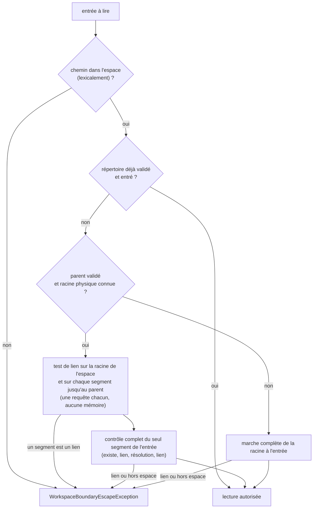
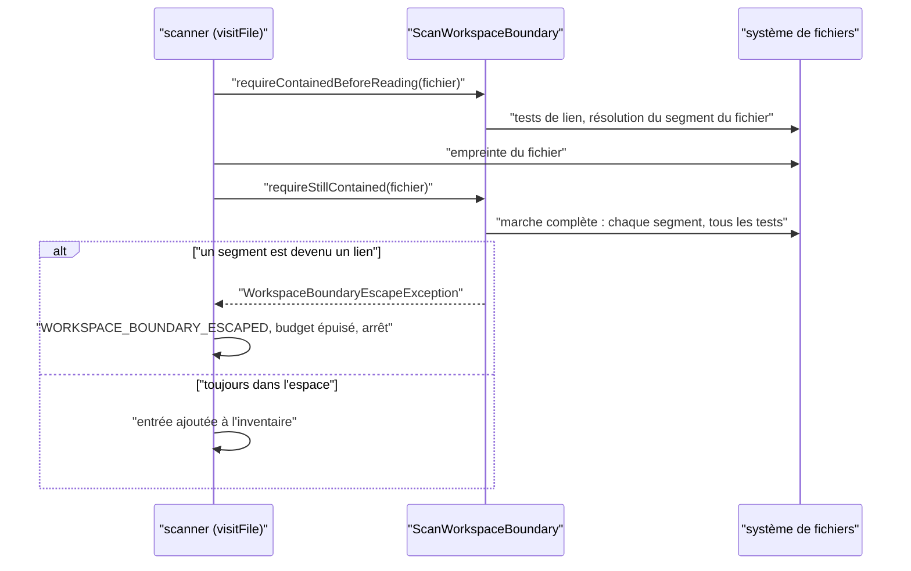

# Frontière physique de l'espace de travail et coût d'un scan (`workspace-boundary-scan-cost`)

Spec de référence : [`openspec/specs/workspace-boundary-scan-cost/spec.md`](../../../openspec/specs/workspace-boundary-scan-cost/spec.md)
· Relevé du 2026-11-04 sur `2913fc30`.

## Objet et périmètre

Le scan d'inventaire des sources (`LocalSourceInventoryScanner`) parcourt l'espace de travail local et ne doit lire
aucun contenu à travers un lien symbolique ni hors de l'espace. La capacité fixe ce que le scan refuse, ce qu'il retient
d'une validation pendant un scan, et combien de requêtes de frontière il consacre à chaque entrée.

- **Acteurs** : `LocalSourceInventoryScanner`, `ScanWorkspaceBoundary` (une instance par scan),
  `WorkspacePathBoundary` (contrôle sans mémoire, utilisé par le watcher), `LocalSourceWatcher`,
  `WorkspaceBoundaryEscapeException`.
- **Inclus** : le refus `WORKSPACE_BOUNDARY_ESCAPED`, le coût en requêtes avant lecture, la revalidation après
  empreinte, le remplacement d'un segment par un lien pendant le scan, la durée de vie de ce que le scan retient.
- **Exclus** : les budgets du scan (répertoires, fichiers, octets, profondeur), la lecture des fichiers par les
  providers (`SafeWorkspaceFileResolver`, voir [`openspec-provider-reading.md`](openspec-provider-reading.md)).

## Exigences

| Alias | Exigence (titre exact) | En bref | Nature |
|---|---|---|---|
| R1 | A source scan SHALL refuse every path that leaves the workspace physically | refus `WORKSPACE_BOUNDARY_ESCAPED` d'une racine, d'un répertoire ou d'un fichier qui sort de l'espace (lexicalement, par lien, ou physiquement) et d'une racine d'espace qui est un lien ; le refus arrête le scan | `[EXIGENCE]` |
| R2 | The boundary work of a scan SHALL resolve each directory once and link-test every segment before each read | pas de résolution par fichier ; avant chaque lecture, un test de lien par segment, jamais répondu de mémoire (ADR-0157) | `[EXIGENCE]` |
| R3 | A segment replaced by a link during a scan MUST still be refused before the file enters the inventory | la validation après empreinte interroge le système de fichiers à cet instant, pour chaque segment | `[EXIGENCE]` |
| R4 | No content SHALL be read through a link once a validated segment has become one | un ancêtre validé puis remplacé par un lien, ou une racine remplacée, est refusé avant la lecture suivante (ADR-0157) | `[EXIGENCE]` |
| R5 | What a scan remembers MUST NOT outlive that scan nor reach the watcher | les répertoires validés sont oubliés à la fin du scan ; le watcher interroge le système de fichiers à chaque appel | `[EXIGENCE]` |

## Comportement détaillé

### Ce que le scan retient

- `[EXISTANT VÉRIFIÉ]` `ScanWorkspaceBoundary` garde l'ensemble `validatedDirectories` et la racine physique
  `physicalWorkspace`. `enterSourceRoot()` vide l'ensemble au début de chaque racine de sources ; l'instance est créée
  par `scanInternal` pour un seul scan et n'est jamais réutilisée (R5).
- `[EXISTANT VÉRIFIÉ]` `WorkspacePathBoundary.requireContained` crée une nouvelle `ScanWorkspaceBoundary` à chaque
  appel : le watcher ne dispose d'aucune mémoire, et chaque contrôle fait la marche complète (R5).

### Avant une lecture (R1, R2, R4)

`requireContainedBeforeReading(chemin)` :

1. refuse lexicalement un chemin hors de l'espace (`source path escapes workspace`) ;
2. rend immédiatement un répertoire déjà validé et entré ;
3. si le parent est validé et la racine physique connue : test de lien sur la racine de l'espace et sur chaque segment
   jusqu'au parent (une requête chacun), puis contrôle complet du seul segment de l'entrée ;
4. sinon : marche complète de la racine jusqu'à l'entrée.

Le contrôle complet d'un segment compte quatre requêtes (existence sans suivre les liens, test de lien, résolution
physique, second test de lien) ; la racine de l'espace en compte trois. Un segment absent ne peut pas s'échapper.
Messages : `workspace root must not be a symbolic link`, `source path crosses a symbolic link inside the workspace`,
`source path resolves outside the workspace`.

### Après l'empreinte (R3)

- `[EXISTANT VÉRIFIÉ]` `requireStillContained(fichier)` refait la marche complète, avec tous les tests, de la racine
  jusqu'au fichier. Un échec est rendu `WORKSPACE_BOUNDARY_ESCAPED` (jamais `SOURCE_UNREADABLE`), le budget est
  épuisé et le parcours se termine : ni le fichier ni un inventaire complet ne sont produits.

### Refus et arrêt (R1)

- `[EXISTANT VÉRIFIÉ]` Un refus de la frontière sur une racine, un répertoire ou un fichier est rendu sous le code
  `WORKSPACE_BOUNDARY_ESCAPED`, épuise le budget (`budget.exhaust()`) et termine la marche : les entrées suivantes ne
  sont pas visitées. Le refus est levé uniquement sous le nom `WorkspaceBoundaryEscapeException`, jamais comme
  `IOException` nue qui serait lue comme `SOURCE_UNREADABLE`.
- `[EXISTANT VÉRIFIÉ]` Un lien rencontré dans l'arbre (répertoire : `SKIP_SUBTREE` ; fichier : ignoré) n'est ni entré
  ni lu, et n'entre pas dans l'inventaire.

## Diagrammes

### Que contrôle la frontière avant de lire une entrée ?

Existant vérifié par lecture de `ScanWorkspaceBoundary.requireContainedBeforeReading`. Exigences R1, R2 et R4.
Organigramme, pas UML.

Un répertoire validé épargne la résolution des segments au-dessus de l'entrée, jamais leur test de lien (R2, R4).

### Dans quel ordre un fichier est-il contrôlé pendant un scan ?

Existant vérifié par lecture de `LocalSourceInventoryScanner.scanRoot`. Exigences R2, R3 et R4.

## Écarts et questions ouvertes

- `[EXISTANT VÉRIFIÉ]` **Échappement lexical : exception, pas échec de scan.** R1 demande le code
  `WORKSPACE_BOUNDARY_ESCAPED` pour une racine « qui sort lexicalement » de l'espace. `LocalSourceInventoryScanner.resolveWithin`
  lève `IllegalArgumentException("source root escapes workspace: …")` avant toute marche, et le test le fige
  (`LocalSourceInventorySecurityTest#sourceRootThatEscapesTheWorkspaceViaRelativeTraversalIsRejectedBeforeAnyFilesystemWalk`).
  Le code n'est donc pas celui de la spec pour ce cas. `[QUESTION]` Aligner la spec sur l'exception, ou le code sur
  l'échec nommé.
- `[EXISTANT VÉRIFIÉ]` **Racine de source qui est elle-même un lien.** Le scanner la rend `SYMLINK_NOT_FOLLOWED`
  (« symbolic-link source root is not followed ») et poursuit avec la racine suivante, avant tout contrôle de frontière
  (`rejectsSourceRootThatIsItselfASymbolicLinkWithoutTraversingItsTarget`). La spec nomme `WORKSPACE_BOUNDARY_ESCAPED`
  et l'arrêt du scan pour une racine qui « traverse un lien » ; elle ne tranche pas ce cas. `[QUESTION]`
- `[EXISTANT VÉRIFIÉ]` **Racine d'espace qui est un lien, au démarrage.** Sans racines de sources explicites, la racine
  de l'espace est aussi la racine de scan : le même test `Files.isSymbolicLink` la rend `SYMLINK_NOT_FOLLOWED` avant que
  la frontière ne la voie. Le message `workspace root must not be a symbolic link` n'est atteint qu'avec une racine de
  source en dessous, ou quand la racine est remplacée en cours de scan. **Preuve manquante** pour le scénario « A
  workspace root that is a link » au niveau du scan complet ; `ScanWorkspaceBoundaryTest#aWorkspaceRootReplacedByALinkDuringAScanIsRefusedBeforeTheNextEntryIsRead`
  ne teste que l'objet de frontière.
- `[EXISTANT VÉRIFIÉ]` **Preuves propres à Linux.** Les trois tests de remplacement d'un ancêtre pendant la lecture
  d'un fichier portent `@DisabledOnOs(WINDOWS)` (un répertoire parcouru y est tenu ouvert) : le scénario « An ancestor
  is replaced while a file is being fingerprinted » n'a pas de preuve sous Windows. Tous les tests de lien sont
  conditionnés par `assumeTrue` à la création possible d'un lien.
- `[EXISTANT VÉRIFIÉ]` « never `SOURCE_UNREADABLE` » (R3) : le test du remplacement d'ancêtre exige la présence de
  `WORKSPACE_BOUNDARY_ESCAPED` (`anyMatch`) et n'affirme pas l'absence de `SOURCE_UNREADABLE` ; la garde est portée par
  `WorkspaceBoundaryRefusalArchitectureTest`.
- `[EXISTANT VÉRIFIÉ]` Les scénarios « An ordinary tree is scanned completely » et « The refusal says nothing more than
  before » comparent à un état antérieur que le dépôt ne conserve pas ; le premier est tenu par comparaison à un
  inventaire recalculé dans le test, le second par les messages figés cités plus haut. **Preuve manquante** pour une
  comparaison du chemin affiché d'un refus à une référence.
- Validation OpenSpec : `openspec validate workspace-boundary-scan-cost --strict` réussit à la date du relevé ; aucune
  exigence de la spec ne dépasse 500 caractères (la plus longue en compte 436).

## Traçabilité

| Exigence | Scénario | Conception ou diagramme | Changement | Preuve |
|---|---|---|---|---|
| R1 | A source root reached through a linked intermediate directory | organigramme | archive `2026-10-21-check-the-workspace-boundary-once-per-directory` | [`LocalSourceInventorySecurityTest`](../../../morpheus-application/src/test/java/com/morpheus/application/sync/LocalSourceInventorySecurityTest.java)`#aSourceRootThatEscapesTheWorkspaceStopsTheScanBeforeTheNextRoot` ; [`IntermediateSymlinkBoundaryTest`](../../../morpheus-application/src/test/java/com/morpheus/application/sync/IntermediateSymlinkBoundaryTest.java)`#scannerRejectsRootWhoseIntermediateComponentEscapesWorkspace` |
| R1 | A workspace root that is a link | organigramme | idem | **preuve manquante** au niveau du scan (voir Écarts) ; objet de frontière : [`ScanWorkspaceBoundaryTest`](../../../morpheus-application/src/test/java/com/morpheus/application/sync/ScanWorkspaceBoundaryTest.java)`#aWorkspaceRootReplacedByALinkDuringAScanIsRefusedBeforeTheNextEntryIsRead` |
| R1 | A link inside the tree is not followed | organigramme | idem | `LocalSourceInventorySecurityTest#safeDefaultDoesNotTraverseExternalSymbolicLinkWhenPlatformSupportsLinks` (lien de répertoire) ; lien de fichier : **preuve manquante** pour un fichier lien à l'intérieur de l'arbre |
| R1 | An ordinary tree is scanned completely | organigramme | idem | `ScanWorkspaceBoundaryTest#anOrdinaryTreeProducesTheInventoryOfItsFiles` |
| R1 | The refusal says nothing more than before | — | idem | messages : `ScanWorkspaceBoundaryTest` (deux assertions de message) ; code et arrêt : [`WorkspaceBoundaryRefusalArchitectureTest`](../../../morpheus-architecture-tests/src/test/java/com/morpheus/architecture/WorkspaceBoundaryRefusalArchitectureTest.java)`#theScannerReportsAnEscapeAfterReadingAsAnEscapeAndStops`, `#theScanBoundaryRefusesOnlyThroughItsNamedException` ; chemin affiché : **preuve manquante** |
| R2 | Deepening a tree adds one link test per segment and no resolution per file | organigramme | idem | `ScanWorkspaceBoundaryTest#deepeningATreeAddsOneResolutionPerDirectoryAndOneLinkTestPerSegmentAboveEachEntry` |
| R2 | A directory is resolved once per scan | organigramme | idem | `ScanWorkspaceBoundaryTest#aFileIsResolvedOnceAndOnlyLinkTestedAboveWhateverNumberOfFilesItsDirectoryHolds` |
| R2 | The source root still takes the full walk | organigramme | idem | `ScanWorkspaceBoundaryTest#theSourceRootTakesTheFullWalkBeforeAnyEntryIsVisited` |
| R2 | The proof holds no duration | — | idem | `ScanWorkspaceBoundaryTest` : assertions sur `boundaryQueriesOfLastScan()` ; aucune horloge (seul `Duration.ofMillis(250)` règle l'attente du watcher) |
| R3 | An ancestor is replaced while a file is being fingerprinted | séquence | idem | `ScanWorkspaceBoundaryTest#anAncestorReplacedByALinkInsideTheWorkspaceWhileAFileIsReadIsRefused`, `#anAncestorReplacedByALinkOutsideTheWorkspaceWhileAFileIsReadIsRefused` (Linux seulement) ; revalidation complète : `#theRevalidationAfterFingerprintingStaysAWalkOfTheWholePath` |
| R3 | The file itself is replaced by a link | séquence | idem | `LocalSourceInventorySecurityTest#replacementBySymbolicLinkDuringScanProducesNoInventoryWhenLinksAreSupported` |
| R4 | A validated ancestor becomes a link resolving inside the workspace | organigramme, séquence | idem | `ScanWorkspaceBoundaryTest#aValidatedAncestorReplacedByALinkInsideTheWorkspaceIsRefusedBeforeTheNextEntryIsRead`, `#anAncestorReplacedByALinkInsideTheWorkspaceLeavesEveryOtherFileOfTheScanUnread` (Linux seulement) |
| R4 | The workspace root becomes a link during a scan | organigramme | idem | `ScanWorkspaceBoundaryTest#aWorkspaceRootReplacedByALinkDuringAScanIsRefusedBeforeTheNextEntryIsRead` |
| R5 | A second scan validates again | — | idem | `ScanWorkspaceBoundaryTest#aDirectoryReplacedByALinkBetweenTwoScansOfTheSameScannerIsRefusedByTheSecond` |
| R5 | A watcher event is checked afresh | — | idem | `ScanWorkspaceBoundaryTest#theWatcherChecksADirectoryItAlreadyCheckedAgainWhenAnEventArrives` ; racine du watcher : `IntermediateSymlinkBoundaryTest#watcherRejectsRootWhoseIntermediateComponentEscapesWorkspace` |

## Sources

- ADR : [SEC-0157](../../architecture/adr/SEC-0157-aucun-contenu-n-est-lu-a-travers-un-lien-ni-hors-de-l-espace-de-travail.md)
  (aucun contenu lu à travers un lien ni hors de la frontière).
- Archive OpenSpec : `2026-10-21-check-the-workspace-boundary-once-per-directory`.
- Frontières voisines : [ADR-0150](../../architecture/adr/ARCH-0150-ce-que-le-coeur-applicatif-peut-toucher.md)
  (classes d'accès fichier de l'application).
