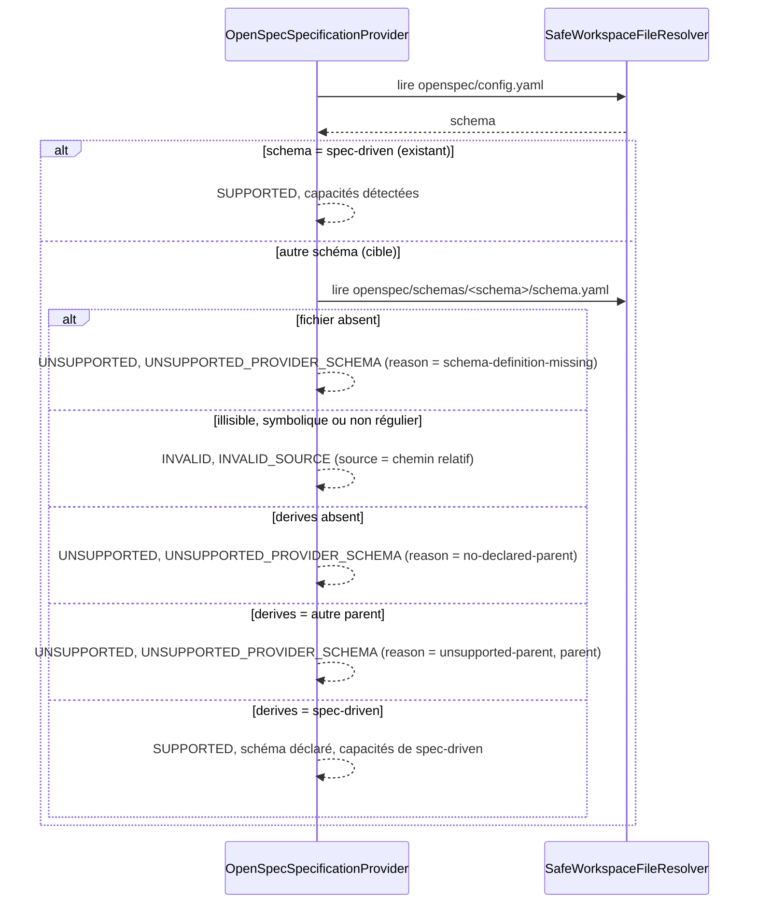

# Conception : accepter un schéma OpenSpec qui déclare dériver de `spec-driven`

## Contexte

- [EXISTANT VÉRIFIÉ] `OpenSpecSpecificationProvider.probe` lit `openspec/config.yaml` par `SafeWorkspaceFileResolver`
  (ou par la session de budget), extrait `schema:` (`readSchema`, BOM et scalaire entre guillemets admis), puis compare
  à `SUPPORTED_SCHEMA = "spec-driven"` par `equals`. Tout autre schéma rend `UNSUPPORTED`, le diagnostic
  `UNSUPPORTED_PROVIDER_SCHEMA` et les détails `provider`, `schema`, `supportedSchema`.
- [EXISTANT VÉRIFIÉ] `detailed-uml` n'apparaît dans aucun `.java` de production. Les trois projets du mainteneur le
  déclarent et portent `openspec/schemas/detailed-uml/` (constat `AUD-ARC-22`, 15/11/2026).
- [EXISTANT VÉRIFIÉ] Le contenu écrit sous `detailed-uml` garde la structure que le lecteur lit : `## Why`,
  `## What Changes`, `## Capabilities`, deltas `## ADDED|MODIFIED|REMOVED|RENAMED Requirements`, `### Requirement:`,
  `#### Scenario:`, tâches `- [ ] X.Y` (`openspec/schemas/detailed-uml/templates/`). L'ingestion de nexus, schéma
  réécrit en `spec-driven`, publie sans diagnostic.
- [EXISTANT VÉRIFIÉ] La CLI OpenSpec 1.14.3 accepte une clé `derives:` inconnue dans `schema.yaml` comme dans
  `config.yaml` : `openspec schema validate detailed-uml` reste valide, `openspec new change` et `openspec status`
  fonctionnent (copie jetable, 15/11/2026).
- [EXISTANT VÉRIFIÉ] `SafeWorkspaceFileResolver` refuse un chemin absolu ou remontant, un composant symbolique et un
  fichier non régulier.

## Exigences couvertes

| Capacité | Exigence (titre exact) | Rubriques de conception qui y répondent |
|---|---|---|
| `openspec-provider-reading` | A project schema is read only when it declares that it derives from spec-driven | §Décisions D1, D2, D3 ; §Traitements ; §Gestion des erreurs |

## Composants et frontières

- `morpheus-provider-openspec`, `com.morpheus.provider.openspec.OpenSpecSpecificationProvider` : seule classe modifiée
  pour la décision ; la lecture de `schema.yaml` passe par le même résolveur ou la même session que `config.yaml`.
- Aucun port de `morpheus-application` ne change : `ProviderProbeResult` garde sa forme (statut, schéma, localisateur,
  capacités, diagnostics). `ProviderAntiLockInTest` et `LayerDependencyTest` restent inchangés.

## Modèle de domaine et invariants

Sans objet : aucun type du domaine ne change. Le schéma rapporté reste la chaîne déclarée par `config.yaml`.

## Traitements et interactions

Question : que fait le probe d'un schéma autre que `spec-driven` ? Existant : il refuse. Cible : il lit la définition
du schéma de projet et n'accepte que la déclaration `derives: spec-driven`.

## États et transitions

Sans objet : le probe n'a pas de cycle de vie ; il rend un des trois statuts existants.

## Contrats d'interface

Aucune surface publique ne change : `contracts/public-surfaces.tsv` et l'OpenAPI ne bougent pas. Les détails du
diagnostic `UNSUPPORTED_PROVIDER_SCHEMA` gagnent une clé `reason` (et `declaredParent` quand il existe) ; ce sont des
détails de diagnostic, déjà ouverts à des clés propres à chaque provider.

## Persistance et intégrité

Sans objet : rien n'est persisté par le probe. Un projet enregistré sous `detailed-uml` puis synchronisé publie ses
snapshots comme un projet `spec-driven`.

## Transactions, concurrence et idempotence

Sans objet : lecture seule, sans état.

## Sécurité et isolation

`schema.yaml` est une entrée non fiable du workspace : lu par `SafeWorkspaceFileResolver` (pas de lien symbolique, pas
de remontée), borné par `maxDocumentBytes` du budget, et seule la valeur scalaire de `derives` est extraite, par la même
analyse ligne à ligne que `schema:` — aucun parseur YAML général n'entre dans le provider. Le nom de schéma lu dans
`config.yaml` est validé comme un segment de chemin unique avant de construire `openspec/schemas/<schema>/` : lettres,
chiffres, `.`, `_` et `-`, premier caractère alphanumérique, dernier caractère autre que `.`, sans `..`. Un nom contenant `/`, `\`, `:` ou `..` est
refusé (`UNSUPPORTED`, `reason = invalid-schema-name`), avant toute lecture.

## Gestion des erreurs et reprise

Chaque refus est nommé (§Traitements) ; aucune exception ne sort du probe. Un schéma refusé ne lit aucune catégorie : le
fail-closed d'un schéma inconnu est conservé.

## Observabilité

Le diagnostic nomme le schéma, le parent déclaré et le motif ; jamais le chemin absolu du workspace.

## Performance et stratégie de mesure

Un fichier de plus lu par probe, borné par `maxDocumentBytes`. Sans budget M19 concerné.

## Compatibilité, migration et retour arrière

Un workspace `spec-driven` est lu exactement comme avant. Retour arrière : retirer la branche du probe ; les projets
`detailed-uml` redeviennent refusés, leurs snapshots publiés restent lisibles.

## Décisions

### D1 : la déclaration vit dans la définition du schéma
- **Nature** : [DÉCISION] (mainteneur, 16/11/2026)
- **Exigences servies** : `openspec-provider-reading` › A project schema is read only when it declares that it derives
  from spec-driven
- **Choix** : `derives: spec-driven` dans `openspec/schemas/<schema>/schema.yaml`. Le schéma dit de qui il dérive ; la
  déclaration voyage avec lui dans les trois dépôts, et un projet ne peut pas se déclarer compatible sans porter la
  définition qu'il prétend dériver.
- **Alternatives écartées** : `derives:` dans `openspec/config.yaml` (proposé par l'audit, toléré aussi par la CLI ;
  écarté parce que la déclaration se détache du schéma qu'elle qualifie) ; une liste de schémas admis dans MORPHEUS (chaque schéma dérivé exigerait une version du produit, et le
  produit se prononcerait sur des schémas qu'il ne voit pas) ; déclarer `spec-driven` dans les projets et porter
  `detailed-uml` ailleurs (écarté par l'audit : le schéma pilote les gabarits et le workflow de rédaction amont).
- **Compromis** : le provider lit un fichier de plus, et fait confiance à une déclaration ; c'est le lecteur, inchangé,
  qui refuse ensuite un contenu qui ne suit pas la structure (catégorie FAILED, diagnostic attribué).
- **ADR** : ADR-0169, acceptée le 16/11/2026. Elle remplace ADR-0002 (archivé), dont la contrainte « un autre schéma est
  refusé à la sonde » change en partie : la décision du provider de référence se lit dans un seul ADR actif
  (`.claude/rules/adr.md`).

### D2 : dériver engage les catégories de `spec-driven`, et rien de plus
- **Nature** : [DÉCISION]
- **Exigences servies** : idem, et `openspec-provider-reading` › The probe only claims what the reader can read
- **Choix** : un schéma dérivé reçoit les capacités que `detectCapabilities` donne à `spec-driven` ; les artefacts
  ajoutés (diagrammes, matrices de `design.md`) ne créent aucune catégorie et restent ignorés comme sous `spec-driven`.
- **Alternatives écartées** : lire `design.md` en `DESIGN_DECISIONS` pour `detailed-uml` (structure propre au schéma,
  hors de ce changement).
- **Compromis** : MORPHEUS ne tire rien des diagrammes de `detailed-uml`.
- **ADR** : ADR-0169.

### D3 : un seul niveau, un seul parent
- **Nature** : [DÉCISION]
- **Exigences servies** : idem
- **Choix** : seul `derives: spec-driven` est accepté ; un schéma qui dérive d'un schéma dérivé est refusé.
- **Alternatives écartées** : suivre une chaîne (boucles et profondeur à borner pour aucun besoin constaté).
- **Compromis** : un écosystème à deux niveaux devra déclarer `spec-driven` directement.
- **ADR** : ADR-0169.

## Écarts constatés

| Constat | Source A | Source B | Traitement proposé |
|---|---|---|---|
| Le scénario « An unreadable dialect is not reported as supported » n'a pas de preuve exacte | spec `openspec-provider-reading` | page durable, ligne de traçabilité R1 | hors de ce changement ; le nouveau test de 1.2 ne s'y substitue pas |

## Stratégie de vérification

| Exigence | Scénario | Preuve | État |
|---|---|---|---|
| A project schema is read only when it declares that it derives from spec-driven | A derived schema that declares its parent | `OpenSpecSpecificationProviderTest#aSchemaThatDeclaresItDerivesFromSpecDrivenIsReadAsSpecDriven` (copie temporaire d'`openspec-basic`) | écrit |
| idem | A schema that declares no parent | `OpenSpecSpecificationProviderTest#aSchemaThatDeclaresNoParentStaysUnsupported` | écrit |
| idem | A declared schema whose directory is missing | `OpenSpecSpecificationProviderTest#aDeclaredSchemaWithoutItsDefinitionStaysUnsupported` ; `rejectsUnknownOpenSpecSchemaExplicitly` reste vert | écrit |
| idem | A schema that derives from an unknown parent | `OpenSpecSpecificationProviderTest#aSchemaThatDerivesFromAnUnknownParentStaysUnsupported` ; un parent dérivé : `#aSchemaThatDerivesFromADerivedSchemaStaysUnsupported` | écrit |
| idem | A schema definition that cannot be read | `OpenSpecSpecificationProviderTest#anUnreadableSchemaDefinitionIsInvalidAndNamed` (répertoire à la place du fichier) ; `#aSymbolicSchemaDefinitionIsInvalidAndNamed` (lien symbolique) | écrit |
| idem | (§Sécurité) nom de schéma hors segment unique | `OpenSpecSpecificationProviderTest#aSchemaNameThatIsNotASinglePathSegmentIsRefusedBeforeAnyRead` | écrit |

## Documentation durable et diagrammes à mettre à jour

`docs/developer/specifications/openspec-provider-reading.md` (exigence R5, organigramme du probe, traçabilité) ;
ADR-0169, ADR-0002 (archivé), `docs/architecture/adr/README.md`, `docs/architecture/arc42/09-decisions.md`,
`docs/developer/ARCHGATE.md` (la règle d'ADR-0002 (archivé) suit ADR-0169) ; le guide utilisateur qui dit quels schémas sont
lus.

## Questions ouvertes

Aucune : D1 est tranchée par le mainteneur (16/11/2026).
