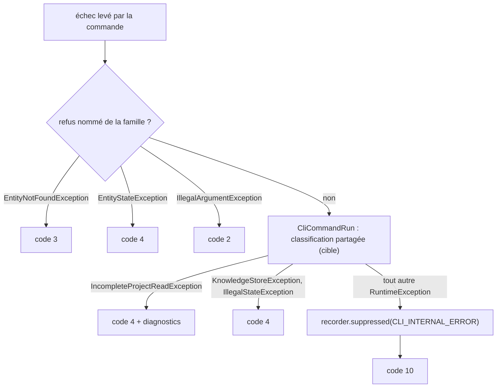

# Conception : un échec imprévu de la CLI sort en 10 et est compté (AUD-QUA-31)

## Contexte

[EXISTANT VÉRIFIÉ] `CliCommandRun.run` (`morpheus-cli/src/main/java/com/morpheus/cli/command/CliCommandRun.java`,
lignes 65-81) classe un échec dans cet ordre : `CliFailure` → son code ; `IllegalArgumentException` → `2` ;
`IncompleteProjectReadException` → `4` avec ses diagnostics ; `KnowledgeStoreException | IllegalStateException` →
`4` ; tout autre `RuntimeException` → `10`. Il ne reçoit aucun recorder et ne compte rien. Ses appelants :
`MorpheusChangeCli`, `MorpheusPathsCli`, `MorpheusProjectCli`, `MorpheusQualityCli`, `MorpheusRequirementCli`,
`MorpheusSyncStatusCli` et `MorpheusCli`.

[EXISTANT VÉRIFIÉ] Treize classes de capacité ne passent pas par `CliCommandRun.run` et terminent par un `catch
(RuntimeException)` qui rend `STATE_ERROR` (liste et lignes dans `proposal.md`). Avant ce `catch`, chacune classe déjà
ses refus nommés (`EntityNotFoundException` → `3`, `EntityStateException` → `4`, `IllegalArgumentException` → `2`,
selon la famille). Leur dernier `catch` absorbe donc deux populations : de vrais refus d'état
(`IllegalStateException("project has no ACTIVE snapshot: …")` dans `MorpheusAcceptanceCriteriaCli` ligne 65,
`KnowledgeStoreException` d'un store) et les défauts internes.

[EXISTANT VÉRIFIÉ] `MorpheusServerCli` (ligne 92) rend `10` mais ne compte pas. `MorpheusMain.run` construit chaque
classe de capacité avec `runtime.recorder()`, sauf `MorpheusServerCli`, `MorpheusPathsCli` et `MorpheusCli`.

[EXISTANT VÉRIFIÉ] Le HTTP compte un défaut interne par `UnforeseenFailureTrace.record(recorder, failure)`, qui appelle
`recorder.suppressed(SuppressedFailureFamily.HTTP_INTERNAL_ERROR, failure)`. L'événement porte la famille et le type,
jamais le message (`OperationalRecorder.suppressed`).

[EXISTANT VÉRIFIÉ] `MorpheusStateRefusalExitCodeTest` et `OneErrorLineForEveryFamilyTest` (`morpheus-cli`) épinglent
les codes des refus d'état et la forme de la ligne d'erreur.

Motivation : voir `proposal.md`, section Why.

## Exigences couvertes

| Capacité | Exigence (titre exact) | Rubriques de conception qui y répondent |
|---|---|---|
| `cli-argument-base` | Every CLI failure SHALL be reported through one error line | §Écarts constatés, D4 |
| `cli-argument-base` | Un échec qu'aucune commande ne prévoit sort avec le code d'erreur interne | D1, D2, §Traitements |
| `suppressed-failure-trace` | Un échec imprévu d'une commande CLI est compté sous une famille nommée | D3, §Observabilité |

## Composants et frontières

- `com.morpheus.cli.command.CliCommandRun` : propriétaire de la classification d'un échec en code de sortie (D1) et du
  comptage d'un `10` (D3).
- Les treize classes de capacité de `com.morpheus.cli.command` : leur dernier `catch (RuntimeException)` délègue à
  `CliCommandRun` ; leurs `catch` de refus nommés restent en place.
- `MorpheusServerCli`, `MorpheusPathsCli` (`com.morpheus.cli.command`) : reçoivent le recorder du processus par leur
  constructeur, comme les autres classes de capacité.
- `com.morpheus.cli.MorpheusCli` (aide, `version`) : reçoit l'`OperationalRuntime` que `MorpheusMain` détient déjà ;
  `OperationalRuntime` est dans `DispatchersHoldNoUseCaseArchitectureTest.CLI_ALLOWANCE`, `OperationalRecorder` ne
  l'est pas (D3).
- `com.morpheus.application.operability.SuppressedFailureFamily` : famille `CLI_INTERNAL_ERROR`, clé
  `cli-internal-error`, niveau `ERROR`.

Frontières : `CliCommandPaths`, `MorpheusMain`, `MorpheusCli` restent des dispatchers
(`DispatchersHoldNoUseCaseArchitectureTest`) ; `CliErrorLine` reste le seul écrivain de la ligne
(`cli-argument-base` › A private copy of the argument base SHALL be refused).

## Modèle de domaine et invariants

Sans objet : aucun type du domaine n'est touché.

## Traitements et interactions

Question : que devient un échec levé par une commande d'une des treize familles ?

Existant : la branche « non » rend directement `4` dans les treize familles. Cible : elle passe par la classification
partagée. Exigences : `cli-argument-base` › Un échec qu'aucune commande ne prévoit sort avec le code d'erreur interne ;
`suppressed-failure-trace` › Un échec imprévu d'une commande CLI est compté sous une famille nommée.

## États et transitions

Sans objet : aucun cycle de vie.

## Contrats d'interface

Contrat existant : table des codes de `docs/user/CLI.md` § 19 et `CliExitCode`. Seule la classification change pour
ces treize familles ; aucune valeur numérique ni aucune forme de ligne. L'objet JSON d'erreur garde `exitCode`, `code`,
`message` (et `diagnostics` pour une lecture refusée).

## Persistance et intégrité

Sans objet : aucune donnée persistée ne change. Un échec imprévu laisse la base dans l'état où la commande l'a
laissée, comme aujourd'hui ; seul le code de sortie change.

## Transactions, concurrence et idempotence

Sans objet : la classification a lieu après l'échec, hors de toute transaction.

## Sécurité et isolation

L'événement ne porte que la famille et le type (`suppressed-failure-trace` › The trace SHALL name the family and the
type and SHALL NOT carry the message) : un message qui nommerait un chemin du poste n'atteint pas le journal. La ligne
d'erreur garde le texte de l'échec, comme le socle commun aujourd'hui.

## Gestion des erreurs et reprise

Aucun repli silencieux : un échec non classé n'est plus déguisé en refus d'état. Le comptage ne doit pas masquer
l'échec : si le recorder lui-même échoue, son échec est ajouté en supprimé à l'échec d'origine et le code reste `10`.

## Observabilité

Compteur `failure.suppressed.cli-internal-error` et événement `FAILURE_SUPPRESSED` (`family`, `failureType`) sur le
recorder du processus. Un processus CLI ne sert pas de route `metrics` : le compteur se lit dans le journal
opérationnel (mode JSON ou fichier) et dans les tests. Ligne à ajouter à la table des familles de
`docs/developer/OPERABILITY.md`.

## Performance et stratégie de mesure

Sans objet : un appel de recorder sur un chemin d'échec.

## Compatibilité, migration et retour arrière

Un script qui lisait `4` pour un défaut interne de ces familles lit `10`, valeur que la table publiée annonçait déjà.
La note de version de la version courante le dit (`docs/user/release-notes/`). Retour arrière : `git revert`, sans
donnée à migrer.

## Décisions

### D1 : la classification est écrite une fois, dans `CliCommandRun`
- **Nature** : [DÉCISION]
- **Exigences servies** : `cli-argument-base` › Un échec qu'aucune commande ne prévoit sort avec le code d'erreur interne
- **Choix** : extraire de `CliCommandRun.run` une méthode publique de classification (nom fixé à l'implémentation,
  par exemple `CliCommandRun.refuse(args, err, recorder, failure)`) qui reproduit l'ordre existant (`CliFailure`,
  `IllegalArgumentException`, `IncompleteProjectReadException`, `KnowledgeStoreException | IllegalStateException`,
  reste) ; `run` et le dernier `catch (RuntimeException)` des treize familles l'appellent.
- **Alternatives écartées** : remplacer `STATE_ERROR` par `INTERNAL_ERROR` dans chaque `catch` — ferait passer en `10`
  les vrais refus d'état que ces `catch` absorbent (`IllegalStateException` d'un snapshot absent) et garderait treize
  copies ; supprimer le `catch` et laisser l'échec remonter — les treize familles ne passent pas par
  `CliCommandRun.run`, l'échec atteindrait `MorpheusMain.main` sans ligne d'erreur ; faire passer les treize familles
  par `CliCommandRun.run` — réécrit leur lecture des arguments, hors constat.
- **Compromis** : un appel de plus dans chaque famille, contre une seule table de classification.
- **ADR** : non concerné (`GEN-0059` fixe les codes, inchangés).

### D2 : un interdit tient la délégation
- **Nature** : [DÉCISION]
- **Exigences servies** : `cli-argument-base` › Un échec qu'aucune commande ne prévoit sort avec le code d'erreur interne
- **Choix** : un test de `morpheus-architecture-tests` refuse, dans une source principale de `com.morpheus.cli.command`
  autre que `CliCommandRun`, un `catch (RuntimeException …)` dont le corps rend un code de sortie littéral. Mécanisme
  textuel : l'intention est « ce câblage ne doit pas apparaître », qu'aucune règle sur le bytecode ne voit
  (`.claude/rules/architecture.md`, câblage explicite). La violation plantée (un `STATE_ERROR` remis dans
  `MorpheusPortfolioCli`) est consignée dans la PR.
- **Alternatives écartées** : se fier aux tests de famille seuls — une quatorzième famille copierait le motif.
- **Compromis** : un interdit textuel de plus, non plafonné (part textuelle délibérément non plafonnée).
- **ADR** : non concerné.

### D3 : le `10` est compté sur le recorder du processus, sur toutes les commandes
- **Nature** : [DÉCISION]
- **Exigences servies** : `suppressed-failure-trace` › Un échec imprévu d'une commande CLI est compté sous une famille nommée
- **Choix** : famille `CLI_INTERNAL_ERROR` (`cli-internal-error`, `ERROR`) dans `SuppressedFailureFamily` ; la
  classification de D1 reçoit le recorder et l'appelle avant d'écrire la ligne `10`. `MorpheusServerCli` et
  `MorpheusPathsCli` reçoivent `runtime.recorder()` ; `MorpheusCli` reçoit l'`OperationalRuntime`, déjà permis à un
  dispatcher, et en lit le recorder.
- **Alternatives écartées** : réutiliser `HTTP_INTERNAL_ERROR` — un opérateur ne distinguerait plus le transport ;
  laisser `MorpheusCli` sans comptage — la règle « toute commande » aurait une exception non écrite ; ajouter
  `OperationalRecorder` à `CLI_ALLOWANCE` — élargit une liste de gouvernance sans besoin.
- **Compromis** : la famille compte dans un processus court ; sa valeur est l'événement du journal, pas un compteur
  servi.
- **ADR** : non concerné ; `ARCH-0115` (runtime opérationnel remis par le lanceur) s'applique tel quel.

### D4 : la première exigence de `cli-argument-base` dit ce qu'elle protège
- **Nature** : [DÉCISION]
- **Exigences servies** : `cli-argument-base` › Every CLI failure SHALL be reported through one error line
- **Choix** : remplacer « The exit codes MUST NOT change. » par « Writing the line MUST NOT change the exit code the
  command answers. » ; le reste du bloc est recopié tel quel.
- **Alternatives écartées** : laisser la phrase — elle interdirait, lue hors de son changement d'origine, toute
  correction de classification.
- **Compromis** : aucun.
- **ADR** : non concerné.

## Écarts constatés

| Constat | Source A | Source B | Traitement proposé |
|---|---|---|---|
| Treize familles rendent `4` pour un défaut interne | `catch (RuntimeException)` des treize classes | `docs/user/CLI.md` § 19, `CliCommandRun` | D1, D2 |
| La CLI ne compte aucun défaut interne | `CliCommandRun`, `MorpheusServerCli` | `UnforeseenFailureTrace` (HTTP) | D3 |
| « The exit codes MUST NOT change » se lit comme un gel de toute classification | `openspec/specs/cli-argument-base/spec.md` | la présente correction | D4 |

## Stratégie de vérification

| Exigence | Scénario | Preuve | État |
|---|---|---|---|
| Un échec qu'aucune commande ne prévoit sort avec le code d'erreur interne | Un défaut interne sous une famille qui le rendait en 4 | test paramétré par les treize familles (`morpheus-cli`, nom fixé à l'écriture) qui fait lever un `RuntimeException` non classé et exige `10` | à écrire |
| idem | Un refus d'état garde son code | `MorpheusStateRefusalExitCodeTest`, `MorpheusAcceptanceCriteriaCliTest` | existant |
| idem | Un défaut interne sous la sortie JSON | cas `--json` du test paramétré | à écrire |
| idem | (délégation) | interdit textuel de D2, violation plantée | à écrire |
| Every CLI failure SHALL be reported through one error line | tous | `OneErrorLineForEveryFamilyTest`, `CliErrorLineTest` | existant |
| Un échec imprévu d'une commande CLI est compté sous une famille nommée | les trois | test de la classification de `CliCommandRun` avec un `OperationalRuntime` de test ; `SuppressedFailureTraceTest` (parcourt `values()`) | à écrire / existant |

Point d'injection du test paramétré : un double écrit à la main d'un collaborateur que la famille reçoit déjà
(recorder, registre de résolveurs, passerelle NEXUS) ou une base dont une lecture lève un `RuntimeException` non
classé ; aucune fabrique de test ajoutée au code de production (`.claude/rules/code-style.md`). Une famille qui
n'offre aucun point d'injection est couverte par le test de la classification et par l'interdit de D2, et la tâche le
dit.

## Documentation durable et diagrammes à mettre à jour

`docs/developer/specifications/cli-argument-base.md` (comportement, diagramme du refus, traçabilité),
`docs/developer/specifications/suppressed-failure-trace.md` (famille ajoutée), `docs/developer/OPERABILITY.md` (table
des familles), `docs/user/CLI.md` § 19 (un échec imprévu sort en `10` sur toutes les commandes), notes de version de la
version courante.

## Questions ouvertes

Aucune.
