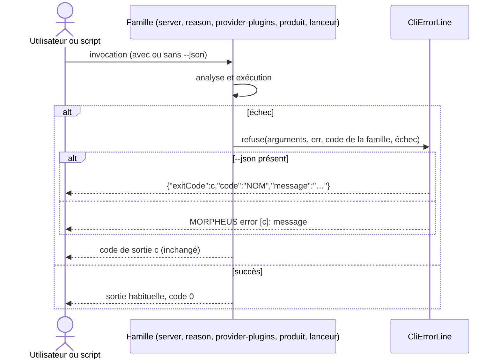

# Conception : écrire chaque échec de la CLI par une seule ligne d'erreur

## Contexte

Motivation : voir `proposal.md`, section Why. État vérifié le 2026-11-03 sur `ef006fb7` :

- `[EXISTANT VÉRIFIÉ]` `CliErrorLine` (`morpheus-cli/src/main/java/com/morpheus/cli/command/`) porte la ligne
  `MORPHEUS error [<code>]: <message>`, sa forme JSON et `failureText`. `CliCommandRun` l'utilise pour les commandes de
  la base partagée ; `CliCommandRun.refuseUndeclared` détecte `--json` dans les arguments bruts.
- `[EXISTANT VÉRIFIÉ]` Écrivent leur propre préfixe par `println` : `MorpheusProductCli` (lignes 51 et 54),
  `MorpheusReasoningCli` (53, 56), `MorpheusProviderPluginCli` (45, 48), `MorpheusServerCli` (87 à 96), et
  `MorpheusMain` (68, 74 pour le journal ; 366 à 423 pour les lanceurs `mcp`, `api` et distant).
- `[EXISTANT VÉRIFIÉ]` `CliCommandRun` écrit `failure.getMessage()` pour une `CliFailure`, ce qui écrirait `null` pour
  une `CliFailure` sans message.

## Exigences couvertes

| Capacité | Exigence (titre exact) | Rubriques |
|---|---|---|
| `cli-argument-base` | Every CLI failure SHALL be reported through one error line | D1, D2, D3, D4, Traitements |
| `cli-argument-base` | Aucune commande n'écrit son propre préfixe d'erreur | D5 |

## Composants et frontières

Tout reste dans `morpheus-cli`. `CliErrorLine` reste le seul écrivain de la ligne ; aucune autre classe ne gagne une
méthode de signature `(PrintStream, CliExitCode, …)`, ce que `CliArgumentBaseArchitectureTest#noCliTypeButTheOwnerWritesTheErrorLine`
tient déjà. Aucune dépendance nouvelle entre modules.

## Traitements et interactions

Cible. Exigence : la ligne d'erreur unique. La famille garde sa table de correspondance entre type d'échec et code ;
seul l'écrivain de la ligne change.

## Contrats d'interface

Sortie d'erreur de la CLI, documentée pour l'utilisateur dans `docs/user/release-notes/RELEASE_NOTES_1.2.2.md` et
`docs/user/INSTALLATION.md`. Aucune route HTTP, aucun outil MCP, aucune ligne de `contracts/public-surfaces.tsv`.

Persistance, transactions, observabilité, performance : sans objet, la sortie d'erreur seule change.

## Sécurité et isolation

Le texte d'un échec reste celui de `CliErrorLine.failureText`, comme avant ; aucun message nouveau ne nomme un chemin.

## Compatibilité, migration et retour arrière

Rupture de la forme textuelle de la sortie d'erreur pour les familles listées ; un script qui reconnaissait leurs
préfixes doit lire `MORPHEUS error [`. Les codes de sortie, seul contrat stable pour un script, ne changent pas. Retour
arrière : revenir sur ce changement, sans donnée à migrer.

## Décisions

### D1 : un écrivain partagé qui reçoit les arguments bruts
- **Nature** : [DÉCISION]
- **Exigences servies** : la ligne d'erreur unique.
- **Choix** : `CliErrorLine.refuse(String[] args, PrintStream err, CliExitCode code, Throwable failure)` écrit la ligne
  en JSON quand `args` contient `--json`, comme `CliCommandRun.refuseUndeclared`, et rend le code.
- **Alternatives écartées** : faire passer les familles par `CliCommandRun.run`, écarté parce que sa table de codes
  (`RuntimeException` → `INTERNAL_ERROR`) changerait les codes de `reason`, `provider-plugins` et du produit (4) ;
  lire `--json` dans l'analyse de chaque famille, écarté parce qu'un refus survient souvent avant cette analyse.
- **Compromis** : la détection de `--json` sur les arguments bruts ne distingue pas `--json` employé comme valeur
  d'une option ; c'est déjà le cas de `refuseUndeclared`.
- **ADR** : non concerné.

### D2 : garder chaque code de sortie
- **Nature** : [DÉCISION]
- **Exigences servies** : la ligne d'erreur unique (« The exit codes MUST NOT change »).
- **Choix** : chaque famille garde sa correspondance (par exemple `server` : `EntityNotFoundException` → 3,
  `EntityStateException` → 4, `IllegalArgumentException` → 2, autre → 10 ; produit, `reason`, `provider-plugins` :
  2 et 4 ; lanceurs : 2 et 10 ; journal : 2 et 5).
- **Alternatives écartées** : aligner sur `CliCommandRun`, écarté (rupture des codes, seul contrat stable d'un script).
- **Compromis** : deux tables de correspondance coexistent ; la ligne, elle, est unique.
- **ADR** : non concerné.

### D3 : nommer le transport dans le refus de démarrage d'un lanceur
- **Nature** : [DÉCISION]
- **Exigences servies** : la ligne d'erreur unique.
- **Choix** : un échec de démarrage s'écrit `MORPHEUS error [10]: MCP startup failed: <texte>` (de même `API` et
  `remote API`) ; un refus d'usage garde son texte seul.
- **Alternatives écartées** : le texte seul, écarté parce que l'ancien préfixe (`MORPHEUS MCP startup error`) était la
  seule indication de la phase en échec.
- **Compromis** : le message d'un démarrage refusé gagne quelques mots.
- **ADR** : non concerné.

### D4 : le texte d'une `CliFailure` sans message
- **Nature** : [DÉCISION]
- **Exigences servies** : la ligne d'erreur unique (texte = message, ou nom du type).
- **Choix** : `CliCommandRun` passe par `CliErrorLine.failureText` pour une `CliFailure` aussi.
- **Alternatives écartées** : aucune ; c'est l'énoncé de l'exigence.
- **Compromis** : aucun.
- **ADR** : non concerné.

### D5 : refuser tout préfixe d'erreur propre, par le texte
- **Nature** : [DÉCISION]
- **Exigences servies** : Aucune commande n'écrit son propre préfixe d'erreur.
- **Choix** : une assertion textuelle dans `CliArgumentBaseArchitectureTest` cherche, hors commentaires, un littéral
  `"MORPHEUS …` qui contient `error` ailleurs que dans `CliErrorLine.java`, sans liste d'exceptions.
- **Alternatives écartées** : une règle ArchUnit, écartée parce qu'un littéral est une constante de compilation que le
  bytecode n'attribue pas à son auteur (`.claude/rules/architecture.md`, « Règle ArchUnit ou assertion textuelle »).
- **Compromis** : un préfixe construit par concaténation (`"MORPHEUS " + "server error"`) échapperait à la recherche ;
  la revue le tient.
- **ADR** : non concerné.

## Écarts constatés

| Constat | Source A | Source B | Traitement proposé |
|---|---|---|---|
| Neuf préfixes au lieu d'un format | spec `cli-argument-base` | code de `morpheus-cli` | unifier (ce changement) |
| `CliFailure` sans message écrite `null` | spec | `CliCommandRun` | D4 |
| Les notes de version 1.2.2 annoncent les préfixes inchangés | `RELEASE_NOTES_1.2.2.md` | ce changement | réécrire le paragraphe |

## Stratégie de vérification

| Exigence | Scénario | Preuve | État |
|---|---|---|---|
| Ligne d'erreur unique | Two sub-commands, the same kind of failure | `CliOptionRefusalTableTest#everyCellOfTheTableIsWhatTheSubCommandAnswers` (table réécrite au format unique) | existant, attentes modifiées |
| idem | A failure without a message | `CliErrorLineTest` ; test ajouté pour une `CliFailure` sans message | à écrire |
| idem | A command family that answered with its own prefix | `CliOptionRefusalTableTest` (lignes `update-check`, `reason`, `provider-plugins`, `server`) | existant, attentes modifiées |
| idem | A refused launch of a server | test ajouté dans `morpheus-cli` sur `runMcp`, `runApi`, `runRemoteApi` | à écrire |
| idem | A refusal under the JSON output | test ajouté : une famille refusée avec `--json` écrit l'objet JSON | à écrire |
| Aucun préfixe propre | Un préfixe propre réintroduit | `CliArgumentBaseArchitectureTest`, méthode ajoutée ; rouge avant le correctif | à écrire |
| idem | Une ligne d'information n'est pas un préfixe | même classe, test sur un exemple | à écrire |

## Documentation durable et diagrammes à mettre à jour

- `docs/developer/specifications/cli-argument-base.md` : écart résolu, traçabilité, diagramme de séquence.
- `docs/user/release-notes/RELEASE_NOTES_1.2.2.md`, `docs/user/INSTALLATION.md`.

## Questions ouvertes

Aucune.
