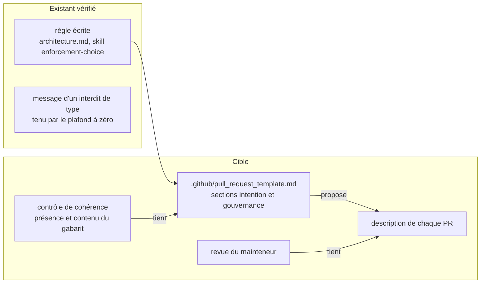

# Conception : demander dans la pull request l'intention de chaque assertion textuelle

Conception allégée : le changement ajoute un fichier hors du code produit et un contrôle de cohérence. Motivation :
voir `proposal.md`, section Why.

## Contexte

État vérifié le 2026-11-06 sur `30520bd3` :

- `[EXISTANT VÉRIFIÉ]` Aucun gabarit de pull request : `git ls-files | grep -i pull_request` ne rend rien ; `.github/`
  contient `workflows/`, `AI_GOVERNANCE.md`, `CODEOWNERS`, `dependabot.yml`.
- `[EXISTANT VÉRIFIÉ]` La phrase d'intention est une convention : `.claude/rules/architecture.md`, section « Règle
  ArchUnit ou assertion textuelle » (« Avant de choisir, **écrire l'intention en une phrase** ») ; skill
  `.claude/skills/enforcement-choice/SKILL.md` (« D'abord : écrire l'intention en une phrase »). Pour les interdits
  textuels de **type**, l'intention est déjà exigée dans le code, comme message de l'assertion
  (`enforcement-mechanism-accounting` › A new textual ban of a type SHALL state which proposition it enforces ;
  `EnforcementMechanismAccountingTest.UNEXPLAINED_TYPE_BAN_CEILING`).
- `[EXISTANT VÉRIFIÉ]` ADR-0103, qui posait ce critère, est archivé
  (`docs/architecture/adr/archive/0103-textual-assertions-and-archunit-rules-enforce-different-things.md`, statut
  « Remplacée par ADR-0130 ») ; son bandeau renvoie le critère à `.claude/rules/architecture.md` et à la skill. Aucun ADR
  actif ne porte la phrase d'intention.
- `[EXISTANT VÉRIFIÉ]` `.claude/rules/governance.md` exige de « Justifier dans la description de la PR toute
  modification de `contracts/public-surfaces.tsv`, `config/*ratchets*.properties`,
  `docs/developer/reference/openapi/*.yaml` ou d'un test sous `morpheus-architecture-tests/` » ; l'en-tête de
  `config/debt-counter-ratchets.properties` dit qu'une hausse de clé exige un ADR consolidé « and the pull request says
  so ». Rien ne le rappelle à l'auteur.
- `[EXISTANT VÉRIFIÉ]` Les workflows déclenchés par `pull_request` (`ci.yml`, `codeql.yml`, `nightly.yml`,
  `security.yml`) ne lisent pas `github.event.pull_request.body` ; `.claude/rules/security.md` interdit d'exposer un
  secret au chemin `pull_request` et de développer une expression dans un bloc `run:`.
- `[EXISTANT VÉRIFIÉ]` Une classe de la suite qui ne lit que des fichiers non compilés porte `@CoherenceCheck`
  (`CoherenceCheckMarkerTest#everyTestClassThatReadsNoCodeIsMarkedAndNoOtherIs`).

## Exigences couvertes

| Capacité | Exigence (titre exact) | Rubriques |
|---|---|---|
| `enforcement-mechanism-accounting` | Le gabarit de pull request demande l'intention de chaque assertion textuelle ajoutée | D1, D3, D4 |
| `enforcement-mechanism-accounting` | Le gabarit de pull request demande la justification d'une modification de gouvernance | D2, D4 |

## Qui tient quoi

Question : une fois le changement livré, quelle partie de la phrase d'intention le build tient-il, et laquelle reste à
la revue ?

Le build tient le gabarit (présence, sections) ; il ne lit jamais une description de pull request, que la revue seule
juge. Exigences : les deux exigences ajoutées.

## Décisions

### D1 : un gabarit de pull request plutôt qu'une règle de plus
- **Nature** : [DÉCISION]
- **Exigences servies** : `enforcement-mechanism-accounting` › Le gabarit de pull request demande l'intention de chaque
  assertion textuelle ajoutée.
- **Choix** : `.github/pull_request_template.md`, que GitHub pré-remplit à l'ouverture d'une pull request. La section
  d'intention demande, par assertion textuelle ajoutée ou modifiée dans la suite d'architecture : le fichier, la phrase
  d'intention (la mention interdite, ou la dépendance qu'elle représente), le mécanisme retenu et, pour une règle sur le
  bytecode, la violation plantée qui l'a fait échouer. Elle renvoie à `.claude/rules/architecture.md` par chemin.
- **Alternatives écartées** : (a) n'écrire la demande que dans `.claude/rules/` : écarté, la règle existe déjà et ne
  laisse aucune trace en revue (c'est le constat) ; (b) un `CONTRIBUTING.md` enrichi : écarté, il n'est pas affiché à
  l'ouverture d'une pull request et le dépôt n'accepte pas de contribution non sollicitée (`CONTRIBUTING.md`, ligne 9) ;
  (c) exiger le message d'intention dans chaque assertion textuelle, sur le modèle des interdits de type : écarté pour
  ce changement, il reviendrait à plafonner la part textuelle globale, que `.claude/rules/architecture.md` refuse
  délibérément.
- **Compromis** : un gabarit se contourne en effaçant la section ; seule la revue le voit.
- **ADR** : non concerné. Décision : oui ; portée et durée : non (un fichier d'aide à la revue, aucun module, aucun
  format, aucune surface) ; coût du retour arrière : nul. Le critère lui-même vit dans `.claude/rules/architecture.md`
  depuis l'archivage d'ADR-0103.

### D2 : un seul gabarit porte aussi la justification de gouvernance
- **Nature** : [DÉCISION]
- **Exigences servies** : `enforcement-mechanism-accounting` › Le gabarit de pull request demande la justification d'une
  modification de gouvernance.
- **Choix** : une seconde section du même gabarit, qui reprend la liste de `.claude/rules/governance.md` et la hausse
  d'une clé de `config/debt-counter-ratchets.properties`.
- **Alternatives écartées** : deux gabarits (`PULL_REQUEST_TEMPLATE/` multiple) : écarté, GitHub n'en pré-remplit aucun
  sans paramètre d'URL, et un mainteneur unique n'a qu'un type de pull request ; une capacité nouvelle pour la seule
  section de gouvernance : écarté, le gabarit est un seul fichier tenu par un seul contrôle.
- **Compromis** : la capacité `enforcement-mechanism-accounting` porte une exigence de gouvernance au sens large ; les
  fichiers qu'elle nomme sont ceux qui gouvernent l'enforcement.
- **ADR** : non concerné.

### D3 : aucun workflow ne lit la description de la pull request
- **Nature** : [DÉCISION]
- **Exigences servies** : `enforcement-mechanism-accounting` › Le gabarit de pull request demande l'intention de chaque
  assertion textuelle ajoutée (scénario « Une pull request laisse la section vide »).
- **Choix** : la description n'est jugée que par la revue.
- **Alternatives écartées** : un job `pull_request` qui lit `github.event.pull_request.body` et échoue si la section est
  vide alors que le diff ajoute un `contains(` sous la suite : écarté parce qu'il ne vérifie que la présence d'un texte,
  pas sa justesse ; qu'il faut le relancer à chaque édition de la description (type d'événement `edited`) ; qu'il
  ajoute un contexte de contrôle que la protection de branche ne requiert pas, donc ignoré ou ajouté aux checks requis
  avec les effets de saut connus ; et qu'il fait entrer un texte libre et non fiable dans un job, qui devrait passer
  par `env:` et jamais par une expression dans `run:` (`.claude/rules/security.md`). Un contrôle par message de commit
  (trailer) : écarté, même limite et plus de friction.
- **Compromis** : une pull request à section vide passe le build ; la revue est l'unique filet.
- **ADR** : non concerné.

### D4 : un contrôle de cohérence textuel du gabarit
- **Nature** : [DÉCISION]
- **Exigences servies** : les deux exigences ajoutées.
- **Choix** : une classe de la suite d'architecture, marquée `@CoherenceCheck`, qui lit le gabarit et y cherche le titre
  de chaque section et, pour la gouvernance, les chemins nommés. Intention : « le gabarit demande ces deux choses ».
- **Alternatives écartées** : une règle ArchUnit : sans objet, la cible est un `.md` où le texte est la seule prise
  (`.claude/rules/architecture.md`, « Restent textuels par nature »).
- **Compromis** : un titre reformulé casse le contrôle ; c'est voulu, le titre est le contrat que le test et la revue
  partagent.
- **ADR** : non concerné.

## Écarts constatés

| Constat | Source A | Source B | Traitement proposé |
|---|---|---|---|
| L'action dit qu'ADR-0103 « réclame déjà » la phrase d'intention « pour toute nouvelle assertion contains sur un artefact de documentation » | constat `AUD-TRV-03`, champ `action` | ADR-0103 (archivé) : l'intention est énoncée « avant d'écrire quoi que ce soit », jamais en description de PR, et sa section « Décision » §2 écarte expressément les artefacts non-Java | le gabarit demande l'intention pour toute assertion textuelle ajoutée à la suite, artefact non compilé compris ; la référence à ADR-0103 n'est pas reprise dans l'exigence |
| ADR-0103 est cité par le constat comme décision en vigueur | constat, champs `preuve` et `impact` | registre : ADR-0103 n'est que dans `archive/` | aucun ADR à citer ; le critère vit dans `.claude/rules/architecture.md` |

## Stratégie de vérification

| Exigence | Scénario | Preuve | État |
|---|---|---|---|
| Intention | Le gabarit est présent avec sa section | contrôle de cohérence ajouté (méthode sur la section d'intention) | à écrire |
| Intention | La section d'intention est retirée du gabarit | même méthode ; violation plantée une fois (section supprimée), échec constaté, retour arrière | à écrire |
| Intention | Le gabarit est supprimé | même classe, échec sur fichier absent ; violation plantée une fois | à écrire |
| Intention | Une pull request laisse la section vide | aucun workflow ne lit `pull_request.body` : relecture de `.github/workflows/` | manuel |
| Gouvernance | La section de gouvernance est retirée du gabarit | méthode sur la section de gouvernance ; violation plantée une fois | à écrire |
| Gouvernance | La section nomme les fichiers de gouvernance | même méthode | à écrire |
| R4 (existante) | classe ajoutée marquée | `CoherenceCheckMarkerTest#everyTestClassThatReadsNoCodeIsMarkedAndNoOtherIs` | existant |

Sans objet : composants et frontières, modèle de domaine, traitements, états, contrats d'interface, persistance,
transactions, sécurité (aucune entrée non fiable lue par le build), erreurs, observabilité, performance (le changement
ajoute un fichier Markdown et un test sans effet sur le code produit). Compatibilité et retour arrière : supprimer le
gabarit et sa classe de test, sans donnée à migrer ; le nombre d'exécutions déclarées du module monte, il ne baisse
pas.

## Documentation durable et diagrammes à mettre à jour

- `docs/developer/specifications/enforcement-mechanism-accounting.md` : deux exigences au tableau, section « Le gabarit
  de pull request », diagramme « Qui tient quoi », traçabilité.
- `.claude/rules/architecture.md` et `.claude/skills/enforcement-choice/SKILL.md` : renvoi au gabarit après « écrire
  l'intention en une phrase ».
- `.claude/rules/governance.md` : renvoi au gabarit dans la puce « Justifier dans la description de la PR ».

## Questions ouvertes

Aucune.
