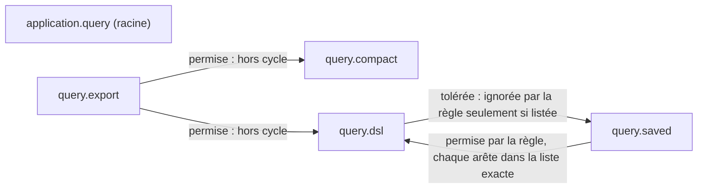
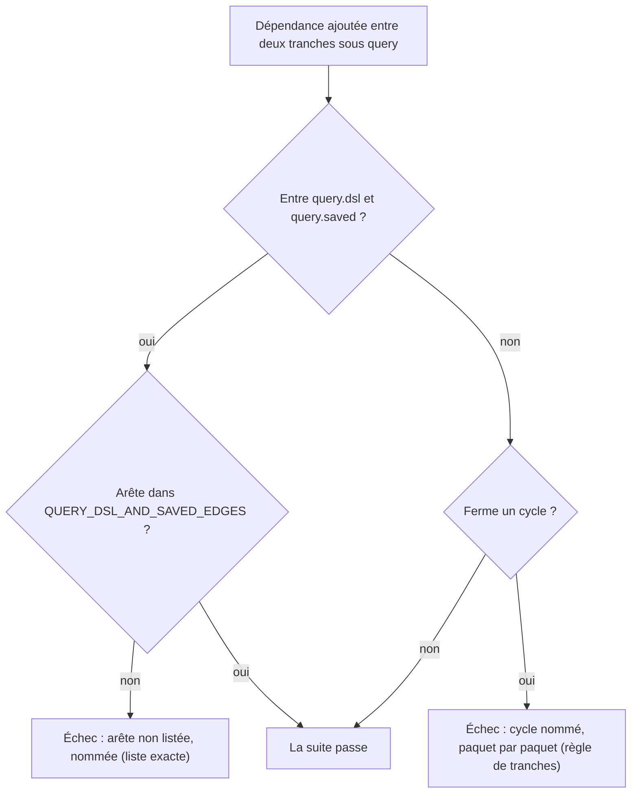

# Conception : borner le cycle entre le DSL de requête et les vues enregistrées

Conception allégée : changement local à la suite d'architecture, sans code de production. Les rubriques sans objet
sont regroupées en fin de Contexte.

## Contexte

Motivation : voir `proposal.md`, section Why. État vérifié le 2026-11-06 sur `30520bd3` :

- `[EXISTANT VÉRIFIÉ]` `ApplicationPackageCyclesArchitectureTest`
  (`morpheus-architecture-tests/src/test/java/com/morpheus/architecture/`) construit sa règle par
  `firstLevelPackagesFreeOfCycles(root)` = `slices().matching(root + ".(*)..").should().beFreeOfCycles()` (ligne 38),
  avec un `because` qui cite ADR-0156 ; la javadoc (lignes 25 à 27) dit que `query.dsl` et `query.saved` forment une
  seule tranche. Le test `theCycleRuleRefusesTwoPackagesThatDependOnEachOther` prouve la règle sur les fixtures
  `com.morpheus.architecture.cycles.fixture.alpha` et `.beta` et attend `ADR-0156` dans le message.
- `[EXISTANT VÉRIFIÉ]` Imports croisés (texte) : `dsl/QueryPublicViews.java:3-5` → `SavedViewDefinition`,
  `SavedViewEntry`, `SavedViewVersion` ; `saved/SavedViewService.java:3-8` → `QueryBudgets`, `QueryDefinition`,
  `QueryExecutionService`, `QueryResult`, `QueryScope`, `QueryValidator` ; `saved/SavedViewStore.java:3` →
  `QueryScope` ; `saved/SavedViewDefinition.java:3-4` → `QueryBudgets`, `QueryDefinition` ;
  `saved/SavedViewVersion.java:3` → `QueryDefinition`. Mesure de l'audit du 06/11 sur `30520bd3`, retrouvée à
  l'identique.
- `[EXISTANT VÉRIFIÉ]` Bytecode (`jdeps -verbose:class` sur `morpheus-application/target/classes`, 2026-11-06) :
  `QueryPublicViews` dépend aussi de `SavedViewId`, `SavedViewStatus` et des types imbriqués
  `SavedViewEntry$Readable` / `$Unreadable`, qu'elle n'importe pas (appels chaînés). Entre sous-paquets de `query`,
  seuls existent `dsl→saved`, `saved→dsl`, `export→dsl` et `export→compact` ; la racine `query` ne dépend d'aucun
  sous-paquet.
- `[EXISTANT VÉRIFIÉ]` `SavedViewDefinition` et `SavedViewService` ne lisent de `QueryBudgets` que des constantes
  `public static final int` (`MAX_SAVED_VIEW_NAME`, `MAX_SAVED_VIEWS_PER_SCOPE`) : `javap -c` montre la valeur
  inlinée (`sipush`) et aucun `getstatic` vers `QueryBudgets`. Seule une entrée inutilisée du pool de constantes
  subsiste ; qu'ArchUnit la compte ou non reste à constater (tâche 1.1).
- `[EXISTANT VÉRIFIÉ]` ARCH-0156, décision 5 : « aucun cycle entre tranches de premier niveau, sans exception » ;
  « Don't » : « ni de liste d'exceptions pour en tolérer un » ; conséquence négative : la paire échappe à la règle et
  `QueryPlatformArchitectureTest` « est l'endroit d'une règle sur eux ».
- `[EXISTANT VÉRIFIÉ]` `ProductionClassListsArchitectureTest` exige que toute liste qui nomme des classes de
  production soit un compteur de dette (ADR accepté qui le nomme par `TestClass.CHAMP`, taille égale à sa clé de
  `config/debt-counter-ratchets.properties`, qui ne fait que baisser) ou une table de faits ; une carte de collections
  compte les éléments de ses valeurs. `AdapterCompositionRootArchitectureTest.COMPOSITION_ROOTS` y est déclaré sous
  `ARCH-0156`.

Sans objet : modèle de domaine, contrats d'interface, persistance, transactions, sécurité, observabilité, performance
(aucun code du produit ne change) ; compatibilité et retour arrière : retirer la règle et la clé suffit, sans donnée.

## Exigences couvertes

| Capacité | Exigence (titre exact) | Rubriques de conception qui y répondent |
|---|---|---|
| `application-package-cycles` | Les paquets sous la plateforme de requête sont sans cycle, à une paire nommée près | D1, D2 |
| `application-package-cycles` | Les arêtes entre le DSL de requête et les vues enregistrées forment une liste exacte qui ne fait que rétrécir | D3 |
| `application-package-cycles` | La liste des arêtes tolérées est un compteur de dette adossé à une décision acceptée | D4 |
| `application-package-cycles` | La règle de la plateforme de requête juge chacun de ses paquets | D1 |
| `application-package-cycles` | La décision d'architecture nomme la paire tolérée et son compteur | D5 |

## Vues

Question : quelles dépendances entre paquets de la requête existent, lesquelles la règle cible tolère-t-elle, et par
quel mécanisme ? Organigramme (`flowchart`, pas UML). Flèches pleines : dépendances existantes vérifiées par `jdeps`
le 2026-11-06 ; l'étiquette dit ce que la cible en fait.

Explication : la racine n'a aucune dépendance vers un sous-paquet (et reste une tranche jugée). Le seul cycle est
`dsl ↔ saved`. La règle cible ignore les seules arêtes listées de `dsl` vers `saved` ; le sens `saved → dsl` reste
vu, mais sans arête de retour il ne ferme aucun cycle : c'est la liste exacte qui l'empêche de grandir. Exigences :
les deux premières de la table.

Question : que se passe-t-il quand un contributeur ajoute une dépendance sous `query` ? Organigramme de décision
(cible).

Explication : une arête `dsl → saved` non listée échoue **deux fois** (règle de tranches et liste), une arête
`saved → dsl` non listée une fois (liste). Une arête listée qui disparaît échoue par la liste jusqu'à ce que l'entrée et
la clé baissent. Exigences : les trois premières.

## Décisions

### D1 : une règle de deuxième niveau sous `query`, racine comprise, dans la classe des cycles de l'application
- **Nature** : [DÉCISION]
- **Exigences servies** : `application-package-cycles` › Les paquets sous la plateforme de requête sont sans cycle, à
  une paire nommée près ; › La règle de la plateforme de requête juge chacun de ses paquets.
- **Choix** : dans `ApplicationPackageCyclesArchitectureTest`, une règle `slices().assignedFrom(…)` qui range chaque
  classe de `com.morpheus.application.query.X..` dans la tranche `X` et chaque classe de la racine
  `com.morpheus.application.query` dans une tranche à elle, puis `beFreeOfCycles()` ; un test de complétude, sur le
  patron de `theCycleRuleSeesEveryFirstLevelPackageOfTheApplicationSources`, compare les sous-paquets déclarés par les
  sources à ceux des classes importées ; un test sur fixtures (deux paquets de deuxième niveau sous
  `com.morpheus.architecture.cycles`) prouve le refus.
- **Alternatives écartées** : `slices().matching("com.morpheus.application.query.(*)..")`, écarté parce que les
  classes de la racine `query` n'appartiennent à aucune tranche et qu'un cycle passant par elle échapperait — le défaut
  de granularité même que relève le constat ; la règle dans `QueryPlatformArchitectureTest`, comme l'annonce
  ARCH-0156, écartée parce que cette suite M24 porte les frontières de transport, de store et de manifeste, alors que la
  capacité `application-package-cycles`, sa fabrique de règle et ses fixtures vivent ici (l'ADR consolidé de D5 corrige
  la phrase) ; une règle au deuxième niveau de toute l'application (`com.morpheus.application.(*).(*)..`), écartée
  faute de mesure des autres paquets — hors périmètre.
- **Compromis** : une règle de plus à tenir si la plateforme de requête est réorganisée.
- **ADR** : couvert par l'ADR consolidé de D5.

### D2 : l'exception ne vise que le sens `dsl → saved`, arête par arête
- **Nature** : [DÉCISION]
- **Exigences servies** : `application-package-cycles` › Les paquets sous la plateforme de requête sont sans cycle, à
  une paire nommée près.
- **Choix** : pour chaque origine de `query.dsl` présente dans la liste, un `ignoreDependency(origine, cibles listées)`
  dont le prédicat de cible ramène un type imbriqué à son type de premier rang. Le sens `saved → dsl` est le sens
  naturel (une vue enregistrée garde et exécute une définition de requête) ; `dsl → saved` (`QueryPublicViews` qui
  projette des vues enregistrées) est l'arête de retour, celle qu'une résorption retirerait.
- **Alternatives écartées** : ignorer tout `dsl ↔ saved`, écarté parce qu'une arête de retour nouvelle ne serait plus
  vue que par la liste, sans message de cycle ; ignorer le sens `saved → dsl`, écarté parce qu'il compte plus d'arêtes
  et que c'est le sens qui doit rester.
- **Compromis** : l'exception dépend de la liste de D3, qu'elle lit ; une liste vide supprime l'exception d'elle-même.
- **ADR** : couvert par D5.

### D3 : une liste exacte des arêtes, mesurée sur le bytecode et sur le texte
- **Nature** : [DÉCISION]
- **Exigences servies** : `application-package-cycles` › Les arêtes entre le DSL de requête et les vues enregistrées
  forment une liste exacte qui ne fait que rétrécir.
- **Choix** : `QUERY_DSL_AND_SAVED_EDGES`, carte ordonnée « type d'origine de premier rang → ensemble ordonné de types
  cibles de premier rang », dans les deux sens. Mesure = union de deux lectures : les dépendances directes du bytecode
  (ArchUnit), ramenées au type de premier rang ; et, dans le texte hors commentaires de chaque source des deux paquets,
  les types de l'autre paquet nommés par un `import` ou un nom qualifié. Égalité exigée dans les deux sens, chaque écart
  nommé « origine → cible ».
- **Alternatives écartées** : un nombre d'arêtes seul, écarté parce qu'il ne nomme pas l'arête apparue et que le
  mécanisme du dépôt exige une liste dont la taille est la clé ; le bytecode seul, écarté parce qu'une constante inlinée
  (`QueryBudgets.MAX_SAVED_VIEW_NAME` dans `SavedViewDefinition`) n'y laisse pas de dépendance ; le texte seul, écarté
  parce que les types atteints par appel chaîné (`SavedViewId`, `SavedViewStatus` depuis `QueryPublicViews`) n'y sont
  pas nommés ; les classes imbriquées comptées à part, écarté parce qu'un déplacement dans un type imbriqué changerait
  le compte sans changer le couplage.
- **Compromis** : deux lectures à maintenir ; un nom construit par réflexion ou concaténation échapperait au texte, et
  le module ne l'emploie pas (`ApplicationTechnologyBoundaryArchitectureTest`).
- **ADR** : couvert par D5.

### D4 : un compteur de dette, pas une table de faits
- **Nature** : [DÉCISION]
- **Exigences servies** : `application-package-cycles` › La liste des arêtes tolérées est un compteur de dette adossé
  à une décision acceptée.
- **Choix** : déclarer `ApplicationPackageCyclesArchitectureTest.QUERY_DSL_AND_SAVED_EDGES` en
  `Kind.debtCounterUnder(<ADR consolidé>)` dans `ProductionClassListsArchitectureTest`, et ajouter sa clé à
  `config/debt-counter-ratchets.properties` à la taille mesurée à l'implémentation (aucune valeur recopiée ici).
- **Alternatives écartées** : une table de faits, écartée parce que la liste décrit une dette qu'on attend voir
  disparaître et qu'une table ne promet pas de rétrécir ; une clé dans un autre fichier, écartée (mécanisme existant).
- **Compromis** : relever la clé exige un ADR consolidé, comme pour tout compteur.
- **ADR** : couvert par D5.

### D5 : remplacer ARCH-0156 par un ADR consolidé
- **Nature** : [PROPOSITION]
- **Exigences servies** : `application-package-cycles` › La décision d'architecture nomme la paire tolérée et son
  compteur ; › La liste des arêtes tolérées est un compteur de dette adossé à une décision acceptée.
- **Choix** : la décision 5 d'ARCH-0156 (« sans exception ») et son « Don't » (« ni de liste d'exceptions ») changent en
  partie : `.claude/rules/adr.md` impose un ADR consolidé qui reprend les décisions 1 à 4 et 6, réécrit la 5 (premier
  niveau sans exception ; deuxième niveau sous `query` sans cycle hors de la paire nommée, bornée par
  `ApplicationPackageCyclesArchitectureTest.QUERY_DSL_AND_SAVED_EDGES`), porte la mesure datée du 2026-11-06 sur
  `30520bd3`, et passe ARCH-0156 en `Remplacée`. Filtre : décision entre options réelles (résorber, borner, ignorer),
  portée sur les paquets de l'application et la gouvernance des compteurs, retour arrière qui défait une règle et un
  compteur. Le compteur `COMPOSITION_ROOTS`, déclaré sous ARCH-0156, est redéclaré sous le nouvel ADR, et les mentions
  `ADR-0156` du dépôt (dont le `because` de la règle et l'assertion du test sur fixtures) sont redirigées.
- **Alternatives écartées** : un amendement d'ARCH-0156, interdit par `.claude/rules/adr.md` ; aucun ADR, impossible
  (un compteur de dette exige un ADR accepté qui le nomme).
- **Compromis** : la fusion attend l'acceptation du mainteneur ; nombreuses mentions d'`ADR-0156` à rediriger.
- **ADR** : ADR à proposer.

## Écarts constatés

| Constat | Source A | Source B | Traitement proposé |
|---|---|---|---|
| Le constat compte des imports (13) ; le bytecode montre d'autres cibles (`SavedViewId`, `SavedViewStatus`, types imbriqués) et une constante inlinée sans dépendance | `findings.json` (`verif_preuve`) | `jdeps`, `javap` du 2026-11-06 | la liste de D3 mesure l'union ; sa taille est relue à l'implémentation |
| ARCH-0156 désigne `QueryPlatformArchitectureTest` comme lieu de la règle | ARCH-0156, conséquences négatives | D1 | réécrit par l'ADR consolidé |
| Le titre de l'exigence de premier niveau (« … SHALL be named ») annonce des dépendances nommées que son corps interdit | spec `application-package-cycles` | page durable, section Écarts | inchangé ici ; la paire nommée de deuxième niveau ne touche pas le premier niveau |

## Stratégie de vérification

| Exigence | Scénario | Preuve | État |
|---|---|---|---|
| Sans cycle, à une paire près | Le code en vigueur passe | `ApplicationPackageCyclesArchitectureTest`, méthode ajoutée sur les classes de production | à écrire |
| idem | La règle est prouvée sur une paire connue | test sur fixtures de deuxième niveau | à écrire |
| idem | Arête `dsl → saved` hors liste ; cycle nouveau ; cycle par la racine | violation plantée une fois (tâche 2.4), échec constaté, retour arrière | manuel, consigné |
| Liste exacte | Arête ajoutée ; arête disparue ; constante inlinée ; type imbriqué | test de la liste sur production + tests sur fixtures | à écrire |
| Compteur de dette | les trois scénarios | `ProductionClassListsArchitectureTest#everyDebtCounterIsNamedByTheAcceptedDecisionRecordItDeclares`, `#everyDebtCounterHoldsExactlyTheSizeItsRatchetAllows` | existant |
| Complétude | Sous-paquet ajouté ; classes non importées | test de complétude ajouté | à écrire |
| Décision nommée | Un lecteur cherche pourquoi | revue de l'ADR consolidé ; `AdrIndexCoherenceTest` | manuel + existant |

## Documentation durable et diagrammes à mettre à jour

- `docs/developer/specifications/application-package-cycles.md` : exigences ajoutées, les deux organigrammes, écarts,
  traçabilité.
- `.claude/rules/architecture.md`, section « Les paquets de l'application sont sans cycle » : règle de deuxième niveau
  et compteur, sans nombre.
- ADR consolidé remplaçant ARCH-0156, `docs/architecture/adr/README.md`, `docs/architecture/arc42/09-decisions.md`.

## Questions ouvertes

- `[QUESTION]` ArchUnit compte-t-il l'entrée inutilisée du pool de constantes laissée par une constante inlinée ?
  Sans effet sur la conception (l'union de D3 la voit par le texte) ; constaté en tâche 1.1.
- `[QUESTION]` Coordination avec `thresh-every-module-coverage-on-its-own-floor`, qui propose aussi un ADR consolidé
  (de GEN-0154) : deux numéros distincts, à attribuer dans l'ordre de fusion.
- `[QUESTION]` Coordination avec `hold-every-class-list-of-a-decision-record-to-its-gate`, qui cite ARCH-0156 comme
  ADR qui référence `COMPOSITION_ROOTS` sans l'énumérer : l'ADR consolidé de D5 doit garder cette forme, et celui des
  deux changements qui fusionne second relit l'identifiant de l'ADR en vigueur.
