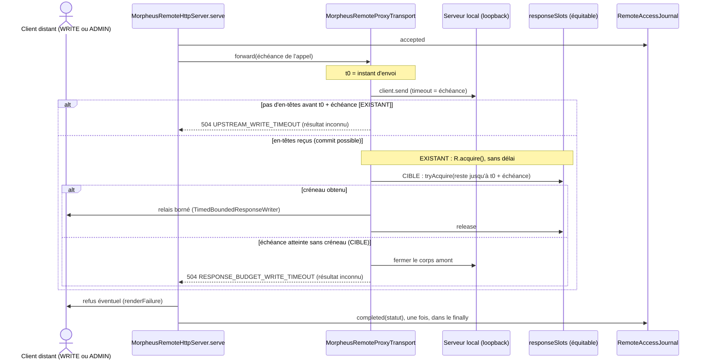

# Conception : borner l'attente d'un créneau de réponse du proxy distant

## Contexte

Motivation : voir `proposal.md`, section Why. État vérifié le 2026-11-06 sur `30520bd3` :

- `[EXISTANT VÉRIFIÉ]` `MorpheusRemoteProxyTransport.forward` (`morpheus-api/src/main/java/com/morpheus/api/remote/MorpheusRemoteProxyTransport.java:65-108`) :
  une lecture (`deadline.readOnly()`) prend son créneau par `responseSlots.tryAcquire()` avant `client.send` et reçoit
  `429 RESPONSE_BUDGET_EXHAUSTED` (`:80-86`, compteur `runtime.recordThrottledRequest()`) ; une écriture appelle
  `client.send` (dont `request.timeout(deadline.timeout())` borne l'attente des en-têtes amont, `:114`), puis
  `awaitResponseBudget` (`:90-93`), qui fait `responseSlots.acquire()` sans délai (`:166-175`, appel `:168`) et ferme le
  corps amont sur interruption (`:169-174`). Le `finally` ne rend le créneau que s'il a été pris (`:103-107`).
- `[EXISTANT VÉRIFIÉ]` Le sémaphore est équitable (`:41`) ; il compte
  `MorpheusRemoteHttpServer.MAX_PROXY_IN_FLIGHT_BYTES / MAX_PROXY_RESPONSE_BYTES` créneaux
  (`MorpheusRemoteHttpServer.java:48-49`, `:61`). Les écritures admises sont bornées par
  `privilegedConcurrencyLimit(maxConcurrentRequests)` (`MorpheusRemoteHttpServer.java:467-470`).
- `[EXISTANT VÉRIFIÉ]` Un détenteur de créneau le garde : pour une lecture, de l'appel amont (au plus
  `UpstreamDeadline.READ`) à la fin de l'écriture de sa réponse ; pour une écriture, pendant l'écriture de sa réponse.
  L'écriture d'une réponse est bornée par `TimedBoundedResponseWriter.RESPONSE_STALL_TIMEOUT` et
  `RESPONSE_TOTAL_TIMEOUT` (`transport/TimedBoundedResponseWriter.java:50-51`).
- `[EXISTANT VÉRIFIÉ]` L'expiration amont d'une écriture rend `504 UPSTREAM_WRITE_TIMEOUT`, « it may have completed:
  read its state before retrying » (`:259-271`), tenu par `remote-proxy-upstream-bounds` › A timed-out write SHALL be
  answered as an unknown outcome.
- `[EXISTANT VÉRIFIÉ]` `serve` (`MorpheusRemoteHttpServer.java:241-341`) traduit toute `TransportException` en
  `RemoteFailure` (`proxy`, `:502-504`), la rend par `renderFailure`, et écrit l'issue au journal d'accès **une fois**,
  dans son `finally`, par `accessJournal.completed(attributed, status)` après `exchange.close()` (`:335-339`). Un
  enregistrement porte le statut, jamais le code (`RemoteAccessJournal.completed`, `:88-93`).
- `[EXISTANT VÉRIFIÉ]` Le patron d'ADR-0159 : la sauvegarde distante prend un travailleur dans
  `DatabaseCallWorkers.ADMISSION_WAIT` puis attend au plus `BACKUP_DEADLINE` (`= UpstreamDeadline.WRITE.timeout()`,
  `MorpheusRemoteHttpServer.java:58`) ; refus `429 DATABASE_WORKERS_BUSY` et `504 BACKUP_TIMEOUT`, ce dernier « it may
  still complete » (`:366-378`). Documentation : une réponse `504` de l'opération `/server/backups` et le texte de la
  réponse `TooManyRequests` dans `morpheus-v1-remote-m26.yaml:51-58` et `:165-170` ; aucune mention dans
  `contracts/public-surfaces.tsv` (ligne `server.backup.create`).
- `[EXISTANT VÉRIFIÉ]` Les tests existants de l'attente : `MorpheusRemoteProxyResponseBudgetTest#aMutationWaitsForTheBudgetRatherThanBeingRefusedAfterItsCommit`
  et `#anInterruptWhileWaitingForTheBudgetClosesTheUpstreamResponse`, dont le double `WatchedSemaphore` redéfinit
  `acquire()` (`morpheus-api/src/test/java/com/morpheus/api/remote/MorpheusRemoteProxyResponseBudgetTest.java:130-200`).

## Exigences couvertes

| Capacité | Exigence (titre exact) | Rubriques de conception qui y répondent |
|---|---|---|
| `remote-proxy-upstream-bounds` | Every proxied response SHALL be read within the memory budget | D1, Traitements |
| `remote-proxy-upstream-bounds` | Une écriture sans créneau de réponse à son échéance reçoit un refus de résultat inconnu | D2, D3, D4, D6, Traitements |
| `remote-proxy-upstream-bounds` | L'adaptateur HTTP n'attend aucun sémaphore sans délai | D5 |
| `remote-proxy-upstream-bounds` | La réponse à une écriture relayée commence avant l'échéance de son appel | D1, D7 |

## Composants et frontières

Tout reste dans `morpheus-api`, paquet `com.morpheus.api.remote` : `MorpheusRemoteProxyTransport` (attente, refus) ;
`MorpheusRemoteHttpServer` et `RemoteAccessJournal` inchangés. Aucune dépendance nouvelle ; `ApiPackageCyclesArchitectureTest`
et `ApiEntryTypesArchitectureTest` ne sont pas concernés (aucun type nouveau hors du paquet). La règle de D5 vit dans
`morpheus-architecture-tests/src/test/java/com/morpheus/architecture/m26/RemoteServerArchitectureTest.java`.

## Traitements et interactions

Question : que se passe-t-il pour une écriture relayée quand tous les créneaux de réponse sont pris, avant et après ce
changement ?

Existant et cible sont marqués dans les notes. Exigences : « Every proxied response SHALL be read within the memory
budget », « Une écriture sans créneau de réponse à son échéance reçoit un refus de résultat inconnu », « La réponse à une
écriture relayée commence avant l'échéance de son appel ». Seule la branche « en-têtes reçus » change ; le relais et le
journal suivent le chemin actuel.

## Contrats d'interface

- Route : aucune ajoutée ni modifiée ; toutes les routes WRITE et ADMIN relayées par la façade sont concernées, dont
  `POST /provider-plugins/probe` (seule route relayée décrite opération par opération dans
  `morpheus-v1-remote-m26.yaml`). Rôle requis inchangé.
- Erreur ajoutée : statut `504`, code `RESPONSE_BUDGET_WRITE_TIMEOUT`, enveloppe `ErrorEnvelope`, message qui dit que
  l'opération a pu aboutir et qu'il faut relire l'état avant de rejouer. Idempotence : comme pour
  `UPSTREAM_WRITE_TIMEOUT`, le client relit avant de rejouer une opération non idempotente.
- Documentation du contrat (D6) : `morpheus-v1-remote-m26.yaml`, une réponse `504` sur `/provider-plugins/probe` qui
  nomme `UPSTREAM_WRITE_TIMEOUT` et `RESPONSE_BUDGET_WRITE_TIMEOUT`, et une phrase de `info.description` qui dit que tout
  appel WRITE ou ADMIN relayé peut recevoir ces deux `504`. `contracts/public-surfaces.tsv` ne change pas : ses lignes
  décrivent des capacités et des routes, pas leurs codes de refus (`BACKUP_TIMEOUT` n'y figure pas).
  `PublicHttpRouteConvergenceTest` compare méthodes et chemins : il n'est pas touché.

## Transactions, concurrence et idempotence

- `[DÉCISION]` La file reste équitable : `tryAcquire(long, TimeUnit)` d'un sémaphore équitable respecte l'ordre
  d'arrivée. Avec un reste nul ou négatif, l'appel devient `tryAcquire(0, …)`, qui ne passe devant aucune attente.
- `[EXISTANT VÉRIFIÉ]` L'opération locale peut avoir été validée : la façade ne la défait pas et ne le prétend pas (même
  position qu'`UPSTREAM_WRITE_TIMEOUT` et `BACKUP_TIMEOUT`).

## Sécurité et isolation

Le message du refus ne nomme ni chemin, ni identifiant, ni corps amont. Le corps amont n'est jamais relayé partiellement.
Rien ne change aux en-têtes (`applySecurityHeaders`) ni à l'autorisation.

## Gestion des erreurs et reprise

`[DÉCISION]` Le refus est une `TransportException` (`504`, `RESPONSE_BUDGET_WRITE_TIMEOUT`) levée par
`MorpheusRemoteProxyTransport`, traduite comme les autres par `proxy`. Le corps amont est fermé avant de lever. Le
`finally` de `forward` ne rend rien (aucun créneau pris). L'interruption pendant l'attente garde son traitement actuel
(`503 UPSTREAM_INTERRUPTED`, corps fermé).

## Observabilité

- `[DÉCISION]` Le refus compte dans `runtime.recordThrottledPrivilegedRequest()`, le compteur des écritures refusées
  pour capacité, comme `RESPONSE_BUDGET_EXHAUSTED` compte une lecture dans `recordThrottledRequest()`. Aucun compteur
  nouveau, donc aucune clé nouvelle dans la réponse de `server/status`.
- `[DÉCISION]` Journal d'accès : aucune branche propre. L'issue est écrite une fois dans le `finally` de `serve`, avec le
  statut `504` (`.claude/rules/security.md`, « L'issue s'écrit une fois ») ; le journal ne porte pas de code, donc ce
  refus et `UPSTREAM_WRITE_TIMEOUT` y sont indistincts, ce qui est déjà vrai de tous les `504`.

## Performance et stratégie de mesure

Aucun budget M19 ne couvre ce chemin. La borne est décidée par D1 et calculée depuis les constantes (D7) ; aucun chiffre
nouveau n'est introduit.

## Compatibilité, migration et retour arrière

Un client voit un nouveau code `504` là où, aujourd'hui, il attendait sans limite. Aucun format persisté, aucune version
de schéma. Retour arrière : revenir au `acquire()` (perte de la borne, rien d'autre).

## Décisions

### D1 : la borne de l'attente est l'échéance de l'appel, comptée depuis l'envoi
- **Nature** : [DÉCISION]
- **Exigences servies** : `remote-proxy-upstream-bounds` › Every proxied response SHALL be read within the memory
  budget ; › La réponse à une écriture relayée commence avant l'échéance de son appel.
- **Choix** : `forward` note l'instant d'envoi `t0` ; l'attente du créneau dure au plus `t0 + deadline.timeout() −
  maintenant`. Pour une route WRITE ou ADMIN, la source est `UpstreamDeadline.WRITE` (lue par
  `MorpheusRemoteRoutePolicy.Authorization.upstreamDeadline()`), sans constante nouvelle. Raisonnement : l'échéance
  des écritures est la seule durée que le code, la documentation utilisateur (`docs/user/TEAM_REMOTE_SERVER.md`, table
  des échéances) et ADR-0159 (`BACKUP_DEADLINE`) présentent au client comme celle d'une écriture ; partager
  l'échéance entre l'attente amont et l'attente du créneau fait que le client reçoit un statut avant elle, quel que soit
  le nombre d'écritures en file. La fin de la réponse est ensuite bornée par `RESPONSE_TOTAL_TIMEOUT`.
- **Alternatives écartées** :
  - un délai propre après la réponse amont, égal à `RESPONSE_TOTAL_TIMEOUT` (un tour d'écriture d'un détenteur) : la
    borne vue du client devient échéance + `RESPONSE_TOTAL_TIMEOUT` + `RESPONSE_TOTAL_TIMEOUT`, toujours au-delà de
    l'échéance annoncée, et un tour ne libère pas un créneau pour un écrivain en neuvième position ;
  - écrire seulement la borne composée actuelle (l'autre branche de l'action de l'audit) : elle dépend du nombre
    d'écritures en file, donc elle n'est pas une borne qu'un client peut régler ;
  - prendre le créneau avant l'appel, comme une lecture : écarté par la Javadoc actuelle (`:159-162`) — des écritures
    lentes tiendraient le budget sans octet de réponse et refuseraient toutes les lectures.
- **Compromis** : une écriture dont l'amont répond tard dispose de peu de temps pour son créneau ; sous saturation, elle
  reçoit un résultat inconnu plutôt qu'un succès retardé. C'est la même réponse qu'à une écriture lente, et elle arrive
  dans l'échéance annoncée.
- **ADR** : non concerné (décision locale à une classe, réversible sans donnée ; ADR-0159 n'est pas modifié).

### D2 : un code distinct, `504 RESPONSE_BUDGET_WRITE_TIMEOUT`
- **Nature** : [DÉCISION]
- **Exigences servies** : › Une écriture sans créneau de réponse à son échéance reçoit un refus de résultat inconnu.
- **Choix** : statut `504`, comme `UPSTREAM_WRITE_TIMEOUT` et `BACKUP_TIMEOUT`, la famille « résultat inconnu » de la
  façade ; code nommé d'après le budget qu'il signale (`RESPONSE_BUDGET_EXHAUSTED` pour une lecture).
- **Alternatives écartées** : réutiliser `UPSTREAM_WRITE_TIMEOUT` (l'amont a répondu : le code mentirait sur la cause, et
  l'opérateur ne distinguerait pas un serveur local lent d'un budget de réponse saturé) ; `503` (dit « non traité,
  rejouable », faux ici) ; `429` (dit « refusé avant tout travail », faux ici).
- **Compromis** : un code de plus à documenter.
- **ADR** : non concerné.

### D3 : la réponse amont est fermée, jamais relayée en partie
- **Nature** : [DÉCISION]
- **Exigences servies** : › Une écriture sans créneau de réponse à son échéance reçoit un refus de résultat inconnu.
- **Choix** : comme sur interruption (`:169-174`), fermer `response.body()` avant de lever le refus ; rien n'est écrit
  vers le client avant le refus.
- **Alternatives écartées** : relayer le statut amont sans corps (une réponse sans son corps n'est pas la réponse amont,
  et elle ne tiendrait pas le budget mémoire qu'elle contourne).
- **Compromis** : le client perd le corps d'une opération peut-être réussie ; il relit l'état, comme le message le dit.
- **ADR** : non concerné.

### D4 : aucune branche propre au journal d'accès
- **Nature** : [DÉCISION]
- **Exigences servies** : › Une écriture sans créneau de réponse à son échéance reçoit un refus de résultat inconnu
  (scénario « Le refus est consigné une fois »).
- **Choix** : le refus suit le chemin de toute `TransportException` ; l'issue est écrite par le `finally` de `serve`.
- **Alternatives écartées** : ajouter le code au journal (le journal ne porte aucun code par décision d'ADR-0113 et de
  `remote-access-journal` ; l'ajouter pour un seul refus créerait une exception).
- **Compromis** : le journal ne distingue pas ce `504` des autres.
- **ADR** : non concerné.

### D5 : une règle ArchUnit sur les appels, pas un texte
- **Nature** : [DÉCISION]
- **Exigences servies** : › L'adaptateur HTTP n'attend aucun sémaphore sans délai.
- **Choix** : intention en une phrase — « aucune classe de l'adaptateur HTTP n'appelle une attente non bornée d'un
  sémaphore ». C'est un appel compilé, que le bytecode voit et qu'aucune constante inlinée ne cache : règle
  `noClasses().that().resideInAPackage("com.morpheus.api..").should().callMethod(Semaphore.class, "acquire")`, et de même
  pour `acquire(int)`, `acquireUninterruptibly()` et `acquireUninterruptibly(int)`, avec un `because` qui cite cette
  exigence. `com.morpheus.api..` est dans l'ensemble importé (les règles `m26` le lisent déjà) ; la sélection n'est pas
  vide, donc `failOnEmptyShould` reste satisfait. Aucune liste d'exceptions, donc ni compteur de dette ni table de
  faits.
- **Alternatives écartées** : `assertFalse(source.contains(".acquire()"))` (préfixe de famille : attrape
  `tryAcquire()` mal écrit et rate `acquire(1)` ou un appel par référence de méthode) ; étendre la règle à tout le
  produit (d'autres modules n'ont pas été mesurés ; à proposer séparément si besoin).
- **Compromis** : un sémaphore enveloppé par une classe d'un autre module échapperait à la règle ; aucun n'existe.
- **ADR** : non concerné.

### D6 : documenter le code là où `BACKUP_TIMEOUT` l'est
- **Nature** : [DÉCISION]
- **Exigences servies** : › Une écriture sans créneau de réponse à son échéance reçoit un refus de résultat inconnu
  (scénario « Le refus est documenté pour les clients distants »).
- **Choix** : réponse `504` sur l'opération relayée décrite (`/provider-plugins/probe`), phrase d'`info.description` pour
  les routes relayées, table des échéances de `docs/user/TEAM_REMOTE_SERVER.md`, paragraphe de
  `docs/developer/REMOTE_SERVER_PLATFORM.md`, notes de version de la version en préparation.
- **Alternatives écartées** : modifier `contracts/public-surfaces.tsv` (aucune capacité ni route ne change ; la
  convention du fichier ne porte pas les codes de refus) ; décrire chaque route métier relayée dans le supplément
  distant (il dit lui-même que ces routes gardent leur sémantique de `morpheus-v1.yaml`).
- **Compromis** : la documentation du code est textuelle ; aucun test ne compare les codes émis à l'OpenAPI (écart déjà
  vrai pour `UPSTREAM_WRITE_TIMEOUT`, voir Écarts).
- **ADR** : non concerné.

### D7 : la borne composée est écrite et calculée
- **Nature** : [DÉCISION]
- **Exigences servies** : › La réponse à une écriture relayée commence avant l'échéance de son appel.
- **Choix** : la documentation dit « réponse commencée au plus tard à l'échéance des écritures, terminée au plus tard
  après le délai total d'écriture d'une réponse » ; un test de `morpheus-api` (à côté de
  `MorpheusRemoteProxyResponseBudgetTest`) calcule les deux valeurs depuis `UpstreamDeadline.WRITE` et
  `TimedBoundedResponseWriter.RESPONSE_TOTAL_TIMEOUT` et exige qu'elles figurent dans `REMOTE_SERVER_PLATFORM.md` et
  `TEAM_REMOTE_SERVER.md`, comme `RepositoryDocumentationCoherenceTest` le fait pour les ratchets.
- **Alternatives écartées** : la borne écrite sans test (elle a déjà menti : « jamais plus de cinq minutes », voir
  Écarts).
- **Compromis** : deux pages épinglées par un test de plus.
- **ADR** : non concerné.

## Écarts constatés

| Constat | Source A | Source B | Traitement proposé |
|---|---|---|---|
| La revérification place l'échéance de la sauvegarde « dans le même fichier » (`:58`) | `verif_constat` de `AUD-PRF-20` | `MorpheusRemoteHttpServer.java:58`, pas `MorpheusRemoteProxyTransport.java` | noté ; sans effet sur le constat |
| `privilegedConcurrencyLimit` est cité `:443-446` | preuve initiale de `AUD-PRF-20` | `MorpheusRemoteHttpServer.java:467-470` | noté |
| « jamais plus de cinq minutes » pour une mutation lente est faux aujourd'hui (attente non bornée) et le resterait après ce changement (échéance puis délai total d'écriture) | `docs/user/TEAM_REMOTE_SERVER.md` (paragraphe de la capacité privilégiée) | D1, D7 | réécrire avec la borne composée (tâche 3.2) |
| L'attente est décrite sans borne | `docs/developer/REMOTE_SERVER_PLATFORM.md:230` | ce changement | réécrire (tâche 3.1) |
| Le nombre de créneaux et le plafond d'écritures sont recopiés en chiffres | `REMOTE_SERVER_PLATFORM.md:222` (« huit slots ») ; Javadoc `MorpheusRemoteProxyTransport.java:159-161` (« eight slots … sixteen concurrent mutations ») | `MorpheusRemoteHttpServer.java:48-49`, `:61`, `:467-470` | citer les constantes (tâches 2.1, 3.1) |
| Aucun refus de la façade sur un appel relayé n'est dans l'OpenAPI distante ; `/provider-plugins/probe`, relayé et ADMIN, n'a pas de `504` | `morpheus-v1-remote-m26.yaml:87-140` | `UPSTREAM_WRITE_TIMEOUT` émis par `MorpheusRemoteProxyTransport.java:266-270` | D6 (tâche 3.3) |
| La capacité n'a pas de page durable et sa spec principale ne renvoie à aucune | `openspec/specs/remote-proxy-upstream-bounds/spec.md` (`## Purpose`) | `docs/developer/specifications/README.md` | créer la page (tâche 3.4) ; le renvoi de `## Purpose` relève d'un changement de spec principale, signalé ici |

## Stratégie de vérification

| Exigence | Scénario | Preuve | État |
|---|---|---|---|
| Every proxied response… | An oversized response to a write is refused | `MorpheusRemoteProxyResponseBudgetTest#anOversizedResponseToAWriteIsRefusedByNameAndItsSlotComesBack` | existant |
| idem | A write waits for a slot that frees in time | `#aMutationWaitsForTheBudgetRatherThanBeingRefusedAfterItsCommit`, slot libéré avant l'échéance | existant, à adapter |
| Refus de résultat inconnu | Aucun créneau ne se libère avant l'échéance | test à écrire : sémaphore à zéro, échéance courte (`new UpstreamDeadline(…, false)`), amont `201` ; code, message, aucun octet écrit, créneaux libres inchangés, corps amont fermé | à écrire, rouge avant le correctif (l'appel ne revient pas) |
| idem | Le refus n'est pas celui d'un amont lent | `#aWriteTheUpstreamNeverAnswersEndsAtItsDeadlineAsAnUnknownOutcome` garde `UPSTREAM_WRITE_TIMEOUT` ; le test ci-dessus exige l'autre code | existant + à écrire |
| idem | Le refus est consigné une fois | test à écrire au niveau de `MorpheusRemoteHttpServer` (budget saturé) : un `accepted`, un `completed` à `504`, créneaux rendus | à écrire |
| idem | Le refus est documenté | relecture de `morpheus-v1-remote-m26.yaml` ; `PublicHttpRouteConvergenceTest` vert | manuel + existant |
| Aucun sémaphore sans délai | Une attente non bornée réintroduite | règle ajoutée à `RemoteServerArchitectureTest`, rouge sur le code actuel (`MorpheusRemoteProxyTransport.awaitResponseBudget`) | à écrire |
| Réponse avant l'échéance | La borne écrite suit les constantes | test à écrire (D7) | à écrire |

## Documentation durable et diagrammes à mettre à jour

- `docs/developer/specifications/remote-proxy-upstream-bounds.md` (nouvelle, avec le diagramme de séquence ci-dessus) et
  son index (section « Frontière HTTP locale et distante » de `docs/developer/specifications/README.md`).
- `docs/developer/REMOTE_SERVER_PLATFORM.md`, `docs/user/TEAM_REMOTE_SERVER.md`, notes de version de la version en
  préparation, `docs/developer/reference/openapi/morpheus-v1-remote-m26.yaml`.

## Questions ouvertes

- Nommer le statut amont dans le message du refus (« the local operation answered 201 ») : utile au client, sans
  divulgation ; ne change ni le code, ni le statut, ni les tâches au-delà du texte du message.
