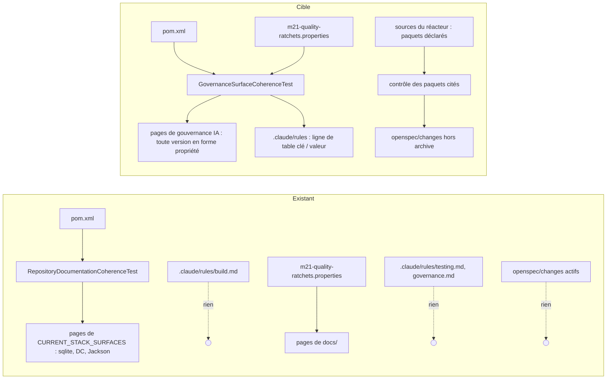

# Conception : comparer à sa source chaque document qui affirme un fait courant

Conception allégée : trois contrôles de cohérence documentaire et deux corrections de texte, sans code de production.

## Contexte

Motivation : voir `proposal.md`, section Why. État vérifié le 2026-11-06 sur `30520bd3` :

- `[EXISTANT VÉRIFIÉ]` `RepositoryDocumentationCoherenceTest#activeStackDocumentationAndD2ValidatorsFollowTheRootPomDependencyVersions`
  parcourt `CURRENT_STACK_SURFACES` et n'y cherche que trois mentions en texte libre (`SQLITE_JDBC_MENTION`,
  `DEPENDENCY_CHECK_MENTION`, `JACKSON_MENTION`). Ajouter `.claude/rules/build.md` à la liste, comme le propose
  l'action du constat, ne ferait **pas** échouer le build sur `jacoco.version` : aucun motif ne lit JaCoCo.
- `[EXISTANT VÉRIFIÉ]` `.claude/rules/build.md` écrit des versions sous deux formes : trois éléments XML
  (`<jackson.version>`, `<sqlite-jdbc.version>`, `<dependency-check.maven.plugin.version>`, lignes 8 à 10, la liste
  qu'exige `D2RepositoryHardeningArchitectureTest#dependencyAndQualityBaselineIsPinned`) et neuf affectations
  `nom.version=valeur` (lignes 75 à 78) ; plus une version en prose (« `mcp-sdk` 2.1.0 », ligne 81). Une recherche des
  deux formes sur toutes les pages de gouvernance IA ne les trouve que dans `build.md`.
- `[EXISTANT VÉRIFIÉ]` `GovernanceSurfaceCoherenceTest.activeGovernanceSurfaces` collecte déjà les pages de gouvernance
  IA (`.claude/CLAUDE.md`, `.github/AI_GOVERNANCE.md`, `.claude/commands`, `.claude/agents`, `.claude/rules`, les
  `SKILL.md` de `.claude/skills`) et refuse qu'un de ces emplacements disparaisse ; elle y interdit déjà un schéma SQLite
  littéral et un total d'ADR ou de modules.
- `[EXISTANT VÉRIFIÉ]` `.claude/rules/testing.md` porte une table `| Clé | Valeur constatée |` dont la première colonne
  est la clé en span de code ; `.claude/rules/governance.md` (« Ratchets de présence qualifiée ») recopie les mêmes
  valeurs en prose, sans clés (« présence `…/…/…` »). Les deux concordent aujourd'hui avec
  `config/m21-quality-ratchets.properties` ; aucun test ne les lit. `RepositoryDocumentationCoherenceTest#operatorFacingQualityGateDocumentationMirrorsTheNormativeRatchets`
  compare les pages de `docs/`, `CONTRIBUTING.md`, `scripts/README.md` et `distribution/README.md`, pas `.claude/rules/`.
- `[EXISTANT VÉRIFIÉ]` `openspec/changes/` ne contient qu'un changement actif avant ce lot ; son `design.md:13` cite
  `com.morpheus.integration.mcp` (ancien nom), que le module `morpheus-mcp-transport` ne déclare plus
  (`morpheus-mcp-transport/src/main/java/com/morpheus/transport/mcp/`). `ModulePackageCorrespondenceTest` tient la
  correspondance module → paquet, mais ne lit aucun document.

## Exigences couvertes

| Capacité | Exigence (titre exact) | Rubriques |
|---|---|---|
| `dependency-version-management` | Une version qu'une page de gouvernance IA écrit sous la forme d'une propriété du POM DOIT égaler la valeur de cette propriété | D1, D2 |
| `stated-fact-currency` | Une valeur de cliquet qu'une page de règles recopie sous le nom de sa clé DOIT égaler cette clé | D3 |
| `stated-fact-currency` | Un nom de paquet `com.morpheus` cité dans un changement OpenSpec actif DOIT exister dans les sources du réacteur | D4, D5 |
| `stated-fact-currency` | Seule une mention marquée « (ancien nom) » ou « (à créer) » DOIT être admise pour un paquet absent des sources | D4 |

## Composants et frontières

Les trois contrôles vivent dans `morpheus-architecture-tests` : versions et cliquets dans `GovernanceSurfaceCoherenceTest`,
qui possède déjà la collection des pages de gouvernance ; les paquets cités dans une classe ajoutée, voisine de
`ModulePackageCorrespondenceTest`. Le parcours de l'arbre passe par `RepositoryTree.files(root)`
(`RepositoryTreeOwnershipTest`), qui écarte `.claude/worktrees/` et les sorties générées. Aucune dépendance nouvelle.

## Traitements et interactions

Question : quelles copies sont comparées à quelle source, avant et après ?

Existant : les flèches en pointillé sont les copies qu'aucun contrôle ne lit. Cible : chacune a sa source. Exigences :
les trois de `stated-fact-currency` et celle de `dependency-version-management`. `flowchart` n'est pas de l'UML.

## Décisions

### D1 : comparer la forme propriété sur toutes les pages de gouvernance, plutôt qu'ajouter `build.md` à `CURRENT_STACK_SURFACES`
- **Nature** : [DÉCISION]
- **Exigences servies** : `dependency-version-management` › Une version qu'une page de gouvernance IA écrit sous la forme
  d'une propriété du POM DOIT égaler la valeur de cette propriété.
- **Choix** : `GovernanceSurfaceCoherenceTest` cherche, sur chaque page de `activeGovernanceSurfaces`, les deux formes
  exactes `<nom.version>valeur</nom.version>` et `nom.version=valeur`, et compare chaque occurrence à la propriété de
  même nom dans `pom.xml`. Aucune liste de propriétés n'est tenue : toute propriété écrite est comparée, et rien ne
  peut être restreint en silence.
- **Alternatives écartées** :
  - *ajouter `build.md` à `CURRENT_STACK_SURFACES`* (action du constat) : le test ne compare que trois dépendances en
    texte libre ; JaCoCo, JUnit, ArchUnit, le SDK MCP, Reactor et SLF4J resteraient libres de dériver, et le test ne
    ferait pas l'échec préalable que l'action demande ;
  - *ajouter un motif en texte libre par dépendance* : la liste croît à chaque dépendance, et le texte libre attrape des
    nombres voisins (le commentaire de `RepositoryDocumentationCoherenceTest` le dit pour sa fenêtre de 24 caractères) ;
  - *retirer les versions de `build.md`* : la page sert à dire où vit chaque version ; un agent qui la lit a besoin de
    l'état courant, et `.claude/rules/meta.md` admet une copie tenue par un contrôle.
- **Compromis** : une version écrite en prose (« `mcp-sdk` 2.1.0 ») n'est pas comparée ; D2 la réécrit.
- **ADR** : non concerné.

### D2 : la prose de `build.md` cite la propriété, pas sa valeur
- **Nature** : [DÉCISION]
- **Exigences servies** : idem.
- **Choix** : « `reactor-bom` doit rester sur la même ligne que `mcp-sdk` 2.1.0 » devient une phrase qui nomme la
  propriété `mcp-sdk.version` sans recopier sa valeur ; la correction de `jacoco.version` se fait après l'échec du
  contrôle (tâche 1.2).
- **Alternatives écartées** : comparer aussi cette prose — un motif de plus pour une seule phrase.
- **Compromis** : aucun.
- **ADR** : non concerné.

### D3 : une seule copie des cliquets dans `.claude/rules/`, comparée par clé
- **Nature** : [DÉCISION]
- **Exigences servies** : `stated-fact-currency` › Une valeur de cliquet qu'une page de règles recopie sous le nom de sa
  clé DOIT égaler cette clé.
- **Choix** : le contrôle lit, dans chaque page de `.claude/rules/`, les lignes de table dont la première cellule est une
  clé de `config/m21-quality-ratchets.properties` en span de code, et compare le premier nombre de la cellule suivante.
  `.claude/rules/governance.md` remplace sa phrase « Valeurs constatées … » par un renvoi à la table de
  `.claude/rules/testing.md` et au fichier ; `.claude/rules/meta.md` retire `governance.md` de la liste des
  destinations d'une hausse.
- **Alternatives écartées** :
  - *comparer aussi la phrase de `governance.md`* : elle écrit les valeurs sans clés, dans un ordre propre ; un motif
    pour elle seule serait fragile, et deux copies dans le même dossier n'apportent rien au lecteur ;
  - *retirer aussi la table de `testing.md`* : c'est la page que `.claude/rules/testing.md` désigne aux agents pour les
    seuils ; une copie comparée y reste utile.
- **Compromis** : la table de `testing.md` porte une date de relevé (« constatée le … ») que le contrôle ne lit pas ; la
  tâche qui relève un cliquet la met à jour, comme aujourd'hui.
- **ADR** : non concerné.

### D4 : marquer dans le texte l'ancien nom et le paquet à créer
- **Nature** : [DÉCISION]
- **Exigences servies** : `stated-fact-currency` › Seule une mention marquée « (ancien nom) » ou « (à créer) » DOIT être
  admise pour un paquet absent des sources ; `stated-fact-currency` › Un nom de paquet `com.morpheus` cité dans un
  changement OpenSpec actif DOIT exister dans les sources du réacteur.
- **Choix** : deux faux positifs légitimes — un renommage raconté, un paquet qu'un changement propose — sont admis par
  une marque écrite juste après le span de code, dans la même ligne : « (ancien nom) » ou « (à créer) ». Une marque
  « (à créer) » sur un paquet qui existe fait échouer le build, pour qu'elle ne survive pas à l'implémentation.
- **Alternatives écartées** :
  - *une liste d'exceptions dans le test* : le lecteur du document ne la voit pas, et elle croît sans revue ;
  - *reconnaître des tournures* (« renommé », « formerly », « ancien ») : les changements s'écrivent en français et en
    anglais, et une tournure non prévue devient un faux négatif silencieux ;
  - *ne lire que les phrases au présent* : aucun test ne sait dire le temps d'une phrase.
- **Compromis** : un auteur de changement doit connaître les deux marques ; le message d'échec les nomme.
- **ADR** : non concerné.

### D5 : ce que veut dire « existe dans les sources »
- **Nature** : [DÉCISION]
- **Exigences servies** : `stated-fact-currency` › Un nom de paquet `com.morpheus` cité dans un changement OpenSpec
  actif DOIT exister dans les sources du réacteur.
- **Choix** : l'ensemble des paquets est celui des répertoires qui contiennent un `.java` sous `src/main/java` ou
  `src/test/java` d'un module du `<modules>` du POM racine, avec tous leurs préfixes (`com.morpheus.integration` existe
  parce que `com.morpheus.integration.minos` existe). Le nom cité est la plus longue suite de segments en minuscules
  après `com.morpheus.` : `com.morpheus.api..` donne `com.morpheus.api`, un nom de classe qualifié donne son paquet. Les
  fichiers lus sont les `.md` de `openspec/changes/` hors `archive/`. Le contrôle passe sans rien lire quand aucun
  changement n'est actif ; son test sur corpus temporaire prouve qu'il refuse.
- **Alternatives écartées** : *les seuls paquets de production importés par ArchUnit* : un changement de test cite
  légitimement un paquet de test ; *lire tout `openspec/`* : les specs principales et les archives sont des relevés
  consolidés ou datés, tenus ailleurs.
- **Compromis** : un paquet cité hors span de code est lu aussi ; c'est voulu, la prose ment autant que le code.
- **ADR** : non concerné.

## Écarts constatés

| Constat | Source A | Source B | Traitement proposé |
|---|---|---|---|
| L'action « ajouter `build.md` à `CURRENT_STACK_SURFACES` » ne ferait pas échouer le build sur JaCoCo | action d'`AUD-DEP-29` | `RepositoryDocumentationCoherenceTest` ne compare que sqlite-jdbc, Dependency-Check et Jackson | D1 |
| Lignes citées par le constat décalées d'une | constat : versions en `:74-79`, JaCoCo en `:78` | `.claude/rules/build.md` : affectations en `:75-78`, JaCoCo en `:77` | aucune ; le contrôle cite la page et la propriété, pas la ligne |
| « neuf versions » : le constat compte les affectations, la page en porte douze occurrences (trois XML, neuf affectations) | constat | `build.md` | aucune ; le contrôle lit toutes les occurrences |
| Version produit recopiée sans contrôle | `.claude/CLAUDE.md:21`, `.claude/rules/governance.md:95`, `:133` | `ProductMetadata` | hors périmètre ; question ouverte de la proposition |
| Les propres textes de ce lot citent l'ancien paquet | ce changement (proposition, design) | D4 | chaque mention porte la marque « (ancien nom) » |

## Stratégie de vérification

| Exigence | Scénario | Preuve | État |
|---|---|---|---|
| Version en forme propriété | La version de JaCoCo restée en arrière | `GovernanceSurfaceCoherenceTest`, méthode ajoutée ; rouge sur `build.md` actuel | à écrire |
| idem | Un bump qui ne touche que le POM / Les deux formes / Propriété absente / Contrôle a trouvé | même méthode, tests sur corpus temporaire | à écrire |
| Cliquet recopié | Un cliquet relevé sans la page / Clé retirée / Mesure datée / Contrôle a trouvé | `GovernanceSurfaceCoherenceTest`, méthode ajoutée ; violation plantée dans la table de `testing.md` puis retirée | à écrire |
| Paquet cité existe | Le paquet supprimé par un renommage | test ajouté ; rouge sur `design.md:13` du changement vivant | à écrire |
| idem | Formes existantes / Archive / Aucun changement actif | tests sur corpus temporaire | à écrire |
| Marques | Renommage raconté / Paquet à créer / Marque restée / Autre formulation | tests sur corpus temporaire | à écrire |

## Documentation durable et diagrammes à mettre à jour

- `docs/developer/specifications/dependency-version-management.md` : exigence ajoutée, traçabilité.
- `docs/developer/specifications/stated-fact-currency.md` (nouvelle, depuis le gabarit) et l'index
  `docs/developer/specifications/README.md`.
- `.claude/rules/build.md`, `.claude/rules/governance.md`, `.claude/rules/meta.md`.
- `docs/developer/OPENSPEC_SCHEMA.md` (conventions de rédaction) : les deux marques.

## Questions ouvertes

Aucune qui change les specs ou les tâches ; la version produit recopiée est renvoyée au mainteneur (proposition).

Sans objet : modèle de domaine, états, contrats d'interface, persistance, transactions, sécurité, erreurs, observabilité,
performance, migration — le changement ne touche que des tests d'architecture et des documents.
