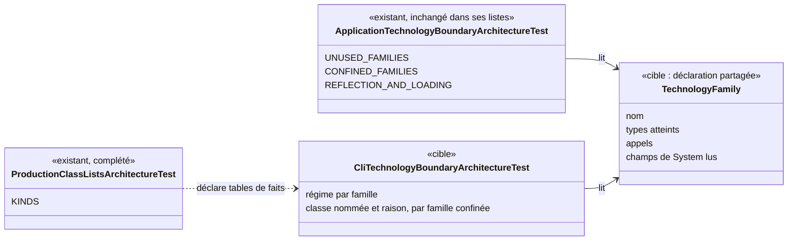

# Conception : confiner les familles technologiques qu'emploie la CLI

## Contexte

Motivation : voir `proposal.md`, section Why. État vérifié le 2026-11-06 sur `30520bd3` :

- `[EXISTANT VÉRIFIÉ]` `ApplicationTechnologyBoundaryArchitectureTest` déclare deux tables privées : `UNUSED_FAMILIES`
  (SQL, bibliothèque JSON, exécution de processus, réseau sortant, fils d'exécution) et `CONFINED_FAMILIES` (accès
  fichier, environnement du processus, flux standard, horloge murale, réflexion et chargement), une famille étant un
  prédicat sur les types atteints, sur les appels et sur les champs de `System` lus (record privé `Family`). Il importe
  `com.morpheus.application` seul (`importPackages(APPLICATION)`).
- `[EXISTANT VÉRIFIÉ]` `ReflectionAndClassLoadingBoundaryArchitectureTest` importe tout `com.morpheus` et confine la
  réflexion et le chargement de classes, bytecode et texte, avec ses propres listes (tables de faits hors application).
- `[EXISTANT VÉRIFIÉ]` `DatabaseWorkArchitectureTest` (`BE-0159`) borne ses règles à `com.morpheus.api..`, et son
  prédicat de pool ne reconnaît que `Thread.ofPlatform` et `Executors.newFixedThreadPool`.
- `[EXISTANT VÉRIFIÉ]` `morpheus-architecture-tests/pom.xml` déclare `morpheus-cli` en dépendance de test : ses classes
  sont importables par une règle ArchUnit.
- `[EXISTANT VÉRIFIÉ]` Relevé **textuel** des sources de `morpheus-cli/src/main/java` (recherche d'imports et d'appels,
  06/11 sur `30520bd3`) ; il guide la conception, la mesure sur le bytecode (tâche 1.1) fait foi :

| Famille | Classes relevées par le texte | Remarque |
|---|---|---|
| Réseau sortant | `command.UpdateManifestFetcher` | `MorpheusMain` et `launch.TlsKeystorePassword` ne citent `javax.net.ssl.SSLContext` qu'en javadoc, sans dépendance compilée |
| Fils d'exécution | `command.UpdateManifestFetcher` | |
| Accès fichier | `command.UpdateManifestFetcher`, `command.ProjectWorkspace`, `MorpheusCli`, `MorpheusMain`, `launch.RemoteApiLaunchOptions` | `MorpheusCli` et `MorpheusMain` par `new FileOutputStream(FileDescriptor.out)` ; `RemoteApiLaunchOptions` par `File.pathSeparator` seul |
| Environnement du processus | `MorpheusCli`, `MorpheusMain` | `RemoteApiLaunchOptions` lit un `Properties` reçu, pas `System` |
| Flux standard | `MorpheusMain` (`System.err`, `FileDescriptor`), `MorpheusCli` (`FileDescriptor`) | les commandes reçoivent leurs `PrintStream` |
| Horloge murale | `command.CliRuntime`, `command.MorpheusCompositionCli`, `command.MorpheusControlledLifecycleCli`, `command.MorpheusExternalIntegrationCli`, `command.MorpheusProjectCli`, `command.MorpheusServerCli`, `command.MorpheusSyncStatusCli`, `launch.OperationalSlf4jServiceProvider` | `Instant.now()` passé aux services, `Clock.systemUTC()` injecté |
| SQL, bibliothèque JSON, exécution de processus | aucune | |
| Réflexion, chargement | aucune | tenue par `ReflectionAndClassLoadingBoundaryArchitectureTest` |

## Exigences couvertes

| Capacité | Exigence (titre exact) | Rubriques |
|---|---|---|
| `cli-technology-boundary` | Chaque famille technologique DOIT avoir un régime déclaré pour la CLI | D1, D2 |
| `cli-technology-boundary` | Une famille refusée DOIT l'être dans tout `com.morpheus.cli` | D2 |
| `cli-technology-boundary` | Une famille confinée DOIT n'être atteinte que par les classes que le gate de la CLI nomme pour elle | D1, D2 |
| `cli-technology-boundary` | Une classe nommée pour une famille confinée DOIT encore l'atteindre | D1 |
| `cli-technology-boundary` | Les listes de classes du gate de la CLI DOIVENT être des tables de faits déclarées | D3 |

## Composants et frontières

Tout est dans `morpheus-architecture-tests`. Question : qui déclare les familles, et qui les juge, avant et après ?

Existant : les familles sont un record privé du gate de l'application. Cible : une seule déclaration, que les deux gates
lisent ; le gate de la CLI ajoute un régime par famille. Exigences : toutes celles de `cli-technology-boundary`. Le
diagramme est un diagramme de classes UML des classes de test.

`LayerDependencyTest` et `AdapterSiblingArchitectureTest` ne changent pas ; la CLI garde le droit, qu'elle tient de son
rôle de câblage, d'atteindre les adaptateurs.

## Traitements et interactions

Pour chaque famille du vocabulaire : lire son régime pour la CLI (échec si absent) ; refusée → aucune classe de
`com.morpheus.cli..` ne l'atteint ; confinée → seules les classes nommées l'atteignent, et l'ensemble qui l'atteint égale
la liste nommée ; libre ou tenue ailleurs → rien n'est jugé ici, et la raison est écrite. Les classes imbriquées sont
rapportées à leur classe de premier niveau, comme dans le gate de l'application.

## Décisions

### D1 : reprendre la mécanique du gate de l'application en partageant les familles
- **Nature** : [DÉCISION]
- **Exigences servies** : Chaque famille technologique DOIT avoir un régime déclaré pour la CLI ; Une famille confinée
  DOIT n'être atteinte que par les classes que le gate de la CLI nomme pour elle ; Une classe nommée pour une famille
  confinée DOIT encore l'atteindre.
- **Choix** : extraire le record `Family` et les prédicats des familles d'`ApplicationTechnologyBoundaryArchitectureTest`
  dans une déclaration de paquet partagée des tests d'architecture ; le gate de l'application et
  `CliTechnologyBoundaryArchitectureTest` la lisent. Le gate de la CLI porte une table famille → régime, et pour chaque
  famille confinée une table classe → raison. Les règles sont celles de l'application : `never(reach(family))` par
  famille, puis l'égalité des ensembles nommés et mesurés.
- **Alternatives écartées** :
  - *copier les définitions dans le gate de la CLI* : deux définitions de « réseau sortant » divergeraient en silence ;
  - *un seul gate paramétré par module* : mélangerait les compteurs de dette d'`ARCH-0150` et des tables de faits dans
    une classe, et ferait baisser le compte de méthodes `@Test` que tient `architectureTestsMinimum`
    (`.claude/rules/architecture.md` : découper par intention) ;
  - *une règle textuelle sur les imports* : un appel par nom qualifié ou une constante échapperait différemment ; le
    bytecode voit les dépendances, et aucun membre de ces familles n'est une constante inlinable visée par l'intention
    (« aucune dépendance compilée »). Le texte n'est ajouté que si la tâche 1.1 en trouve le besoin.
- **Compromis** : déplacer le record touche le gate de l'application ; ses listes, ses noms de constantes et ses clés de
  cliquet ne bougent pas, ce que `ProductionClassListsArchitectureTest` vérifie.
- **ADR** : non concerné.

### D2 : les régimes des familles dans la CLI
- **Nature** : [DÉCISION]
- **Exigences servies** : Chaque famille technologique DOIT avoir un régime déclaré pour la CLI ; Une famille refusée
  DOIT l'être dans tout `com.morpheus.cli`.
- **Choix** :
  - **refusées** : SQL (la persistance passe par `SqliteOperationRuntime`, `ARCH-0156`), bibliothèque JSON (la sortie
    JSON vient de l'application), exécution de processus (aucun usage ; les pairs sont lancés par les intégrations) ;
  - **confinées** : réseau sortant et fils d'exécution (le transport de la découverte de mise à jour, une classe),
    accès fichier (les classes du relevé, dont l'ouverture des flux standard par descripteur et un
    `File.pathSeparator` nommés avec leur raison plutôt que traités à part), environnement du processus et flux
    standard (le câblage du processus) ;
  - **libre** : horloge murale. La CLI est la racine de composition qui fournit l'heure d'une commande aux services ;
    l'invariant utile — l'application reçoit `java.time.Clock` — est tenu par le gate de l'application, et une liste
    de commandes qui lisent l'heure ne dirait rien de la frontière ;
  - **tenue ailleurs** : réflexion et chargement de classes, par `ReflectionAndClassLoadingBoundaryArchitectureTest` sur
    tout le produit ; le gate de la CLI ne répète pas son interdit (`.claude/rules/architecture.md`).
- **Alternatives écartées** : *confiner aussi l'horloge* : une liste qui croît à chaque commande, sans frontière à
  protéger ; *refuser le réseau et les fils* : impossible sans déplacer `UpdateManifestFetcher`, que `ARCH-0150` a
  placé dans la CLI ; *traiter `File.pathSeparator` et `FileDescriptor` en vocabulaire* : divergerait de la définition
  de la famille fichier de l'application, qui compte `java.io.File` et `FileOutputStream` entiers.
- **Compromis** : une commande peut lire l'heure sans revue ; c'est déjà le cas aujourd'hui.
- **ADR** : non concerné (voir D5).

### D3 : tables de faits, pas compteurs de dette
- **Nature** : [DÉCISION], à confirmer par le mainteneur (question ouverte de la proposition)
- **Exigences servies** : Les listes de classes du gate de la CLI DOIVENT être des tables de faits déclarées.
- **Choix** : chaque liste est déclarée `TABLE_OF_FACTS` dans `ProductionClassListsArchitectureTest.KINDS` ; chaque
  entrée porte sa raison dans la table classe → raison. Le fait énoncé : « ces classes atteignent cette famille dans un
  module de transport, qui a vocation à la porter ». Aucune clé n'est ajoutée à `config/debt-counter-ratchets.properties`.
- **Alternatives écartées** : *compteurs de dette* : une dette suppose un état cible où la liste rétrécit ; le réseau de
  la découverte de mise à jour est là où `ARCH-0150` l'a voulu, et un compteur exigerait un ADR accepté qui le nomme
  (`everyDebtCounterIsNamedByTheAcceptedDecisionRecordItDeclares`).
- **Compromis** : une table de faits peut grandir ; elle ne grandit pas en silence, puisque l'exactitude dans les deux
  sens oblige à écrire le nom et sa raison dans le test, ce que la revue lit.
- **ADR** : non concerné tant que les listes sont des tables de faits.

### D4 : `morpheus-api` exclu de ce changement
- **Nature** : [DÉCISION]
- **Exigences servies** : périmètre de toutes les exigences.
- **Choix** : le gate ne porte que sur `com.morpheus.cli`. `morpheus-api` fera l'objet d'un changement à part, à ouvrir
  après celui-ci, qui réutilisera la déclaration partagée de D1.
- **Alternatives écartées** : *inclure `morpheus-api`* : il porte déjà des règles de famille par groupe (fils :
  `DatabaseWorkArchitectureTest` ; JSON : `HttpRoutesTransportBoundaryArchitectureTest` et la règle des `JsonMapper`
  stricts), qu'il faut réconcilier sans les répéter ; sa mesure est plus large et touche des classes de sécurité
  (serveur remote, fichier d'identités, keystore TLS) dont le confinement mérite sa propre revue. Le faire ici doublerait
  la surface du changement sans rien apporter au défaut constaté, qui est dans la CLI.
- **Compromis** : `morpheus-api` reste sans gate de familles d'ici là ; `AUD-ARC-18` reste partiel pour ce volet.
- **ADR** : non concerné.
- **Suite** : le second volet est porté par ce même changement (D6) plutôt que par un changement à part, pour garder
  une seule déclaration partagée et une seule question ouverte (D3).

### D6 : le volet `morpheus-api`
- **Nature** : [DÉCISION], régime de l'horloge et nature des listes à confirmer par le mainteneur
- **Exigences servies** : toutes celles de `api-technology-boundary`.
- **Choix** : `ApiTechnologyBoundaryArchitectureTest`, sur le patron du gate de la CLI et la même `TechnologyFamily`.
  Mesure sur le bytecode (`33acc9e0`, règle jetable non laissée dans le dépôt) : SQL, exécution de processus,
  environnement du processus, flux standard et réflexion ne sont atteints par aucune classe de `com.morpheus.api` ; la
  bibliothèque JSON par le seul décodeur ; le réseau sortant, les fils d'exécution, l'accès fichier et l'horloge par
  plusieurs classes, dont celles des deux serveurs et du fichier d'identités remote. Régimes :
  - **refusées** : SQL, exécution de processus, environnement du processus (le serveur reçoit sa configuration de la
    CLI, mot de passe TLS compris), flux standard ;
  - **confinées** : bibliothèque JSON, réseau sortant (la famille compte `InetAddress` et `javax.net.ssl` : la
    politique de loopback et le TLS de la façade y sont nommés), fils d'exécution, accès fichier ;
  - **libre** : horloge murale, comme dans la CLI ;
  - **tenue ailleurs** : réflexion et chargement de classes.
  Les listes sont des tables de faits (D3). Le gate ne répète pas les règles plus fines du module :
  `DatabaseWorkArchitectureTest` (qui construit le pool de base) et `HttpRoutesTransportBoundaryArchitectureTest`
  (quel routeur décode, et le `JsonMapper` strict) gardent leurs règles et leurs doublons textuels.
- **Alternatives écartées** : *tenir la bibliothèque JSON « ailleurs »* : la règle des routeurs ne voit ni les services
  ni les serveurs ; *redéfinir le réseau sortant pour ce module* (sans `InetAddress` ni TLS) : deux définitions d'une
  famille divergeraient (D1) ; *confiner l'horloge* : la liste nommerait les classes du fichier d'identités et les
  services sans protéger de frontière ; *factoriser la mécanique des gates de familles* : elle touche les gates de
  l'application et de la CLI, hors du volet.
- **Compromis** : la mécanique des quatre règles existe en deux copies, une par module de transport.
- **ADR** : non concerné, même filtre que D5.

### D5 : pas d'ADR rédigé ; filtre appliqué
- **Nature** : [DÉCISION]
- **Exigences servies** : aucune directement.
- **Choix** : filtre de `.claude/rules/adr.md` — 1. décision : oui (régimes choisis entre options) ; 2. portée et durée :
  oui (contraint un module de transport) ; 3. coût du retour arrière : non, retirer ce gate ne casse ni donnée, ni
  contrat, ni garantie de sécurité, ni code. Pas d'ADR. Le déplacement du transport hors du cœur est déjà écrit dans
  `ARCH-0150` (décision 1 : `UpdateManifestFetcher` dans `morpheus-cli`) ; ce qui manquait est le gate, pas la décision.
  Le régime de la CLI est décrit dans `.claude/rules/architecture.md`.
- **Alternatives écartées** : *un ADR consolidé qui remplace `ARCH-0150`* ou *un ADR des modules de transport* : à
  proposer seulement si le mainteneur choisit des compteurs de dette (D3), qui l'exigent.
- **Compromis** : la règle vit dans un test et une page de règles, pas dans le registre.
- **ADR** : ADR à proposer **si** la question ouverte est tranchée en faveur de compteurs de dette ; sinon non concerné.

## Écarts constatés

| Constat | Source A | Source B | Traitement proposé |
|---|---|---|---|
| « le prix du déplacement n'est écrit nulle part dans l'ADR qui l'a décidé » | `AUD-ARC-18`, impact | `ARCH-0150` décision 1 et conséquences positives nomment `UpdateManifestFetcher` et le module qui possède le processus | D5 : la décision est écrite, le gate manque |
| Citations de ligne du gate de l'application décalées | constat : `importPackages(APPLICATION)` en `:111-113` | `ApplicationTechnologyBoundaryArchitectureTest.java:114-116` | aucune ; le changement cite les noms |
| « 1 famille sur 4 du vocabulaire couverte hors application » | constat, `reste` | vocabulaire partagé : hors application, seule la réflexion est confinée sur tout le produit | le gate de la CLI donne un régime à chacune |
| `java.io.File` atteint par `File.pathSeparator`, sans accès | relevé textuel | définition de la famille fichier | D2 : nommé avec sa raison |

## Stratégie de vérification

| Exigence | Scénario | Preuve | État |
|---|---|---|---|
| Régime déclaré | Une famille ajoutée au vocabulaire / Le régime de chaque famille | `CliTechnologyBoundaryArchitectureTest`, méthode d'exhaustivité ; famille factice plantée puis retirée | à écrire |
| Famille refusée | Dépendance SQL / Jackson | règle `never(reach)` ; classe plantée dans `morpheus-cli` puis retirée | à écrire |
| Famille confinée | Seconde classe réseau / fils / `System.out` | règle de confinement ; violation plantée puis retirée | à écrire |
| Classe nommée atteint encore | La lecture du manifeste quitte la CLI / La règle a quelque chose à juger | égalité des ensembles ; nom factice ajouté à une liste puis retiré ; `archRule.failOnEmptyShould` actif | à écrire |
| Tables de faits | Liste non déclarée / Aucun cliquet créé | `ProductionClassListsArchitectureTest#everyListOfProductionClassesIsADebtCounterOrATableOfFacts` | existant, liste complétée |

## Documentation durable et diagrammes à mettre à jour

- `docs/developer/specifications/cli-technology-boundary.md` (nouvelle) et l'index `docs/developer/specifications/README.md`.
- `docs/developer/specifications/application-technology-boundary.md` : renvoi à la déclaration partagée (aucune exigence
  ne change).
- `.claude/rules/architecture.md`, section « Ce que l'application touche (ADR-0150) » : un paragraphe pour la CLI.

## Questions ouvertes

Voir la proposition (tables de faits ou compteurs de dette). Elle n'arrête pas ce changement : les tables de faits sont
le défaut, et passer à des compteurs ne change que leur déclaration et ajoute un ADR.

Sans objet : modèle de domaine, états, contrats d'interface, persistance, transactions, sécurité (aucune frontière de
confiance ne bouge), erreurs, observabilité, performance, migration — le changement n'ajoute qu'un gate.
