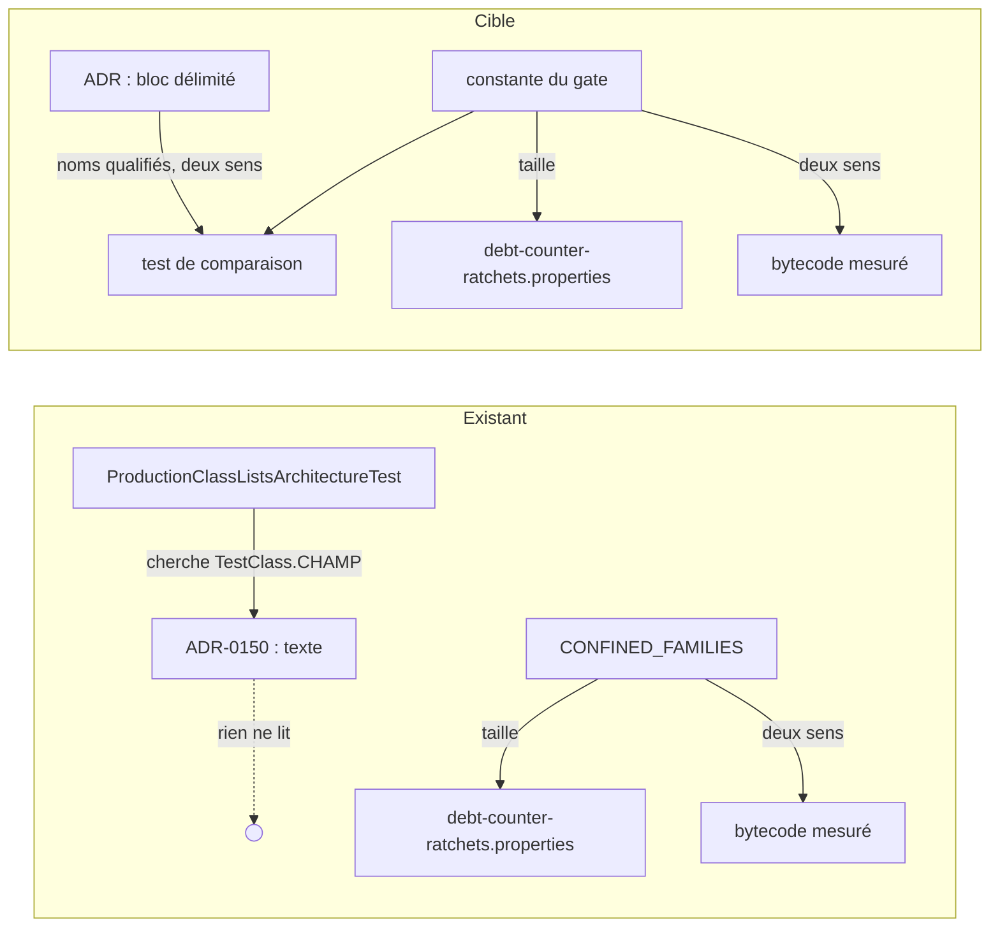

# Conception : comparer à son gate chaque liste de classes qu'un ADR énumère

Conception allégée : le changement ajoute un contrôle de build et clarifie deux ADR, sans code de production.

## Contexte

Motivation : voir `proposal.md`, section Why. État vérifié le 2026-11-06 sur `30520bd3` :

- `[EXISTANT VÉRIFIÉ]` `ApplicationTechnologyBoundaryArchitectureTest` porte `CONFINED_FAMILIES` (une table famille →
  noms qualifiés) et `REFLECTION_AND_LOADING`, privées ; `everyNamedClassStillReachesItsFamily` compare chaque liste à
  l'ensemble mesuré sur le bytecode, dans les deux sens.
- `[EXISTANT VÉRIFIÉ]` `ProductionClassListsArchitectureTest.KINDS` déclare ces deux listes `debtCounterUnder("ARCH-0150")`,
  `AdapterCompositionRootArchitectureTest.COMPOSITION_ROOTS` sous `ARCH-0156`, les deux listes de
  `SqliteStorePackagesArchitectureTest` sous `ARCH-0158`, et `ApiEntryTypesArchitectureTest.ENTRY_TYPES` en
  `TABLE_OF_FACTS` sans ADR. `everyDebtCounterIsNamedByTheAcceptedDecisionRecordItDeclares` cherche la seule chaîne
  `TestClass.CHAMP` dans l'ADR ; `everyDebtCounterHoldsExactlyTheSizeItsRatchetAllows` compare une **taille** à sa clé
  de `config/debt-counter-ratchets.properties`. Aucun des deux ne lit les noms écrits dans l'ADR.
- `[EXISTANT VÉRIFIÉ]` `ARCH-0150` énumère les classes deux fois : la table « Mesure » du `Context`, datée
  (« Mesuré … sur `develop` à `b60a9286`, le 25/10/2026 »), en noms relatifs à `com.morpheus.application`, avec
  longueurs et numéros de ligne ; et la table de la décision 2, en noms simples, groupés par famille et par sort. La
  seconde concorde avec le gate, sauf la ligne « horloge murale » qui écrit « les six classes de la mesure ».
- `[EXISTANT VÉRIFIÉ]` La section `Decision` d'`ARCH-0150` compte déjà près de 2 000 caractères (mesure du 06/11 sur
  `30520bd3`, relevée par script) : `.claude/rules/adr.md` la veut sous 2 000, `archgate check` signale au-delà. Y
  écrire six noms d'horloge et des noms qualifiés la ferait dépasser.
- `[EXISTANT VÉRIFIÉ]` `ARCH-0156` et `ARCH-0158` nomment leurs listes par `TestClass.CHAMP`, sans énumération.
- `[EXISTANT VÉRIFIÉ]` `ARCH-0155` §3 énumère les six types d'entrée en noms simples, comme `ENTRY_TYPES`.

## Exigences couvertes

| Capacité | Exigence (titre exact) | Rubriques |
|---|---|---|
| `adapter-internal-boundaries` | Une liste de classes qu'un ADR en vigueur énumère DOIT égaler la constante du gate qui la tient | D1, D4, Traitements |
| `adapter-internal-boundaries` | Une table de faits qu'un ADR en vigueur énonce DOIT déclarer cet ADR | D5 |
| `application-technology-boundary` | Une classe que le registre de la frontière technologique nomme par un nom qualifié DOIT exister à ce nom | D6 |
| `application-technology-boundary` | Le registre de la frontière technologique NE DOIT PAS porter de mesure périssable de ses classes nommées | D2, D3 |

## Composants et frontières

Tout reste dans `morpheus-architecture-tests` et dans `docs/`. Les constantes comparées deviennent lisibles du test de
comparaison (visibilité de paquet, comme `ENTRY_TYPES` l'est déjà) ; aucune n'est déplacée, renommée ni changée de
contenu, donc `ProductionClassListsArchitectureTest` les trouve toujours sous leur nom `TestClass.CHAMP`.

## Traitements et interactions

Question : qui compare quoi, aujourd'hui et après le changement ?

Existant : la flèche en pointillé dit qu'aucun contrôle ne lit les noms de l'ADR. Cible : chaque liste est tenue par
trois comparaisons — au bytecode (existante), à sa taille autorisée (existante), à l'ADR (ajoutée). Exigence : « Une
liste de classes qu'un ADR en vigueur énumère DOIT égaler la constante du gate qui la tient ». `flowchart` n'est pas de
l'UML ; il suffit à montrer qui lit quoi.

Déroulé de la comparaison : pour chaque liste que `KINDS` déclare énumérée par un ADR, ouvrir l'ADR du registre ;
refuser un bloc délimité absent ou vide, une ligne illisible ou une famille hors vocabulaire ; puis comparer les
ensembles et nommer les écarts. Une liste déclarée référencée seulement n'est pas lue.

## Décisions

### D1 : le gate lit l'ADR, les constantes restent la source exécutable
- **Nature** : [DÉCISION]
- **Exigences servies** : `adapter-internal-boundaries` › Une liste de classes qu'un ADR en vigueur énumère DOIT égaler
  la constante du gate qui la tient.
- **Choix** : un test de comparaison lit une énumération délimitée dans l'ADR et la compare à la constante du test,
  laissée où elle est. La déclaration de chaque liste dans `ProductionClassListsArchitectureTest.KINDS` dit si son ADR
  l'**énumère** (bloc obligatoire, comparé) ou la **référence** seulement (`ARCH-0156`, `ARCH-0158` : rien à comparer).
  Déclarer l'énumération rend le bloc obligatoire : le retirer de l'ADR fait échouer le build au lieu de suspendre la
  comparaison en silence.
- **Alternatives écartées** :
  - *extraire la liste dans un fichier de données lu par le gate, et y renvoyer depuis l'ADR* : l'ADR perdrait les noms
    qu'il décide (Archgate remet le texte de l'ADR, pas le fichier), et `ProductionClassListsArchitectureTest` mesure la
    taille d'un champ de test par réflexion sur la classe (`everyDebtCounterHoldsExactlyTheSizeItsRatchetAllows`) : il
    faudrait réécrire ce mécanisme et la clé `TestClass.CHAMP` des cliquets ;
  - *parser librement les tables Markdown de l'ADR* : `ARCH-0150` en porte deux, de formes différentes, et la table de
    décision groupe les noms par sort ; un parseur qui devine la table voudrait se taire quand il devine mal ;
  - *exiger de tout ADR rattaché qu'il énumère* : contredirait le choix d'`ARCH-0156` et d'`ARCH-0158` de renvoyer à la
    constante, qui est déjà une source unique.
- **Compromis** : un nom de classe écrit dans l'ADR **hors** du bloc délimité n'est pas comparé ; D6 couvre ce trou pour
  `ARCH-0150` (nom qualifié introuvable), la revue pour le reste.
- **ADR** : non concerné (contrôle de cohérence documentaire, réversible sans coût ; filtre de `.claude/rules/adr.md`,
  question 3 : non).

### D2 : la mesure datée quitte l'ADR plutôt que d'être comparée ou mise à jour
- **Nature** : [DÉCISION]
- **Exigences servies** : `application-technology-boundary` › Le registre de la frontière technologique NE DOIT PAS
  porter de mesure périssable de ses classes nommées.
- **Choix** : la table « Mesure » (familles, longueurs, appelants, tests qui nomment, total, numéros de ligne) est
  recopiée telle quelle dans un relevé daté sous `docs/project/research/`, à son SHA et à sa date ; l'ADR garde une
  phrase de contexte et un lien vers ce relevé.
- **Alternatives écartées** :
  - *comparer aussi les longueurs* : une longueur change à chaque commit qui touche la classe ; la comparer ferait
    échouer le build sur une modification sans rapport avec la décision (`.claude/rules/meta.md` : un chiffre périssable
    est une copie) ;
  - *mettre la table à jour* : elle redeviendrait fausse au prochain commit, et dédoublerait la décision 2 ;
  - *la laisser comme relevé daté dans l'ADR* : `.claude/rules/adr.md` range la « mesure datée » hors des ADR et veut un
    ADR rédigé au présent ; c'est cette table que l'audit a lue comme une affirmation présente.
- **Compromis** : le lecteur de l'ADR suit un lien pour voir la mesure qui a motivé l'option C.
- **ADR** : non concerné.

### D3 : clarifier `ARCH-0150` sans en changer la décision
- **Nature** : [DÉCISION]
- **Exigences servies** : `application-technology-boundary` › Le registre de la frontière technologique NE DOIT PAS
  porter de mesure périssable de ses classes nommées.
- **Choix** : la décision 2 garde ses familles, ses listes et ses sorts ; elle énonce la règle et renvoie, pour les
  noms, à une table unique délimitée (D4) placée hors de la section `Decision` (sous `Compliance and Enforcement`), qui
  porte nom qualifié, famille et sort de chaque classe, y compris les six classes d'horloge. Les totaux du texte au
  présent (« onze classes », « 34 autres paquets », « cinq lecteurs ») sont retirés ou renvoyés à la constante. La
  contradiction interne disparaît avec la table « Mesure ».
- **Alternatives écartées** : *un ADR consolidé qui remplace `ARCH-0150`* : `.claude/rules/adr.md` le réserve à une
  décision qui change ; ici le sens ne change pas (« clarifier son texte si son sens ne change pas ») ; *garder les noms
  dans la section `Decision`* : elle dépasserait 2 000 caractères (voir Contexte).
- **Compromis** : Archgate remet aux agents une décision qui renvoie à la table au lieu de l'écrire.
- **ADR** : `ARCH-0150` clarifié ; aucun ADR nouveau.

### D4 : la forme de l'énumération délimitée
- **Nature** : [DÉCISION]
- **Exigences servies** : `adapter-internal-boundaries` › Une liste de classes qu'un ADR en vigueur énumère DOIT égaler
  la constante du gate qui la tient.
- **Choix** : un commentaire HTML ouvrant qui nomme la liste (`<!-- liste TestClass.CHAMP -->`) et un commentaire
  fermant encadrent une table ou une liste Markdown ; chaque nom est un span de code, relatif à la racine de paquet
  que le test déclare pour la liste (`files.LocalWritePermissionHardener` pour l'application, nom simple pour
  `ENTRY_TYPES`, comme la constante). Pour une table famille → noms, la colonne des familles prend ses mots dans un
  vocabulaire fermé que le test déclare (fichier, environnement, flux standard, horloge murale, réflexion).
- **Alternatives écartées** : *un en-tête de section dédié* : Archgate contrôle les sections du gabarit et refuse les
  sections d'amendement ; un commentaire HTML ne change ni le rendu ni la structure ; *des noms simples* : la dérive de
  paquet du constat (`security.` contre `files.`) passerait.
- **Compromis** : un ADR gagne deux commentaires invisibles au rendu ; le contributeur doit savoir qu'ils existent, ce
  que dit l'échec du test.
- **ADR** : non concerné.

### D5 : une table de faits peut déclarer l'ADR qui l'énonce
- **Nature** : [DÉCISION]
- **Exigences servies** : `adapter-internal-boundaries` › Une table de faits qu'un ADR en vigueur énonce DOIT déclarer
  cet ADR.
- **Choix** : la sorte `Kind` de `ProductionClassListsArchitectureTest` gagne une variante « table de faits énoncée par
  un ADR », que seule `ENTRY_TYPES` prend aujourd'hui (`ARCH-0155`). Elle n'a ni clé de cliquet ni obligation de
  rétrécir : seule la comparaison s'applique.
- **Alternatives écartées** : *déclarer `ENTRY_TYPES` compteur de dette* : la liste n'a pas vocation à rétrécir
  (`ARCH-0155` §3 admet un type ajouté par ADR) ; *laisser `ARCH-0155` §3 hors de la comparaison* : l'audit la cite
  comme seconde liste exposée au même défaut.
- **Compromis** : une table de faits qu'un ADR énoncerait sans la déclarer reste invisible ; la revue le tient.
- **ADR** : non concerné.

### D6 : un nom qualifié d'`ARCH-0150` résout dans les sources
- **Nature** : [DÉCISION]
- **Exigences servies** : `application-technology-boundary` › Une classe que le registre de la frontière technologique
  nomme par un nom qualifié DOIT exister à ce nom.
- **Choix** : un contrôle textuel lit `ARCH-0150` entier, retient chaque span de code de la forme
  `paquet(.paquet)*.Classe` qui commence par un paquet de premier niveau de `com.morpheus.application`, et exige le
  fichier source correspondant sous `morpheus-application/src/main/java`.
- **Alternatives écartées** : *étendre à tous les ADR* : les ADR acceptés citent aussi des noms d'autres modules et des
  noms historiques dans leur `Context` ; le constat ne porte que sur `ARCH-0150`, et l'étendre est une décision à
  mesurer d'abord.
- **Compromis** : un nom simple périmé (sans paquet) hors du bloc délimité n'est pas vu.
- **ADR** : non concerné.

## Écarts constatés

| Constat | Source A | Source B | Traitement proposé |
|---|---|---|---|
| Le constat cite `ARCH-0148` / `ARCH-0147` dans sa preuve d'origine | `findings.json`, champ `preuve` | registre : `ARCH-0150` remplace `ADR-0148`, la liste de six types est en `ARCH-0155` §3 | le changement cible `ARCH-0150` et `ARCH-0155`, comme la revérification du 06/11 |
| La divergence est dans la section « Mesure », datée, et non dans la décision 2 | constat (« la table Mesure diverge du gate ») | `ARCH-0150` : décision 2 concorde, sauf la ligne d'horloge | D2, D3 |
| La « contradiction interne » est celle d'une mesure prise avant l'extraction du transport | constat | `ARCH-0150` : la mesure date de `b60a9286`, la décision 1 décrit l'état après extraction | traitée par D2 ; aucune décision à corriger |
| Citations de ligne du gate décalées | constat : `importPackages(APPLICATION)` en `:111-113` | `ApplicationTechnologyBoundaryArchitectureTest.java:114-116` | aucune ; le changement cite les noms, pas les lignes |
| La page durable signale déjà la mesure datée | `docs/developer/specifications/application-technology-boundary.md`, Écarts | ce changement | la tâche de mise à jour retire l'écart une fois résolu |

## Stratégie de vérification

| Exigence | Scénario | Preuve | État |
|---|---|---|---|
| Liste énumérée = constante | Une classe ajoutée au gate et pas à l'ADR | test de comparaison, violation plantée puis retirée | à écrire |
| idem | Un nom que l'ADR énumère et que le gate ne porte plus | test de comparaison sur un ADR de corpus temporaire | à écrire |
| idem | Le même nom simple dans un autre paquet | idem | à écrire |
| idem | Une énumération que le build ne sait pas lire | idem | à écrire |
| idem | Un ADR qui nomme la liste par sa seule référence | le test passe sur `ARCH-0156` et `ARCH-0158` réels | à écrire |
| Table de faits énoncée | Les six types d'entrée | test de comparaison sur `ARCH-0155` réel | à écrire |
| idem | Un type d'entrée ajouté sans l'ADR | violation plantée puis retirée | à écrire |
| idem | Une table de faits déclare un ADR qui ne l'énumère pas | `ProductionClassListsArchitectureTest`, méthode ajoutée, corpus temporaire | à écrire |
| Nom qualifié existe | Une classe déplacée / retirée / contrôle a lu des noms | contrôle textuel ajouté ; rouge sur l'`ARCH-0150` actuel | à écrire |
| Pas de mesure périssable | les trois scénarios | relecture de l'ADR clarifié ; D6 couvre la part vérifiable | manuel |

## Documentation durable et diagrammes à mettre à jour

- `docs/developer/specifications/adapter-internal-boundaries.md` : exigences, traçabilité, diagramme de la cible.
- `docs/developer/specifications/application-technology-boundary.md` : exigences, écart « Section Mesure » résolu.
- `docs/architecture/adr/ARCH-0150-ce-que-le-coeur-applicatif-peut-toucher.md`,
  `docs/architecture/adr/ARCH-0155-un-role-est-un-paquet-et-une-liste-de-classes-declare-sa-sorte.md`.
- Relevé daté ajouté sous `docs/project/research/`, indexé dans le `README.md` de `docs/project/` si l'index le prévoit.
- `.claude/rules/architecture.md` (section des compteurs de dette) : une phrase sur la comparaison à l'ADR.

## Questions ouvertes

Aucune.

Sans objet : modèle de domaine, états, contrats d'interface, persistance, transactions, sécurité, erreurs, observabilité,
performance, migration — le changement ne touche que des tests d'architecture et des documents.
