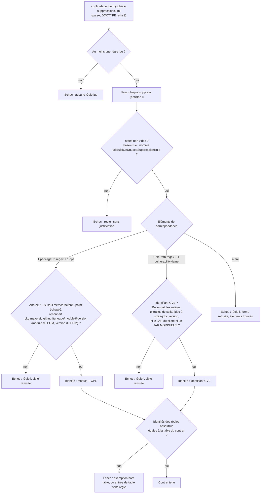

# Conception : tenir le fichier de suppressions Dependency-Check par un contrat

Conception allégée : le changement ajoute un contrôle de build sur un fichier de configuration, sans code de production.

## Contexte

Motivation : voir `proposal.md`, section Why. État vérifié le 2026-11-06 sur `30520bd3` :

- `[EXISTANT VÉRIFIÉ]` `config/dependency-check-suppressions.xml` porte trois `<suppress>` :
  - `:3-20`, `base="true"` : `<packageUrl regex="true">^pkg:maven/io\.github\.fturleque/morpheus-store-sqlite@1\.2\.2$</packageUrl>`
    et un `<cpe>` (`cpe:/a:sqlite:sqlite`) ;
  - `:21-36`, `base="true"` : `<filePath regex="true">` sur les natives extraites du JAR `sqlite-jdbc` et
    `<vulnerabilityName>` d'un seul CVE (identifiant : lire le fichier) ;
  - `:37-46`, sans `base` : `packageUrl` ancré sur `morpheus-cli` à la version du réacteur et un `<cpe>`
    (`cpe:/a:github:cli`).
  Chaque règle a des notes non vides ; les deux notes `base="true"` nomment `failBuildOnUnusedSuppressionRule`.
- `[EXISTANT VÉRIFIÉ]` Le fichier est chargé par les deux profils (`pom.xml:295-297`, `:338-340`) ;
  `failBuildOnUnusedSuppressionRule` n'est actif que sur le scan produit (`pom.xml:292`, commentaire `:331-334`).
  `scripts/validate-d2.sh:88-89` et `scripts/validate-d2.ps1:112-113` cherchent ces deux chaînes dans le POM.
- `[EXISTANT VÉRIFIÉ]` Le patron voisin : `DependencyCheckWorkflowContractTest#theSqliteEngineEmbeddedBySqliteJdbcIsIdentifiedWhateverTheHistoryOfTheDatabase`
  (`d2/DependencyCheckWorkflowContractTest.java:726-790`) parse `config/dependency-check-hints.xml` avec
  `disallow-doctype-decl`, lit `<sqlite-jdbc.version>` dans le POM et exige que l'indice reconnaisse les natives extraites
  sans reconnaître le JAR du pilote ni le code MORPHEUS. La classe porte `@CoherenceCheck`.
- `[EXISTANT VÉRIFIÉ]` Les versions du réacteur et du pilote ont une seule source : `<version>` et
  `<sqlite-jdbc.version>` du POM racine ; les modules : ses `<module>`.

## Exigences couvertes

| Capacité | Exigence (titre exact) | Rubriques de conception qui y répondent |
|---|---|---|
| `dependency-check-suppression-contract` | Chaque règle de suppression prend une des deux formes admises | D1, D2, diagramme |
| `dependency-check-suppression-contract` | Une règle d'association vise exactement un module MORPHEUS à la version du réacteur | D1, D3 |
| `dependency-check-suppression-contract` | Une règle de vulnérabilité nommée vise un seul CVE sur les bibliothèques extraites du pilote | D1, D5 |
| `dependency-check-suppression-contract` | Chaque règle de suppression porte sa justification | D2 |
| `dependency-check-suppression-contract` | Les règles exemptées du contrôle des règles inutilisées sont exactement celles que le contrat nomme | D4 |

## Composants et frontières

Une classe de test ajoutée, `DependencyCheckSuppressionContractTest`, dans
`morpheus-architecture-tests/src/test/java/com/morpheus/architecture/d2/`. Elle ne lit que `pom.xml` et
`config/dependency-check-suppressions.xml`, ne charge aucune classe de production et n'évalue aucune règle sur le
bytecode : elle porte `@CoherenceCheck` (`CoherenceCheckMarkerTest` refuse un désaccord dans les deux sens). Aucun module
de production ne change.

Sans objet : modèle de domaine, persistance, transactions, sécurité d'exécution, observabilité, performance (aucun code
de production touché).

## Traitements et interactions

Question : comment le contrat classe-t-il une règle, et à quel moment échoue-t-il ?

Cible ; aujourd'hui, aucune de ces branches n'existe : le fichier n'est lu que par Dependency-Check au scan. Toutes les
exigences du changement. Les échecs sont accumulés et rendus ensemble (une liste de problèmes, comme
`UpgradeGuideCoherenceTest#versionProblems`), pour qu'une PR qui casse deux règles les voie toutes deux.

## Décisions

### D1 : deux formes admises, toute autre refusée par son nom
- **Nature** : [DÉCISION]
- **Exigences servies** : `dependency-check-suppression-contract` › Chaque règle de suppression prend une des deux
  formes admises ; › Une règle d'association vise exactement un module MORPHEUS à la version du réacteur ; › Une règle de
  vulnérabilité nommée vise un seul CVE sur les bibliothèques extraites du pilote.
- **Choix** : les deux formes réellement présentes, et elles seules : association (`packageUrl` + un `cpe`) et
  vulnérabilité nommée (`filePath` + un `vulnerabilityName`). Les autres éléments de correspondance du schéma 1.4
  (`gav`, `sha1`, `cve`, `cwe`, `cvssBelow`, `vulnerabilityName` à côté d'un `packageUrl`, plusieurs `cpe`…) sont refusés.
  L'attribut `until` est admis sans être exigé ; tout autre attribut que `base` et `until` est refusé.
- **Alternatives écartées** : une liste d'éléments interdits (une forme nouvelle du schéma passerait) ; admettre
  `<cve>` en plus de `<vulnerabilityName>` (deux façons d'écrire la même chose, sans besoin constaté).
- **Compromis** : une suppression légitime d'une troisième forme exige de modifier le contrat dans la même PR — c'est
  l'effet voulu : la forme devient une décision relue.
- **ADR** : non concerné (filtre de `.claude/rules/adr.md` : pas de décision durable transverse coûteuse à inverser).

### D2 : la justification est une note non vide, et l'exemption se justifie par son nom
- **Nature** : [DÉCISION]
- **Exigences servies** : › Chaque règle de suppression porte sa justification.
- **Choix** : `<notes>` non vide après retrait des blancs ; pour `base="true"`, les notes contiennent
  `failBuildOnUnusedSuppressionRule`.
- **Alternatives écartées** : une longueur minimale de note (un chiffre arbitraire, qui se contourne par du remplissage) ;
  la lecture des commentaires XML (`.claude/rules/build.md` dit « commentaire », mais le fichier porte ses raisons dans
  `<notes>`, que Dependency-Check reporte dans son rapport : c'est la forme à tenir).
- **Compromis** : le contrat prouve qu'une raison a pu être écrite, pas qu'elle est juste — la revue la lit, comme pour
  `RefusalTestEvidenceArchitectureTest`.
- **ADR** : non concerné.

### D3 : une règle d'association reconnaît une seule chaîne, calculée depuis le POM
- **Nature** : [DÉCISION]
- **Exigences servies** : › Une règle d'association vise exactement un module MORPHEUS à la version du réacteur.
- **Choix** : l'expression doit commencer par `^`, finir par `$`, et, une fois `\.` remplacé par `.`, ne contenir aucun
  métacaractère d'expression régulière ; la chaîne obtenue doit égaler
  `pkg:maven/io.github.fturleque/<module>@<version>` pour un `<module>` du POM racine et sa `<version>`. La version vient
  du POM, jamais d'un littéral du test, comme `<sqlite-jdbc.version>` pour l'indice.
- **Alternatives écartées** : vérifier seulement l'ancrage `^…$` (l'action de l'audit) — `^…morpheus-.*$` est ancré et
  vise tous les modules ; compiler l'expression et l'essayer sur des échantillons — un échantillon ne prouve pas qu'aucune
  autre chaîne n'est reconnue.
- **Compromis** : le passage de version ajoute ce fichier au lot indivisible du changement de version
  (`.claude/rules/governance.md`, « Le passage de version est un lot indivisible ») ; il y était déjà de fait, puisque
  la règle sans `base` ferait échouer le scan produit (règle inutilisée) et la règle `base="true"` cesserait de
  s'appliquer sans que ce contrôle le dise, le faux positif revenant alors au scan nocturne. Le contrat avance cet échec au build.
- **ADR** : non concerné.

### D4 : les exemptions sont une table de faits exacte, identifiée par cible
- **Nature** : [DÉCISION]
- **Exigences servies** : › Les règles exemptées du contrôle des règles inutilisées sont exactement celles que le
  contrat nomme.
- **Choix** : une constante du test énumère les identités exemptées (module + CPE, ou identifiant CVE), comparée par
  égalité d'ensembles. L'identité ne porte pas la version, pour que la table ne bouge pas à chaque passage de version.
  C'est une table de faits : elle ne nomme aucune classe de production, donc `ProductionClassListsArchitectureTest` ne la
  déclare pas et `config/debt-counter-ratchets.properties` ne la borne pas ; elle peut grandir, mais seulement par un
  diff du test, fichier de gouvernance dont la PR doit justifier la modification (`.claude/rules/governance.md`).
- **Alternatives écartées** : un compte de règles exemptées (on échange une exemption contre une autre sans que le
  compte bouge) ; un compteur qui ne fait que baisser (une exemption peut être légitime, comme les deux actuelles, que
  l'histoire de la base de vulnérabilités rend nécessaires).
- **Compromis** : la table double une information du fichier ; c'est le prix d'un ajout visible.
- **ADR** : non concerné.

### D5 : la règle de vulnérabilité nommée est la forme exécutable de R5 de `vulnerability-feed-freshness`
- **Nature** : [DÉCISION]
- **Exigences servies** : › Une règle de vulnérabilité nommée vise un seul CVE sur les bibliothèques extraites du pilote.
- **Choix** : la capacité nouvelle porte le contrat du fichier entier ; l'exigence `vulnerability-feed-freshness` ›
  « A suppression on the embedded engine SHALL name one vulnerability and the extracted libraries only », qui dit le
  sens d'une telle suppression, n'est pas modifiée, et sa page durable cite le nouveau test comme preuve. Les
  échantillons de chemins sont construits depuis `<sqlite-jdbc.version>` (natives Windows et Linux) comme dans le test de
  l'indice ; les contre-échantillons sont le JAR du pilote et un JAR de module MORPHEUS.
- **Alternatives écartées** : étendre `vulnerability-feed-freshness`, dont la page durable exclut explicitement « les
  autres suppressions » et dont l'objet est la fraîcheur de la base ; modifier R5 pour y ajouter le refus de build
  (doublon du contrat).
- **Compromis** : le sujet « suppression du moteur SQLite » est lu dans deux capacités ; la page durable de chacune
  renvoie à l'autre.
- **ADR** : non concerné.

### D6 : une assertion XML, pas une règle ArchUnit
- **Nature** : [DÉCISION]
- **Exigences servies** : toutes.
- **Choix** : intention en une phrase — « une règle du fichier de suppressions ne retire que ce qu'elle déclare ». La
  cible est un `.xml` : le texte y est la seule prise (`.claude/rules/architecture.md`, « Restent textuels par nature »).
  Parse DOM avec espaces de noms et `disallow-doctype-decl`, comme le test de l'indice.
- **Alternatives écartées** : un contrôle dans `scripts/validate-d2.*` (hors de `clean verify`, et deux copies à tenir).
- **Compromis** : aucun.
- **ADR** : non concerné.

## Écarts constatés

| Constat | Source A | Source B | Traitement proposé |
|---|---|---|---|
| « `base="true"` sur la première seulement » est périmé : deux règles sur trois le portent | preuve initiale de `AUD-TST-21` | `config/dependency-check-suppressions.xml:3`, `:21` | déjà noté par la revérification du 2026-11-06 ; rien à faire |
| Le second lecteur du POM est en `:339`, pas en `:338` | preuve initiale de `AUD-TST-21` | `pom.xml:339` | idem |
| R5 de `vulnerability-feed-freshness` n'a aucune preuve automatique | page `vulnerability-feed-freshness.md` (« Preuve manquante (R5) ») | absence de lecteur du fichier | la combler (tâche 2.3) |
| La concordance des `packageUrl` avec la version du réacteur n'est tenue par aucun test | page `vulnerability-feed-freshness.md` (« Autres suppressions du même fichier ») | `config/dependency-check-suppressions.xml:18`, `:44` | D3 |
| `.claude/rules/build.md` parle de « commentaire », le fichier porte ses raisons en `<notes>` | `.claude/rules/build.md:24` | fichier de suppressions | reformuler la règle (tâche 2.4) |

## Stratégie de vérification

| Exigence | Scénario | Preuve | État |
|---|---|---|---|
| Deux formes admises | Le fichier actuel est admis | `DependencyCheckSuppressionContractTest`, méthode sur le fichier réel | à écrire |
| idem | Une règle sans CPE… ; Une forme non admise ; Un fichier vide… | même classe, corpus fabriqués | à écrire |
| Règle d'association | les quatre scénarios | même classe, corpus fabriqués ; violation plantée une fois dans le vrai fichier puis retirée | à écrire |
| Règle de vulnérabilité nommée | les deux scénarios | même classe, corpus fabriqués | à écrire |
| Justification | les deux scénarios | même classe, corpus fabriqués | à écrire |
| Table des exemptions | les deux scénarios | même classe, corpus fabriqués ; `base="true"` posé une fois sur la règle de `morpheus-cli` puis retiré | à écrire |

## Documentation durable et diagrammes à mettre à jour

- `docs/developer/specifications/dependency-check-suppression-contract.md` (nouvelle, avec le diagramme ci-dessus) et
  son index `docs/developer/specifications/README.md`.
- `docs/developer/specifications/vulnerability-feed-freshness.md` : preuve de R5, renvoi vers la page nouvelle.
- `.claude/rules/build.md` : la justification d'une suppression est tenue par le contrat.

## Questions ouvertes

- Exiger `until` sur une règle de vulnérabilité nommée (voir `proposal.md`). Le contrat l'admet sans l'exiger ; le
  trancher ne change ni les autres exigences ni les tâches.
