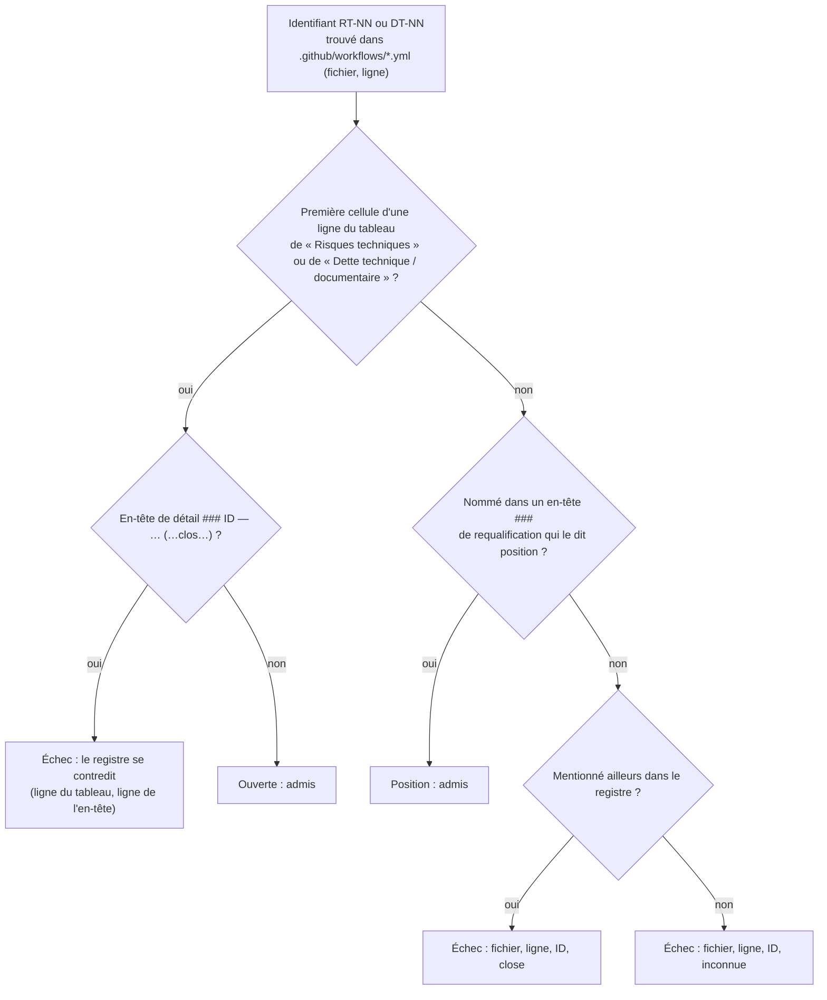

# Conception : refuser qu'un workflow renvoie vers une entrée close du registre des risques

Conception allégée : le changement ajoute un contrôle de cohérence entre deux familles de fichiers non Java, sans code
de production.

## Contexte

Motivation : voir `proposal.md`, section Why. État vérifié le 2026-11-06 sur `30520bd3` :

- `[EXISTANT VÉRIFIÉ]` Le registre écrit l'état d'une entrée par sa **place**, pas par un champ :
  - tableau de `## Risques techniques` (`register.md:14-28`) : une ligne `| RT-NN | … |` par risque ouvert, `RT-14`
    compris, alors que sa mitigation dit qu'aucun éditeur n'est encore déclaré (risque accepté en attente du
    certificat) ;
  - tableau de `## Dette technique / documentaire` (`register.md:228-232`) : une ligne `| DT-NN | … |` par dette
    active ;
  - en-têtes de détail : `### RT-13 — … (constaté le 09/09/2026, ouvert)` (`:30`) ; la version close portait
    « (constaté le 09/09/2026, clos le 22/09/2026) » et n'avait plus de ligne au tableau
    (`git show cba6dd68:docs/architecture/risks/register.md`, ligne 27) ;
  - entrées closes, sorties du tableau et nommées en prose : « Les anciennes dettes `DT-06` … et `DT-09` … sont
    résolues et retirées du tableau actif » (`:234`), « Les anciens risques `RT-10` … et `RT-11` … ne sont plus actifs »
    (`:220`), « `DT-16` est **ouverte et close le 15/09/2026** » (`:343`), « `DT-01` est **éliminée** » (`:355`) ;
  - positions, sorties du tableau mais toujours vraies : « ### Requalification du 22/09/2026 — `DT-13` est une
    position, pas une dette » (`:242`), « ### Requalifications du 16/09/2026 — `DT-04`, `DT-05`, `DT-12` sont des
    positions, pas des dettes » (`:282`).
- `[EXISTANT VÉRIFIÉ]` Renvois des workflows : `RT-13` sept fois dans `security.yml`, `RT-08` cinq fois dans
  `nightly.yml` ; aucun autre identifiant `RT-`/`DT-` sous `.github/`.
- `[EXISTANT VÉRIFIÉ]` Tests qui touchent le registre ou ses renvois :
  `RepositoryDocumentationCoherenceTest` (les ratchets recopiés dans le registre, `:339-345`) ;
  `D2RepositoryHardeningArchitectureTest#theMacosLaneStaysAdvisoryAndClaimsNoSupport` (le texte `RT-08 open, no
  support claimed` de `nightly.yml`, `:298`) ; `DependencyCheckWorkflowContractTest` exige que l'annotation de
  provenance cite `RT-13` (`:254`). Aucun ne lit l'état d'une entrée.

## Exigences couvertes

| Capacité | Exigence (titre exact) | Rubriques de conception qui y répondent |
|---|---|---|
| `risk-register-references` | Un workflow ne renvoie qu'à une entrée du registre qui n'est pas close | D1, D3, diagramme |
| `risk-register-references` | Une entrée au tableau actif ou requalifiée en position n'est pas close | D2, diagramme |
| `risk-register-references` | Le registre ne dit pas close une entrée qu'il garde au tableau actif | D4 |
| `risk-register-references` | La règle des renvois ne passe pas à vide | D5 |

## Composants et frontières

Une classe de test ajoutée, `RiskRegisterReferencesTest`, dans
`morpheus-architecture-tests/src/test/java/com/morpheus/architecture/`, à côté de
`RepositoryDocumentationCoherenceTest`. Elle lit `docs/architecture/risks/register.md` et les fichiers de
`.github/workflows/` (racine trouvée par `RepositoryRoot.locate()`, liste de fichiers par `Files.list` du seul
répertoire des workflows, pas par un parcours de l'arbre), ne charge aucune classe de production : elle porte
`@CoherenceCheck`. Aucun module de production ne change.

Sans objet : modèle de domaine, persistance, transactions, sécurité d'exécution, observabilité, performance (aucun code
de production touché).

## Traitements et interactions

Question : quel état le contrat attribue-t-il à un identifiant cité par un workflow, et quand échoue-t-il ?

Cible ; aujourd'hui aucun de ces contrôles n'existe. Exigences : les trois premières. La quatrième (non-vacuité) est
vérifiée avant ce classement. Les problèmes sont accumulés et rendus ensemble.

## Décisions

### D1 : le renvoi reconnu est l'identifiant, partout dans le fichier
- **Nature** : [DÉCISION]
- **Exigences servies** : `risk-register-references` › Un workflow ne renvoie qu'à une entrée du registre qui n'est
  pas close.
- **Choix** : tout jeton `\b(RT|DT)-[0-9]+\b` d'un `.yml` de `.github/workflows/`, commentaires et noms d'étape
  compris. Un chemin vers le registre sans identifiant n'est pas jugé.
- **Alternatives écartées** : ne juger que les messages `echo` (le commentaire `security.yml:291` renvoie aussi le
  lecteur, et un commentaire périmé trompe autant) ; exiger la forme « RT-NN in docs/architecture/risks/register.md »
  (la moitié des renvois actuels, ceux de `nightly.yml`, ne nomment pas le fichier).
- **Compromis** : une phrase historique (« RT-10 a été clos ») écrite dans un workflow serait refusée ; un workflow
  n'a pas à porter l'histoire du registre.
- **ADR** : non concerné (filtre de `.claude/rules/adr.md`).

### D2 : l'état se lit dans la structure existante du registre
- **Nature** : [DÉCISION]
- **Exigences servies** : › Une entrée au tableau actif ou requalifiée en position n'est pas close.
- **Choix** : ouverte = première cellule d'une ligne du premier tableau de l'une des deux sections nommées ; position =
  identifiant entre accents graves dans un en-tête `###` qui contient « position » ; close = toute autre mention.
  `RT-14`, risque accepté sans correctif, est au tableau : il est ouvert, et un workflow peut y renvoyer. Une position
  (`DT-13`) reste vraie : un workflow qui explique son double run peut la citer.
- **Alternatives écartées** : ajouter une colonne « Statut » aux tableaux (réécriture du registre et vocabulaire à
  tenir, pour une information que la place donne déjà) ; lire les mots « clos », « résolu », « éliminée » dans la prose
  (vocabulaire ouvert, une forme nouvelle passerait) ; traiter une position comme close (elle n'est pas réglée, elle est
  assumée — le registre le dit : « une position, pas une dette »).
- **Compromis** : renommer une section ou changer la forme des en-têtes de requalification exige de modifier la règle ;
  D5 garantit que cela échoue au lieu de tout lire close.
- **ADR** : non concerné.

### D3 : un identifiant inconnu est refusé, sous un autre nom que « close »
- **Nature** : [DÉCISION]
- **Exigences servies** : › Un workflow ne renvoie qu'à une entrée du registre qui n'est pas close.
- **Choix** : refus avec l'état « inconnue » quand l'identifiant n'apparaît nulle part dans le registre.
- **Alternatives écartées** : l'admettre (une coquille `RT-31` pour `RT-13` enverrait le lecteur nulle part) ; le
  confondre avec « close » (le correctif n'est pas le même : corriger le renvoi, pas rouvrir l'entrée).
- **Compromis** : aucun.
- **ADR** : non concerné.

### D4 : le registre qui se contredit est refusé
- **Nature** : [DÉCISION]
- **Exigences servies** : › Le registre ne dit pas close une entrée qu'il garde au tableau actif.
- **Choix** : une ligne au tableau actif et un en-tête de détail `### ID — …` dont la parenthèse finale contient
  « clos » ou « close » font échouer, quels que soient les renvois. La clôture de `cba6dd68` avait retiré la ligne et
  daté l'en-tête ; une clôture écrite à moitié (en-tête daté, ligne gardée) passerait sinon pour ouverte.
- **Alternatives écartées** : faire primer l'en-tête sur la ligne (deux sources d'état, et la règle choisirait en silence).
- **Compromis** : le mot est lu dans une parenthèse précise, pas dans toute la prose ; une clôture écrite ailleurs reste
  à la revue.
- **ADR** : non concerné.

### D5 : la règle refuse de passer à vide
- **Nature** : [DÉCISION]
- **Exigences servies** : › La règle des renvois ne passe pas à vide.
- **Choix** : échec si aucune ligne de tableau actif n'est lue, ou si aucun identifiant n'est trouvé dans les
  workflows. Aucun compte attendu n'est écrit (pas de chiffre recopié) : « au moins un ».
- **Alternatives écartées** : un compte exact de lignes (chiffre périssable, `.claude/rules/meta.md`).
- **Compromis** : si les workflows cessaient tous de citer le registre, la règle échouerait ; il faudrait alors la
  retirer explicitement, ce qui est une décision relue.
- **ADR** : non concerné.

### D6 : une assertion textuelle, pas une règle ArchUnit
- **Nature** : [DÉCISION]
- **Exigences servies** : toutes.
- **Choix** : intention en une phrase — « un renvoi d'un workflow désigne une entrée vivante du registre ». Les cibles
  sont un `.yml` et un `.md` : le texte y est la seule prise (`.claude/rules/architecture.md`). Fonction pure (registre,
  workflows) → problèmes, exercée sur le dépôt et sur des corpus fabriqués.
- **Alternatives écartées** : un ajout à `RepositoryDocumentationCoherenceTest`, déjà chargé de plusieurs contrats ; une
  classe dédiée garde ses corpus fabriqués à côté de la règle.
- **Compromis** : aucun.
- **ADR** : non concerné.

## Écarts constatés

| Constat | Source A | Source B | Traitement proposé |
|---|---|---|---|
| La preuve initiale comptait cinq messages (`:91`, `:120`, `:182`, `:310`) ; il y a sept renvois (six messages et un commentaire) | preuve initiale de `AUD-DEP-26` | `security.yml:96`, `:123`, `:186`, `:217`, `:291`, `:361`, `:369` | déjà recompté par la revérification du 2026-11-06 ; la règle juge tous les jetons |
| `nightly.yml` renvoie aussi au registre (`RT-08`), ce que le constat ne nomme pas | constat `AUD-DEP-26` | `nightly.yml:8`, `:116`, `:189`, `:191`, `:192` | couvert par la règle |
| L'en-tête du registre date sa mise à jour au 2026-09-04 alors que des entrées sont datées d'octobre et novembre | `register.md:6` | `register.md:30`, `:60` et suivantes | hors périmètre : signalé, non traité |
| Le registre ne dit nulle part comment l'état d'une entrée se lit | `register.md` | ce changement | une phrase en tête du registre (tâche 2.3) |

## Stratégie de vérification

| Exigence | Scénario | Preuve | État |
|---|---|---|---|
| Renvoi vers une entrée non close | Les renvois actuels sont admis | `RiskRegisterReferencesTest`, méthode sur le dépôt | à écrire |
| idem | Une entrée close et toujours citée ; Un identifiant inconnu ; Un renvoi au registre sans identifiant | même classe, corpus fabriqués ; violation plantée une fois dans le vrai registre puis retirée | à écrire |
| Tableau actif ou position | les trois scénarios | même classe, corpus fabriqués (`RT-14`, `DT-13`, `DT-06` repris du registre réel) | à écrire |
| Registre qui se contredit | Une clôture écrite à moitié | même classe, corpus fabriqué | à écrire |
| Non-vacuité | Un registre réorganisé | même classe, corpus fabriqué | à écrire |

## Documentation durable et diagrammes à mettre à jour

- `docs/developer/specifications/risk-register-references.md` (nouvelle, avec le diagramme ci-dessus) et son index
  `docs/developer/specifications/README.md`.
- `docs/architecture/risks/register.md` : une phrase d'en-tête qui dit comment l'état d'une entrée est lu et quel test
  le tient.

## Questions ouvertes

- Étendre la règle à `config/` et `scripts/` (voir `proposal.md`). La fonction pure prend une liste de fichiers : le
  trancher ne change que cette liste.
