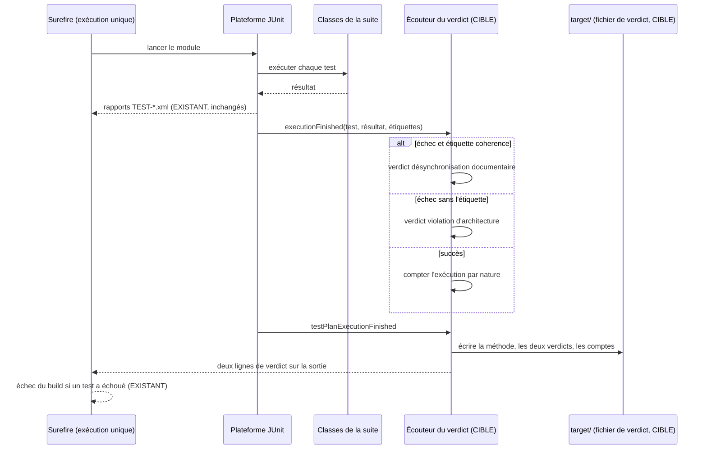

# Conception : rapporter une désynchronisation documentaire à part d'une violation d'architecture

Motivation : voir `proposal.md`, section Why. Le changement touche l'outillage de test d'un module et un workflow ; il
ne touche aucun code de production.

## Contexte

État vérifié le 2026-11-06 sur `30520bd3` :

- `[EXISTANT VÉRIFIÉ]` `CoherenceCheck` (`morpheus-architecture-tests/src/test/java/com/morpheus/architecture/`) porte
  `@Tag(CoherenceCheck.TAG)`, `TAG = "coherence"` ; `CoherenceCheckMarkerTest` exige le marqueur exactement sur les
  classes qui n'évaluent aucune règle, ne lisent aucune source de production et ne chargent aucune classe de production.
- `[EXISTANT VÉRIFIÉ]` `morpheus-architecture-tests/pom.xml` ne configure pas Surefire ; le POM racine ne déclare qu'une
  configuration commune en `pluginManagement` (`useModulePath`, `systemPropertyVariables`), sans `<execution>`, sans
  `groups` ni `excludedGroups`. Une seule exécution (`default-test`) lance toutes les classes du module ; un échec de
  cohérence et une règle violée finissent sur la même ligne de Maven.
- `[EXISTANT VÉRIFIÉ]` Aucun workflow, script ni POM ne passe `-Dgroups=coherence` ; seule la Javadoc de `CoherenceCheck`
  cite la commande (page durable, écart 5).
- `[EXISTANT VÉRIFIÉ]` Les validateurs de présence comptent les rapports par leur chemin : `scripts/validate-m21.sh` et
  `scripts/validate-d2.sh` par `rglob('target/surefire-reports/TEST-*.xml')`, `scripts/validate-m21.ps1`,
  `scripts/validate-d2.ps1` et `scripts/validate-m22.ps1` par le filtre `[\\/]target[\\/]surefire-reports[\\/]`. Une
  exécution est « générée » si son nom finit par `[N]`, « déclarée » sinon ; `architectureTestsMinimum` borne les
  exécutions déclarées de `morpheus-architecture-tests`.
- `[EXISTANT VÉRIFIÉ]` `.github/workflows/ci.yml`, étape « Upload M21 integrity evidence », publie
  `morpheus-architecture-tests/target/enforcement-composition-summary.txt` et `**/target/surefire-reports/*.xml`.
- `[EXISTANT VÉRIFIÉ]` `GateReachabilityArchitectureTest#everyTestClassOutsideSurefireSelectionIsNamedByAValidatorAWorkflowRuns`
  raisonne sur les motifs de nom (`<include>`, motifs par défaut de Surefire), pas sur les étiquettes.
- `[EXISTANT VÉRIFIÉ]` Le module déclare `junit-jupiter-api` en test, pas `junit-platform-launcher` ; aucune ressource de
  test (`src/test/resources` absent).

## Exigences couvertes

| Capacité | Exigence (titre exact) | Rubriques |
|---|---|---|
| `enforcement-mechanism-accounting` | Un échec d'un contrôle de cohérence est rapporté comme une désynchronisation documentaire | D1, D2, Traitements |
| `enforcement-mechanism-accounting` | Le verdict distinct ne change ni la sélection ni le compte des exécutions | D1, D3 |

## Composants et frontières

Tout reste dans les sources et ressources de **test** de `morpheus-architecture-tests` : un écouteur de la plateforme
JUnit (`TestExecutionListener`), son enregistrement de service
(`src/test/resources/META-INF/services/org.junit.platform.launcher.TestExecutionListener`), une fonction de
classification testée à part. L'écouteur ne déclare aucun `@Test` : `ArchitectureSuiteSources.suite()` ne le compte pas
parmi les classes de la suite, et `CoherenceCheckMarkerTest` ne le juge pas. Aucune classe de production ne change ; la
frontière de réflexion et de chargement (`ReflectionAndClassLoadingBoundaryArchitectureTest`) vise les classes du
produit, et le chargement de l'écouteur est fait par la plateforme JUnit.

## Traitements et interactions

Question : comment un échec devient-il un verdict, aujourd'hui et après le changement ?

Existant : Surefire, la plateforme, les rapports et l'échec du build. Cible : l'écouteur et son fichier. L'échec du
build reste décidé par Surefire ; le verdict le précède et le nomme. Exigences : les deux exigences ajoutées.

## Décisions

### D1 : un écouteur de la plateforme JUnit, pas une seconde exécution Surefire
- **Nature** : [DÉCISION]
- **Exigences servies** : les deux exigences ajoutées.
- **Choix** : l'écouteur lit l'étiquette `coherence` sur l'identifiant de chaque test terminé (étiquettes héritées de la
  classe) et classe les échecs ; il ne modifie ni la sélection, ni l'ordre, ni les rapports.
- **Alternatives écartées** :
  (a) deux exécutions Surefire (`default-test` avec `excludedGroups=coherence`, une exécution nommée avec
  `groups=coherence`) : la ligne d'échec de Maven nommerait l'exécution, mais une exécution qui échoue arrête le module
  avant la suivante, donc un verdict masque l'autre ; et `-Dtest` désignant une seule classe laisse l'autre exécution
  sans test, ce que Surefire refuse par défaut (`failIfNoSpecifiedTests`) — le désactiver ferait passer au vert une
  faute de frappe dans `-Dtest`, sur un module que toutes les règles du dépôt font lancer par `-Dtest`. Comportement de
  Surefire 3 à rejouer si l'option revient ;
  (b) un second `reportsDirectory` pour les contrôles de cohérence : les validateurs de présence ne lisent que
  `target/surefire-reports/`, le compte des exécutions déclarées du module baisserait sous `architectureTestsMinimum` ;
  (c) préfixer le message de chaque assertion des classes marquées : des centaines d'éditions, aucune garantie pour une
  exception levée hors assertion, et rien ne l'enforcerait ;
  (d) sortir les contrôles de cohérence dans un vérificateur hors du module (proposition de l'action du constat) :
  écarté par le mainteneur et contraire à l'exigence R4 en vigueur.
- **Compromis** : la dernière ligne de Maven reste « There are test failures » ; le verdict est dans la sortie qui la
  précède et dans le fichier de preuve.
- **ADR** : non concerné. Décision : oui ; portée et durée : un module de tests, aucune surface, aucun format persisté ;
  coût du retour arrière : faible (retirer l'écouteur et sa ligne de service).

### D2 : le fichier de verdict et sa publication
- **Nature** : [DÉCISION]
- **Exigences servies** : Un échec d'un contrôle de cohérence est rapporté comme une désynchronisation documentaire.
- **Choix** : `morpheus-architecture-tests/target/enforcement-verdict.txt`, première ligne qui nomme la méthode (comme
  `enforcement-composition-summary.txt`), puis le nombre d'exécutions de chaque nature et la liste des tests de chaque
  verdict, dans un ordre stable (tri par identifiant). Écrit à la fin du plan, succès compris. Ajouté à l'étape
  « Upload M21 integrity evidence » de `ci.yml`.
- **Alternatives écartées** : la sortie seule : écarté, la CI ne garderait aucune trace hors du journal ; un champ de
  plus dans `enforcement-composition-summary.txt` : écarté, ce fichier décrit les sources de la suite (R3), pas une
  exécution, et sa méthode est différente.
- **Compromis** : le fichier décrit l'exécution du moment ; un `-Dtest` partiel l'écrase avec un verdict partiel, ce que
  sa première ligne doit dire (sélection appliquée).
- **ADR** : non concerné.

### D3 : prouver l'invariance du compte et de la sélection
- **Nature** : [DÉCISION]
- **Exigences servies** : Le verdict distinct ne change ni la sélection ni le compte des exécutions.
- **Choix** : la classification est une fonction pure testée sur des jeux d'étiquettes et de résultats ; l'invariance du
  compte est relevée une fois (même révision, avec et sans l'écouteur) et consignée ; `-Dtest` sur une classe marquée
  seule est rejoué et consigné.
- **Alternatives écartées** : lancer un plan JUnit imbriqué sur des classes fixtures en échec depuis un test : écarté,
  des fixtures en échec découvertes par Surefire feraient échouer le build, et les en exclure par nom ajoute une
  sélection que `GateReachabilityArchitectureTest` jugerait.
- **Compromis** : l'invariance du compte est une preuve de revue au moment du changement, pas de chaque build ; le
  validateur de présence, lui, la tient à chaque exécution par `architectureTestsMinimum`.
- **ADR** : non concerné.

## Écarts constatés

| Constat | Source A | Source B | Traitement proposé |
|---|---|---|---|
| L'action demande de « déplacer les assertions de cohérence documentaire pure vers un vérificateur dédié hors du module de gates » | constat `AUD-TRV-03`, champ `action` | exigence R4 en vigueur (« SHALL stay in the gate module ») ; décision du mainteneur du 06/11 | le verdict distinct remplace le déplacement ; question gardée ouverte |
| Le scénario R4 « The build selects the coherence checks » n'a pas de preuve | spec R4 | page durable, écart 5 ; aucun build ne passe `-Dgroups=coherence` | non résolu par ce changement ; le fichier de verdict prouve seulement que l'étiquette est lue à chaque build (nombre d'exécutions marquées) |
| La constante `CoherenceCheck.TAG` est citée comme sélection par `-Dgroups` dans la Javadoc, sans test | `CoherenceCheck` (Javadoc) | aucun test | la tâche 2.4 rejoue `-Dgroups=coherence` et consigne le résultat |

## Stratégie de vérification

| Exigence | Scénario | Preuve | État |
|---|---|---|---|
| Verdict | Seul un contrôle de cohérence échoue | test de la classification ; violation plantée une fois (phrase d'une page de `docs/` lue par une classe marquée), verdict lu, retour arrière | à écrire |
| Verdict | Une règle sur le code échoue | test de la classification ; violation plantée une fois (dépendance interdite dans une classe de production), verdict lu, retour arrière | à écrire |
| Verdict | Les deux natures échouent dans la même exécution | test de la classification | à écrire |
| Verdict | Aucun échec | fichier de verdict après `./mvnw test -pl morpheus-architecture-tests` | à écrire |
| Invariance | Le compte des validateurs de présence | relevé avant/après dans `target/surefire-reports/` | manuel, consigné |
| Invariance | Une seule classe marquée sélectionnée par -Dtest | commande rejouée | manuel, consigné |

Sans objet : modèle de domaine, états, contrats d'interface, persistance, transactions, sécurité (aucune entrée non
fiable, aucun secret), performance (une écriture de fichier en fin de plan). Observabilité : le verdict est
l'observabilité ajoutée ; il ne contient que des identifiants de tests. Compatibilité et retour arrière : retirer
l'écouteur, sa ligne de service, la dépendance de test et la ligne de `ci.yml`.

## Documentation durable et diagrammes à mettre à jour

- `docs/developer/specifications/enforcement-mechanism-accounting.md` : deux exigences, section « Le verdict distinct »,
  diagramme de séquence, écart 5 mis à jour, traçabilité.
- `.claude/rules/architecture.md` (paragraphe `@CoherenceCheck`) et `docs/developer/BUILD_AND_TEST.md` si ce dernier
  décrit la lecture d'un échec du module : renvoi au fichier de verdict.

## Questions ouvertes

- `[QUESTION]` Sortir un jour les contrôles de cohérence du module de gates ? Écarté par le mainteneur le 06/11 ; aucune
  tâche, aucune spec n'en dépend.
