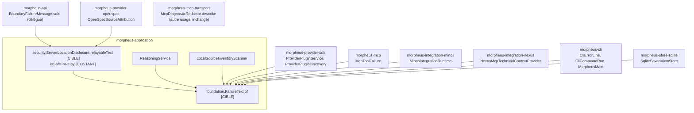
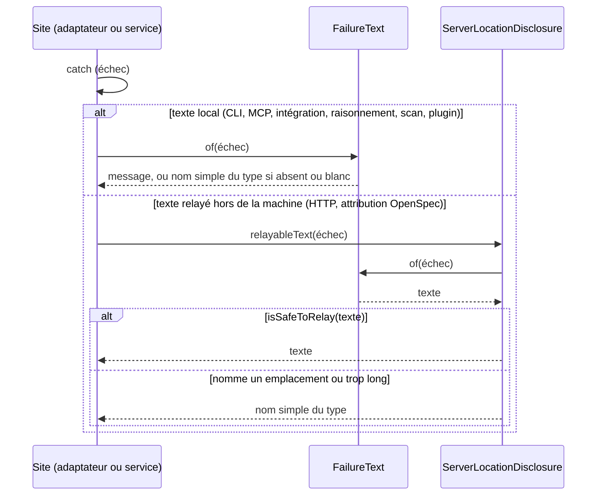

# Conception : former le texte de tout échec par un seul propriétaire

## Contexte

Motivation : voir `proposal.md`, section Why. État relu le 2026-11-06 sur `30520bd3` (copies de travail sous
`.claude/worktrees/` écartées de toutes les recherches).

- `[EXISTANT VÉRIFIÉ]` Sept déclarations de `safeMessage` hors de `morpheus-cli`, au corps identique
  (`getMessage()`, ou `getClass().getSimpleName()` si le message est `null` ou blanc) :

  | Module | Classe:ligne | Paramètre | Portée |
  |---|---|---|---|
  | `morpheus-provider-sdk` | `ProviderPluginService.java:129` | `Throwable` | `private static` |
  | `morpheus-provider-sdk` | `ProviderPluginDiscovery.java:250` | `Exception` | `private static` |
  | `morpheus-application` | `LocalSourceInventoryScanner.java:349` | `Throwable` | `private static` |
  | `morpheus-application` | `ReasoningService.java:146` | `RuntimeException` | `private static` |
  | `morpheus-integration-minos` | `MinosIntegrationRuntime.java:67` | `RuntimeException` | `private static` |
  | `morpheus-integration-nexus` | `NexusMcpTechnicalContextProvider.java:94` | `RuntimeException` | `private`, d'instance |
  | `morpheus-mcp` | `McpToolFailure.java:27` | `RuntimeException` | paquet, `static` |

- `[EXISTANT VÉRIFIÉ]` `CliErrorLine.failureText(Throwable)` (`CliErrorLine.java:23-26`) rend le même texte, écrit par
  `Optional.ofNullable(...).filter(!isBlank)`. Appelants : `CliErrorLine.refuse`, `CliCommandRun` (quatre sites),
  `MorpheusMain` (trois lanceurs).
- `[EXISTANT VÉRIFIÉ]` `CliArgumentBaseArchitectureTest` : `TURNS_A_FAILURE_INTO_TEXT` (`:71-74`) retient une méthode à
  un paramètre assignable à `Throwable` qui rend une `String` — les trois types de paramètre y entrent déjà ;
  `noCliTypeButTheOwnerTurnsAFailureIntoText` (`:86-89`) exige qu'elle soit déclarée dans `CliErrorLine` ; l'import est
  `importPackages(CLI)` (`:67-69`) et `declared` filtre aussi sur le paquet de la CLI (`:176-179`). Le scan textuel de
  `:115-127` porte sur le préfixe d'erreur, pas sur la conversion : la conversion n'a aujourd'hui aucun double textuel.
- `[EXISTANT VÉRIFIÉ]` La forme filtrée existe deux fois, au corps identique : `BoundaryFailureMessage.safe`
  (`morpheus-api/.../transport/BoundaryFailureMessage.java:22`) et `OpenSpecSourceAttribution.relayable`
  (`morpheus-provider-openspec/.../OpenSpecSourceAttribution.java:104`). Toutes deux appellent
  `ServerLocationDisclosure.isSafeToRelay` (`morpheus-application/.../security/`).
- `[EXISTANT VÉRIFIÉ]` D'autres méthodes ont la même signature et un autre usage : `failureType` dans
  `ProviderPluginService` (`:138`), `ProviderPluginDiscovery` (`:262`) et `OpenSpecSourceAttribution` (`:112`), qui ne
  rendent que le type ; `McpDiagnosticRedactor.describe` (`morpheus-mcp-transport`, `:33`), qui rend le type suivi du
  message expurgé de ses secrets. Recherche faite sur les signatures écrites sur une ligne ; la première exécution de la
  règle étendue donne la liste exacte.
- `[EXISTANT VÉRIFIÉ]` Une huitième copie, en ligne, échappe à toute règle par signature :
  `SqliteSavedViewStore.java:350` (`failure.getMessage() == null ? failure.getClass().getSimpleName() : …`), qui garde
  un message blanc.
- `[EXISTANT VÉRIFIÉ]` Les cinq modules des copies, et `morpheus-cli`, `morpheus-api`, `morpheus-provider-openspec`,
  `morpheus-store-sqlite`, déclarent `morpheus-application` dans leur `pom.xml` ; `morpheus-mcp-transport` ne le
  déclare pas et ne le peut pas (`AdapterCompositionRootArchitectureTest#theMcpTransportDependsOnNoOtherMorpheusPackage`).
- `[EXISTANT VÉRIFIÉ]` `com.morpheus.application.foundation` (`PayloadMap`, `StableKey`, `TextDigest`) n'importe aucun
  paquet MORPHEUS ; `application.security` n'importe pas `foundation`. Les deux sens restent libres de cycle pour
  `ApplicationPackageCyclesArchitectureTest` (règle `theApplicationPackagesAreFreeOfCycles`).
- `[EXISTANT VÉRIFIÉ]` Pièges de tests qui citent la conversion :
  `CliOptionValueHasOneBlankDefinitionTest` exige `scan.throwableMessages() > 0` sur les sources de la CLI, et
  `CliErrorLine.failureText` est le seul test de vide sur un message d'échec dans `morpheus-cli` ;
  `AuditRemediationContractTest` (`:64`) refuse `McpToolFailure.safeMessage` dans `MorpheusProviderPluginMcpTools` ;
  `McpArgumentHelperOwnershipTest` refuse qu'un outil MCP déclare `safeMessage`.

## Exigences couvertes

| Capacité | Exigence (titre exact) | Rubriques de conception qui y répondent |
|---|---|---|
| `failure-text-ownership` | Le texte d'un échec a un seul propriétaire | D1, D2, D3, D6, D7, Traitements |
| `failure-text-ownership` | Le texte relayé d'un échec a un seul propriétaire | D4 |
| `failure-text-ownership` | Une copie de la conversion d'un échec en texte est refusée par sa signature | D3, D5 |
| `failure-text-ownership` | Le corps de la conversion n'est écrit que chez ses propriétaires | D5, D6 |

## Composants et frontières

Avant et après, vus par les modules qui forment un texte d'échec. Question : où vit chaque conversion, et quelle
arête de dépendance chaque module emprunte-t-il pour l'atteindre ?

Explication : chaque flèche est une dépendance de module **déjà déclarée** ; seule la cible des appels change.
`morpheus-mcp-transport` reste à l'écart. Aujourd'hui `[EXISTANT VÉRIFIÉ]`, chacune de ces boîtes porte sa propre copie
et aucune flèche n'existe vers `FailureText`. Exigences : les deux premières de `failure-text-ownership`.

Frontières tenues par les tests existants : `LayerDependencyTest` (aucune dépendance de l'application vers un
adaptateur), `ApplicationPackageCyclesArchitectureTest` (`security` → `foundation`, jamais l'inverse),
`ApplicationTechnologyBoundaryArchitectureTest` (`getClass().getSimpleName()` est un accesseur de `Class`, pas de la
réflexion au sens de cette règle, `.claude/rules/architecture.md`).

## Traitements et interactions

Cible. Question : quel chemin suit le texte d'un échec selon qu'il reste local ou sort de la machine ? La composition
rend, pour tout échec, le même résultat que `BoundaryFailureMessage.safe` aujourd'hui : un message absent ou blanc
donne le nom du type, que `isSafeToRelay` admet ; un message refusé donne le nom du type ; sinon le message.

## Contrats d'interface

Sans objet : aucune route, aucun outil, aucune commande ni ligne de `contracts/public-surfaces.tsv` ne change ; le
texte rendu reste le même (hors D6).

Modèle de domaine, états, persistance, transactions, observabilité, performance : sans objet, une méthode statique pure
remplace des copies privées.

## Sécurité et isolation

Le filtre de la frontière distante garde une seule implémentation (D4). Les textes locaux restent non filtrés, comme
aujourd'hui (D7) ; aucune clé n'est ajoutée à une projection distante.

## Compatibilité, migration et retour arrière

Aucune donnée ni contrat à migrer. Retour arrière : revenir sur le changement. Le seul texte qui change est celui de D6.

## Décisions

### D1 : le propriétaire vit dans `com.morpheus.application.foundation`
- **Nature** : [DÉCISION]
- **Exigences servies** : `failure-text-ownership` › Le texte d'un échec a un seul propriétaire.
- **Choix** : `public final class FailureText` avec `public static String of(Throwable failure)`, au corps de
  `CliErrorLine.failureText`, dans le paquet qui porte déjà les aides partagées sans dépendance (`TextDigest`,
  `StableKey`, `PayloadMap`).
- **Alternatives écartées** :
  - `morpheus-domain` : tous les modules le voient, mais le domaine est le modèle pur ; mettre en forme un échec pour un
    appelant est un souci de cas d'usage, et le domaine n'en porte aucun autre ;
  - `morpheus-mcp-transport` : `morpheus-application` et `morpheus-provider-sdk` ne peuvent pas en dépendre
    (`applicationMustNotDependOnAdapters` interdit `com.morpheus.transport..`) ;
  - garder `CliErrorLine.failureText` pour seul propriétaire : les cinq modules ne voient pas `morpheus-cli`, et les
    y faire dépendre inverserait les couches ;
  - un module nouveau : une classe d'une méthode ne paie pas une entrée de réacteur, de
    `ModulePackageCorrespondenceTest` et de la population de couverture.
- **Compromis** : `foundation` gagne une classe utilisée par huit modules ; elle reste sans dépendance.
- **ADR** : non concerné (filtre de `.claude/rules/adr.md` : question 3, le retour arrière ne casse ni donnée ni
  contrat).

### D2 : `CliErrorLine.failureText` disparaît
- **Nature** : [DÉCISION]
- **Exigences servies** : idem ; `cli-argument-base` reste vraie sans modification.
- **Choix** : `CliErrorLine.refuse`, `CliCommandRun` et `MorpheusMain` appellent `FailureText.of`. La méthode
  `noCliTypeButTheOwnerTurnsAFailureIntoText` quitte `CliArgumentBaseArchitectureTest` pour la règle étendue (D5),
  plus stricte ; `TURNS_A_FAILURE_INTO_TEXT` sort du contrôle des entrées de `OTHER_PURPOSES` de cette classe.
  `CliOptionValueHasOneBlankDefinitionTest` ne peut plus exiger `scan.throwableMessages() > 0` : la classe « message
  d'un échec » devient vide dans la CLI, et tout test de vide sur le message d'un échec y devient une violation
  (le propriétaire est hors du module), ce qui resserre le garde-fou ; la reconnaissance reste prouvée par ses tests
  sur exemples (`theMessageOfAThrowableIsRecognisedByWhatIsReadNotByTheMethodName`).
- **Alternatives écartées** : déléguer (`failureText` appelle `FailureText.of`) — un délégué a la signature et
  demanderait une entrée de table pour un second nom de la même conversion.
- **Compromis** : deux tests d'architecture sont réécrits ; aucun ne perd de méthode `@Test` sans que la nouvelle
  classe en ajoute au moins autant (`architectureTestsMinimum` ne baisse pas).
- **ADR** : non concerné.

### D3 : la règle retient un paramètre assignable à `Throwable`
- **Nature** : [DÉCISION]
- **Exigences servies** : `failure-text-ownership` › Une copie de la conversion d'un échec en texte est refusée par sa
  signature.
- **Choix** : garder `TURNS_A_FAILURE_INTO_TEXT` tel quel (un paramètre, `isAssignableTo(Throwable.class)`, retour
  `String`), qui retient déjà `Throwable`, `Exception` et `RuntimeException` ; le propriétaire prend `Throwable`, que
  les trois sites appelants satisfont.
- **Alternatives écartées** : un prédicat par sous-type, ou un propriétaire par sous-type — trois noms d'une même
  conversion, et une copie sous un quatrième type (`Error`, une exception du projet) passerait.
- **Compromis** : la règle retient aussi les méthodes d'autre usage (`failureType`, `describe`, le délégué de D4), qui
  vont dans la table de faits de D5.
- **ADR** : non concerné.

### D4 : un second propriétaire pour la forme filtrée, par composition
- **Nature** : [DÉCISION]
- **Exigences servies** : `failure-text-ownership` › Le texte relayé d'un échec a un seul propriétaire.
- **Choix** : `ServerLocationDisclosure.relayableText(Throwable)` rend `FailureText.of(échec)` s'il passe
  `isSafeToRelay`, sinon le nom simple du type. `OpenSpecSourceAttribution.relayable` disparaît au profit de cet appel.
  `BoundaryFailureMessage.safe` reste le point d'obtention que `http-failure-disclosure` nomme, réduit à un appel à
  `relayableText` : il ne lit plus `getMessage()`, et il est nommé dans la table de D5 comme « nom imposé par
  `http-failure-disclosure` ».
- **Alternatives écartées** :
  - `FailureText.relayable` dans `foundation` : ferait dépendre le paquet le plus bas de `security` ;
  - supprimer `BoundaryFailureMessage.safe` : il faudrait modifier `http-failure-disclosure`, dont les deux exigences
    et `HttpFailureDisclosureArchitectureTest` le nomment, pour un gain d'une ligne ;
  - garder le filtre en deux copies, nommées dans la table : c'est le défaut que ce changement corrige.
- **Compromis** : deux propriétaires et un délégué nommé ; la règle les connaît tous les trois.
- **ADR** : non concerné.

### D5 : règle ArchUnit par signature, doublée d'un scan textuel
- **Nature** : [DÉCISION]
- **Exigences servies** : les deux dernières exigences de `failure-text-ownership`.
- **Intentions** : « aucune méthode hors des propriétaires ne convertit un échec en texte » — c'est une propriété de
  déclaration lisible dans le bytecode, donc **ArchUnit** ; « le corps de cette conversion n'est écrit nulle part
  ailleurs » — une lambda (écartée par `declared`), une expression en ligne et un module hors de l'ensemble importé
  (`morpheus-provider-testkit`) échappent au bytecode, donc **texte**. Les deux sont gardés.
- **Choix** : une classe `FailureTextOwnershipArchitectureTest` (paquet racine des tests d'architecture), qui importe
  `com.morpheus` sans les tests, applique `TURNS_A_FAILURE_INTO_TEXT` à toute méthode déclarée non synthétique et
  exige `FailureText` ou `ServerLocationDisclosure` comme classe déclarante, hors `OTHER_PURPOSES` ; et un scan de
  `RepositoryTree.files(root)` limité aux `src/main/java`, commentaires et littéraux blanchis, qui refuse un membre
  lisant `.getMessage()` et `.getSimpleName()` hors des fichiers des propriétaires et de `OTHER_SPELLINGS`
  (`McpDiagnosticRedactor.java`, avec sa raison). `OTHER_PURPOSES` et `OTHER_SPELLINGS` sont des **tables de faits**,
  déclarées dans `ProductionClassListsArchitectureTest.KINDS` (`Kind.TABLE_OF_FACTS`) : elles disent quelles méthodes
  ont un autre usage, elles ne promettent pas de rétrécir.
- **Alternatives écartées** : étendre seulement `CLI` à `com.morpheus` dans `CliArgumentBaseArchitectureTest` — la
  classe porte la base d'arguments de la CLI, et la règle couvrirait le produit depuis un nom qui le cache ; le texte
  seul — raterait une copie dont le corps est écrit autrement (par exemple par `Objects.requireNonNullElse`).
- **Compromis** : le scan textuel est une heuristique ; une copie qui lit le message par un intermédiaire lui échappe,
  la règle par signature la voit si elle est déclarée.
- **ADR** : non concerné.

### D6 : la copie en ligne de `SqliteSavedViewStore` converge, message blanc compris
- **Nature** : [PROPOSITION]
- **Exigences servies** : `failure-text-ownership` › Le texte d'un échec a un seul propriétaire ; › Le corps de la
  conversion n'est écrit que chez ses propriétaires.
- **Choix** : `SqliteSavedViewStore.java:350` appelle `FailureText.of`. Un échec à message blanc donnera le nom du
  type au lieu d'une raison faite d'espaces.
- **Alternatives écartées** : la nommer dans `OTHER_SPELLINGS` — elle n'a pas d'autre usage, seulement une variante
  plus faible du même.
- **Compromis** : un texte change (raison d'une vue illisible dont l'échec porte un message blanc) ; aucun test du
  dépôt ne le fige à ce jour (à confirmer par la tâche 1.3).
- **ADR** : non concerné.

### D7 : aucun filtre de chemin ajouté aux textes locaux
- **Nature** : [DÉCISION]
- **Exigences servies** : `failure-text-ownership` › Le texte d'un échec a un seul propriétaire (scénario « Aucun filtre
  ajouté ni retiré »).
- **Choix** : les sept sites appellent `FailureText.of`, non filtré, comme leurs copies.
- **Alternatives écartées** : appeler `relayableText` partout — changerait en douce ce que la CLI locale et les statuts
  locaux montrent, et doublerait des filtres déjà posés en aval (voir Écarts constatés).
- **Compromis** : les textes que reçoit un client MCP restent non filtrés à ce niveau ; la question reste ouverte.
- **ADR** : non concerné.

## Écarts constatés

| Constat | Source A | Source B | Traitement proposé |
|---|---|---|---|
| `ProviderPluginService` : `safeMessage` à la ligne 129, pas 137 | constat `AUD-QUA-19` (`preuve`) | code à `30520bd3` | citer `:129` ; aucune autre conséquence |
| Le scan textuel cité (`:115-141`) porte sur le préfixe d'erreur, pas sur la conversion | `verif_preuve` du constat | `CliArgumentBaseArchitectureTest.java:115-127` | la conversion reçoit son double textuel (D5) |
| Une seconde copie de la forme filtrée, absente du constat | constat (« huitième forme » unique) | `OpenSpecSourceAttribution.java:104` | converge (D4) |
| Une copie en ligne, absente du constat, qui garde un message blanc | constat (sept copies) | `SqliteSavedViewStore.java:350` | converge (D6, à valider) |
| « Celles qui atteignent un message public relaient le message brut » : au moins trois sorties sont filtrées en aval | `impact` du constat | `IntegrationStatusDisclosure` (statut MINOS), `SourceInventoryScanResult` (diagnostics du scan), `RemoteTextPolicy` (plugins) | aucun changement ; consigné pour la question de D7 |
| `mcp-tool-failure-contract` exige qu'un résultat d'outil ne nomme aucun chemin du serveur ; `McpToolFailure.result` relaie le message tel quel | `openspec/specs/mcp-tool-failure-contract/spec.md` | `McpToolFailure.java:27-34` | hors périmètre (D7) ; question ouverte |

## Stratégie de vérification

| Exigence | Scénario | Preuve | État |
|---|---|---|---|
| Le texte d'un échec a un seul propriétaire | Un échec qui porte un message ; Un échec sans message ou à message blanc | `FailureTextTest` (`morpheus-application`) sur `Throwable`, `Exception`, `RuntimeException`, message `null`, vide, blanc | à écrire |
| idem | idem, sur les sites | tests existants des sites (`CliErrorLineTest`, tests de `McpToolFailure`, de `ProviderPluginService`, des intégrations) verts sans attente modifiée | existant |
| idem | Aucun filtre ajouté ni retiré | test sur un message qui nomme un chemin : `FailureText.of` le rend tel quel | à écrire |
| Le texte relayé d'un échec a un seul propriétaire | Un message qui nomme un emplacement ; Un message écrit par MORPHEUS | test de `ServerLocationDisclosure.relayableText` ; `HttpFailureDisclosureArchitectureTest` et `ExtensionRoutesFailureDisclosureTest` verts | à écrire / existant |
| Une copie … refusée par sa signature | les trois scénarios | `FailureTextOwnershipArchitectureTest`, rouge avant le correctif en nommant les sept copies ; violation plantée puis retirée | à écrire |
| Le corps … chez ses propriétaires | les deux scénarios | même classe, scan textuel ; test sur exemples (lambda, en ligne, commentaire) | à écrire |

## Documentation durable et diagrammes à mettre à jour

- `docs/developer/specifications/failure-text-ownership.md` (nouvelle, avec les deux diagrammes ci-dessus) et sa ligne
  dans `docs/developer/specifications/README.md`.
- `docs/developer/specifications/cli-argument-base.md` : le texte d'un échec vient de `FailureText.of` ; la preuve de
  R5 pour la conversion est `FailureTextOwnershipArchitectureTest`.

## Questions ouvertes

- D6 : le mainteneur accepte-t-il que la raison d'une vue illisible à message blanc devienne le nom du type ?
- D7 : faut-il filtrer, dans un changement séparé, le texte rendu à un client MCP par `McpToolFailure.result` et celui
  du raisonnement, au regard de `mcp-tool-failure-contract` ? Ce changement ne le fait pas.
