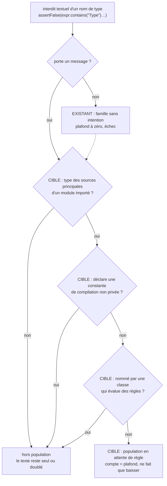

# Conception : écrire en règle sur le bytecode chaque interdit de dépendance dont la cible le permet

Motivation : voir `proposal.md`, section Why. Le changement ne touche que la suite d'architecture ; la conception est
allégée pour les rubriques sans objet, complète pour le classement et les décisions.

## Contexte

État vérifié le 2026-11-06 sur `30520bd3` :

- `[EXISTANT VÉRIFIÉ]` `EnforcementMechanismAccountingTest` tient deux familles d'interdits textuels de type :
  `UNEXPLAINED_TYPE_BAN` (sans message, compte égal à `UNEXPLAINED_TYPE_BAN_CEILING`) et `EXPLAINED_TYPE_BAN` (avec
  message, publiée dans `enforcement-composition-summary.txt`, jamais bloquante). Les deux expressions n'acceptent qu'un
  identifiant avant `.contains(` (`[A-Za-z0-9_]+\.contains\("[A-Z]…"\)`).
- `[EXISTANT VÉRIFIÉ]` La convention « un interdit de type dont la cible ne déclare aucune constante inlinable s'écrit en
  règle ArchUnit » est écrite dans `.claude/rules/architecture.md` et dans la Javadoc d'`UNEXPLAINED_TYPE_BAN_CEILING`.
  Aucune méthode de la suite ne lit la cible d'un interdit ni ses constantes : le plafond à zéro force un message, pas
  une règle. La convention n'est donc tenue que par la revue.
- `[EXISTANT VÉRIFIÉ]` `enforcement-mechanism-accounting` › The architecture suite SHALL publish the composition of its
  own enforcement by one stated method : « The suite MUST NOT fail on any of these counts other than the ceiling
  above ». Les comptes visés sont ceux du fichier de preuve.
- `[EXISTANT VÉRIFIÉ]` `ArchitectureSuiteSources.evaluatesRulesOnBytecode` reconnaît une classe qui évalue des règles
  (import de `com.tngtech.archunit`) ; `ArchitectureSuiteSources.suite()` donne les sources de toutes les classes de la
  suite ; `TestSourceText.code` / `codeAndStrings` blanchissent commentaires et blocs de texte.
- `[EXISTANT VÉRIFIÉ]` L'ensemble importé par ArchUnit est le classpath du module : les dépendances déclarées dans
  `morpheus-architecture-tests/pom.xml` (`morpheus-provider-testkit` n'y est pas).
- `[EXISTANT VÉRIFIÉ]` `ProductionClassListsArchitectureTest` exige qu'une **liste** de classes de production d'un test
  soit un compteur de dette ou une table de faits ; un plafond entier n'est pas une liste.
- Mesure de ce relevé (méthode approchée : expression `EXPLAINED_TYPE_BAN`, cible cherchée par nom de fichier dans les
  sources principales, constantes non privées cherchées par expression, « nommée par une classe de règles » = nom
  simple présent dans une classe qui importe ArchUnit) : la plupart des interdits de type à message visent un type
  hors du dépôt, une constante ou un texte de workflow, ou une cible à constante non privée
  (`MorpheusRemoteIdentityFile`, `CanonicalJsonSerializer`, `SqliteSpecificationKnowledgeStore`) ; parmi les cibles sans
  constante, toutes sauf une sont déjà nommées par une classe de règles. Le candidat restant est
  `MessageTooLargeException` (`m21/AuditHardeningWorkflowContractTest`), dont l'interdit porte sur une région de méthode
  et non sur la classe entière. Ce relevé n'est ni un seuil ni une cible : la population se mesure par l'expression de
  la suite à l'implémentation.
- Mesure de l'audit du 06/11 sur `30520bd3` (constat `AUD-TRV-03`, champ `verif_preuve`, méthode qui y est inscrite) :
  assertions `contains` et règles `noClasses()` dans un rapport de l'ordre de dix-huit pour une. Ce rapport n'est pas
  l'objet de ce changement (D5).

## Exigences couvertes

| Capacité | Exigence (titre exact) | Rubriques |
|---|---|---|
| `enforcement-mechanism-accounting` | Les interdits textuels de type qui attendent une règle sur le bytecode forment une population qui ne fait que rétrécir | D1, D2, D3, Classement |
| `enforcement-mechanism-accounting` | Une règle qui remplace ou double un interdit textuel est livrée avec sa violation plantée | D4 |

## Classement d'un interdit textuel de type

Question : quand un interdit textuel de type compte-t-il dans la population qui doit rétrécir, et qu'est-ce qui change
par rapport à aujourd'hui ?

Existant : seule la branche « porte un message ? » est jugée. Cible : la suite suit aussi la cible de chaque interdit,
avec ou sans message (la flèche pointillée : un interdit sans message reste refusé par la famille existante, et serait
aussi compté ici). Exigence : la population qui ne fait que rétrécir.

## Décisions

### D1 : une population mesurée, dans une classe à part, sans ADR
- **Nature** : [DÉCISION]
- **Exigences servies** : `enforcement-mechanism-accounting` › Les interdits textuels de type qui attendent une règle sur
  le bytecode forment une population qui ne fait que rétrécir.
- **Choix** : une classe ajoutée à la suite compte la population et l'égale à un plafond entier qu'elle déclare, sur le
  patron d'`UNEXPLAINED_TYPE_BAN_CEILING` : échec au-dessus avec les membres par fichier, échec au-dessous jusqu'à
  l'abaissement dans le même changement. La classe lit des sources de production (la cible), donc ne porte pas
  `@CoherenceCheck` ; elle n'est pas fusionnée dans `EnforcementMechanismAccountingTest`, qui est un contrôle de
  cohérence et le resterait.
- **Alternatives écartées** : (a) ajouter la mesure à `EnforcementMechanismAccountingTest` : écarté, la lecture des cibles
  lui ferait perdre `@CoherenceCheck` et l'exigence R3 interdit à cette classe d'échouer sur un compte publié autre que
  le plafond existant ; (b) une liste nommée des interdits en attente : écarté, ce serait une liste de classes de
  production, donc un compteur de dette adossé à un ADR accepté et à une clé de `config/debt-counter-ratchets.properties`
  (`ProductionClassListsArchitectureTest`), plus lourd qu'un plafond dérivé pour la même propriété ; (c) migrer sans
  mesurer : écarté, c'est l'état actuel, où la convention n'est tenue que par la revue.
- **Compromis** : le compte n'est pas publié dans `enforcement-composition-summary.txt` ; il égale à tout instant le
  plafond déclaré, qui le publie de fait.
- **ADR** : non concerné. Décision : oui ; portée et durée : la suite de tests seulement, ni module de production, ni
  surface, ni format persisté, ni modèle de sécurité ; coût du retour arrière : faible (supprimer une classe de test).
  ADR-0103, qui portait le critère de choix, est archivé et son bandeau le renvoie à une convention de test
  (`docs/architecture/adr/archive/0103-textual-assertions-and-archunit-rules-enforce-different-things.md`).

### D2 : l'expression de la population
- **Nature** : [DÉCISION]
- **Exigences servies** : idem, scénarios « La cible déclare une constante inlinable » et « L'expression est prouvée
  dans les deux sens ».
- **Choix** : (1) un interdit est `assertFalse(<expression>.contains("<NomDeType>")` suivi de `)` ou de `,`, lu dans le
  code (commentaires et blocs de texte blanchis, littéraux gardés), quel que soit le récepteur ; (2) la cible est le
  fichier `<NomDeType>.java` des `src/main/java` d'un module déclaré en dépendance de `morpheus-architecture-tests/pom.xml`,
  un nom présent dans deux modules étant compté s'il l'est dans l'un ; (3) une constante inlinable est un champ
  `static final` non privé de type `String` ou primitif (implicitement public dans une interface) ; (4) « nommée par une
  classe de règles » : le nom simple apparaît, comme mot entier, dans le code d'une classe de la suite pour laquelle
  `ArchitectureSuiteSources.evaluatesRulesOnBytecode` est vrai.
- **Alternatives écartées** : lire les constantes sur le bytecode par ArchUnit : écarté, plus exact mais la classe
  importerait ArchUnit et changerait de nature sans gain sur la propriété (une sur-approximation des constantes classe
  hors population, donc laisse le texte, sens sûr) ; exiger que la règle soit dans la même classe que l'interdit :
  écarté, les règles de famille (`HttpRoutesFamilyArchitectureTest`) couvrent légitimement des interdits écrits dans les
  tests de chaque routeur ; vérifier que la règle a le même sujet que l'interdit : écarté, aucune lecture textuelle ne
  le dit sûrement.
- **Compromis** : un nom simple cité par une classe de règles pour une autre raison sort l'interdit de la population ;
  la revue le tient. Un littéral qui est un préfixe de famille (`MorpheusRemote`) n'a pas de fichier cible et sort de la
  population ; il est déjà doublé par `HttpRoutesFamilyArchitectureTest` (`haveSimpleNameStartingWith`).
- **ADR** : non concerné.

### D3 : aucun chiffre cible, un plafond qui ne fait que baisser
- **Nature** : [DÉCISION]
- **Exigences servies** : la population qui ne fait que rétrécir.
- **Choix** : le plafond est posé à la mesure de l'implémentation, puis abaissé à chaque membre qui reçoit sa règle. Le
  changement migre les membres présents (tâches du groupe 2), sans promettre de compte final.
- **Alternatives écartées** : un objectif chiffré (zéro, ou un rapport assertions/règles) : écarté, le brief du
  mainteneur et `.claude/rules/meta.md` interdisent un chiffre non dérivé, et un rapport se fait baisser en ajoutant
  des règles qui ne voient rien de neuf.
- **Compromis** : la population peut ne pas atteindre zéro si un membre est légitimement une « mention » (son intention
  est la mention elle-même) ; ce membre se résout en nommant la cible dans une règle qui la double, ou reste au plafond
  avec sa raison dans le message de l'assertion.
- **ADR** : non concerné.

### D4 : la méthode de migration et sa preuve
- **Nature** : [DÉCISION]
- **Exigences servies** : `enforcement-mechanism-accounting` › Une règle qui remplace ou double un interdit textuel est
  livrée avec sa violation plantée.
- **Choix** : pour chaque membre, écrire l'intention en une phrase ; écrire la règle dans le `*ArchitectureTest` de
  cette intention (règle transverse dans `LayerDependencyTest`, de groupe dans le test du groupe), une méthode par
  intention ; garder l'assertion textuelle à côté dans le doute (`.claude/rules/architecture.md`, « Dans le doute,
  garder les deux ») ; vérifier que la cible est dans l'ensemble importé et que le littéral n'est pas un préfixe de
  famille ; casser la règle une fois et consigner l'échec dans la tâche.
- **Alternatives écartées** : regrouper les interdits d'une classe en une règle : écarté, le nombre d'exécutions
  déclarées du module baisserait et `architectureTestsMinimum` ne se baisse pas (`.claude/rules/testing.md`) ; une
  fixture compilée qui viole chaque règle, gardée en test : proposée seulement là où la règle se paramètre par son
  sujet (patron de `ApplicationPackageCyclesArchitectureTest#theCycleRuleRefusesTwoPackagesThatDependOnEachOther`) —
  `[PROPOSITION]`, non exigée.
- **Compromis** : la trace de la violation plantée est une preuve de revue, pas de build.
- **ADR** : non concerné.

### D5 : la part textuelle globale reste sans plafond
- **Nature** : [DÉCISION]
- **Exigences servies** : aucune exigence ajoutée ; compatibilité avec R3.
- **Choix** : aucun plafond sur le nombre d'assertions textuelles ni sur leur rapport aux règles.
- **Alternatives écartées** : plafonner la part textuelle, comme le demandait la phrase d'ouverture de l'action du
  constat : écarté, `.claude/rules/architecture.md` le refuse délibérément (« un ratio se fait baisser en supprimant un
  contrôle de documentation ou en ajoutant une règle qui ne voit rien de neuf ») et R3 interdit d'échouer sur ces comptes.
- **Compromis** : le rapport mesuré par l'audit peut continuer de croître avec les contrôles de documentation.
- **ADR** : non concerné.

## Écarts constatés

| Constat | Source A | Source B | Traitement proposé |
|---|---|---|---|
| La convention « cible sans constante inlinable → règle ArchUnit » n'a pas de test | `.claude/rules/architecture.md`, Javadoc d'`UNEXPLAINED_TYPE_BAN_CEILING` | suite d'architecture (aucune lecture de cible) | ce changement |
| Les deux familles ne voient qu'un récepteur identifiant : `assertFalse(Files.readString(p).contains("Type"), …)` leur échappe | spec R1 (« the assertions that refuse the mention of a type name ») | `UNEXPLAINED_TYPE_BAN`, `EXPLAINED_TYPE_BAN` | la population ajoutée accepte tout récepteur ; les deux familles existantes ne sont pas modifiées ici (l'écart reste à la page durable) |
| La règle écrit la valeur du plafond (« le plafond vaut 0 ») | spec R1 (« No document of the repository restates the ceiling's value ») | `.claude/rules/architecture.md` | déjà relevé (page durable, écart 1) ; la tâche 3.1 retire la valeur en réécrivant le paragraphe |
| L'action parle de « classes sans constante inlinable » ; l'interdit vise un type cible, pas la classe qui l'écrit | constat, champ `action` | `.claude/rules/architecture.md` | la population s'exprime par la cible de l'interdit |

## Stratégie de vérification

| Exigence | Scénario | Preuve | État |
|---|---|---|---|
| Population | Un interdit textuel est ajouté sur une cible qui permet une règle | classe ajoutée, méthode du plafond ; violation plantée une fois (interdit ajouté sur une cible sans constante) | à écrire |
| Population | La cible déclare une constante inlinable | méthode sur exemples | à écrire |
| Population | Une règle est écrite et le plafond est laissé tel quel | méthode du plafond (`assertEquals`) ; vu à chaque membre migré | à écrire |
| Population | L'expression est prouvée dans les deux sens | méthode sur exemples (sept cas) | à écrire |
| Violation plantée | Une règle migrée sans trace de violation | tâches 2.x de ce changement (trace consignée) | manuel (revue) |
| Violation plantée | Une règle migrée qui ne voit aucune classe | `AnEmptyArchitectureRuleFailsTest` | existant |
| R4 (existante) | la classe ajoutée ne porte pas le marqueur | `CoherenceCheckMarkerTest#everyTestClassThatReadsNoCodeIsMarkedAndNoOtherIs` | existant |

Sans objet : modèle de domaine, états, contrats d'interface, persistance, transactions, sécurité, observabilité,
performance (aucun code de production ne change). Compatibilité et retour arrière : supprimer la classe ajoutée ; les
règles ajoutées restent valides seules. Le nombre d'exécutions déclarées du module monte.

## Documentation durable et diagrammes à mettre à jour

- `docs/developer/specifications/enforcement-mechanism-accounting.md` : deux exigences, section « La population en
  attente de règle », diagramme « Classement d'un interdit textuel de type », traçabilité, écart sur les récepteurs.
- `.claude/rules/architecture.md` (« Un interdit textuel de type écrit son intention ») et
  `.claude/skills/enforcement-choice/SKILL.md` : renvoi au test qui tient désormais la convention.

## Questions ouvertes

- `[QUESTION]` Étendre la population aux interdits d'un nom de paquet (`com.morpheus.sdk.provider`, `tools.jackson`,
  `java.sql`) ? Il faudrait apprécier les constantes de tous les types du paquet, et plusieurs de ces interdits sont
  textuels par nature (« Cœurs purs »). À trancher par le mainteneur ; ne change ni les specs ni les tâches de ce
  changement.
- `[QUESTION]` Les cibles d'une bibliothèque (types Jackson, `com.sun.net.httpserver`) sont hors population faute de
  source : faut-il les juger sur le bytecode importé ? Même statut.
