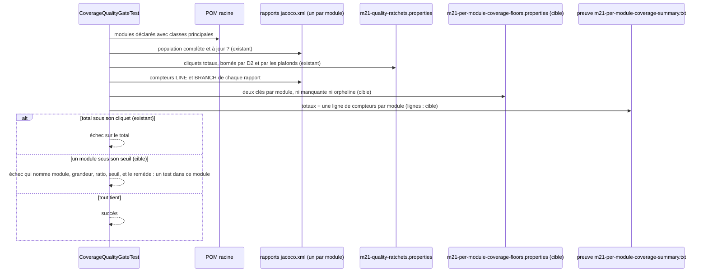
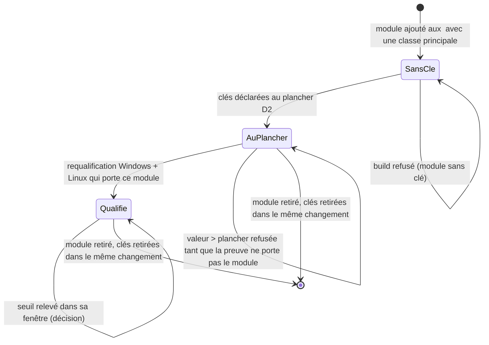

# Conception : un seuil de non-régression de couverture pour chaque module

## Contexte

Motivation : voir `proposal.md`, section Why. État vérifié le 2026-11-06 sur `30520bd3` :

- `[EXISTANT VÉRIFIÉ]` `CoverageQualityGateTest.perModuleCoverageDoesNotRegressBelowQualifiedBaseline`
  (`morpheus-architecture-tests/src/test/java/com/morpheus/architecture/m21/CoverageQualityGateTest.java`, lignes
  128 à 179) lit `perModuleLineCoverageMinimum` et `perModuleBranchCoverageMinimum`, applique `max(plancher D2,
  cliquet)`, vérifie que chaque cliquet reste sous son plafond (`assertRatchetWithinQualifiedWindow`, constantes
  `PER_MODULE_QUALIFIED_LINE_RATIO` et `PER_MODULE_QUALIFIED_BRANCH_RATIO`), puis additionne les compteurs racine
  `LINE` et `BRANCH` de chaque rapport dans deux `Counter` (lignes 143 à 162) et compare deux ratios totaux.
- `[EXISTANT VÉRIFIÉ]` La population est dérivée du POM racine : `reportPopulation` retient tout module des
  `<modules>` qui porte une classe sous `src/main/java`, et `ReportPopulation.assertComplete` refuse un module jamais
  construit, construit sans rapport ou à rapport périmé, en le nommant (ADR GEN-0154, décision 2).
- `[EXISTANT VÉRIFIÉ]` La preuve écrite (`morpheus-architecture-tests/target/m21-per-module-coverage-summary.txt`) et
  la preuve conservée (`config/coverage-qualification/per-module/*.txt`, manifeste `evidence.tsv`) ne portent que des
  totaux : `coverageScope`, `reports`, `lineCovered`, `lineMissed`, `lineRatio`, `branch*`, plafonds et cliquets du
  commit mesuré. Aucune ligne par module.
- `[EXISTANT VÉRIFIÉ]` `CoverageQualificationEvidenceTest` exige que chaque plafond égale le plus bas ratio de sa
  preuve conservée et que chaque cliquet garde trois fois la plus grande des dispersions (runs conservés ou constantes
  `REFERENCE_LINE_SPREAD` / `REFERENCE_BRANCH_SPREAD`) sous la plus basse mesure ; il exige aussi une seule tête pour
  les deux échelles (exigence « Every scale of a qualification SHALL be measured at the same head »).
- `[EXISTANT VÉRIFIÉ]` `CoverageScaleSeparationTest` (`@CoherenceCheck`) refuse, par lecture du texte des sources, que
  le gate par module nomme une clé ou une preuve agrégée, que le gate agrégé nomme une clé ou une preuve par module, et
  que l'un des deux nomme les clés ou la preuve du crédit emprunté.
- `[EXISTANT VÉRIFIÉ]` Un plafond `PER_MODULE_QUALIFIED_*` n'est pas un seuil : c'est la borne haute d'un cliquet
  (`assertRatchetWithinQualifiedWindow` refuse un cliquet au-dessus). Le seul seuil de l'échelle est la paire de clés
  totale.

## Exigences couvertes

| Capacité | Exigence (titre exact) | Rubriques de conception qui y répondent |
|---|---|---|
| `per-module-coverage-floor` | Chaque module de la population est tenu par un seuil qui lui est propre | D2, Traitements |
| `per-module-coverage-floor` | Les seuils par module sont déclarés une fois, par module, dans la configuration de l'échelle par module | D1, D6 |
| `per-module-coverage-floor` | Un module absent de la preuve conservée ne déclare que le plancher D2 | D5, D6 |
| `per-module-coverage-floor` | Le seuil d'un module reste dans sa fenêtre qualifiée | D3, D4 |
| `per-module-coverage-floor` | Le seuil d'un module ne se baisse pas pour faire passer un build | D2, D3 (compromis) |
| `per-module-coverage-floor` | Les seuils par module ne gouvernent ni l'échelle agrégée ni le crédit emprunté | D9 |
| `per-module-coverage-floor` | Le cliquet total de l'échelle par module reste en vigueur à côté des seuils | D8 |
| `coverage-qualification-evidence` | La preuve de l'échelle par module porte les compteurs de chaque module | D3, D5 |
| `coverage-qualification-evidence` | La dispersion d'un module se lit dans la preuve conservée | D4 |

## Composants et frontières

Tout reste dans `morpheus-architecture-tests/src/test/java/com/morpheus/architecture/m21/` et sous `config/` ; aucun
code de production ne change, aucune dépendance entre modules n'est ajoutée.

| Élément | Rôle après le changement |
|---|---|
| `CoverageQualityGateTest` | garde le contrôle du total ; ajoute le contrôle de chaque module ; écrit une ligne par module dans sa preuve |
| `CoverageQualificationEvidenceTest` | vérifie les lignes par module de la preuve conservée et la fenêtre de chaque seuil |
| `CoverageScaleSeparationTest` | ajoute le fichier des seuils par module aux noms que le gate agrégé et le gate du crédit emprunté ne doivent pas lire |
| `config/m21-per-module-coverage-floors.properties` (nouveau) | une clé de lignes et une clé de branches par module de la population |
| `config/coverage-qualification/per-module/*.txt` | résumés conservés au format enrichi, remplacés par une requalification à une seule tête |

Méthode d'enforcement : chaque contrôle vise un fichier (`.properties`, résumé de preuve, source d'un gate) ; le texte
y est la seule prise, aucune règle ArchUnit n'est en jeu (`.claude/rules/architecture.md`, « Règle ArchUnit ou
assertion textuelle »). Le fichier des seuils nomme des modules, pas des classes de production : il ne relève pas de
`ProductionClassListsArchitectureTest`.

Modèle de domaine et invariants : sans objet, aucun type du produit ne change.

## Traitements et interactions

Question : que fait le gate de l'échelle par module d'un réacteur dont un module a cessé de se tester, avant et après
le changement ? Diagramme de séquence UML ; les messages marqués « cible » n'existent pas encore.

Explication : aujourd'hui seule la branche « total » existe, donc un module qui cesse de se tester passe tant que les
autres compensent. La cible ajoute la lecture des seuils et la branche « module ». Le refus liste **tous** les modules
sous leur seuil en une fois, pour qu'un correctif n'en découvre pas un nouveau à chaque build. Exigences :
« Chaque module de la population est tenu par un seuil qui lui est propre », « Le cliquet total de l'échelle par module
reste en vigueur à côté des seuils ».

## États et transitions

Question : comment un module entre dans le fichier des seuils, y monte et en sort ? Diagramme d'états UML (cible).

Explication : la population reste dérivée du POM (GEN-0154, décision 2) ; le fichier des seuils suit, et toute
divergence entre les deux échoue en se nommant. Exigences : « Les seuils par module sont déclarés une fois… », « Un
module absent de la preuve conservée ne déclare que le plancher D2 », « Le seuil d'un module reste dans sa fenêtre
qualifiée ».

## Contrats d'interface

Sans objet : aucune surface publique ; le seul contrat est le format du fichier de seuils et de la preuve, décrit en D1
et D3.

## Persistance et intégrité

Sans objet : aucune donnée du produit ; les fichiers concernés sont de la configuration de build versionnée.

Transactions, concurrence et idempotence, sécurité et isolation : sans objet, gate de build sans état partagé ni
entrée non fiable.

## Gestion des erreurs et reprise

Chaque refus nomme sa cause et son remède, comme le font déjà `ReportPopulation.assertComplete` et
`assertCoverageAtLeast` : module sous son seuil (écrire des tests dans ce module), module sans clé (déclarer les deux
clés au plancher D2), clé orpheline (la retirer), seuil hors fenêtre (requalifier ou rester dans la marge). Aucun repli
silencieux : un module sans clé ne reçoit pas de seuil par défaut.

## Observabilité

La preuve écrite gagne une ligne par module ; elle est publiée par l'artefact `m21-integrity-<OS>` comme aujourd'hui.

## Performance et stratégie de mesure

Sans objet : le gate lit déjà chaque rapport ; il garde ses compteurs par module au lieu de les fondre.

## Compatibilité, migration et retour arrière

Les résumés conservés actuels n'ont pas de lignes par module : ils ne peuvent qualifier aucun seuil au-dessus du
plancher D2. La migration suit D5. Retour arrière : retirer le fichier de seuils et le contrôle ; les preuves enrichies
restent lisibles par l'ancien test, qui ignore les clés qu'il ne lit pas.

## Décisions

### D1 : un fichier de seuils propre à l'échelle par module
- **Nature** : [DÉCISION]
- **Exigences servies** : `per-module-coverage-floor` › Les seuils par module sont déclarés une fois, par module, dans
  la configuration de l'échelle par module.
- **Choix** : `config/m21-per-module-coverage-floors.properties`, clés `<artifactId>.lineCoverageMinimum` et
  `<artifactId>.branchCoverageMinimum`, valeurs en ratio entre 0 et 1 comme les cliquets existants. Le nom du fichier
  porte l'échelle ; l'`artifactId` est celui des `<modules>` du POM racine, ce que `reportPopulation` lit déjà.
- **Alternatives écartées** : des clés `perModule…` dans `config/m21-quality-ratchets.properties`, écartées parce que
  ce fichier est lu par les validateurs et épinglé par `RepositoryDocumentationCoherenceTest`, et parce qu'une clé qui
  commence par `perModuleLineCoverageMinimum` serait confondue, par les `contains` de `CoverageScaleSeparationTest`,
  avec la clé totale ; des constantes dans le gate, écartées parce qu'un seuil est de la configuration relue par
  `CoverageQualificationEvidenceTest` ; un seuil en nombre de lignes couvertes, écarté parce qu'il échouerait quand du
  code couvert est retiré et ne se compare pas aux cliquets existants.
- **Compromis** : un fichier de plus à répercuter lors d'une hausse ; il n'est épinglé par aucune page.
- **ADR** : couvert par l'ADR consolidé de D7.

### D2 : un contrôle par module, à côté du contrôle total
- **Nature** : [DÉCISION]
- **Exigences servies** : `per-module-coverage-floor` › Chaque module de la population est tenu par un seuil qui lui
  est propre ; › Le seuil d'un module ne se baisse pas pour faire passer un build.
- **Choix** : la boucle sur les rapports garde un `Counter` de lignes et un de branches par module ; une méthode
  `@Test` distincte (`everyModuleOfThePopulationHoldsItsOwnFloor`) compare chacun à `max(plancher D2, seuil)` et
  échoue une fois en listant tous les modules en défaut, avec le remède « écrire des tests dans ce module ». Un test sur
  un réacteur assemblé dans un `@TempDir` (patron de
  `theDerivedPopulationRefusesAnAmputatedReactorAndNamesWhatIsMissing`) prouve le refus : un module sous son seuil
  pendant que le total tient.
- **Alternatives écartées** : étendre la méthode existante, écarté parce qu'un échec du total masquerait celui d'un
  module et inversement ; échouer au premier module, écarté (un module découvert par build).
- **Compromis** : une exécution déclarée de plus dans le module d'architecture, ce qui ne baisse aucun cliquet de
  présence.
- **ADR** : couvert par D7.

### D3 : la fenêtre d'un seuil se lit dans la preuve conservée
- **Nature** : [DÉCISION]
- **Exigences servies** : `per-module-coverage-floor` › Le seuil d'un module reste dans sa fenêtre qualifiée ;
  `coverage-qualification-evidence` › La preuve de l'échelle par module porte les compteurs de chaque module.
- **Choix** : le gate écrit, par module, `module.<artifactId>.lineCovered`, `.lineMissed`, `.branchCovered`,
  `.branchMissed` ; `CoverageQualificationEvidenceTest` lit ces lignes dans les résumés conservés, vérifie qu'elles
  font les totaux et portent le même ensemble de modules, et refuse un seuil hors de [plancher D2, plus basse mesure du
  module − 3 × dispersion retenue], comptée en lignes et en branches comme pour les cliquets.
- **Alternatives écartées** : un plafond qualifié par module, en constantes dans le gate (comme
  `PER_MODULE_QUALIFIED_*`), écarté parce que deux constantes par module saisies à la main doublent ce que la preuve
  conservée dit déjà ; des seuils dérivés automatiquement de la preuve sans clé, écartés parce qu'une requalification
  faite après la régression d'un module baisserait son seuil sans que personne ne le décide.
- **Compromis** : rien dans le build n'interdit de **baisser** une clé dans sa fenêtre : la baisse reste visible dans
  le diff d'un fichier de gouvernance et se justifie dans la PR (`.claude/rules/governance.md`), comme pour les
  cliquets existants.
- **ADR** : couvert par D7.

### D4 : la dispersion d'un module, jamais nulle
- **Nature** : [DÉCISION]
- **Exigences servies** : `coverage-qualification-evidence` › La dispersion d'un module se lit dans la preuve
  conservée.
- **Choix** : dispersion retenue = max(écart observé pour ce module entre les résumés conservés, constantes
  `REFERENCE_LINE_SPREAD` / `REFERENCE_BRANCH_SPREAD` de `CoverageQualificationEvidenceTest`).
- **Alternatives écartées** : l'écart observé seul, écarté parce que quatre runs identiques donnent zéro et un seuil
  collé à la mesure transformerait une variation ordinaire en échec ; une part de la référence proportionnelle à la
  taille du module, écartée parce qu'aucune mesure ne la soutient et que les tests qui ne s'exécutent que sur un OS
  concentrent la dispersion dans peu de modules.
- **Compromis** : pour un petit module, la marge est large en points ; le seuil y attrape un module qui cesse de se
  tester, pas une baisse fine. `[QUESTION]` adopter une référence par module quand assez de qualifications seront
  conservées — peut attendre, sans changer les specs.
- **ADR** : couvert par D7.

### D5 : amorcer la preuve par module par une requalification des deux échelles à une seule tête
- **Nature** : [PROPOSITION]
- **Exigences servies** : `per-module-coverage-floor` › Un module absent de la preuve conservée ne déclare que le
  plancher D2 ; `coverage-qualification-evidence` › La preuve de l'échelle par module porte les compteurs de chaque
  module.
- **Choix** : livrer d'abord le gate qui écrit les lignes par module, avec tous les seuils au plancher D2 ; prendre les
  artefacts `m21-integrity-<OS>` de deux runs par plateforme de la tête de la PR (patron des runs `pull_request` et
  `workflow_dispatch` de `d3580dc9`) ; remplacer la preuve conservée **des deux échelles** et les quatre plafonds à
  cette tête, puis poser chaque seuil dans sa fenêtre, dans la même PR.
- **Alternatives écartées** : dériver les lignes par module des `jacoco.xml` des runs `41107774651` et `41107784162`
  (même tête que la preuve en vigueur), écarté par défaut parce qu'un résumé conservé se garde tel que le gate l'a
  écrit et que ces artefacts expirent ; requalifier la seule échelle par module, refusé par l'exigence « Every scale of
  a qualification SHALL be measured at the same head ».
- **Compromis** : la requalification peut faire **baisser** un plafond si la couverture a reculé depuis `d3580dc9` ; un
  cliquet devenu trop proche serait alors refusé, ce qui révèle une régression réelle à traiter par des tests, jamais
  en baissant un cliquet. `[QUESTION]` au mainteneur : confirmer cette voie ou autoriser la dérivation depuis les
  artefacts existants.
- **ADR** : non concerné (mode opératoire de la skill `coverage-ratchet`).

### D6 : un module ajouté ou retiré suit la population dérivée
- **Nature** : [DÉCISION]
- **Exigences servies** : `per-module-coverage-floor` › Les seuils par module sont déclarés une fois… ; › Un module
  absent de la preuve conservée ne déclare que le plancher D2.
- **Choix** : l'ensemble des modules attendus dans le fichier est celui de `reportPopulation` ; un module sans clé et
  une clé sans module échouent en se nommant ; un module que la preuve conservée ne porte pas ne peut déclarer que le
  plancher D2. Un module renommé est un retrait plus un ajout.
- **Alternatives écartées** : appliquer un seuil par défaut à un module sans clé, écarté (dégradation silencieuse) ;
  ignorer une clé orpheline, écarté parce qu'elle ressusciterait un seuil le jour où un module reprendrait ce nom.
- **Compromis** : ajouter un module exige deux lignes de configuration dans le même changement.
- **ADR** : couvert par D7 (GEN-0154 décision 2 inchangée).

### D7 : remplacer GEN-0154 par un ADR consolidé
- **Nature** : [PROPOSITION]
- **Exigences servies** : toutes les exigences de `per-module-coverage-floor`.
- **Choix** : GEN-0154 décide « une échelle, une paire de clés, un plafond » (décision 1). Ajouter une paire de clés
  par module change cette décision en partie : `.claude/rules/adr.md` impose un ADR consolidé qui réunit toute la
  décision en vigueur et passe GEN-0154 en `Remplacée`. Filtre : décision entre options réelles (total seul, seuils par
  module déclarés, seuils dérivés), portée durable sur la gouvernance du build de tous les modules, retour arrière qui
  défait une configuration et un format de preuve. Numéro : le suivant du plus haut attribué dans le registre et
  l'archive, relu au moment de la rédaction.
- **Alternatives écartées** : un amendement de GEN-0154, interdit par `.claude/rules/adr.md` ; aucun ADR, écarté parce
  que la décision 1 de GEN-0154 mentirait.
- **Compromis** : la décision attend l'acceptation du mainteneur avant la fusion.
- **ADR** : ADR à proposer.

### D8 : garder le cliquet total et les plafonds de l'échelle
- **Nature** : [DÉCISION]
- **Exigences servies** : `per-module-coverage-floor` › Le cliquet total de l'échelle par module reste en vigueur à
  côté des seuils.
- **Choix** : `perModuleLineCoverageMinimum`, `perModuleBranchCoverageMinimum` et `PER_MODULE_QUALIFIED_*` restent,
  avec leurs contrôles actuels.
- **Alternatives écartées** : remplacer le total par les seuils, écarté parce qu'une règle ne se retire pas sans une
  équivalente (`.claude/rules/governance.md`) et que les plafonds sont tenus par `CoverageQualificationEvidenceTest`.
- **Compromis** : deux niveaux de seuil sur la même échelle, que la documentation distingue.
- **ADR** : couvert par D7.

### D9 : séparer les seuils des autres grandeurs par le texte
- **Nature** : [DÉCISION]
- **Exigences servies** : `per-module-coverage-floor` › Les seuils par module ne gouvernent ni l'échelle agrégée ni le
  crédit emprunté.
- **Choix** : `CoverageScaleSeparationTest` ajoute le nom du fichier de seuils aux `assertReads` du gate par module et
  aux `assertIgnores` du gate agrégé et du gate du crédit emprunté.
- **Alternatives écartées** : une règle ArchUnit, sans prise sur le nom d'un fichier lu par un test.
- **Compromis** : un nom construit par concaténation échapperait au `contains` ; la revue le tient.
- **ADR** : non concerné.

## Écarts constatés

| Constat | Source A | Source B | Traitement proposé |
|---|---|---|---|
| La javadoc du gate affirme qu'« un module qui cesse de se tester reste visible » | javadoc de `CoverageQualityGateTest` | le calcul, qui somme les rapports | réécrire la javadoc avec le contrôle par module |
| Le constat cite la méthode aux lignes `:128-180` | `findings.json` (`verif_preuve`) | méthode aux lignes 128 à 179 à `30520bd3` | négligeable, noté |
| Le titre et la section `preuve` du constat sont périmés (écart de 20,9 points) | `findings.json` | `verif_constat` du 2026-11-06 | hors périmètre (audit) |
| GEN-0154 dit « une paire de clés » par échelle | ADR GEN-0154, décision 1 | ce changement | D7 |

## Stratégie de vérification

| Exigence | Scénario | Preuve | État |
|---|---|---|---|
| Chaque module… seuil propre | Un module cesse de se tester pendant que la somme tient | test `@TempDir` ajouté à `CoverageQualityGateTest` ; rouge avant le contrôle | à écrire |
| idem | Les branches sont jugées à part des lignes | même test, cas branches | à écrire |
| idem | Tous les modules tiennent leur seuil | `CoverageQualityGateTest#everyModuleOfThePopulationHoldsItsOwnFloor` sur le réacteur réel | à écrire |
| Seuils déclarés… | Module ajouté sans seuil ; module retiré dont la clé reste ; module sans classe principale | test `@TempDir` ajouté | à écrire |
| Module absent de la preuve | nouveau module au-dessus du plancher ; au plancher | `CoverageQualificationEvidenceTest`, test sur preuve synthétique | à écrire |
| Fenêtre qualifiée | les trois scénarios | `CoverageQualificationEvidenceTest`, test sur preuve synthétique + contrôle sur la preuve réelle | à écrire |
| Ne se baisse pas | Le message nomme le remède | assertion sur le message du refus | à écrire |
| idem | Une baisse se justifie | revue de PR | manuel |
| Pas de gouvernance croisée | les deux scénarios | `CoverageScaleSeparationTest` étendu ; violation plantée une fois | à écrire |
| Cliquet total | Le total passe sous son cliquet | `CoverageQualityGateTest#ratchetRejectsARegressionThatTheOldD2FloorWouldHaveAccepted` | existant |
| Compteurs de chaque module | les quatre scénarios | `CoverageQualificationEvidenceTest`, tests sur résumés synthétiques | à écrire |
| Dispersion d'un module | instable ; stable | `CoverageQualificationEvidenceTest`, tests synthétiques | à écrire |

## Documentation durable et diagrammes à mettre à jour

- `docs/developer/specifications/per-module-coverage-floor.md` (à créer, avec les deux diagrammes ci-dessus) et
  `docs/developer/specifications/README.md` (section « Gates, preuves et dépendances »).
- `docs/developer/specifications/coverage-qualification-evidence.md` : exigences ajoutées, traçabilité.
- `docs/developer/BUILD_AND_TEST.md`, `.claude/rules/testing.md`, `.claude/skills/coverage-ratchet/SKILL.md` : un
  seuil par module à côté des cliquets, sans valeur recopiée.
- ADR consolidé remplaçant GEN-0154, ligne d'index de `docs/architecture/adr/README.md` et
  `docs/architecture/arc42/09-decisions.md`.

## Questions ouvertes

- Référence de dispersion par module (D4) : peut attendre.
- Voie d'amorçage de la preuve (D5) : à confirmer par le mainteneur avant le groupe 3 des tâches ; la voie recommandée
  ne change ni les specs ni les autres tâches.
