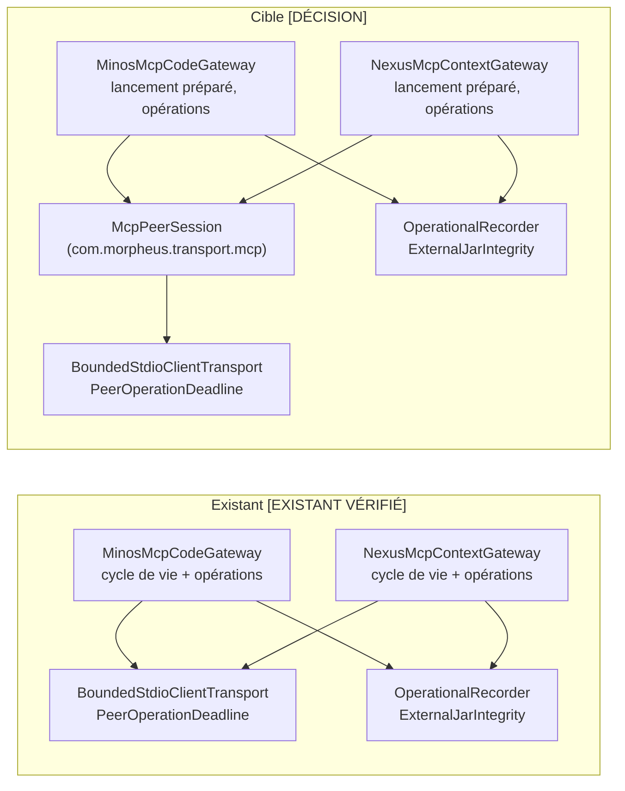

# Conception : partager un seul cycle de vie entre les deux passerelles MCP

## Contexte

Motivation : voir `proposal.md`, section Why. État relu le 2026-11-06 sur `30520bd3`, par lecture intégrale de
`morpheus-integration-minos/src/main/java/com/morpheus/integration/minos/MinosMcpCodeGateway.java` et de
`morpheus-integration-nexus/src/main/java/com/morpheus/integration/nexus/NexusMcpContextGateway.java`, puis `diff` des
deux fichiers après remplacement de `MINOS`/`Minos`/`minos` et `NEXUS`/`Nexus`/`nexus` par un même nom.

- `[EXISTANT VÉRIFIÉ]` Longueurs des deux fichiers identiques à celles du constat (relevé du jour) ; aucune source
  principale des deux modules n'a changé depuis la mesure de l'audit.
- `[EXISTANT VÉRIFIÉ]` Les deux passerelles importent `OperationalRecorder` et `SuppressedFailureFamily`
  (`application.operability`), `ExternalJarIntegrity` (`application.security`) et, du transport,
  `BoundedStdioClientTransport`, `McpPeerLaunch`, `PeerOperationDeadline` ; du SDK, `McpClient`, `McpSyncClient`,
  `McpJsonDefaults`, `CallToolRequest`, `TextContent`.
- `[EXISTANT VÉRIFIÉ]` `morpheus-mcp-transport` dépend de `mcp-core`, `reactor-core`, `reactive-streams` et
  `mcp-json-jackson3` (son `pom.xml`) : `McpClient`, `McpSyncClient` et `McpJsonDefaults` y sont disponibles. Il ne
  dépend d'aucun module MORPHEUS (`AdapterCompositionRootArchitectureTest#theMcpTransportDependsOnNoOtherMorpheusPackage`,
  ARCH-0162 décision 3). Il remet déjà le comptage à la passerelle par des observateurs : `BoundedStdioClientTransport`
  reçoit un `Consumer<Throwable>` (`processTreeFailures`), `PeerOperationDeadline.arm` un `Runnable` (`countingAbort`).
- `[EXISTANT VÉRIFIÉ]` `OperationalRecorder.suppressing(famille)` rend un `Consumer<Throwable>` qui appelle
  `suppressed(famille, échec)` (`OperationalRecorder.java:42-45`) : un observateur remis au socle compte exactement
  comme l'appel direct d'aujourd'hui.
- `[EXISTANT VÉRIFIÉ]` Épinglages textuels qui lisent les deux fichiers :
  `SilentCatchArchitectureTest#theModulesThatCannotCountAreHandedWhatDoes` (`processTreeFailures(launch.recorder()));`
  et `return recorder.suppressing(SuppressedFailureFamily.MCP_PEER_PROCESS_TREE);`),
  `ExternalCodeTrustBoundaryArchitectureTest#noMcpLaunchPathTakesThePeerEnvironmentFromTheSdkParameters` (texte
  `McpPeerLaunch`, absence de `getEnv(`, règle sur `ServerParameters` pour les classes déclarées dans
  `BoundedStdioClientTransport`, `MinosMcpCodeGateway`, `NexusMcpContextGateway`),
  `UnreachableSecurityBranchArchitectureTest#anMcpPeerIsLaunchedFromItsVerifiedCopyOrNotAtAll`
  (`Path launchJar = staged.orElseThrow();`) et `ProductionIntegrityContractTest#theHandlerSafetyBoundOutlastsTheLongestPeerOperation`
  (`REQUESTS_PER_OPERATION` de chaque passerelle).
- `[EXISTANT VÉRIFIÉ]` Tests jumeaux par passerelle : `MinosSuppressedFailureTraceTest` / `NexusSuppressedFailureTraceTest`
  (`deleteStagedCounting`, `processTreeFailures`, `countingAbort`), `MinosMcpTransportIntegrationTest` /
  `NexusMcpTransportIntegrationTest` (`requireBoundedResponse`), `MinosMcpOperationDeadlineTest` /
  `NexusMcpOperationDeadlineTest`.
- `[EXISTANT VÉRIFIÉ]` `McpPeerSettingsResolutionArchitectureTest` compare les réglages des deux pairs sur une table de
  configurations ; c'est le patron que l'action du constat cite. Le changement vivant
  `resolve-both-mcp-peers-through-one-settings-resolver` (lu, non touché) a placé le résolveur de réglages dans
  `morpheus-application` et écarté le transport parce que la vérification du pin aurait dû lui être passée en
  fonction ; il a mis les passerelles hors de son périmètre (« really differ »).

## Comparaison des deux passerelles

Verdict par membre, après normalisation du nom du pair. « Identique » : texte égal au nom du pair près ; « divergent » :
contenu propre au pair. La dernière colonne dit où le membre vit après ce changement.

| Membre | Verdict | Pourquoi | Après |
|---|---|---|---|
| Constantes d'outils, `MINOS_SERVER_CLASS` | divergent | contrat de chaque pair (ADR-0128, décision 3) | passerelle |
| `MAX_MCP_RESPONSE_BYTES` | identique (même valeur) | même borne de réponse ; lue par les tests de chaque module | passerelle, passée au socle |
| `REQUESTS_PER_OPERATION` | divergent | nombre de requêtes propre à chaque pair ; épinglé par `ProductionIntegrityContractTest` | passerelle |
| `REQUIRED_TOOLS` | divergent en valeur, identique en usage | l'ensemble est propre au pair, la vérification ne l'est pas | valeur : passerelle ; vérification : socle |
| `MAX_SYMBOLS`, `MAX_PROJECTS`, `MAX_CONTEXT_ITEMS`, `MAX_EXCLUDED_ITEMS`, `MAX_METADATA_ENTRIES` | divergent | bornes des charges de chaque pair | passerelle |
| Champs `client`, `deadline`, `stagedJar`, `recorder` | identique | état d'une session ouverte | socle (session) ; la passerelle garde la session |
| `mapper` (`JsonMapper` sans `FAIL_ON_UNKNOWN_PROPERTIES`) | identique | trois lignes, au service de la lecture des charges, qui est propre au pair ; les mettre en commun serait une abstraction prématurée (`.claude/rules/code-style.md`) | passerelle |
| Constructeur public `(réglages, enregistreur)` | identique après renommage | une ligne typée par les réglages du pair | passerelle |
| Constructeurs de paquet `(commande, arguments, environnement, délai[, échéance], enregistreur)` | identique après renommage | points d'entrée des tests de chaque module | passerelle, délèguent au socle |
| Constructeur privé `(Launch)` : `initialize`, `listTools`, vérification des outils, nettoyage sur échec, traduction de l'échéance | identique après renommage | seuls `REQUIRED_TOOLS` et le type d'exception varient | socle (ouverture) |
| Opérations publiques (`indexStatus`, `findSymbols` / `listProjects`, `buildContext`) et `symbol` / `item` | divergent | contrat et charges de chaque pair | passerelle |
| `close()` | identique (seul le commentaire diffère) | séquence échéance → fermeture → suppression comptée | socle |
| `call(outil, arguments)` | identique après renommage | appel, réponse bornée, erreur, charge vide, échéance | socle |
| `requireBoundedResponse`, `text` | identique après renommage | contrôles de la réponse d'un outil | socle |
| `requireCardinality` | NEXUS seulement | borne de ses charges | passerelle NEXUS |
| `launch(réglages, enregistreur)` | identique sauf la forme des arguments (`-cp <copie> <classe>` contre `-jar <copie>`) et le nom de la propriété du répertoire de travail | porte `ExternalJarIntegrity.stageVerifiedCopy`, un type de l'application, et l'invariant épinglé `Path launchJar = staged.orElseThrow();` | passerelle ; son nettoyage sur échec appelle le socle |
| `buildClient` | identique après renommage | construction du transport borné et du client | socle |
| `deadlineExceeded` | identique après renommage | message de dépassement | socle |
| `closeStartedSuppressing`, `deleteStagedSuppressing` | identique | nettoyage attaché à l'échec primaire | socle |
| `deleteStagedCounting` | identique | nettoyage compté (`STAGED_ARTIFACT_CLEANUP`) | socle, avec observateur |
| `processTreeFailures` | identique | une ligne qui construit l'observateur sur l'enregistreur ; nomme `SuppressedFailureFamily`, que le socle ne peut pas voir | passerelle |
| `countingAbort` | identique | compte l'échec d'un abandon puis le propage | socle, avec observateur |
| `requireText` | identique | NEXUS ne l'emploie que pour `Launch` ; MINOS aussi pour ses arguments d'outil | `Launch` : socle ; MINOS garde le sien pour ses arguments |
| Record `Launch` | identique | description d'un lancement : commande (rognée), arguments, environnement, délai, échéance, copie normalisée | socle, sans l'enregistreur |
| Records de charge | divergent | charges de chaque pair | passerelle |

Conclusion `[EXISTANT VÉRIFIÉ]` : ce qui diverge se limite aux contrats des pairs (outils, charges, bornes), au nombre de
requêtes par opération et à la forme de la commande de lancement. Le reste est identique au nom du pair près.

## Exigences couvertes

| Capacité | Exigence (titre exact) | Rubriques de conception qui y répondent |
|---|---|---|
| `mcp-peer-gateway-lifecycle` | Le cycle de vie d'un client de pair MCP existe une fois | Comparaison, D1, D3, Traitements |
| `mcp-peer-gateway-lifecycle` | Le socle du cycle de vie ne connaît aucun type MORPHEUS | D1, D2 |
| `mcp-peer-gateway-lifecycle` | Le comportement observable des deux passerelles est conservé | D2, D3, D4 |
| `mcp-peer-gateway-lifecycle` | Une passerelle ne refait pas le cycle de vie | D5 |

## Composants et frontières

Question : quelles classes portent le cycle de vie avant et après, et quelles dépendances chacune garde-t-elle ?



Explication : le socle `McpPeerSession` (nom proposé) entre dans le paquet du transport et ne dépend que de lui et du
SDK ; les passerelles gardent seules les types de l'application. Exigences : les deux premières de la capacité.

## Traitements et interactions

Question : comment une opération traverse-t-elle le socle, et qui compte quoi quand elle échoue ?

```mermaid
sequenceDiagram
    participant G as Passerelle (MINOS ou NEXUS)
    participant S as McpPeerSession
    participant D as PeerOperationDeadline
    participant P as Pair MCP
    G->>G: launch(réglages) : copie vérifiée, arguments propres au pair
    G->>S: open(lancement, pair, observateurs)
    S->>D: arm(échéance, abandon compté)
    S->>P: initialize, tools/list
    alt outil requis absent
        S->>S: fermer le client, supprimer la copie (échecs attachés en supprimés)
        S-->>G: exception du pair « … incompatible; required tools missing »
    else échéance expirée
        S-->>G: exception du pair « … exceeded its n ms deadline »
    else ouvert
        S-->>G: session
    end
    G->>S: call(outil, arguments)
    S->>P: tools/call
    alt erreur, charge vide, réponse trop grande, plus d'un contenu
        S-->>G: exception du pair, message inchangé
    else
        S-->>G: texte de la charge
        G->>G: lecture de la charge, propre au pair
    end
    G->>S: close()
    S->>D: close()
    S->>P: closeGracefully (échec compté MCP_PEER_SHUTDOWN)
    S->>S: supprimer la copie (résidu compté STAGED_ARTIFACT_CLEANUP)
```

Cible. Exigences : les trois premières de la capacité. L'existant suit la même séquence, dupliquée dans chaque passerelle.

## Contrats d'interface

Sans objet : aucune surface publique ne change ; la commande de lancement de chaque pair reste celle d'ADR-0128.

Modèle de domaine, états, persistance, transactions, performance : sans objet, le changement déplace du code sans
changer les échéances (`PeerOperationDeadline.of`, inchangé) ni les bornes.

## Sécurité et isolation

Le pair est toujours lancé depuis sa copie vérifiée, préparée par la passerelle (épinglage de
`UnreachableSecurityBranchArchitectureTest` inchangé). L'environnement du pair reste celui de `McpPeerLaunch`, construit
par la passerelle ; la règle sur `ServerParameters` d'`ExternalCodeTrustBoundaryArchitectureTest` s'étend au socle.

## Gestion des erreurs et reprise

Les échecs gardent leur type (celui de la passerelle) et leur message. Les échecs de nettoyage restent attachés à
l'échec primaire (`addSuppressed`) ou comptés, comme aujourd'hui ; aucun n'est perdu.

## Compatibilité, migration et retour arrière

Aucune donnée ni contrat à migrer. Retour arrière : revenir sur le changement.

## Décisions

### D1 : le socle vit dans `morpheus-mcp-transport`
- **Nature** : [DÉCISION]
- **Exigences servies** : `mcp-peer-gateway-lifecycle` › Le cycle de vie d'un client de pair MCP existe une fois ;
  › Le socle du cycle de vie ne connaît aucun type MORPHEUS.
- **Choix** : une classe publique `McpPeerSession` dans `com.morpheus.transport.mcp`, à côté de
  `BoundedStdioClientTransport` et `PeerOperationDeadline`, qu'elle compose.
- **Alternatives écartées** :
  - `morpheus-application` : le cœur ne lance pas de processus et ne dépend pas du SDK MCP (ADR-0150), et
    `applicationMustNotDependOnAdapters` lui interdit `com.morpheus.transport..` ;
  - un module dédié qui verrait l'application et le transport : il garderait `OperationalRecorder` et la préparation
    de la copie, mais coûte une entrée de réacteur, de `ModulePackageCorrespondenceTest`, d'`AdapterSiblingArchitectureTest`
    et de la population de couverture pour une classe ;
  - une passerelle dépendant de l'autre : les adaptateurs sont frères (ADR-0128, décision 1) ;
  - deux copies tenues égales par un test de parité : c'est l'état actuel avec un meilleur test, écarté pour les mêmes
    raisons que dans `resolve-both-mcp-peers-through-one-settings-resolver`.
  L'objection que ce changement vivant opposait au transport (le pin passé en fonction) ne s'applique pas ici : la
  préparation de la copie vérifiée reste dans la passerelle, et le socle reçoit une copie déjà vérifiée.
- **Compromis** : le module du transport gagne la notion de session de pair ; le comptage lui arrive par trois
  observateurs.
- **ADR** : non concerné (question 3 du filtre : déplacer une classe se renverse sans casser donnée ni contrat).
  ARCH-0162, décision 3, reste vrai. ADR-0128, décision 3, dit que « l'adaptateur liste les outils du pair » : la
  passerelle garde la liste et le socle la vérifie ; clarifier ce texte sans en changer le sens si la revue le juge
  trompeur.

### D2 : ce que la passerelle remet au socle
- **Nature** : [DÉCISION]
- **Exigences servies** : › Le socle du cycle de vie ne connaît aucun type MORPHEUS ; › Le comportement observable des
  deux passerelles est conservé.
- **Choix** : la passerelle remet le nom du pair (`MINOS`, `NEXUS`), ses outils requis, sa borne de réponse, un
  lancement (`McpPeerLaunch`, délai de requête, échéance d'opération, copie vérifiée facultative), une fabrique de son
  exception (message, cause facultative), et trois observateurs `Consumer<Throwable>` construits par
  `recorder.suppressing(...)` pour `MCP_PEER_SHUTDOWN`, `STAGED_ARTIFACT_CLEANUP` et `MCP_PEER_PROCESS_TREE`. Le socle
  rend les exceptions de la passerelle ; celles qu'il lève lui-même ne sont pas réemballées par son propre `call`.
- **Alternatives écartées** : une exception propre au socle que chaque passerelle traduirait — chaque appel garderait
  un `catch` de traduction, et les tests qui attendent `MinosIntegrationException` ou `NexusIntegrationException`
  changeraient ; passer l'`OperationalRecorder` — interdit par la règle du transport.
- **Compromis** : une fabrique et trois observateurs à l'ouverture ; `processTreeFailures` reste une ligne dans
  chaque passerelle, parce qu'elle nomme `SuppressedFailureFamily`.
- **ADR** : non concerné.

### D3 : ce qui reste dans chaque passerelle
- **Nature** : [DÉCISION]
- **Exigences servies** : › Le cycle de vie d'un client de pair MCP existe une fois ; › Le comportement observable des
  deux passerelles est conservé.
- **Choix** : les membres « passerelle » du tableau de comparaison : constantes d'outils, `REQUESTS_PER_OPERATION`,
  bornes des charges, `mapper`, constructeurs, opérations et records de charge, `launch` (préparation de la copie et
  forme de la commande), `processTreeFailures`, et le `requireText` de MINOS pour ses arguments d'outil.
- **Alternatives écartées** : mettre `launch` en commun en paramétrant la forme des arguments — sa seule part commune
  est la préparation de la copie, qui appelle `ExternalJarIntegrity` (application), et son épinglage de sécurité vise
  chaque passerelle ; mettre `mapper` en commun — trois lignes (`code-style.md`).
- **Compromis** : la préparation de la copie (dix lignes, dont la traduction de l'échec d'intégrité) reste écrite deux
  fois ; sa suppression sur échec appelle le socle.
- **ADR** : non concerné.

### D4 : la parité est structurelle, et les tests de chaque passerelle restent
- **Nature** : [DÉCISION]
- **Exigences servies** : › Le comportement observable des deux passerelles est conservé.
- **Choix** : la parité tient parce qu'il n'existe plus qu'une implémentation, ce que la règle de D5 garde ; les tests
  du socle (ouverture, outil absent, échéance, erreur d'outil, charge vide, réponse trop grande, fermeture, résidu
  compté, abandon compté) s'écrivent dans `morpheus-mcp-transport` sur ses pairs de test (`FixtureBoundedMcpServer` et
  voisins) ; les tests existants de chaque passerelle restent, attentes inchangées, et prouvent que chacune remet les
  bons observateurs et le bon nom.
- **Alternatives écartées** : un test de parité comportementale dans `morpheus-architecture-tests`, sur le patron de
  `McpPeerSettingsResolutionArchitectureTest` — il lui faudrait lancer un vrai pair MCP pour chaque passerelle par
  leurs constructeurs publics, avec un JAR épinglé, là où les pairs de test vivent dans les sources de test des
  modules ; supprimer les tests jumeaux — ferait baisser les ratchets de présence.
- **Compromis** : les tests jumeaux restent jumeaux ; ils testent désormais un câblage, plus une implémentation.
- **ADR** : non concerné.

### D5 : règle ArchUnit qui refuse la réapparition d'une copie
- **Nature** : [DÉCISION]
- **Exigences servies** : › Une passerelle ne refait pas le cycle de vie.
- **Intention** : « aucune classe des intégrations ne construit le client MCP, n'arme l'échéance, ni ne nettoie la
  copie vérifiée elle-même, et toute classe qui décrit un lancement de pair passe par le socle ». Ce sont des
  dépendances et des appels compilés, donc **ArchUnit**. Les cibles (`McpClient`, `McpSyncClient`,
  `BoundedStdioClientTransport`, `PeerOperationDeadline.arm`, `Files.deleteIfExists`, `Throwable.addSuppressed`) ne
  portent aucune constante de compilation que l'interdit viserait, et les deux modules d'intégration sont dans
  l'ensemble importé (`morpheus-architecture-tests/pom.xml`) : le texte n'ajouterait rien.
- **Choix** : une classe `McpPeerGatewayLifecycleArchitectureTest` avec deux règles : `noClasses()` de
  `com.morpheus.integration..` vers ces types et appels ; et toute classe de `com.morpheus.integration..` qui dépend
  de `McpPeerLaunch` dépend de `McpPeerSession`. Aucune liste de classes de production : sélection par paquet et par
  dépendance.
- **Alternatives écartées** : un scan textuel des deux fichiers — il nommerait les fichiers par leur chemin, verrait la
  mention et pas l'appel, et raterait une troisième passerelle ; une liste des passerelles — serait une table de faits
  de plus, quand la dépendance à `McpPeerLaunch` les désigne d'elle-même.
- **Compromis** : un appel légitime futur à `Files.deleteIfExists` dans une intégration devrait passer par le socle ou
  justifier une règle réécrite.
- **ADR** : non concerné.

## Écarts constatés

| Constat | Source A | Source B | Traitement proposé |
|---|---|---|---|
| Les passerelles « really differ » | `design.md` de `resolve-both-mcp-peers-through-one-settings-resolver` (non-objectifs) | comparaison ci-dessus | la divergence est bornée aux contrats des pairs ; ce changement-là reste intact, son non-objectif ne visait que son propre périmètre |
| Le paquet du transport y est nommé `com.morpheus.integration.mcp` (ancien nom) | `design.md` du même changement (Contexte) | `morpheus-mcp-transport/src/main/java/com/morpheus/transport/mcp/` | signalé seulement ; ce changement n'y touche pas |
| `requireText` de NEXUS ne sert qu'à `Launch` | constat (le bloc commun « porte requireText ») | `NexusMcpContextGateway.java:338-343`, appelé à `:355` seulement | sans conséquence : `Launch` passe au socle |
| `Launch` rogne la commande, `McpPeerLaunch` ne fait que refuser une commande vide | `Launch` (`requireText`) | `McpPeerLaunch.java` | le socle garde le rognage, pour ne rien changer (D2) |

## Stratégie de vérification

| Exigence | Scénario | Preuve | État |
|---|---|---|---|
| Le cycle de vie … existe une fois | Les deux passerelles ouvrent leur pair par le même socle | `McpPeerGatewayLifecycleArchitectureTest` (règle de passage par le socle) ; `MinosMcpTransportIntegrationTest`, `NexusMcpTransportIntegrationTest` verts | à écrire / existant |
| idem | Un pair auquel il manque un outil requis | `McpPeerSessionTest` (transport) ; tests d'incompatibilité existants des passerelles | à écrire / existant |
| Le socle … aucun type MORPHEUS | les deux scénarios | `theMcpTransportDependsOnNoOtherMorpheusPackage` ; `McpPeerSessionTest` (observateurs) ; `MinosSuppressedFailureTraceTest`, `NexusSuppressedFailureTraceTest` retargetés sur le câblage | existant / à écrire |
| Le comportement observable … conservé | Une opération qui dépasse son échéance | `MinosMcpOperationDeadlineTest`, `NexusMcpOperationDeadlineTest`, attentes inchangées | existant |
| idem | Un outil qui rend une erreur ou une charge vide | `McpPeerSessionTest` ; tests existants des passerelles | à écrire / existant |
| Une passerelle ne refait pas le cycle de vie | les deux scénarios | `McpPeerGatewayLifecycleArchitectureTest`, rouge avant le correctif sur les deux passerelles ; violation plantée puis retirée | à écrire |

## Documentation durable et diagrammes à mettre à jour

- `docs/developer/specifications/mcp-peer-gateway-lifecycle.md` (nouvelle, avec le tableau de comparaison réduit à
  la répartition finale et les deux diagrammes) et sa ligne dans `docs/developer/specifications/README.md`.
- ADR-0128 : clarification éventuelle de la décision 3 (D1), sans changement de sens.

## Questions ouvertes

- Module dédié aux clients de pairs plutôt que le transport (D1) : à confirmer par le mainteneur ; la conception
  retient le transport.
- Nom du socle : `McpPeerSession` est proposé ; la revue peut en préférer un autre sans changer la conception.
