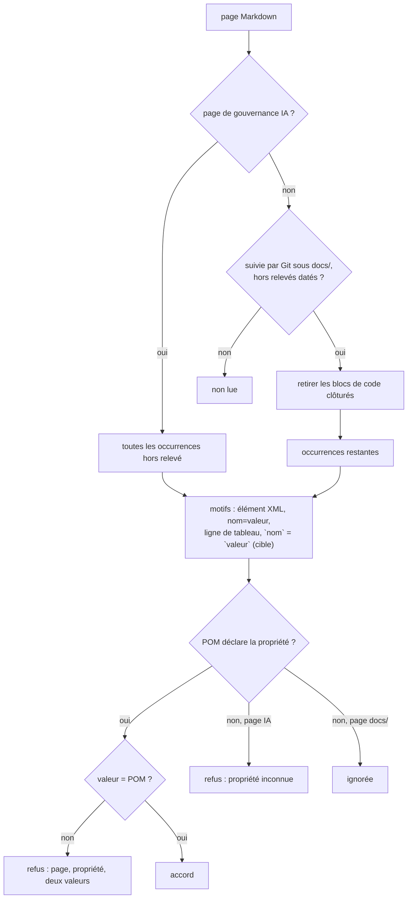

# Conception : comparer aux propriétés du POM toute page vivante de `docs/`

Conception allégée : contrôle documentaire de la suite d'architecture, sans code de production.

## Contexte

- [EXISTANT VÉRIFIÉ] `GovernanceSurfaceCoherenceTest` (`@CoherenceCheck`) :
  `everyVersionAGovernancePageWritesAsAPomPropertyEqualsThePom` parcourt `activeGovernanceSurfaces(root)`, extrait par
  `statedVersions` les occurrences de `VERSION_PROPERTY_ELEMENT` et `VERSION_PROPERTY_ASSIGNMENT`, puis
  `requireAgreement` refuse une valeur différente du POM **et** une propriété que le POM ne déclare pas. Un scan qui ne
  lit rien échoue (`aVersionScanThatReadsNothingFailsInsteadOfPassing`).
- [EXISTANT VÉRIFIÉ] `activeGovernanceSurfaces` refuse une surface déclarée absente ou vide : la liste des pages IA est
  un corpus complet, gardé tel quel.
- [EXISTANT VÉRIFIÉ] Formes d'origine du constat, antérieures à `91bb2d86` : ligne de tableau
  `| \`spotbugs.maven.plugin.version\` | \`4.10.4.1\` | … |` (`CODE_AUDIT.md`) et
  `` `spotbugs.maven.plugin.version` = `4.10.4.1` `` en cellule (`SPOTBUGS.md`). Aucun des deux motifs ne les lit.
- [EXISTANT VÉRIFIÉ] Balayage du 11/11/2026 des pages vivantes de `docs/` par les deux motifs existants : deux
  occurrences, `data.version=5.6` (`docs/architecture/risks/register.md:158`, propriété de Dependency-Check) et
  `plugin.version=1.0.0` (`docs/developer/PROVIDER_SDK.md:84`, dans un bloc ```` ```properties ````). Les rapports de
  `docs/project/rapport-supervisor/` sont ignorés par Git (`.gitignore` local du dossier).
- [EXISTANT VÉRIFIÉ] `.claude/rules/testing.md` : un parcours de l'arbre du dépôt passe par `RepositoryTree.files(root)` ;
  `RepositoryTreeOwnershipTest` refuse un `Files.walk` de la racine ailleurs.

## Exigences couvertes

| Capacité | Exigence (titre exact) | Rubriques de conception qui y répondent |
|---|---|---|
| `dependency-version-management` | Une version qu'une page vivante de `docs/` écrit sous la forme d'une propriété du POM DOIT égaler la valeur de cette propriété | D1, D2, D3 |
| `dependency-version-management` | Une version écrite en ligne de tableau ou en égalité de spans de code est une version écrite sous la forme d'une propriété | D4 |

## Traitements et interactions

Question : quelle occurrence d'une page est comparée, et à quelle condition ?



Existant : la branche « page de gouvernance IA » avec les deux premiers motifs. Cible : la branche `docs/`, le retrait
des blocs clôturés, les deux motifs ajoutés, et l'ignorance d'une clé inconnue dans `docs/`. Sert les deux exigences.

## Décisions

### D1 : portée par la règle, pas par une liste de pages
- **Nature** : [DÉCISION]
- **Exigences servies** : `dependency-version-management` › Une version qu'une page vivante de `docs/` écrit …
- **Choix** : toute page `.md` sous `docs/` que `RepositoryTree.files` rend et que Git suit, moins les quatre dossiers de
  relevés datés que `.claude/rules/documentation.md` nomme déjà comme tels. Les pages de `docs/` ne rejoignent pas
  `activeGovernanceSurfaces` : elles forment un second corpus, sans exigence de complétude.
- **Alternatives écartées** : (a) ajouter `docs/developer/CODE_AUDIT.md` et `SPOTBUGS.md` à `GOVERNANCE_PAGES` — traite le
  cas, pas la portée, et la prochaine page vivante y échappe ; (b) une liste d'exemptions par fichier — rien ne la tient
  à jour.
- **Compromis** : un relevé daté rangé hors de ces quatre dossiers (section datée d'une page vivante) est lu ; il devra
  écrire la propriété en prose ou dans un bloc clôturé.
- **ADR** : non concerné.

### D2 : un bloc de code clôturé est une transcription, pas un énoncé
- **Nature** : [DÉCISION]
- **Exigences servies** : même exigence, scénario « Une transcription dans un bloc de code clôturé »
- **Choix** : dans les pages de `docs/`, le texte entre deux clôtures ```` ``` ```` est retiré avant la lecture. Les pages
  de gouvernance IA gardent leur lecture actuelle (aucune n'en a besoin, et `build.md` écrit la version de référence
  dans un bloc XML).
- **Alternatives écartées** : exempter des fichiers entiers qui contiennent des transcriptions — retirerait aussi leurs
  tableaux vivants.
- **ADR** : non concerné.

### D3 : dans `docs/`, seule une propriété déclarée par le POM est comparée
- **Nature** : [DÉCISION]
- **Exigences servies** : même exigence, scénario « La clé d'un autre artefact »
- **Choix** : une clé `*.version` que le POM racine ne déclare pas est ignorée dans `docs/` ; elle reste refusée sur les
  pages de gouvernance IA.
- **Alternatives écartées** : refuser toute clé inconnue partout — `docs/` décrit légitimement des propriétés d'autres
  artefacts (`data.version` de Dependency-Check, manifeste de plugin) ; une marque d'exemption — une syntaxe de plus pour
  un cas sans risque.
- **Compromis** : dans `docs/`, une propriété retirée du POM et laissée sur une page n'est plus vue. Le cas d'origine
  (valeur restée en arrière d'une propriété vivante) est vu.
- **ADR** : non concerné.

### D4 : deux motifs ajoutés, communs à toutes les pages
- **Nature** : [DÉCISION]
- **Exigences servies** : `dependency-version-management` › Une version écrite en ligne de tableau ou en égalité de spans de code …
- **Choix** : (a) ligne de tableau dont une cellule est exactement un span de code `nom.version` et une cellule
  suivante exactement un span de code de valeur (premier caractère chiffré) ; (b) `` `nom.version` = `valeur` ``. Prouvés
  sur exemples dans `bothShapesOfAVersionAreComparedAndAPropertyThePomDoesNotDeclareIsRefused`, étendu ou doublé d'une
  méthode sœur, y compris le tableau `| Propriété | Rôle |` qui ne doit rien lire.
- **Alternatives écartées** : relier une version en prose à la propriété la plus proche — heuristique fragile ; la règle
  de `build.md` (citer la propriété, pas la valeur) couvre la prose.
- **ADR** : non concerné.

## Écarts constatés

| Constat | Source A | Source B | Traitement proposé |
|---|---|---|---|
| L'audit dit que le gate « sait comparer exactement cette forme » ; aucun motif ne lit les formes d'origine | `docs/project/audits/2026-10-09/reverification-2026-11-10.md` | `GovernanceSurfaceCoherenceTest.java:65-69` | D4 ; le relevé daté n'est pas réécrit |
| Le cas `AUD-QUA-23` est déjà corrigé dans les pages | constat (10/11) | `91bb2d86` | le changement ne traite que le mécanisme |

## Stratégie de vérification

| Exigence | Scénario | Preuve | État |
|---|---|---|---|
| Une version qu'une page vivante de `docs/` … | Un bump qui ne touche que le POM | méthode sur le dépôt réel + violation plantée : remettre `4.10.4.1` dans `CODE_AUDIT.md`, échec constaté, retour arrière | à écrire |
| idem | relevé daté / bloc clôturé / clé d'un autre artefact / fichier non suivi | test sur corpus temporaire (`@TempDir`, dépôt Git initialisé ou liste de fichiers suivis simulée) | à écrire |
| Une version écrite en ligne de tableau … | les trois scénarios | test sur exemples (chaînes) | à écrire |

## Documentation durable et diagrammes à mettre à jour

- `docs/developer/specifications/dependency-version-management.md` : deux exigences, diagramme ci-dessus, matrice.
- `.claude/rules/build.md`, paragraphe « Toute version écrite sur une page de gouvernance IA … » : portée étendue aux
  pages vivantes de `docs/`, formes lues, prose toujours non comparée.

## Questions ouvertes

Aucune.
