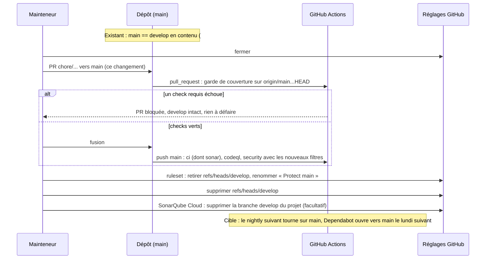

# Conception : une seule branche longue, `main`

Changement d'outillage et de processus : aucun module Java de production, aucune surface publique, aucun schéma ne
bouge. La conception est allégée. Les rubriques qui restent sont celles où une erreur casserait la CI ou la bascule.

## Contexte

- [EXISTANT VÉRIFIÉ] Le ruleset `20792822` « Protect main & develop » inclut `~DEFAULT_BRANCH` et
  `refs/heads/develop`. Il interdit suppression et force-push, exige une pull request et quatre checks requis en mode
  strict : `exact-head (ubuntu-latest)`, `exact-head (windows-latest)`, `dependency-check (ubuntu-latest)` et
  `java (ubuntu-latest)`. La branche par défaut est `main`, et `delete_branch_on_merge` est actif (lu par `gh api` le
  11/11/2026).
- [EXISTANT VÉRIFIÉ] `ci.yml` se déclenche sur `push` de `main` et `develop` et sur toute `pull_request`. Sa garde de
  couverture des lignes modifiées connaît deux bases, `develop` et `main`, et refuse toute autre base (`exit 2`). Son
  job `sonar` ne tourne que sur `push` de `main`, sans nommer de branche.
- [EXISTANT VÉRIFIÉ] Neuf jobs de `nightly.yml` épinglent `develop` sur planification : `sonar-develop`,
  `macos-smoke`, `m19-budgets`, `release-rehearsal`, `release-rehearsal-assets`, `windows-validators`,
  `validators-without-a-lane`, `spotbugs-report` et `pit-mutation`. Les sept jobs « dispatched ref, or develop on a
  schedule » utilisent `github.event_name == 'schedule' && 'develop' || github.ref`. Un workflow planifié tourne sur
  la branche par défaut, donc `github.ref` y vaut déjà `refs/heads/main`.
- [EXISTANT VÉRIFIÉ] `scripts/classify-sonar-quality-gate.sh` porte une exemption `UNREADABLE_OFF_MAIN` : un HTTP 403
  sur la lecture du portail d'une branche nommée autre que `main` devient un verdict inconnu, et non un échec. Seul
  `sonar-develop` nomme une branche (`SONAR_BRANCH_NAME: develop`).
- [EXISTANT VÉRIFIÉ] `release.yml` refuse un tag non atteignable depuis `main` (étapes « Verify tag belongs to main »)
  et appelle `validate-m28.ps1 -BaseRef origin/main`.
- [EXISTANT VÉRIFIÉ] Le cache Dependency-Check est écrit par les événements de confiance (`push`, `schedule`,
  `workflow_dispatch`) et restauré par les pull requests depuis leur branche de base. Une pull request vers `main`
  restaure donc le cache de `main`, comme #631 l'a montré le 11/11/2026 (base vieille de 209 h).

## Exigences couvertes

| Capacité | Exigence (titre exact) | Rubriques de conception qui y répondent |
|---|---|---|
| `single-integration-branch` | Aucune configuration versionnée ne DOIT nommer une branche d'intégration autre que main | D1, D6 |
| `single-integration-branch` | Toute pull request DOIT être comparée à main pour la couverture des lignes modifiées | D2 |
| `single-integration-branch` | Chaque fusion dans main DOIT recevoir une analyse statique | D3 |
| `single-integration-branch` | Dependabot DOIT viser la branche par défaut | D1 |
| `single-integration-branch` | La base de comparaison par défaut d'un validateur DOIT être main | D4 |
| `gate-reachability` | The M19 budget gates SHALL run on a schedule on both platforms and a missed budget SHALL fail the run | D5 |
| `gate-reachability` | The release build SHALL be rehearsed on a schedule on both platforms and a failed rehearsal SHALL fail the run | D5 |
| `vulnerability-feed-freshness` | The alert SHALL come after the scan and SHALL NOT block by name | D7 |

## Composants et frontières

Fichiers touchés, par famille :

| Famille | Fichiers | Nature de la modification |
|---|---|---|
| Workflows | `ci.yml`, `codeql.yml`, `security.yml`, `nightly.yml`, `release.yml` | filtres `branches: [main]`, garde de couverture à une base, `nightly.yml` sans `sonar-develop` et sans épinglage, commentaires au présent alignés |
| Dependabot | `.github/dependabot.yml` | retrait des deux `target-branch: develop` |
| Validateurs | `scripts/validate-{d2,m25,m26,m27}.{ps1,sh}` (base et repli), `scripts/validate-{m28,r2,r3}.{ps1,sh}` (base) | `origin/main` par défaut, `main` en repli, messages qui nomment les deux |
| Sonar | `scripts/classify-sonar-quality-gate.sh` et `scripts/tests/test_classify_sonar_quality_gate.py` | retrait de l'exemption `UNREADABLE_OFF_MAIN` (D3) |
| Tests des scripts | `scripts/tests/{test_validator_verdicts,test_validator_entry_refusals,test_validate_dispatcher,validator_harness}.py` | dépôts fabriqués sur `main` au lieu de `develop`. `test_dependency_check_scripts.py` et `test_write_build_provenance.py` passent une branche en donnée : `main` |
| Tests d'architecture | `D2RepositoryHardeningArchitectureTest`, `AuditHardeningWorkflowContractTest`, `SonarQualityGateClassificationContractTest` | assertions réécrites (D6), une méthode ajoutée (D1) |
| Configuration d'agents | `.archgate/config.json` (`baseBranch`), `.claude/settings.json`, `.claude/hooks/pre-bash.ps1`, `.claude/rules/{build,governance}.md`, `.claude/skills/coverage-ratchet/SKILL.md` | `develop` retiré des phrases au présent et des listes de protection |
| Documentation vivante | voir « Documentation durable » | phrases au présent réécrites, relevés datés intacts |

Frontière : aucune règle de couche n'est concernée. Les assertions sur les `.yml` restent textuelles, puisque le
texte est la seule prise sur ces fichiers (`.claude/rules/architecture.md`, « Règle ArchUnit ou assertion
textuelle »).

## Traitements et interactions

Question : dans quel ordre basculer sans fenêtre où une pull request, un workflow ou une protection pointe vers une
branche absente ?

Tant que la pull request n'est pas fusionnée, `develop` et ses workflows restent intacts, et un échec ne laisse rien
à défaire. La suppression de `develop` vient en dernier, puisque le ruleset l'interdit tant qu'il l'inclut. Entre la
fusion et la suppression, `develop` existe sans qu'aucune pull request ni aucun workflow ne la vise.

## Sécurité et isolation

- [DÉCISION] `SONAR_TOKEN` ne vit plus que dans le job `sonar` de `ci.yml`, qui ne tourne que sur un push de `main`,
  c'est-à-dire sur du code déjà fusionné. Retirer `sonar-develop` supprime le second porteur du jeton et sa garde
  `github.ref_name == 'main' || github.ref_name == 'develop'`. La surface du secret diminue.
- [EXISTANT VÉRIFIÉ] La clé NVD n'est lue que par les événements de confiance de `security.yml`. Le changement ne
  touche pas ce chemin, seulement le filtre de branches.
- [DÉCISION] Les protections contre force-push et suppression de `.claude/settings.json` et de `pre-bash.ps1` gardent
  `main` et `master`. `develop` en sort (voir Questions ouvertes de la proposition). Le hook reste en ASCII pur et se
  teste après édition (`.claude/rules/tooling.md`).

## Compatibilité, migration et retour arrière

- Une pull request ouverte vers `develop` au moment de la suppression serait fermée par GitHub. Il n'y en a aucune
  hormis #632, que la bascule ferme.
- Retour arrière : recréer `develop` depuis `main`, revenir sur la pull request de ce changement, rétablir l'inclusion
  dans le ruleset. Rien n'est perdu : aucun historique ne vit seulement sur `develop` après #631.
- Les relevés datés qui citent `develop` (audits, `VALIDATION_*`, mesures de couverture « à `develop` … » dans les
  commentaires des gates et dans `.claude/rules/testing.md`) restent vrais à leur date et ne se réécrivent pas
  (`.claude/rules/documentation.md`, « Relevés datés »).
- Requalification de couverture : la méthode de `.claude/rules/testing.md` mesure deux runs d'un même SHA. Elle
  utilisait le run `push` de `develop` et le run de la pull request de promotion. Elle utilise désormais le run `push`
  de `main` et un run `workflow_dispatch` du même SHA, comme le 07/11/2026. La skill `coverage-ratchet` le dit.

## Décisions

### D1 : une règle textuelle refuse `develop` dans la configuration versionnée
- **Nature** : [DÉCISION]
- **Exigences servies** : `single-integration-branch` › Aucune configuration versionnée ne DOIT nommer une branche
  d'intégration autre que main ; Dependabot DOIT viser la branche par défaut
- **Choix** : une méthode ajoutée à `D2RepositoryHardeningArchitectureTest`, qui lit déjà les workflows. Elle lit
  `.github/workflows/*.yml`, `.github/dependabot.yml`, `scripts/validate-*.{ps1,sh}` et `.archgate/config.json`,
  cherche le mot `develop` en limite de mot (`\bdevelop\b`, donc ni `developer` ni `docs/developer/`), et nomme
  chaque fichier fautif. Une seconde assertion exige l'absence de `target-branch` dans `dependabot.yml`.
- **Alternatives écartées** : une classe nouvelle, qui devrait porter `@CoherenceCheck` puisqu'elle ne lit aucune
  source de production, et qui disperserait les contrats de workflow. Un scan de tout le dépôt, qui frapperait les
  relevés datés.
- **Compromis** : un commentaire au présent qui citerait `develop` dans un workflow serait refusé. C'est voulu, la
  phrase serait fausse.
- **ADR** : non concerné. Le filtre de `.claude/rules/adr.md` échoue à la troisième question : le retour arrière ne
  casse ni données, ni contrat, ni garantie de sécurité.

### D2 : la garde de couverture ne connaît plus qu'une base
- **Nature** : [DÉCISION]
- **Exigences servies** : `single-integration-branch` › Toute pull request DOIT être comparée à main pour la
  couverture des lignes modifiées
- **Choix** : le `case` de `ci.yml` garde la branche `main` et le refus `*)`. La branche `develop)` disparaît. Les
  minima `--minimum 0.80 --minimum-branch 0.70` ne bougent pas.
- **Alternatives écartées** : comparer à `origin/${BASE_REF}` pour toute base, ce qui accepterait silencieusement une
  base inconnue, alors que le refus nommé existe pour cela.
- **Compromis** : une future branche de maintenance devra ajouter sa base explicitement.
- **ADR** : non concerné.

### D3 : l'analyse SonarQube Cloud par fusion remplace l'analyse nocturne de `develop`
- **Nature** : [DÉCISION]
- **Exigences servies** : `single-integration-branch` › Chaque fusion dans main DOIT recevoir une analyse statique
- **Choix** : supprimer le job `sonar-develop` de `nightly.yml`. Le job `sonar` de `ci.yml` analyse chaque push sur
  `main`, qui est désormais chaque fusion. L'exemption `UNREADABLE_OFF_MAIN` du classificateur n'a plus de
  déclencheur : elle est retirée avec ses tests, et un 403 reste une erreur nommée.
- **Alternatives écartées** : garder une analyse nocturne de `main`, qui doublerait l'analyse par fusion. Garder
  l'exemption « au cas où », ce qui laisserait du code mort et une porte vers un verdict inconnu.
- **Compromis** : SonarQube Cloud garde une branche `develop` orpheline jusqu'à sa suppression manuelle.
- **ADR** : non concerné.

### D4 : les validateurs prennent `origin/main`, avec `main` en repli
- **Nature** : [DÉCISION]
- **Exigences servies** : `single-integration-branch` › La base de comparaison par défaut d'un validateur DOIT être
  main
- **Choix** : même forme qu'aujourd'hui, valeurs changées. Les messages d'échec nomment `origin/main` et `main`. La
  parité `.ps1`/`.sh` reste tenue par `GateReachabilityArchitectureTest`.
- **Alternatives écartées** : supprimer le repli, ce qui casserait un clone sans `origin`.
- **ADR** : non concerné.

### D5 : la planification de `nightly.yml` suit la branche par défaut
- **Nature** : [DÉCISION]
- **Exigences servies** : `gate-reachability` › les deux exigences modifiées
- **Choix** : les sept `ref: ${{ github.event_name == 'schedule' && 'develop' || github.ref }}` deviennent
  `ref: ${{ github.ref }}`. `macos-smoke` perd son `ref: develop`. L'en-tête de `nightly.yml` décrit une cadence
  bornée sur `main`.
- **Alternatives écartées** : retirer `ref:` entièrement, ce qui reviendrait au même mais effacerait l'intention
  écrite d'analyser le ref dispatché.
- **ADR** : non concerné.

### D6 : les assertions de workflow sont réécrites, aucune n'est perdue
- **Nature** : [DÉCISION]
- **Exigences servies** : toutes celles de `single-integration-branch`
- **Choix** :
  - `D2RepositoryHardeningArchitectureTest` : `branches: [main, develop]` devient `branches: [main]` pour
    `security.yml` et `codeql.yml`, et l'exigence `target-branch: develop` devient l'absence de `target-branch`.
  - `AuditHardeningWorkflowContractTest#developIsAnalysedOnABoundedCadenceInAWorkflowNoPullRequestCanReach` est
    renommée pour ce qu'elle tient désormais : `nightly.yml` ne porte aucun `SONAR_TOKEN`, n'a aucun déclencheur
    `pull_request`, garde sa planification, et `ci.yml` analyse chaque push sur `main`. Une méthode reste une méthode,
    donc `architectureTestsMinimum` ne baisse pas.
  - `SonarQualityGateClassificationContractTest` exige l'absence de `UNREADABLE_OFF_MAIN`, et qu'aucun workflow ne
    nomme `SONAR_BRANCH_NAME`.
- **Alternatives écartées** : supprimer les méthodes devenues sans objet, ce qui ferait baisser le compte et
  enfreindrait « jamais supprimer une règle sans la remplacer » (`.claude/rules/governance.md`).
- **Compromis** : la description de la pull request justifie chaque assertion modifiée, au titre des fichiers de
  gouvernance.
- **ADR** : non concerné.

### D7 : le ruleset est renommé, la spec suit
- **Nature** : [DÉCISION]
- **Exigences servies** : `vulnerability-feed-freshness` › The alert SHALL come after the scan and SHALL NOT block by
  name
- **Choix** : le mainteneur retire `refs/heads/develop` du ruleset `20792822` et le renomme « Protect main ». Les
  checks requis et le mode strict ne changent pas dans ce changement. La vérification reste manuelle (`gh api`).
- **Alternatives écartées** : garder le nom, qui mentirait sur ce que protège le ruleset.
- **ADR** : non concerné.

## Écarts constatés

| Constat | Source A | Source B | Traitement proposé |
|---|---|---|---|
| GEN-0133 décrit au présent une CI de « `develop` et `main` » | `docs/architecture/adr/GEN-0133-toolchain-java-21-et-maven-wrapper.md` | état cible | clarification du texte, sans changement de décision |
| Le commentaire du job `sonar` de `ci.yml` renvoie à `sonar-develop` | `ci.yml` | `nightly.yml` après D3 | commentaire réécrit au présent |
| `docs/developer/README.md` annonce « branche d'intégration develop » | page vivante | état cible | réécrite |

## Stratégie de vérification

| Exigence | Scénario | Preuve | État |
|---|---|---|---|
| Aucune configuration versionnée ne DOIT nommer… | Un workflow qui filtre encore develop est refusé | nouvelle méthode de `D2RepositoryHardeningArchitectureTest`, violation plantée (remettre `develop` dans un filtre, constater l'échec, revenir) | à écrire |
| Aucune configuration versionnée ne DOIT nommer… | Un mot qui contient develop n'est pas une branche | même méthode, `docs/developer/` présent dans les workflows | à écrire |
| Toute pull request DOIT être comparée à main… | Une pull request vers main est comparée à main ; Une pull request vers une autre base est refusée | `AuditHardeningWorkflowContractTest#pullRequestCoverageGateIncludesChangedBranches`, complétée : elle n'assertait que les minima, elle exige aussi `origin/main...HEAD` et `Unsupported pull-request base branch` + CI de la pull request du changement | à compléter |
| Chaque fusion dans main DOIT recevoir une analyse statique | La lane nocturne ne porte plus le jeton | méthode renommée d'`AuditHardeningWorkflowContractTest` | à écrire |
| Chaque fusion dans main DOIT recevoir une analyse statique | Une fusion est analysée | job `sonar` du push de `main` après la fusion | manuel |
| Dependabot DOIT viser la branche par défaut | Une mise à jour ouvre sa pull request vers main | `D2RepositoryHardeningArchitectureTest` + première pull request Dependabot | à écrire / manuel |
| La base par défaut d'un validateur DOIT être main | les deux scénarios | `python -m unittest discover -s scripts/tests` (Linux et Windows en CI) | à adapter |
| gate-reachability (M19, répétition) | A nightly run produces the evidence… | dispatch manuel de `nightly.yml` sur la branche du changement, puis le premier run planifié sur `main` | manuel |
| vulnerability-feed-freshness | The alert cannot block a pull request by name | `gh api repos/FTurleque/morpheus-engine/rulesets/20792822` après bascule | manuel |
| Ensemble | — | `./mvnw test -pl morpheus-architecture-tests`, puis `./mvnw clean verify` par la CI des deux plateformes | à exécuter |

## Documentation durable et diagrammes à mettre à jour

- Nouvelle page `docs/developer/specifications/single-integration-branch.md`, indexée dans
  `docs/developer/specifications/README.md`.
- Phrases au présent à réécrire : `SECURITY.md`, `distribution/README.md`, `scripts/README.md`,
  `docs/developer/{README,BUILD_AND_TEST,ARCHGATE,CODE_AUDIT,COLD_START_RECOVERY,MCP,OPERABILITY,POLICY_PLATFORM,REMOTE_SERVER_PLATFORM,SPOTBUGS}.md`,
  `docs/architecture/README.md`, `docs/architecture/arc42/{01,02,03,04,05,08,11}-*.md`,
  `docs/architecture/quality/scenarios.md`, `docs/project/governance/{ROADMAP,README,DOCUMENTATION_STATUS}.md`,
  `docs/user/UPGRADE_1_2.md`. Chaque occurrence est classée avant d'être touchée : une phrase au présent est
  réécrite, une mesure ou un état daté reste tel quel.
- `docs/architecture/risks/register.md` : DT-13 est retirée, puisque son objet, la pull request de promotion,
  disparaît. RT-13 et les lignes qui décrivent l'état actif (CI, ruleset « Protect main & develop ») sont réécrites.
  Les tableaux de preuves datés restent.
- GEN-0133 : clarification d'une phrase (voir Écarts).
- Les ADR archivés et `docs/project/research/` ne bougent pas.

## Questions ouvertes

- La suppression de la branche `develop` dans le projet SonarQube Cloud est un geste du mainteneur. Elle n'est pas
  nécessaire au fonctionnement.
